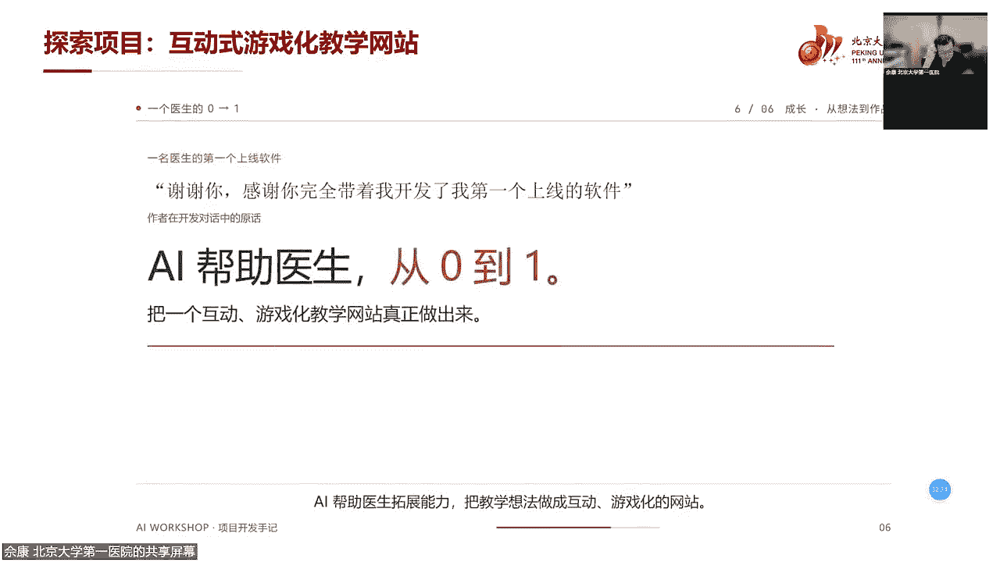
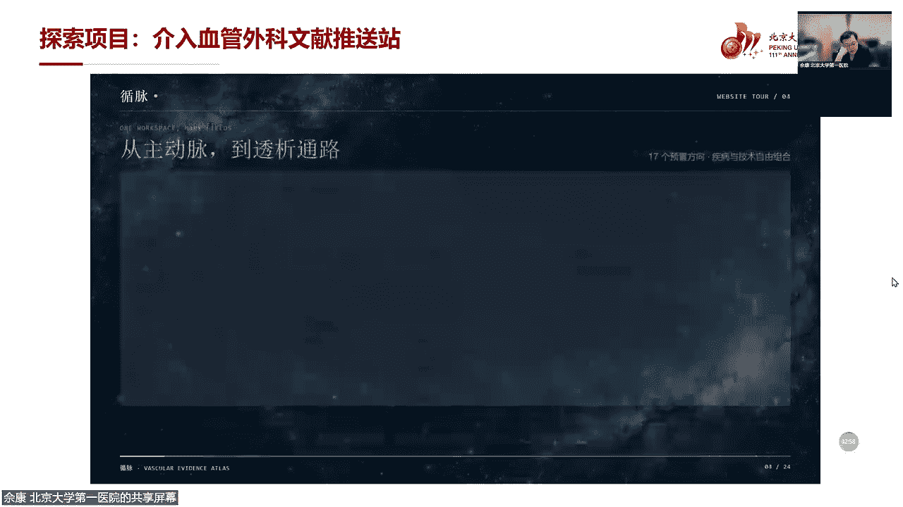
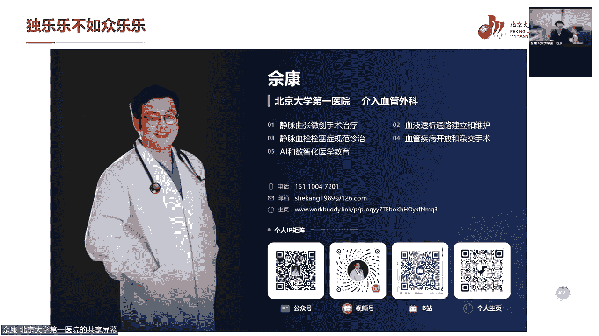

# 🏥 AI赋能医生临床直觉：医疗教研新范式：01：静脉血栓塞症AI知识库与智能体构建教程

## 开篇概述

在本节教程中，我们将学习如何利用人工智能技术赋能医生的临床直觉，构建面向静脉血栓塞症的AI知识库与辅助决策智能体。内容将涵盖从临床痛点分析、知识库搭建、智能体迭代，到复杂病例工作流设计等完整过程，适合对医疗AI应用感兴趣的初学者阅读。

## 第一部分 静脉血栓塞症的临床背景

静脉血栓塞症是临床中非常危急的疾病类别，主要包含两个相互关联的疾病。深静脉血栓形成发生在下肢深静脉，而肺栓塞则是血栓脱落后堵塞肺动脉引发的严重后果。

深静脉血栓形成的急性期非常关键，因为一旦血栓脱落，会进入肺动脉并引起广泛的肺动脉血栓形成，这可能直接导致患者死亡。肺栓塞属于猝死性疾病，在猝死原因中排名第四，且发病率较高。

在欧洲和美国，静脉血栓塞症的年发病率约为每千人1到2例。大约有3分之1的患者与住院治疗相关。国家卫健委已将提高静脉血栓塞症规范预防治疗率列入连续6年的国家十大医疗质量目标，目标值设定为60%。

然而现实情况与目标存在巨大差距。根据2019年CHES研究，适宜的预防率仅为10.3%。这意味着绝大多数患者未能获得规范化的预防与治疗。

以下是静脉血栓塞症的核心疾病分类：
- 深静脉血栓形成：下肢深静脉内形成血栓
- 肺栓塞：血栓脱落进入肺动脉导致堵塞

```
规范预防治疗率 = 规范预防治疗的患者数 / 所有需要预防治疗的患者数
```

本节介绍了静脉血栓塞症的基本概念与临床重要性。接下来，我们将分析在实际教学和诊疗中，医生面临哪些具体痛点。

## 第二部分 临床教学与诊疗中的核心痛点

在临床工作中，血管外科医生常遇到多方面的挑战，这些挑战既来源于教学，也来源于跨科室协作。

对于规培医生来说，他们在血管外科轮转的时间非常短，通常只有约一个月。有些医生是在轮转结束前才来，有些则是一开始就来。在这个短暂的一个月中，需要讲授大量专科知识。虽然静脉血栓栓塞症是必讲内容，但由于学生知识负荷较重，离开血管科后往往会遗忘大部分知识点，导致教学效果不佳。

此外，涉及静脉血栓的其他科室医生及护士老师，常通过私人关系向血管外科医生请教。作为血管外科医生，平时还需兼顾门诊和手术，平会诊响应不够及时。医院规定上午10点前发出的平会诊当天完成，10点后的次日完成，这在治疗过程中会造成一定延误。

临床领域还存在大量新指南和治疗策略变化，传统误区较多。静脉血栓领域的指南非常庞杂，随手一搜可能出现200多篇指南。例如A4CP第9版指南有800页英文内容，发表过程十分漫长。对学生和老师来说，学习负担都很重。

传统的授课方式过于依赖知识灌输，教学效果也比较差。

以下是临床工作中常见的痛点清单：
- 规培医生轮转时间短，知识难以保留
- 跨科室会诊响应不及时，影响治疗时效
- 指南数量庞大且更新频繁，难以跟进
- 传统灌输式教学效果不佳

有了这些痛点的背景，AI时代的到来为构建智能知识库提供了新的可能性。下一节将介绍AI知识库的具体开发过程。

## 第三部分 AI知识库的开发与迭代

AI知识库的核心思路是，借助方便的AI工具作为数据底座，快速建立可靠的知识输出系统。去年4月，团队开始使用MA平台构建该知识库。

MA作为免费的AI工具，功能性表现良好。知识库从去年建设至今，已存放2500份文档。其中约1200份为静脉血栓相关指南及高级别证据，如Q类文献和荟萃分析等。核心结构最初包含少量PPT，之后绝大部分内容为指南和病例库。

知识库还纳入了护士作为管理员，所有内容保持持续更新。由于该工具对工作帮助很大，团队也将其作为案例，向其他专业老师进行展示。

以下是知识库的主要构成内容：
- 指南文档：约1200份，涵盖静脉血栓相关高级别证据
- 病例库：脱敏后的真实临床病例
- 教学课件：少量PPT资料
- 管理员机制：护士参与内容维护与更新

```
AI知识库 = 文档底座 + AI工具 + 持续更新机制
```

在智能体时代，基于该知识库开发了多个版本的静脉血栓诊疗助手。助手可以直接在知识库中搜索答案，界面支持直接提问。

本节介绍了AI知识库的初步搭建与内容构成。随后，我们将通过一个具体的临床案例，展示AI如何辅助实际决策。

## 第四部分 AI辅助临床决策的实际案例

AI辅助临床决策是知识库最直接的应用场景。下面通过一个真实脱敏病例来说明。

患者为结肠癌肝转移，之前因术前发现肺栓塞未能手术。抗凝治疗后出现出血，进入急诊输血。病情缓过来后准备再次手术，住院期间复查影像学（包括CTPA和下肢静脉超声）未发现血栓。术前D二聚体较高，而纤维蛋白原较低。麻醉科提交了全科会诊（MDT）。

麻醉科的主要两个问题是：
1. 该患者是否需要放置下腔静脉滤器来拦截血栓脱落？
2. 是否有其他措施可降低围手术期致死率？

将脱敏后的病人信息输入AI知识库后，AI输出的答案比临床会诊医生提供的意见更加详细且篇幅更长。AI会绘制流程图，提供知识点筛选以及常规反对放置滤器的原则，同时指出本例属于例外情况。

同样，在专家完成MDT后，麻醉科同学又提出两个问题：
1. 影像学已无血栓，是否仍需要围手术期处理？
2. 若下肢B超阴性，是否还需要放置滤器？

人类专家受时间限制，难以详细解释背后的循证医学证据和病理生理原因。但同样的问题发送给AI，可以获得综合了大量信息的辅助性回答。

AI辅助决策的输出特点可以概括为：
- 回答更加详细，包含流程图与原则
- 提供大量参考链接支撑答案
- 弥补人类专家时间限制导致的解释不足

这一应用于2023年6月在《中华医学教育探索》杂志发表，用于医学教育。不过，它与真正插入临床的AI智能体仍有差距，相对基础，但便于推广和架构搭建，且完全不需要代码操作。

本节展示了AI如何辅助复杂临床决策。接下来，我们将介绍基于知识库进化而来的SKI智能体版本。

## 第五部分 SKI智能体的进化与记忆系统

在智能体时代，团队希望AI能够像人类专家传播会诊一样完成临床流程。人类医生会诊时，通常先看会诊目的和病例信息，进行查体，查看详细病例、体温单、基础参数及检验报告，收集信息后调用脑中的知识与经验，结合现实条件书写会诊意见。

AI在除查体以外的许多步骤中都可以替代人完成。

第一版SKI支持文字或图片输入。若为图片输入，先进行OCR识别，然后提示用户补充缺失的患者基本资料，如身高和体重。因为没有身高体重就无法计算BMI，不知道体重也难以确定抗凝剂量。

信息补全后，系统在知识库中多轮查询，命中后输出结构化的会诊意见，并附带参考文献，完全依据知识库内容生成。后来还增加了同步MABG等功能。

早期版本存在脱离现实的问题。例如国际指南推荐使用力白沙湾等进口药物，但国内多为集采药品，系统最初无法考虑这一点。后续通过增加规则和学习内容，逐步解决。

SKI的升级受到复旦大学一篇Rive架构文章的启发。该文章构思源自archive预印本，核心思想是让智能体像人类终身学习一样不断进化，具有一定的经济学习思路。

该架构在每次工作前先搜索智能体脑中的记忆系统，看完病后再更新记忆，实现自净化。架构包括分层记忆系统，涵盖通用推理、静脉血栓专科知识及工具调用技能。系统会感知记忆权重，看完病后强制蒸馏对话，改变权重并更新原始权重。

基于此，团队将原始SKI从V1升级到V2，增加了自净化系统和记忆模块。

```
SKI V2 = 原始智能体 + 分层记忆系统 + 自净化蒸馏机制
```

本节介绍了SKI的版本演进与记忆机制。随后，我们将探讨如何为医生推荐个性化学习资源。

## 第六部分 基于长期记忆的学习资源推荐

除了在诊疗过程中辅助智能体，团队还希望AI能直接帮助医生学习。思路是：AI在工作时读取用户的长期记忆，根据知识库推荐相应学习资源。

例如，医生询问时可能推荐最新文献；学生询问时则推荐基础PPT。同时，系统会识别薄弱记忆点。如果某人反复询问儿科静脉血栓问题，系统会判断其在此方面记忆薄弱，并加入遗忘因子，推荐不同的学习资源。

这一系统是团队自行添加的，未直接借鉴他人架构，但基于上述想法独立实现。AI在工作时，除了蒸馏对话本身，还会推荐相应的学习资源。

```
推荐资源 = f(用户长期记忆, 知识库内容, 薄弱知识点)
```

本节说明了如何基于记忆实现个性化学习推荐。接下来，我们将介绍受自然期刊架构启发的评价系统。

## 第七部分 受MIER架构启发的评价系统

在带孩子出游时，团队看到Nature发布的MIER架构推送。这是一个调用工具的智能体架构，运行在沙盒中，可调用十几种工具完成诊疗任务，使用MIMIC数据库。

团队让AI评估该架构是否可借鉴，发现可行。但MIER更倾向于评价病例是否符合指南。经过讨论，团队设计了激发式任务架构。

最初，知识库中存放了许多脱敏病例，但如何使用这些病例存在困惑。例如，是用于查找病例还是生成虚拟病例？由于病例多来源于门诊，不确定其策略是否最贴近指南，也不确定智能体生成的策略在未读到未来诊疗方向前是否符合指南。

因此，团队建立了评价系统，可将数百份病例批量评价，查看哪些更接近指南共识。该评价并非随时激发，但加入了类似IMAX的机制。

评价系统帮助团队发现，某些传统上认为正确的做法，实际上并不完全符合最新诊疗共识。这些缺陷有时正好是临床科研的切入点。

在没有AI帮助时，形成临床直觉或诊疗思维需要很长时间。有了AI后，可以快速将若干时间内的门诊策略进行评价、学习与反思，使医生进化速度明显加快。

```
病例集合 → 指南共识对比 → 策略评价与反思 → 临床科研切入点
```

本节介绍了基于MIER启发的病例评价机制。随后，我们将展示完整的复杂病例工作流。

## 第八部分 复杂病例的脱敏与诊疗工作流

团队还希望将SKI发展为更强大的工作流。最初的一些脱敏SKI内容已纳入其中。获取临床资料时，需遵守科研伦理及患者数字隐私保护要求。

团队花费约一年多时间，从人工采集病例，到提示词调用API，再适配不同模型。曾使用Cloud Code开发SEP安装文件，之后转为EXCUSE，再迁移到CodeEx或Workbody中适配。团队认为Workbody在此方面执行效果更好。

完整运行流程如下：
1. 拍摄住院病例照片
2. 让AI进行病例脱敏
3. 交付大量脱敏病例
4. 收集脱敏病例
5. 诊疗助手书写会诊意见

IMA平台传图片受限，印象中最多20张，但有些病例非常复杂，可能有几十张照片。迁移到Workbody后，可直接读取文件夹，处理50张照片的一份复杂病例。

整体工作流包括：脱敏、诊疗流程流水线、记忆系统更改、分层推荐与评价。运行时间较长，但能完成非常复杂病例的诊疗工作。

使用示例：拍摄住院病历照片，让AI书写会诊意见，链接到IMAA平台。由于Workbody本身与IMA有MCP集成，可获得非常详细的会诊意见。

该系统最初发布到SKI UP，之后又发布到开放平台。

```
住院病历照片 → 脱敏处理 → 多轮知识库查询 → 结构化会诊意见输出
```

本节展示了从图片输入到结构化输出的完整工作流。接下来，我们将探讨AI知识库当前存在的问题与改进方向。

## 第九部分 AI知识库的当前痛点与改进方向

从AI知识库角度看，仍有诸多需要改进的地方。首先，目前知识库建设简单，但属于非公共同化产品，更多依赖商业平台构建，迁移困难，缺乏工程化标准。

团队近期工作是将其工程化和产品化，使其能更好地版本回滚，自动纳入大量文献，评价文献内容，或提醒管理员纳入与排查知识库内容。

产品化后是否仍需保留病例，团队认为可不保留，可将病例移除。

其次，若真正赋能医院PACS系统，需明确数据获取边界。系统需从知识库采集大量数据，生成辅助医生的诊疗意见。

第三，希望输出可控的动态多模态内容。不仅输出HTML风格的诊疗流程图，还应能直接提取文献中的评分表或图表并输出。知识库入库时需要一定工作量。

第四，需从实验角度确定知识库合适体量。例如，仅放200个指南，还是5000篇文献加指南，效果如何，需进行不同测试或消融实验。

第五，需建立更新与审核机制。如何巡检新文献，决定放入哪些内容。该领域每天新文献数量众多，即使达到标准，工作量也很大。

第六，如何管理版本。在不同知识库评价下，需明确版本控制。

第七，缺乏一套好的问题集。团队近期已做一些搜集，但尚未写成文章。如何评价AI知识库，是否有良好的Benchmark，仍需探索。

第八，建好后能否迁移到其他专科，建立标准知识路径，让其他专科同事也能构建有效果的AI知识库，达到AI辅助诊疗目的。

第九，产品化后如何处理付费与合作问题，以及成果产出方式。

以下是知识库产品化的主要待解决问题：
- 商业平台依赖导致迁移困难，缺乏工程标准
- 医院系统数据获取边界不明确
- 多模态输出能力不足
- 知识库最优体量尚未确定
- 文献更新与审核机制缺失
- 版本管理不完善
- 缺乏标准问题集与Benchmark

```
非工程化知识库 → 工程化与产品化 → 跨专科标准化路径 → 商业化合作
```

本节梳理了知识库面临的痛点。随后，我们将从智能体角度分析更多挑战。

## 第十部分 智能体发展的多重挑战

从智能体角度看，也存在多个问题。团队希望最终打造一个真正能够指导诊疗的智能体，当前痛点如下。

第一，多模态问题。静脉血栓领域尚可，但血管外科许多领域高度依赖多模态数据，尤其是影像，如CTA。数据量很大，若想做得更好，需融入多模态。

第二，持续数据问题。从疾病诊治来看，评分可能需住院期间多次进行，诊疗策略也会随化验单与症状变化而调整。真正的智能体应借助机器学习，作为持续数据智能体，生成动态策略与分析。

第三，在大样本数据集下如何完成机器学习，并真正实现预测。传统模型在文献中预测能力优秀，但外部数据验证缺乏，且能力会有所下降。

第四，与电子病历系统融合。不同医院非标数据多，脏数据多。从电子病历中提取生命体征、化验趋势等存在困难，通常需医院信息中心层面操作。

第五，联邦学习问题。不同医院出于数据不出院原则，不希望任何患者数据离开医院。若要多个医院共同训练单一智能体，需采用联邦学习，以实现多端口共同训练。



第六，通用AI融合问题。智能体做好后，通用AI能力可能已将其包裹或包含，达到更好效果。此时智能体是否仍有价值，需进一步探索。


以下是智能体发展的六大挑战清单：
- 多模态数据融合，尤其是影像数据
- 持续数据下的动态策略生成
- 大样本机器学习与预测验证
- 电子病历系统与脏数据整合
- 基于数据不出院原则的联邦学习
- 通用AI融合后的独特价值定位

```
智能体价值 = 多模态能力 + 持续学习 + 跨院联邦 + 临床落地合规
```




本节详细分析了智能体面临的技术与落地挑战。接下来，我们将介绍团队的其他教学与科研项目。

## 第十一部分 医学教育与教学科研项目

除血管科工作外，团队还承担医院教学管理与教学研究工作，许多内容需与技术人员合作。

首先是面向医学生和医生的AI素养培训教学团队建设。在北医等国家层面有“医学未来学习中心”项目，但目前尚未真正落地，缺乏良好落地形式。

其次是医学教育评价智能体。教学活动众多，如临床查房、临床操作类内容，原始数据多为视频。在模型能力提升背景下，如何利用视频进行评价，是当前研究热点。

从血管科专业角度，团队希望将静脉血栓知识库进行测评级建设，并构建落地效果好的AI辅助临床决策智能体。

个人专业方向在静脉与血液透析通路领域。业内多关注动脉领域，个人对静脉与动力脉通路更感兴趣。

还有数据平台建设，包括临床数据、多读学数据、手术视频与标注等，这些方面仍在探索，不够成熟。

团队也做了一些具体项目。例如，将个人学习文献的内容制作成网站，最初为本科室建设，希望科室学生阅读书籍与文献，不同人有不同兴趣点。网站融合了大量个人读文献、看文献的技巧及工作流。

该网站最初在Astra平台耗额度时制作，每周额度未花完即用完，逐步搭建出来。完成后交给一家医学教育公司，使其成为更广泛框架，结合运营能力进行推广。这些功能大多在GPT中完成，将看文献、做文献总结等技能融入网站。设计想法相对粗浅，主要目标是完成临床科研任务。

另一个项目是评价学生利用AI制作的PPT及其与AI的互动记录。团队最初直接用知识库完成此项工作，评价全班提交的PPT和互动记录。从教学研究角度，还需要外部评审专家作为金标准或方法，评价AI评审能力与效果。

因此，团队为两位外部评审专家编写了网站，让他们完成评审工作。平台功能包括：
- 评价医学教学课件，既看成品，也看人与AI协作过程
- 每次评分回到证据，先培训再正式评审
- 通过典型案例、简单提示、补充材料和审阅提纲，学会识别更好的互动记录
- 五道小题配合及时解析，检查掌握程度，再完成练习评分
- 个人准备完成后，系统自动开放正式评审
- 左侧阅读课件和AI互动记录，右侧按标准实时打分
- 成品与过程分组评价，评分随时保存，提交后锁定
- 管理员实时查看培训进度，以评数量和待处理问题
- 评分总分与操作记录可导出为数据表格，方便后续分析
- 初屏期间不展示AI评分
- 评委完成全部评分并点击全部提交后，才开放专家与AI评分对照
- 聚焦差异条目，回看证据，补充评价，减少重复评审，保留初评与复评记录
- 先统一标准，再独立判断，最后聚焦差异

该平台名为“月恒医学教学课件与人机协作的独立评价平台”。

本节介绍了团队在医学教育与教学评价方面的探索。随后，我们将对全文进行总结。

## 结语与总结

在本节教程中，我们一起学习了静脉血栓塞症的临床背景、AI知识库的构建与迭代、AI辅助临床决策的实际案例、SKI智能体的进化与记忆系统、基于长期记忆的学习资源推荐、受MIER启发的评价架构、复杂病例的脱敏与工作流，以及AI知识库和智能体面临的当前痛点与未来挑战。同时也了解了团队在医学教育评价平台等方面的其他项目。




希望这些内容能为对医疗AI应用感兴趣的初学者提供直观的参考，也期待未来有更多机会与大家继续交流。
