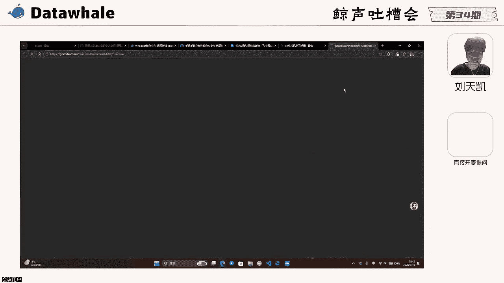
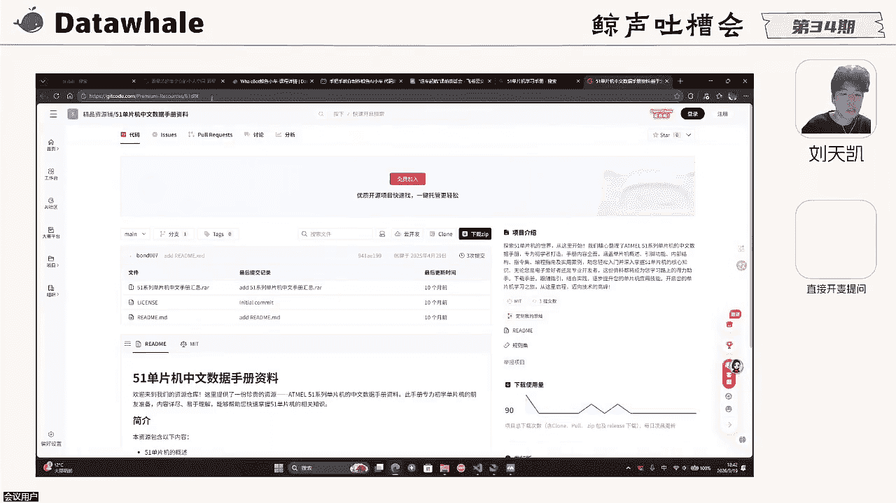
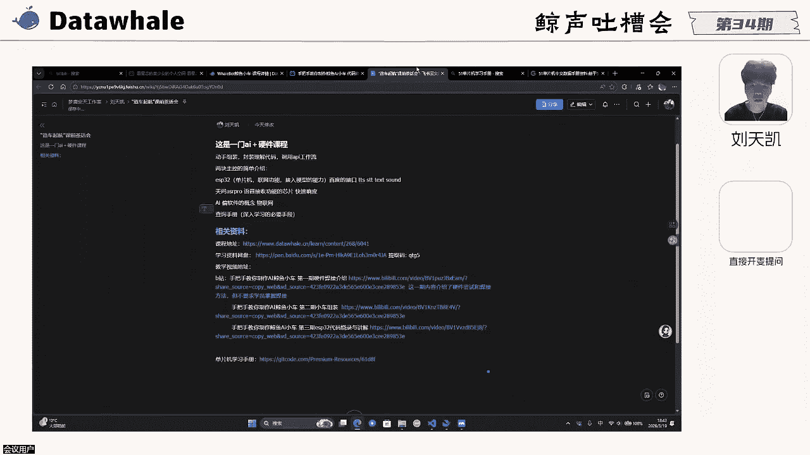
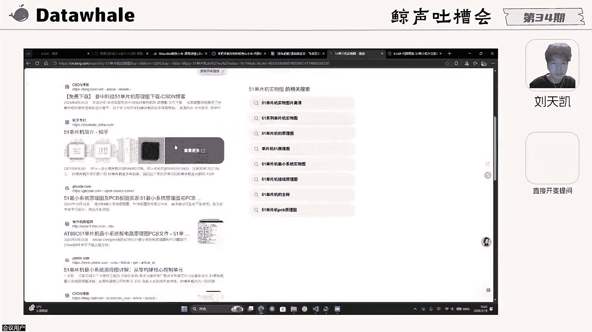
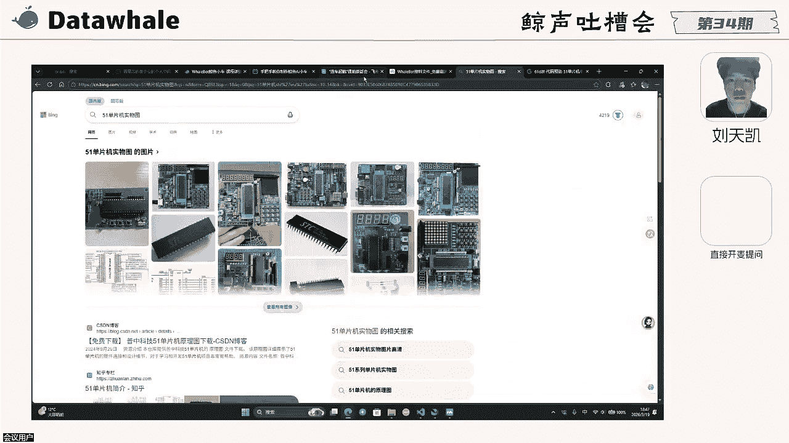
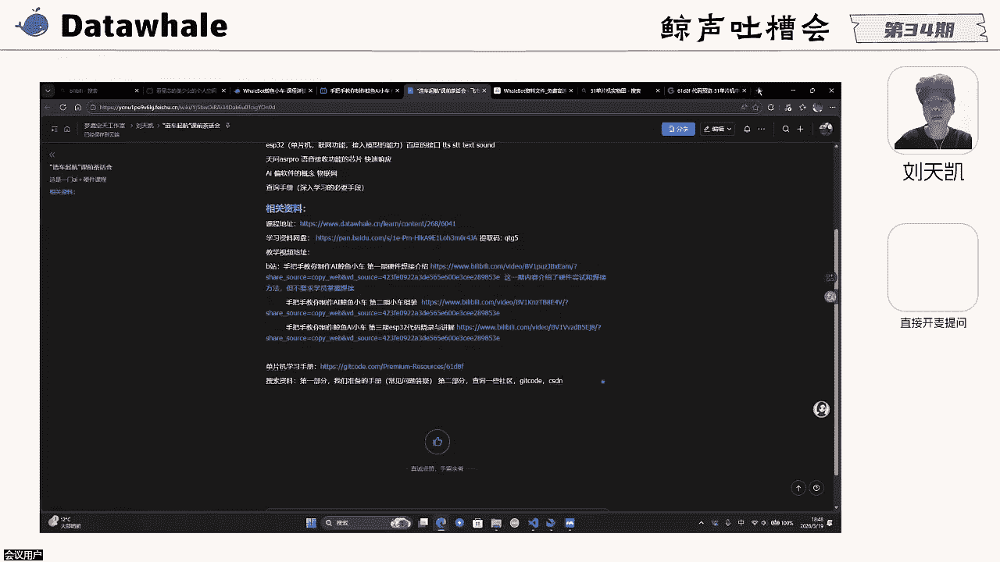
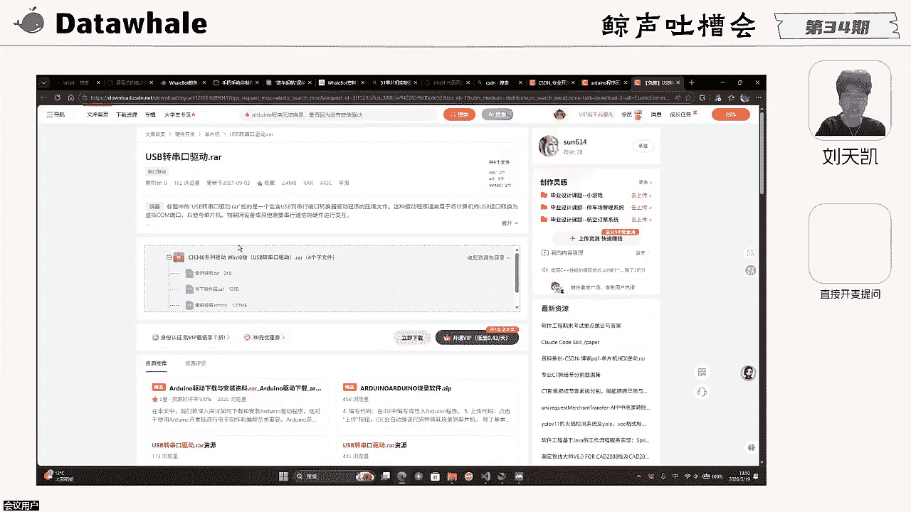
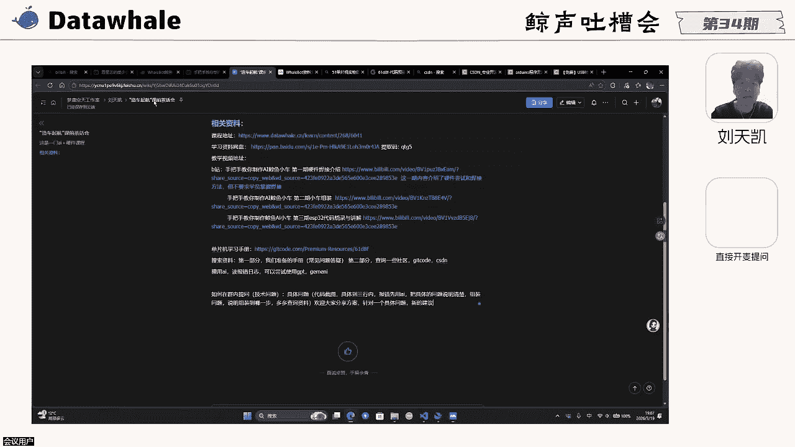
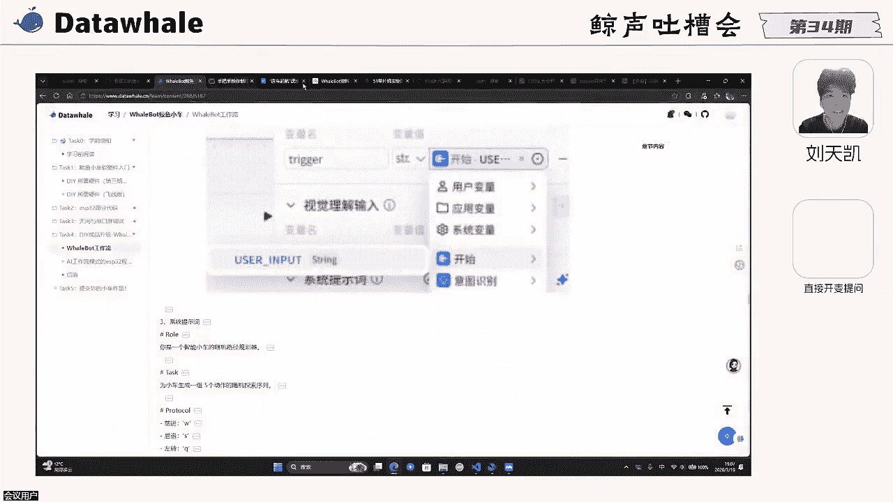
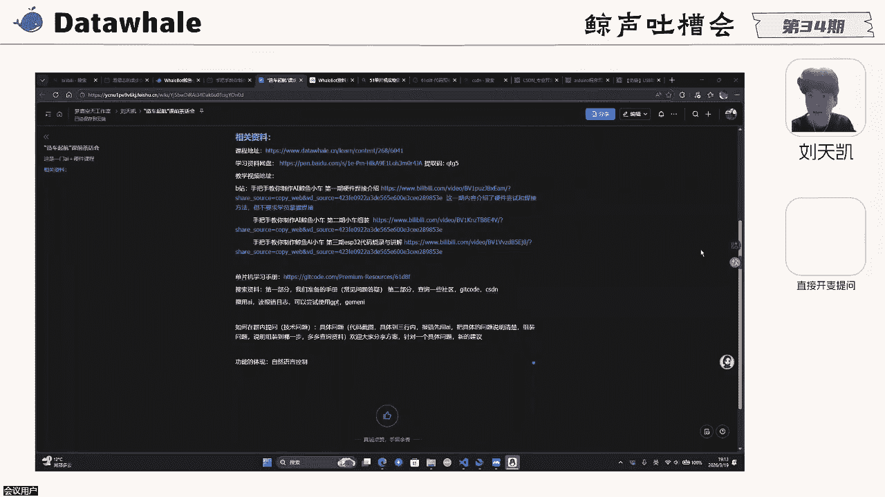

# 🚗 AI鲸鱼小车：01：课程概述与讲师介绍

在本节课中，我们将先整体了解AI鲸鱼小车课程的内容，认识一下授课老师，以及明确学习这门课程需要经历哪几个主要步骤。这门课程并不是一种非常严肃的传统教学形式，相关的资料和录屏也会在课程结束后发送到各个学习群里面。所以大家不需要担心自己是否跟得上进度，可以把它当成一个轻松的茶话会来听，边听边处理自己的其他事情也没有问题。

我是刘天凯，来自郑州大学2023级机械与动力工程学院。虽然我的本科专业是机械工程，但在学习过程中也接触过电控领域，以及一些与AI相关的软硬件开发知识。很高兴能通过这门课程，和大家分享如何把AI能力落地到一个实体小车上面。

这门课程的学习流程一共包含三个重要步骤，大家可以重点留意：

以下是课程的三个主要学习步骤：
- 第一步，动手组装一辆小型的AI小车，把硬件部分搭建完成。
- 第二步，把代码烧录到主控芯片里面，并尝试理解代码的工作逻辑。
- 第三步，学习如何把AI能力和硬件结合起来，通过调用API接口和工作流，让小车具备智能交互功能。

之所以把这门课程定义为AI加硬件，就是希望让小车不仅仅是一块静止的电路板，而是能够真正“火起来”，具备更强的智能能力，听懂你的指令并与你产生交互。在软件和硬件的区别方面，最核心的体现就是我们将使用两块不同的主板，接下来的章节我们会分别介绍它们的作用。

以上就是本节课的概述内容，大家对AI鲸鱼小车的整体面貌应该有了初步认识。接下来，我们将进入更具体的硬件层面，重点认识小车的两块主控芯片。


# 🔧 AI鲸鱼小车：02：核心硬件介绍

在了解了课程的大致流程之后，我们现在来聊聊小车最核心的硬件部分。小车之所以能够动起来、会说话，离不开两块主控芯片的协同工作。软件和硬件上一个很明显的区别，就在于我们选用的主控方案不同。


以下是小车中使用的两块主控芯片及其主要特点：
- 第一块是ESP32。这块芯片本质上是一块单片机，你可以把它理解为一台离线的微型电脑。单片机这种东西从20世纪70年代就被发明出来，一直被广泛应用在传统控制领域、工业设备以及学校实验室中。ESP32在单片机的基础上，额外具备了联网功能，并且能够接入大语言模型，所以我们选择它作为小车的主控芯片，也就是小车的“灵魂”。它负责思考如何回答你的问题，并协调其他硬件模块的工作。
- 第二块是天问ospro芯片。这是一块经过特殊调校、具备语音接收功能的芯片，对语音指令的敏感程度非常高，能够快速捕捉到用户下达的语音指令。之所以要额外引入这块芯片，是因为我们使用的免费云端服务，运算速度不如专门部署的计算服务器那么快。天问ospro的作用就在于补足响应速度，让小车的语音交互体验更加流畅。

ESP32在小车中使用的是百度提供的两项语音服务，分别是TTS和STT。这两个概念可以用下面的方式简单理解：
```
文本 (Text) --TTS转换--> 语音 (Speech)
语音 (Speech) --STT转换--> 文本 (Text)
```
TTS的全称是Text to Speech，也就是把文字变成语音；STT的全称是Speech to Text，也就是把语音变成文字。通过这两个接口，再结合ESP32的算力，小车就可以和你完成语音交互功能。

认识完这两块主板后，我们再来看看，AI到底是怎么和硬件结合在一起的。


# 🤖 AI鲸鱼小车：03：AI与硬件的结合原理






有了硬件基础，我们还需要搞清楚一个更宏观的问题：什么是AI加硬件？它和单纯在电脑上运行的软件AI有什么区别？大家在日常生活中，可能会对AI产生一种敬畏感，觉得不懂AI就会落后于时代，甚至担心自己会被淘汰。其实，我们可以用更直白的方式来看待AI。



AI本质上是一个偏软件的概念。目前最热门的大语言模型，也就是LLM，是基于Transformer框架构建的神经网络算法。你可以把它看作是一串经过大量数据训练的数学算法，其核心原理是通过概率学来判断。最古老的相关公式是贝叶斯公式，它是一种条件概率计算方法。简单来说，当你说一句话的时候，AI并不是真的“听懂”了你的意思，而是通过概率去推测，你可能想要它帮你做什么。所有的智能表现，本质上都是数学模型不断训练出来的结果。



如果把AI和硬件结合起来，它实际上就是在践行物联网的概念。物联网大家都很期待，希望未来的社会中，各种设备之间能够产生智能化的通信和相互交流。AI加硬件，就是物联网的一种硬件实现方式。通过在硬件里面植入AI功能，让这些硬件产生自己的“灵魂”，变得更加智能化。

这个关系可以用一个简单的公式来表示：
```
AI + 硬件 = 物联网的硬件落地实现
```


我们开设这门课程，就是为了帮助大家理解：AI本身可能只是活在你电脑里的一段算法，而通过这门课，我们把它活灵活现地呈现到具体的硬件当中，让大家亲身体验把软件变成实物的乐趣，并且了解在现代生产力条件下，这些技术可以应用到哪些实际场景中。

理解了AI与硬件的关系之后，实际动手之前，我们还需要知道课程的学习资料在哪里，以及开发环境该怎么准备。




# 📚 AI鲸鱼小车：04：课程资料与开发环境

接下来我们进入资料准备环节。无论是零基础的同学，还是有一定经验的同学，都需要先把课程资料和开发环境弄清楚，这样后面才不会在找文件、配环境上浪费太多时间。



我们的课程官网上会发布课程地址和更新公告。需要注意的是，每一期课程的方案可能会有一些变更。比如上一期我们采用的是飞线连接方式。飞线是一种非焊接的硬件连接手段，电子信息专业的同学应该比较熟悉。但是飞线方式对电源稳定性的挑战比较大，所以本期课程做了优化，把线路集成到一块PCB板上，采用直插式的方式，这样可以显著提高硬件的稳定性。官网课程页面里包含了全部的课程内容、简单介绍以及视频链接，大家可以先浏览一下。

关于硬件本身，发到大家手上的板子已经是成品板，不需要大家自己去焊接微小的原件。我们只需要把硬件模块直接插到板子上即可。组装部分主要讲解硬件之间如何连接，以及轮子和电机之间的关系。代码部分则会讲解如何使用Arduino环境，如何配置芯片包，以及代码之间的逻辑关系。



以下是网盘资料中包含的主要文件：
- ESP32的源代码。
- 开发板库，支持离线安装方式。这样做是为了避免网络问题，如果直接通过网络安装整个芯片包，可能需要使用一些特殊的网络手段才能完成。
- 屏幕测试程序。
- PCB设计的原理图。
- 外壳的3D打印文件。如果你手头有3D打印机，可以直接打印外壳。使用的是A1打印机的话，外壳尺寸可能会稍微偏小，如果打印机更大，也可以把外壳和尾巴拼在一起打印，节省时间。

关于PCB设计的原理图，如果大家想了解更具体的讲解，我们可以后续筹备。因为PCB设计需要一定的电子电路基础，至少要了解数字电路和模拟电路的基本知识，否则很难用小白的身份直接讲清楚。

资料和环境准备好之后，在实际操作中，你难免会遇到看不懂的代码或者硬件接口问题。这时候，查阅手册和搜索资料就成了必备技能。


# 🔍 AI鲸鱼小车：05：手册查阅与资料搜索方法

当你拿到硬件板子，准备开始接线或写代码时，一定会遇到各种各样的参数问题。这时候，一份好的芯片手册就是你最好的老师。查询手册是学习单片机和嵌入式硬件时，必须掌握的一个基本技能。

举个例子，假设我们要查询一款51单片机。手册里面会详细说明这款芯片的引脚功能、寄存器类型、定时器设置等等。比如单片机里面有很多寄存器，包括定时器寄存器，用来定义某些功能，具体怎么使用就需要去手册里查。原理图可能比较复杂，如果觉得难以理解，可以先参考实物图，看看开发板上的排针和排母，这些就是实际使用的引脚。

以下是搜索资料时可以使用的主要渠道：
- 第一部分是我们准备的手册和常见问题答疑文档，这些内容会放在课程官网链接上，也会发布到教学群里面。
- 第二部分是各种技术社区。国内比较好用的社区包括GetCode和CSDN。使用CSDN时需要注意，网站上有时会有广告，不要去购买付费内容，直接免费查询就足够了。比如大家遇到“无法上传程序”或者“设备无法识别”这类问题，可以在这些社区搜索，很可能会找到像“安装CH340 USB转串口驱动”这样的具体解决方案。

除了查官方手册，日常学习中还会遇到各种疑难杂症，这时候知道去哪里搜索，以及如何高效提问，就显得尤为重要了。


# ❓ AI鲸鱼小车：06：善用AI与提问技巧

在学习过程中，无论是代码报错还是硬件组装卡壳，都离不开有效的沟通和搜索。本节我们就来聊聊，如何用AI工具帮助调试，以及如何在社区里提出高质量的问题。

当你遇到代码报错，自己看不懂日志内容时，可以直接把报错信息扔给AI工具，比如豆包或者DeepSeek，告诉它你的疑问，通常都能得到帮助。如果AI工具还是理解不了你的问题，可以尝试使用GPT，但这涉及到网络连接的问题，我不会在公开直播里教大家如何解决网络问题，这部分需要大家自行查询。

在群里提问时，也有一定的技巧和社区规范需要遵守。提问技巧本身是一门学问，很多软件社区都会强调社区规范，核心原则就是让别人能听懂你在问什么。

以下是提问时建议包含的具体内容：
- 代码截图，要清晰完整。
- 报错信息，可以先尝试用AI分析，如果还有问题，再把具体问题说明清楚。
- 如果是组装方面的问题，要说明具体组装到了哪一步，在哪个环节遇到了困难。
- 如果无法精准定位问题，至少要说明一个大范围，不要只拍一张整个硬件的照片，然后问“这个怎么装”，这样沟通效率不会很高。

只有把具体问题说清楚，我们才能高效地帮你解决问题。另外，建议大家多多查询资料，因为通过自己查询解决问题，也是学习过程中的一大乐趣来源。做这样一个东西，首先要给自己带来乐趣，而不是一直感觉做不出来就很烦躁。如果你通过手册、课程或者查阅资料解决了问题，那对你来说就是一个很大的突破。同时，也欢迎大家分享自己的方案和建议，可以在群里提出，也可以私信给我。不过最近开学，我平时上课比较忙，可能回复不够及时，但一定会抽时间回复大家。

关于如何学习和提问的方法我们就聊到这里，最后我们来看看课程的后续安排以及实物发货的时间节点。


# 📦 AI鲸鱼小车：07：课程后续与发货安排

很多同学除了课程内容本身，也比较关心实物套件什么时候能收到，以及后续的直播安排。本节我们统一说明一下。

首先感谢每一位参与课程的朋友和同学，感谢大家的支持。我们之前已经办了三期课程，遇到了各种各样的问题。因为采用预售制，我需要在收到费用之后才能统一帮大家采购硬件，而我本人还是一名学生，资金方面比较紧张，所以每次都是提前帮大家整理代购，包括联系快递等等，都需要花时间去协调。因此发货时间确实会有一定的拖沓，这点向大家说明一下，以后我们会继续优化这方面的体验。

关于发货进度，今天已经完成了全部的进货。因为板子需要在确定好总人数之后才能去采购，受限于成本和资金问题，无法提前大量囤货。昨天统计完大致人数后，按这个数量准备了货物。今天进货完成后，大约还需要2到3天的时间，等工作室把所有套件包装好，就会一次性发给大家。



后续的直播安排方面，我计划在第八期推出一个专门的调试视频，从语音调试到如何查看基本的API连接问题，把整个流程过一遍。后面等大家组装完小车、开始测试代码的时候，如果出现一些集中性的共通问题，我会再次开直播，和大家一起现场分析解决。这样大家也能看到技术调试的思路，了解如何通过搜索和思考来解决问题，这本身也是一次学习过程。直播的具体时间，我会根据群里大家的进度来定，大概是在大家组装完、开始代码烧录和调试的时候开启。



我在群里的称呼是刘天凯，使用的是我的微信名和英文名。关于组装难度，大家不必过度担心，因为这次换成了PCB方案，就是把硬件直接插到板子上，测试清楚后导通，再固定在车子上，外壳固定也不复杂，可以参考我们的组装视频。

至此，关于课程后续和发货的安排我们就说明完毕，下面我们来做一个简短的总结，帮助大家梳理今天学到的重点内容。


# 📝 AI鲸鱼小车：08：本节课程总结

在这一节课程中，我们从课程概述开始，依次了解了硬件原理、AI结合方式、资料准备、查阅方法以及后续安排。为了方便大家复习，我们把本节课的核心知识点总结如下：

以下是本节课的主要知识点回顾：
- 课程包含三个步骤：组装小车、代码烧录与理解、AI加硬件调用API和工作流。
- 两块主控芯片：ESP32负责联网和大模型交互，天问ospro负责快速语音响应。
- 语音交互依赖TTS和STT接口，分别实现文本转语音和语音转文本。
- AI本质是基于Transformer的神经网络概率模型，AI加硬件就是物联网的硬件落地。
- 学习资料可从官网、网盘和教学群获取，网盘中包含源代码、开发板库、屏幕测试程序、PCB原理图和3D外壳文件。
- 查阅芯片手册是学单片机的必备技能，重点关注引脚功能、寄存器和定时器。
- 搜索资料可以使用官网答疑、GetCode和CSDN等社区，注意避免付费陷阱。
- 遇到报错可以用豆包、DeepSeek等AI工具辅助分析，提问时要具体、清晰，说明问题所在的步骤和范围。
- 发货已完成进货，预计2到3天内包装发出，后续会开设专门的调试直播。



希望大家在学习过程中不仅仅把它当成任务，更要从中找到乐趣。如果遇到问题，多查资料、多思考，也是成长的一部分。感谢大家的收听和支持，这期AI鲸鱼小车的介绍课程到此结束。
