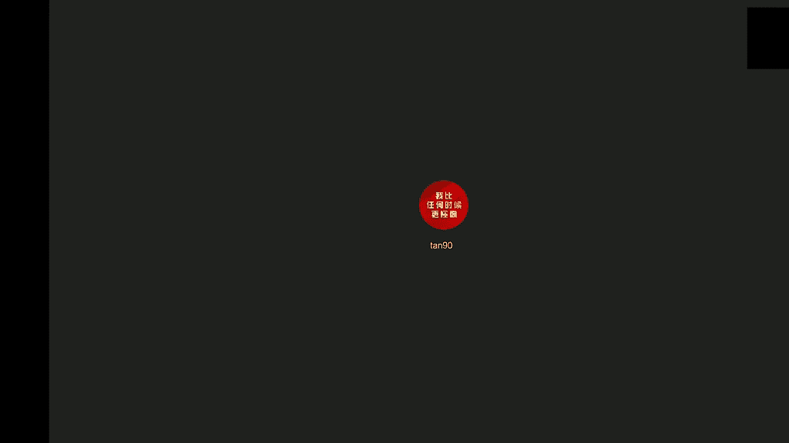
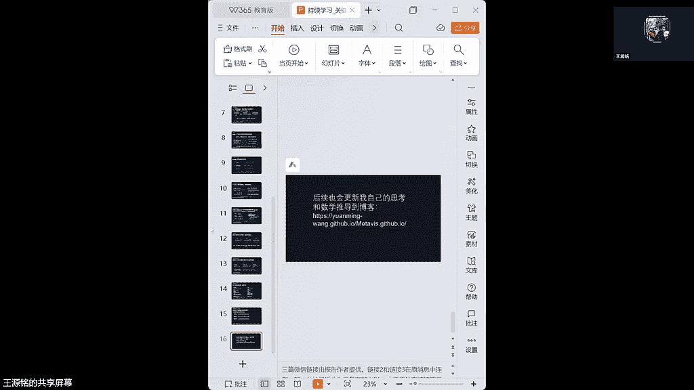
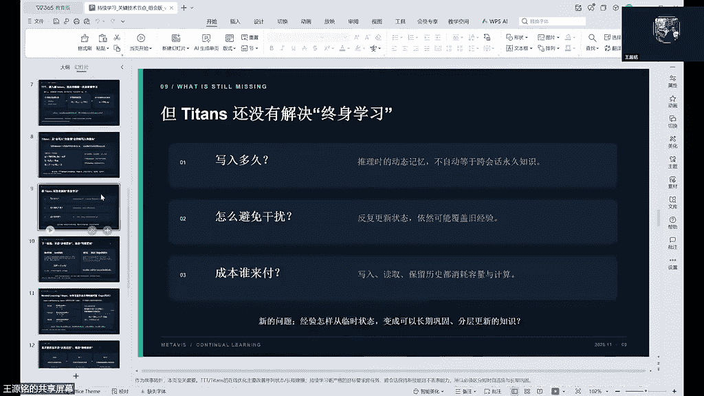

# 🤖 Agent持续学习：EWC与Titans让模型永久进化：第1章：从灾难性遗忘到持久参数更新

## 课程概述

在本节课中，我们将学习大模型如何在不断吸收新经验的同时，避免遗忘旧知识。本节内容围绕持续学习这一核心问题展开，重点介绍弹性巩固权重（EWC）、外部记忆系统、快慢权重机制以及Titans等前沿技术。通过本节课程，你将理解持续学习对通用人工智能（AGI）的重要性，并掌握目前主流的三条技术路线。

## 一、持续学习的背景与核心矛盾

大模型已经具备了很强的推理能力，但在实际应用中存在一个明显的不足：模型完成一次任务之后，通常不会因为这次经历而永久获得新能力。例如，一个Agent今天犯了错误，明天遇到类似情况，它不能自动吸取经验教训。这种缺乏持续学习的能力，被认为是通用人工智能（AGI）面临的重要障碍之一。

在AI技术路线中，持续学习被视为从语言模型到思维链、再到Agent，最终走向聚合智能的关键一步。尽管目前学术界更多关注推理时的增强，但持续学习领域的突破同样迫在眉睫。

持续学习要攻克的核心问题是灾难性遗忘。假设模型已经学会了任务A，现在需要学习任务B。为了适应任务B，模型必须更新参数，但这些参数恰恰对任务A非常重要。于是，在学习任务B的同时，模型可能会遗忘任务A。解决这一矛盾，就是持续学习的核心目标。

目前的相关工作可以大致分为三个层次，它们不是严格的先后替代关系，而是不同的技术路线，但都贯穿着同一个核心矛盾：如何在学习新知识的同时，避免破坏旧知识？

以下是三个技术层次的具体介绍：
- 第一层是外部记忆，主要解决过去信息存储在哪里，以及如何检索回来的问题。代表工作包括MemoryGPT和ACE。
- 第二层是在线更新，也就是状态更新。这类方法尝试让模型在推理过程中改变内部状态，甚至更新小型神经网络的参数。代表工作包括TDT、TS等。
- 第三层是持久参数更新。这类工作进一步探索如何让新经验以参数形式长期积累。代表工作包括MORAAM和SEL等。

接下来，我们重点介绍最具代表性的EWC方法。

## 二、弹性巩固权重（EWC）与灾难性遗忘

EWC是2017年发表在PNAS上的经典论文，专门描述了灾难性遗忘问题，并给出了一个直观的解决方案。

EWC的核心思想是：参数可以更新，但对旧任务重要的参数应该少改，不重要的参数可以多改。这样一来，模型在适应新任务时，就会倾向于保护那些对旧任务至关重要的参数，从而保留旧能力。

为了实现这个目标，EWC设计了如下损失函数：

$$ \mathcal{L}(\theta) = \mathcal{L}_{\text{new}}(\theta) + \lambda \sum_{i} F_i (\theta_i - \theta^*_{i})^2 $$

在这个公式中，$\mathcal{L}_{\text{new}}$是当前任务的新损失，第二项是正则化惩罚项。$\lambda$控制惩罚力度，$\lambda$越大，惩罚越重。$F_i$是Fisher信息矩阵，用来估计每个参数对旧任务的重要程度。$\theta^*_{i}$是学习完旧任务后的参数值。

如果一个参数对旧任务特别重要，那么对应的Fisher信息矩阵值$F_i$就会很大。一旦该参数偏离原来的位置，损失就会显著增加，从而迫使优化器向损失更小的方向更新，达到保护重要参数的目的。

不过，EWC并没有彻底解决遗忘问题，尤其是当任务变得复杂时，约束条件本身也可能变得复杂。

除了EWC这种参数约束方法，还有另一类思路，即利用外部记忆系统。

## 三、第一条技术路线：基于外部记忆的系统

第一条路线的核心思想，是给模型装一个外部记忆系统。基座模型的参数基本不变，改变的是外部存储，让模型更好地利用历史经验。

以下是两个代表性工作：
- MemoryGPT：它把记忆管理放在Agent框架里，类似于一个操作系统。它将上下文窗口当作磁盘，将外部存储当作磁盘，Agent通过调用工具完成换页、读写、淘汰，自主管理记忆。这可以看作是对RAG的改进。
- ACE：它将经验组织成一份不断更新的策略手册（Playbook）。系统包含三个Agent：执行器、反思器和整理器，共同完成经验的提取与组织。

这两类工作的共同特点是，基座模型参数基本不变，改变的只是外部记忆。它们让模型更好地利用历史经验，但这些经验并没有转化为神经网络的内部知识。

外部记忆系统虽然能找回经验，但没有改变模型内部参数。因此，研究者开始探索在推理过程中更新模型状态的方法。

## 四、第二条技术路线：快慢权重与推理时更新

第二条路线改变了一个基本假设：记忆不一定要以历史文本或KV Cache的形式存在。

在当前的Transformer模型中，记忆大多保存在KV Cache里。每次查询向量Q会与KV Cache进行点积运算。虽然已有大量工作针对KV Cache进行量化或压缩，但快慢权重（Fast and Slow Weights）提供了另一种思路。

快慢权重的思想可以这样理解：慢权重是预训练时固定下来的权重，快权重是在推理过程中，通过一次前向传播和梯度下降，记录近期经验的权重。

这一思想在后续的经典论文TET（Test Time Training，推理式训练）中得到了体现。TET的核心思想是，把一个正在训练的小型神经网络当作训练模型的隐藏状态。

具体做法如下：对于输入的token，网络生成三种不同的表示，分别是K、V、Q。K作为神经网络的输入，V作为学习目标，Q用于查询。定义一个损失，让基于网络W对K的输出尽量接近V。对这个损失进行梯度下降，得到新的快权重$W_T$。这里的信号都是自监督的，不需要外部人工标签。然后，用更新好的$W_T$处理查询Q，产生最终输出$O_T$。

TET与传统微调不同，它更新的是推理时的小型快权重，而不是整个大语言模型。更重要的创新在于：传统RNN的隐藏状态是一个向量$h_T$，而TET的隐藏状态实际上是一个小型MLP。

Titans是Google在2025年发布的论文，进一步探讨了梯度下降如何更新内部记忆。它提出了三个重要概念：

以下是Titans中的三个核心概念：
- 惊讶度（Surprise）：模型先用当前参数处理K，再根据目标V比较计算误差。这个损失函数对记忆参数M的梯度，反映了记忆需要向什么方向调整。注意，这是对记忆参数求梯度，而不是对输入token求梯度。
- 动量（Momentum）：引入类似优化器中的动量概念，记录上一个时刻的趋势。动量更新可以用公式表示：

$$ m_t = \beta m_{t-1} + (1 - \beta) g_t $$

这个公式中，$m_t$记录历史梯度趋势，$g_t$是当前梯度，$\beta$控制历史趋势的保留比例。这样记忆更新不完全依赖当前token的决定，之前的趋势也会作用到当前状态。
- 遗忘（Forgetting）：新记忆等于保留一部分旧记忆，再加上新的更新量。遗忘更新可以用公式表示：

$$ M_t = \alpha M_{t-1} + (1 - \alpha) \Delta M $$

其中$\alpha$控制旧记忆的保留比例，$\alpha$越大保留越多，$\alpha$越小保留越少。这个系数是动态更新的。

尽管Titans能够动态更新神经网络，但仍未彻底解决终身学习问题，存在无法确定记忆保留时长、如何避免干扰以及计算成本高等问题。

推理时更新解决了能写入的问题，但如何实现长期持久的参数积累，仍然是第三条技术路线要解决的核心。

## 五、第三条技术路线：持久参数更新与记忆原子

第三条路线旨在让小记忆单元可增量扩展，并按内容激活。

LoRA的核心是通过两个低秩矩阵的乘积来表示权重的增量。相关论文的核心洞察是，将这两个低秩矩阵拆分成秩-1的记忆原子。根据线性代数知识，外积之和等于更新权重。

这样做的好处是，不需要每次都把全部记忆激活，而是根据输入内容，选择相关的记忆参与计算。核心目标是让小记忆单元可增量扩展，实现按内容激活。

2025年的相关工作还提出了让模型自己生成微调数据、自己修改，并结合强化学习与LoRA进行持久的权重更新。

此外，还有一种学习方式提出，模型的更新规则本身也在记录过去。例如指数滑动平均动量公式，其中权重$M$是历史梯度的递归压缩。模型可以被理解为多个嵌套、更新频率不同的学习引擎，分为快更新、中速更新和慢更新。相关架构将学习规则和更新频率都设计为可设计的参数。

## 六、总结与思考

本节课中，我们一起学习了持续学习的三个关键词：能找回、能写入、能积累。

以下是总结内容：
- 能找回：MemoryGPT和ACE能够把外部之前的经验找回。
- 能写入：TDT等方法在推理时，允许外部状态发生改变。
- 能积累：长期保留需要解决干扰与成本问题，如前所述的几篇论文所探讨的方向。

最后，谈谈个人思路。一个比较有价值的方向，是把记忆管理升级成可学习的策略。比如，怎么决定什么值得写入，写入哪一层，什么时候该遗忘。这可以结合强化学习来做，但具体思路仍需进一步探讨。另外，如何评估持续学习的效果，也是非常重要的问题。
