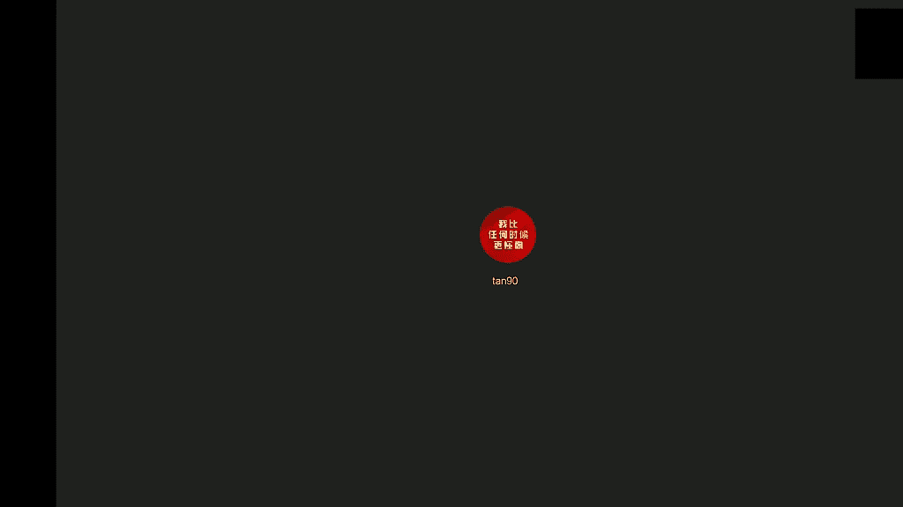
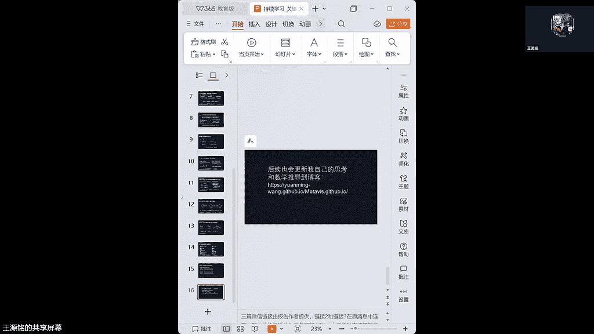
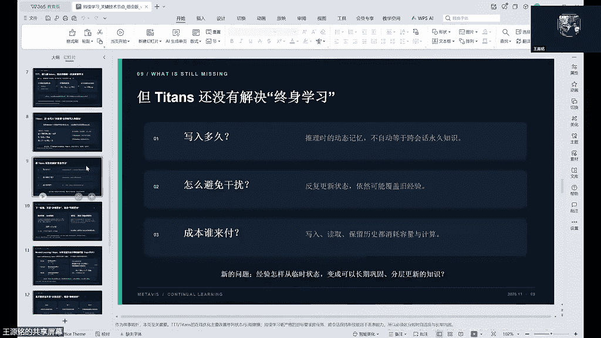

# 🤖 Datawhale AI+X：01：Agent持续学习基础——从灾难性遗忘到持久参数更新


在本节课中，我们将一起学习持续学习的核心问题，理解模型为何会出现灾难性遗忘，并梳理目前研究者提出的三条主要技术路线。随后我们将重点介绍弹性巩固权重（EWC）、外部记忆系统、快慢权重与测试时训练（TTT）、Titans记忆更新机制，以及持久参数积累的相关方法。最后我们会讨论如何评估持续学习效果，并探讨记忆管理的未来方向。


持续学习研究的核心问题是：模型如何在不断吸收新经验的同时，不遗忘旧知识。目前的大模型虽然拥有很强的推理能力，但完成一项任务之后，通常不会因为这段经历而永久获得新能力。举个具体的例子，假设一个智能体在今天完成某个任务时犯了错误，那么明天遇到类似情况时，它能否自动吸取这次经验教训，避免再次犯错？这正是持续学习想要解决的问题。早在2017年，相关研究就已经指出，缺乏持续学习能力是通往通用人工智能（AGI）的重要障碍之一。业界也在讨论AI的技术演进路径，通常认为是从语言模型，发展到思维链，再发展到智能体，随后是持续学习，最终走向更高级的形态。尽管近期很多数据集中在某些特定方向上，但持续学习领域的工作依然相对较少，这使得它成为一个非常值得突破的技术方向。


研究者目前将持续学习的相关工作划分为三个层次。这三个层次并不是严格的先后替代关系，而是不同的技术路线，但它们共同面临同一个核心矛盾：在学习新知识的同时，如何避免破坏旧知识？

以下是三个技术层次的具体说明：

- 第一层是外部记忆。代表性工作包括MemoryGPT和ACE。这类方法主要解决过去的信息存储在哪里，以及如何从中检索回来。
- 第二层是在线更新，也就是状态更新。代表性工作包括TDT、TS和Hope等。这类方法尝试让模型在推理过程中改变内部状态，甚至直接更新一个小型神经网络的参数。
- 第三层是持久参数更新。代表性工作包括MORAAM和SEL等。这类方法进一步探索如何让新经验以参数的形式长期积累下来。


上一节我们介绍了持续学习的三条技术路线，接下来我们重点看看第一条路线中最经典的方法，也就是弹性巩固权重（EWC）。

EWC于2017年发表，是一篇描述灾难性遗忘问题的经典论文。所谓灾难性遗忘，就是模型学会了任务A，之后要学习任务B。为了适应任务B，模型必须更新参数，但这些参数恰好对任务A也很重要。结果就是，在学习任务B的同时，模型可能会把任务A给忘掉。EWC提出了一个非常直观的解决方案：参数是可以变的，但是对旧任务重要的参数应该少改，对旧任务不重要的参数可以多改。这样模型就能在学习新知识的同时，保留旧的能力。

从损失函数的角度来看，EWC的目标函数由两部分组成。公式如下：

$$L = L_{\text{新任务}} + \frac{\lambda}{2} \sum_i F_i (\theta_i - \theta_i^*)^2$$

其中，第一项是当前新任务的损失，第二项是正则化惩罚项。参数λ越大，对旧参数变动的惩罚力度就越大。这里的F_i是Fisher信息矩阵，用来估计每个参数对旧任务的重要程度；θ_i^*则是学习完旧任务之后的参数值。如果某个参数对旧任务非常重要，那么对应的F_i就会很大。一旦这个参数偏离原来的位置，损失就会大幅增加，从而迫使优化器向损失更小的方向进行更新。这样一来，模型就会倾向于保护那些对旧任务至关重要的参数。

不过，EWC并没有彻底解决遗忘问题，尤其是在任务变得越来越复杂时，正则化约束本身也会变得复杂，遗忘现象依然可能发生。


讲完了EWC这种基于参数惩罚的方法，我们再来看看另外两条技术路线中的外部记忆系统，看看它们是如何在不改动模型参数的前提下管理历史经验的。

第一条路线的核心思路，可以理解为给模型装一个外部记忆系统，相当于在智能体框架里增加一个额外的窗口。以MemoryGPT为例，它把上下文窗口当作磁盘，把外部存储也当作磁盘，智能体可以像操作系统管理内存一样，自主完成换页、读写和淘汰操作，实现对记忆的自主管理。这可以看作是对检索增强生成（RAG）的一种改进。

另一个代表性工作是ACE。ACE的做法是将经验组织成一份不断更新的策略手册，也就是playbook。它主要通过三个智能体来提取经验：一个是执行器，一个是反思器，还有一个是整理器。这两个工作的共同特点是，基座模型的参数基本保持不变，真正发生变化的是外部记忆。它们的目的都是让模型更好地利用历史经验，但这些经验并没有转化为神经网络的内部知识。


刚才我们介绍了通过外部记忆来找回过去经验的方法。接下来，我们转向第二条技术路线，探讨如何在推理过程中直接更新模型的内部状态。

第二条路线从一开始就改变了一个基本假设，即记忆不一定要以历史文本或键值缓存（KV Cache）的形式存在。在目前的Transformer模型中，记忆更多地保存在KV Cache里。每当有一个查询向量Q进来，它就会与KV Cache进行点积运算，从而检索相关信息。目前已经有大量工作围绕量化、KV Cache压缩等方向展开，但这些都属于对现有缓存机制的优化。

而快慢权重（Fast Weights）思想提供了另一种思路。它认为，在训练过程中可以使用快速变化的权重来记录近期信息。具体来说，慢权重对应预训练时固定下来的权重，而快权重则是在推理时的前向传播过程中，通过梯度下降来记录当前的近期经验。

这个思想启发了后来的经典论文TTT，也就是测试时训练（Test-Time Training）。TTT的核心思想是构建一个自监督任务。给定一个输入token，模型会得到三种不同的表示，分别是KT、VT和Q。其中KT作为神经网络的输入，VT是学习目标，Q则用来查询。TTT定义一个损失，要求基于网络W对K的输出尽量接近V。对这个损失进行梯度下降，就能得到更新后的快权重W_T。这里的信号完全是自监督的，不需要外部的人工标签。随后，使用更新好的W_T来处理查询Q，最终产生输出O_T。

这个更新过程可以用下面的伪代码简单描述：

```
输入: 查询 Q, 键 K, 目标 V, 网络 W
步骤 1: 计算损失 L = ||W(K) - V||^2
步骤 2: 对 L 做梯度下降，得到快权重 W_T
步骤 3: 用 W_T 处理查询 Q，输出 O_T
```

TTT与LoRA虽然都涉及参数更新，但有本质区别。TTT更新的是一个用于推理时的小型神经网络，也就是快权重，而不是对整个大语言模型进行微调。更关键的创新在于，传统循环神经网络的隐藏状态是一个向量h_t，而TTT的隐藏状态实际上是一个小型的多层感知机（MLP），这正是它最重要的设计点。


介绍完测试时训练之后，我们继续深入探讨2025年Google发布的Titans论文，看看它如何进一步处理记忆的写入与保留问题。

Titans提出了三个比较重要的概念，分别是惊讶度（Surprise）、动量（Momentum）和遗忘（Forgetting）。


首先是惊讶度。模型先用当前梯度处理键K，然后再根据目标V进行比较，计算误差。这个误差对应的是损失函数关于记忆参数M的梯度，而不是对输入token求梯度。这个梯度反映了记忆需要向哪个方向进行调整。

其次是动量。动量机制记录上一个时刻的更新趋势。其中，δT控制保留多少历史更新趋势，θT控制当前梯度的作用强度。这样一来，记忆更新就不完全依赖于当前token的决定，而具有一个近期的趋势，类似于物理学中的动量概念。之前的趋势会持续作用到当前的状态中。

最后是遗忘机制。新的记忆M_T等于保留上一部分旧记忆，再加上刚才计算出来的新更新量。系数α_T用来控制保留的程度。如果α_T比较大，保留的旧记忆就少；如果α_T比较小，保留的旧记忆就多。这个系数是动态更新的。

尽管Titans能够动态更新神经网络，但我认为它还没有彻底解决终身学习问题。它仍然存在三个未解决的问题：一是不知道记忆能够保留多久，以及应该写入多久；二是如何避免新旧信息之间的干扰；三是计算成本如何控制。


了解了Titans的动态更新机制后，我们再来看看如何实现更持久的参数积累，介绍一下MO2M相关的工作。

MO2M的核心洞察是把LoRA中的两个低秩矩阵拆分成多个秩为1的记忆原子。用外积的形式表示，更新权重可以表示为多个记忆原子之和。这种方法不要求每次都将全部记忆激活，而是根据输入的内容，选择相关的记忆参与计算。其核心目标是让小型记忆单元可以增量扩展，并且能够按内容激活。

在2025年的相关论文中，研究者还尝试让模型自己生成微调数据，自己修改数据，并结合强化学习与LoRA，实现持久的权重更新。

关于记忆单元的拆分，可以用奇异值分解（SVD）来理解。SVD把每个字拆成投影方向互相正交的分量，中间的对角线向量保证了投影方向不同。这样就可以保证按内容激活，而不会发生冲突。不过，能够拆分出多少个互相垂直的投影方向，也就限制了记忆单元的数量。


刚才我们介绍了多种持久参数更新的方法，最后再看看一种将学习规则本身可设计化的方法，以及本节课的总结。

有一篇研究提出，模型的更新规则也可以记录过去。以动量公式为例，指数滑动平均动量中的权重M，本质上是对历史梯度的递归压缩。这个研究把模型理解为多个相互嵌套、更新频率不同的学习单元，一共分为快更新、中速更新和慢更新。此外，该研究还提出了HO架构，并与TTT结合，同时融合了之前提出的CMS机制，使得学习规则和更新频率都可以设计。

如果把前面的内容总结成三个关键词，就是：能找回、能写入、能积累。能找回，指的是MemoryGPT和SEL这类方法，能够把外部之前的经验找回来；能写入，指的是TDT和TTT这类方法，可以在推理时改变外部状态；能积累，指的是长期保留知识，需要解决干扰与成本问题。








在课程的问答环节中，同学们也提出了一些值得讨论的问题。以下是几个核心观点的整理：

- 关于持续学习与外部知识库的关系。有人认为，即使上下文窗口再大，模型也记不全所有信息，而且无法根据用户的习惯实时改变行为。相比之下，持续学习能够更好地帮助模型获得单纯依靠知识库或记忆管理无法具备的能力。
- 关于模型能力边界。大语言模型在训练结束后，能力边界似乎已经确定，只有通过后训练或微调才能扩展这个边界。不过也有反对意见指出，上下文学习（ICL）同样能在一次前向推理中完成某种形式的学习。
- 关于持续学习作为通往AGI的门槛。持续学习被认为是跨越通往AGI门槛的重要一步，不能每次都依赖后训练或预训练来更新权重，因为训练资源有限，而且模型无法自适应增长。
- 关于Agent记忆机制与免更新权重的方法。MemoryGPT和ACE等外部系统属于不改动模型参数的方式，但如果一味依赖外挂，一旦脱离运行时环境，就无法进行下一轮的持续迭代。因此，未来的趋势可能是外部记忆与权重更新相结合。
- 关于记忆单元的拆分与冲突。使用SVD可以将信息拆分为投影方向互相正交的分量，从而保证按内容激活且不冲突。但是，能够拆分出多少个互相垂直的投影方向，也就限制了记忆单元的总数量。


从我个人的角度来看，一个比较有价值的方向是把记忆管理升级为可学习的策略。比如，到底什么值得写入，应该写入哪一层，什么时候该遗忘，这些都可以结合强化学习来做。不过我目前的具体思路还没有完全想清楚。另外，评估持续学习效果的方法也非常重要，这也是后续需要重点关注的方向。


本节课中，我们一起学习了持续学习的核心问题与灾难性遗忘，梳理了外部记忆、在线更新和持久参数更新三条技术路线，重点掌握了EWC的损失函数与正则化思想，了解了MemoryGPT与ACE等外部记忆系统，学习了快慢权重与测试时训练（TTT）的原理，探讨了Titans中的惊讶度、动量与遗忘机制，以及MO2M和可设计更新规则在持久参数积累中的应用。希望这些内容能帮助你建立对Agent持续学习的初步认识。

