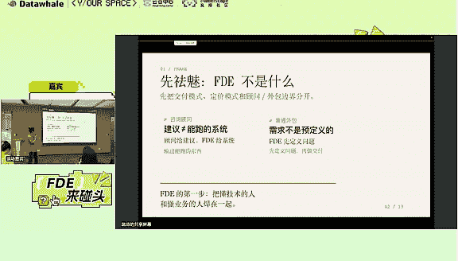

### 🤖 FDE核心：判断力与阶段化落地方式：01：课程概述与FD的基本定义

在本节课中，我们将学习FDE的核心理念，弄清楚FDE到底是什么，又不是什么，并了解FDE在企业服务中的定位。

我叫张新卓。我所在的小团队从2024年开始，主要面向海外客户提供出海服务，帮助企业进行数字化建设，进行技术方案的选型，并落地到实际业务中。我们主要使用的工具是无代码平台和一些自动化平台。后来在开展国内业务时，我们也把飞书纳入了技术选项。很多海外客户也会选择飞书的海外版。

FD这个词大约从今年四五月份开始变得流行，但根据我的实践经验，我觉得现在的FD定义有些狭隘。FD这个词其实源自早已存在20多年的F。在AI时代还没有到来之前，人们是如何进行SD的？我参考了相关案例，并结合自身经验，总结出这份分享，通过想法和案例向大家展示。

关于FD，我们首先要明确它不是什么。

以下是FD不是的两点说明：

- FD不是咨询顾问。咨询顾问通常只提出方案，而FDE需要给出可以交付的成果，并输出观点和实践经验。
- FD不是普通的外包。普通外包和FDE的核心本质区别在于，早期外包常为军工和国防部服务，很多需求属于保密，无法事先写在合同里。

在FDE的实际工作中，你的老板尤其是企业主，通常是非技术人员，很多时候无法清晰描述和定义自己的需求。这就需要FDE人员依靠自身经验和对行业的理解，帮助老板把需求重新梳理，收敛成可量化、可交付的东西，去帮助他们定义问题，并与企业一起合作，把问题定义清楚。

因此，我认为FDE的第一个步骤是：让懂技术的人和懂业务的人坐在一起，让专家和专家之间达成沟通和共识。

---

### 📈 FDE核心：判断力与阶段化落地方式：02：团队的成长路径与AI落地趋势

上一节我们介绍了FD的基本定义，本节中我们来看看一个小团队是如何从基础数字化逐步过渡到AI落地的。

我们在2023年到2024年期间，主要接触的是小微企业。事实上，世界上绝大部分企业都是小微企业，它们也有很多需求。但在那个阶段，很多小微企业甚至连自己的表格都没有，仍然使用传统的Excel，或者在微信、聊天工具里来回发送文件，修改来修改去，最终不知道落在哪个版本。

因此，我们当时帮助很多企业梳理业务流，先把业务语义转换成表格，再建立云端表格，无论是使用飞书还是Notion，搭建语音端智能表格加自动化方式，帮助企业把业务实时体现在数据中台上面。

大概到2024年到2025年这个阶段，市面上出现了很多跨平台自动化工具，例如Make和Coze等。一开始，企业会把数据沉淀在一个平台上。当发现同一个平台的数据无法打通，希望把其他平台打通时，我们就引入外部自动化，即平台A加上外部自动化，与平台B的数据打通，最后全部回到我们自己的数据中台，让所有数据统一。对于小微企业来说，它们通常没有技术背景，基本靠人力解决问题，有了自动化之后，人力成本就省了很多。

从2025年末到现在，我们的小团队去年11月达成了共识。因为我们已经做了两年的基础企业数字化，在这个过程中积累了很多行业经验，例如新媒体、视频制作、跨境电商等方面。具体案例会在后面介绍。然后我们开始判断。去年有一波印象最深刻的发布，许多人发现，很多表格自动化其实不再需要外部自动化或规则化自动化来处理。因为规则化自动化的条件往往很硬，不够自由，不符合实际情境。这时候，用AI写个脚本，甚至直接让AI处理，往往比使用跨平台工作流更好。

从那时起，我们确定了今年的整个趋势方向，即企业的数字化转型与AI技术落地相结合。我们开始有意识地不仅服务海外客户，因为国内有95%以上的企业是小微企业，我们对这一批客户有一些经验和积累，也希望把这些客户纳入自己的版图。

所以到这里，我们的想法是：FDE不仅仅是帮企业安装AI的技术外包，而是需要真正帮助企业实现落地和增长，同时以导师和合作伙伴的身份，帮助企业真正实现增长。如果FDE只是单纯帮企业解决技术方案，那其实和卖方案没有太大区别，并不是真正为企业负责。

---

### 🧭 FDE核心：判断力与阶段化落地方式：03：企业AI落地条件自测

上一节我们回顾了团队的成长路径，本节中我们来看看如何判断一个企业是否具备AI落地的条件。

在实际实践中，因为我们还是与很多小微企业打交道，我聊下来发现，并不是每个企业都具备合适的条件去做AI落地，尤其是AI相关方面的落地。因此，我用比较传统的思维，做了一个简单的自测表，大家可以参考。

以下是自测表的五个判断维度：

- 第一是数据基础。
- 第二是工具的使用以及AI的用量。
- 第三是业务流程。
- 第四是权限与风险。
- 第五是运营和指标。

具体内容较长，这里就不一一详述。主要的逻辑是，如果在座的有FDE人员或企业团队，不妨试试用这个表，先看看自己的客户或自己的企业到底适不适合用AI落地。如果不适合AI落地，那我们可以往前退一步，是不是可以先从最基础的数据化沉淀开始，再到表格的智能辅助，一步步来。必须先有数据，才能接入AI。

---

### 🔄 FDE核心：判断力与阶段化落地方式：04：AI时代的协作逻辑与技术选型

上一节我们介绍了企业AI落地条件自测，本节中我们来看看AI时代的协作逻辑应该如何重新设计，以及如何进行技术选型。

很多老板一找到我们就说，想要做一个AI Agent，这个问题太大了。首先取决于我们是否熟悉这个行业；其次是你的痛点到底在哪里，这一句话我们根本聊不清楚；第三是咱们企业到底处在哪个阶段。如果判断评估后认为不适合用AI，我们会展示三个不同阶段的企业案例，看看我们该如何落地。

在AI时代，为什么我觉得SD是有必要的？最关键的一点在于，2026年在AI时代，工作团队协作正在发生F式变迁。

在传统的S时代，管理软件最终都是为管理者服务，辅助老板做决策。软件在设计时，首先由老板定义需要什么数据，需要什么KPI和指标，然后拆解后设计成流程，给员工使用。员工在工作中收集这些指标，回传到系统，系统最终形成给老板看的数据，辅助老板做分析和决策。

但是AI时代比较不一样的地方在于，AI Agent绝大多数情况是在辅助个人的效率。尤其是在协作中，我们可能很少遇到整个团队使用同一个AI Agent的情况。绝大多数情况是，我们用自己的AI Agent跑通了自己手头最顺畅的业务，解决了自己的痛点。但是这个痛点可能只是解决了我个人自身的情况，并没有和整个团队形成一个良性的循环。

因此，我认为在AI时代重新发明的一套协作逻辑是：从个人AI作为入口，解决我们手头上的痛点和工作，然后把数据自然地沉淀回中台表格，再由团队的AI对这个表格数据进行清洗，回传到上层管理层，让他们看到这些数据，再结合AI辅助做决策，从而达到一个良性的数据循环。

这个逻辑可以用下面的公式表示：

$$
\text{个人AI入口} \rightarrow \text{数据沉淀中台} \rightarrow \text{团队AI清洗} \rightarrow \text{管理层决策} \rightarrow \text{数据飞轮}
$$

如果按照这样的设计思路反过来，发现有些数据收集不到，那我们可能需要从企业的工作流和具体业务开展中去思考，为什么这个数据收集不到。

在具体的沟通与选型方面，我们可以这样考虑：

- 如果要解决信息混乱的问题，可以使用文档和知识库。
- 如果要进行协作，就要选择云端表格或中台。
- 如果规则稳定，可以接入外部RPA，比如道之类的工作流，帮助解决问题。
- 直到出现输入不确定、有语义问题的情况时，再引入AI来解决。

根据我自己的实践，我们并不是All in AI，AI实际上还是我们能力的一个杠杆，它还是一个工具。为什么这样说？因为你不放心，每一次写一个Prompt，让AI这种大模型靠概率的方式去解决问题，很多很小的痛点或者很死的点，最好的方式肯定还是写脚本给它，让AI不容易出错。

---

### 📦 FDE核心：判断力与阶段化落地方式：05：三个落地案例拆解

上一节我们讨论了AI时代的协作逻辑与技术选型，本节中我们来看看三个不同阶段的企业落地案例。

**第一个案例：深圳家具跨境电商**

这个客户是深圳的一家做家具的跨境电商，主要业务场景在亚马逊，每年开放的SKU估计有300到500个。这个客户找到我们的时候，他们想要做一个新品开发的生命周期管理。因为这个客户处于一个较为初级的跨境电商阶段，甚至还没有一个比较好的多维表格来做这件事，他们的整个管理大部分还存在聊天工具里面。虽然案例比较小，但是非常落地，就是很痛的一些事情。

我们给他的方案如下：

- 第一步，先把他的业务流程梳理成一个飞书多维表，然后接入RPA来装入数据。
- 当数据抓进来以后，形成了看板，确定了一个最实际的问题：飞书的仪表盘不好用，因为他们有很多张表，跨表格引用数据做公式特别麻烦。数据同步好之后，这时候AI进场，使用Claude帮他们定制了一个根据他们数据的BI分析表。

整个事情就是帮他们从数据化沉淀的0到1完成。这个案例是在25年初落地的。左边是一个很传统的飞书多维表，大家如果熟悉的话可能就不用解释。简单来说，它是一个项目管理表和一个任务表。项目管理表从项目层面去管理，他们正在当季开发的新品数量。任务表的话，因为他们的流程，每个项目开发流程有将近30到40个子任务，每一个都是这样。同时他们同期开发的新品大概可能有10到20个。这样一来，同期并行的任务就有三四百个，而且是个20人到50人的小微团队，管理这么多数据量，在过去是一个非常头痛的事情。

右边则是我们之后用Claude接入进来以后，帮他们做了一个定制化分析的BI表格，解决了他们基础的第一步数字化。

**第二个案例：新加坡电商**

第二个案例是今年年初做的，也是一个跨境电商案例，但不是上一个案例。这个客户是在新加坡做电商的新加坡本地人，但是他们的货物和物流是从国内进的，他们在自己做本地平台，再在虾皮、亚马逊，以及一些本地电商平台上进行营销。

这个企业非常好，他找到我的时候，因为我们早先去年的时候就已经有一些表格上的合作，所以大家是有一个老客户信任关系的。他今年的需求是发现，虽然表格有了，很多东西还是要靠人工去处理，尤其是最脏的，就是他们的物流在流转的过程中，仓库从国内发货到新加坡，有一环是需要确认拍照。他们的发货货柜以及里面的商品数量都是用拍照的形式，然后附件上传到飞书多维表格，然后需要他们自己的人去逐一核对表格。因为他们的照片拍得很丑，一张张看，照片非常非标，五花八门。都需要花很多的人力去识别标签长什么样，里面有什么东西，然后回填到表格里面。

第二个问题是他们的补货情况。因为跨境就涉及到库存管理的问题，很多时候库存管理在多平台，统一仓库管理的话，他有时候其实不太确定他每个平台上的库存实时情况。尤其是要补货的时候，他们怎么去做下一个季度同一个SKU补货的数量和尺码的预测。他们的传统方法是用一个Excel计算表，写上了他们的公式，然后自己人肉去他们的中心表格里面，把当前卖得好的SKU筛选出来，然后把当前的销售情况以及当前的库存数量这些信息拿到，再把信息回填到表格里面去，人工做计算，计算好之后给出一个补货的数据。他在人工思考完了之后，再形成一个发货单，订货单给到供应商，然后供应商再把这个东西发给他们。整套流程感觉逻辑是通顺的，但是在实践过程中，因为大家如果有服装经验就知道，服装的SKU特别多。像这个企业，他们可能每年估计有3000个SKU，因为服装来说，每个颜色、每一个尺码，每一个变体都是一个新的SKU。这就导致每一次要提取的数据量特别大。

还有一点是关联到广告。因为跨境电商知道要做广告投流，如果你的库存已经卖空了，广告还在跑，那就是一个亏损的情况。

因此，我们整套接到这个需求以后的思路是：

- 第一步，先帮他做一个Agent，定时去看他们那张图片，然后回填数据给员工确认。
- 第二步，帮他们把计算提醒的这个步骤尽可能自动化。
- 第三步，对接其他的广告平台，确认库存数量，然后在库存低的时候，先把广告暂停了，防止客户发不出货的情况。

可以看到，左边这个表是他们的核心SKU表，是我们最开始的时候帮他们做的新品周期管理。但是不同的跨境电商，新品开发的逻辑和数量是不太一样的。这一个案例就是我认为FDE比较好的一个情况：当你在做同一个行业垂直经验比较多的时候，你很容易去做复用。这就是FDE为什么他的飞轮能赚起来的一个核心逻辑。我稍微展开一点讲，因为这个还是挺重要的。因为很多FDE现在遇到企业的需求一进来，他会很自然地说，我们什么都能做。因为在这个时代，大家的技术水平其实是一个被无限拉到一个比较平均的水平，很多东西都不在于技术难点，而在于技术选型的思路，以及大家对这个行业理解的选择。

所以说为什么要做垂直？如果我们不停地去开发新企业、开发新的痛点，那对于FDE来说，我们每一次都要重新学习，或者说找专家去重新研究这件事，那这对于我们来说就是非常累的一个活。你可能做前面3到5个行业，甚至10个行业以内，你还有精力做。那如果以后你要做30个、40个、50个行业，每次都从头开始学，那这无疑是一个非常耗人的事。

所以说，我认为FDE最核心的点是：找到自己最擅长的、有案例或者对行业痛点有理解的一个行业，然后把垂直做深。这样以后同行业的客户理解到：

- 第一，你可以很明确地说出他的痛点，你能get到他想要什么，他也能知道你是懂行的。
- 第二，你有案例展示。
- 第三，你沉淀下来的这些表格资产以及AI的架构，是可以复用的。虽然每个企业会有自己的习惯和一些需要定制的点，但是整体大框架你可以复用的东西，甚至可以达到80%以上。这样的话，你做同类型的客户，会省下非常多的精力。

案例二中间的表格是他们填照片的表格，右边有一个照片案例，可以看到上面还有一个绑带，所有的东西大部分都是手写的。这就体现了一个真实落地场景：其实它真的没有我们想象的那么好，很多数据非常脏，手写的不是打印的，也没有一个统一的格式去规定你这个拍照要拍哪个角度。

这一点，我们最后是找到一个好的模型，便宜的模型去做一个实图，因为传统的OCR是实图，搞不了这么一个废标的情况。在这个案例最后，我们还是建议客户说要跟工厂那边对接，能打印标签就尽量打印标签，能固定角度拍摄就固定角度拍摄，这样尽可能减少我们的出错情况。

**第三个案例：新媒体公司**

前两个案例我给大家展示的，是说明一个企业从没有数据化到有数据化，然后开始有部分AI接入。那现在这一个案例可能是我们今年接触的比较多的案例，主要是做新媒体公司。新媒体公司天然有一个好处，就是说所有的数据基本已经沉淀，他也许没有知识库，但是只要是做新媒体运营的，你的这些资产，就是你的文案啊什么的，基本上肯定是有存稿的。然后我们要去做数据库整理，大家只要收集一下，基本上都是有一个基础的数据沉淀的，这里就非常好。

我们今年做的比较多的，就是帮助他们去做自己的一个简单点来说，所有的在场只要做FDE，我们搭一个知识库，然后再搭一个简内容的模仿他们的风格去做他们的工作流。但是我觉得这当中，为什么我们能做好，是因为在项目管理方面，我们是有之前一贯一脉而成的一些经验。因为其实一个自媒体团队，如果是个人还好，但是我接触到的客户基本上是有一个小矩阵的账号，他可能一个团队大概5到10人的小团队，他手里可能有20到30个账号。20到30个账号就涉及到你每周并行的任务数量有多少，然后正在制作当中的流程有多少？很多小团队做自媒体出单，懂流量，但是他可能没有对管理核对这些任务的数据没有那么敏感，然后也会提到说你这个数据管理的问题。然后我们整套的系统就是配合搭了这个AI检加知识库，再加交付的时候有一个表格，然后表格和AI检也打通，然后去帮助他们能够有一个中台去管理，尤其是决策者知道我们现在人员的效率在哪，本周选题，本周立项做了多少个，哪个卡在哪个阶段。为什么这些，就是把以前都沉淀在你的聊天工具里面的信息全部的进化。然后再同时辅以就是你发布内容的人能够把这个你们的内容仿写飞轮转起来，能有AI的协作。

这一个案例的架构，其实我放的图，它主要是他们团队最好的一点是他们已经接受了Work。很多企业他们想要做FDE，但是他们连AI都不用，你怎么去做FDE？他们连表格都没有，你连数据都没有，你怎么谈数字化？这是一个很头疼的问题。那这一个企业好就好在他们啥都有，有使用AI的习惯，然后有沉淀下来的数据，然后也有一个比较好的沟通机制。那我们就直接说，我们借由这个Work，既然他们都用，那我们用Work上面给他们搭一个专家团，然后这个专家团背后接的是他们本地上的一个知识库。然后在上面给他们。

知识库的话，他的结构就是除了分账号去放语料之外，他最关键的一点是，他可以用这个专家去给他们仿写，然后写内容发回去以后，我们在云端会定期去重新扫描他们，然后根据他们最近的一个风格去更新他们的风格。因为做自媒体最怕的就是你的风格固定。因为做流量这一行有时候也挺玄学的，你不知道，有一条内容他什么时候会爆，为什么会爆。但是你知道，只要沿着这条路，你最近都会爆，但是爆了一段时间之后，他可能又颓了。然后你又要找新的一个切入点。那他的一个风格是持续会变了，这需要一个有点像自己成长的一个过程。

---

### 🎯 FDE核心：判断力与阶段化落地方式：06：FDE的角色定位与核心竞争力

上一节我们拆解了三个落地案例，本节中我们来看看FDE在做这件事时，应该如何定位自己的角色，以及核心竞争力在哪里。

我们把三个案例重新放回一张图里面，然后回到我们今天的重点，就是我们在做FDE的时候，一定要确定我们的客户，我们的企业到底是处在哪个阶段。根据不同的阶段，我们得要给他做一个初步的技术选型，然后做一些建议，然后去告诉他们，如果你们真的想要接AI，那你应该怎么走。如果说你能走的话，那咱们走走；走不了的话，那咱们再看。

首先第一点，如果我们缺流程、缺责任，应该数据未统一，那我们就一定要有一个中台表，然后配合一些RPA把所有的数据拉齐。然后当我们表格清淀好了之后，我们就可以用部分的主数据，部分的数据加一些简单场景的Agent，先去测试这个使用量。他具体解决的其实是可能某个具体岗位员工自己的痛点。但是因为我们有这个数据，然后我们也有Agent，它其实很多员工的绩效就是可以实现了。

然后第三点是，当我们所有东西都有了之后，那整个团队的效率怎么去做提升。项目管理加知识库加Agent，它是怎么去帮助整个企业达到一个更快的数据飞轮。所以说，个人的Agent，他需要先生产真实的数据和方法，他才能从个人提交到企业，而企业提的Agent，他才能有这个东西去做统筹。

最后的话，就是说还是回到做FDE这件事情上面来。做FDE的话，我们一定要把自己的位置放好。我们一定是一个对企业来说是一个专家的角色，是一个顾问的角色。因为很多时候，如果企业主觉得他比你懂，那就完蛋了。因为你的整个行为动线思考都会被企业主牵着走。我们不是企业主提一个要求，要求出来，然后我们就说能做，然后我们想办法去实践，而是我们要结合自己的一个专业度和经验，尤其是同行业的经验，去给到企业主思考，去参考，为什么企业会有这个问题，那他的同行是怎么解决这个问题的。

然后现在自己四个问题：

- 第一，我们的数据真的能被系统稳定使用吗？
- 第二，他那个流程是否写在这个系统里面，是否已经显性化，还是说只在某某个人脑子里，还没有形成知识库，还没有形成一个多维表格能去把这个数据收集起来？
- 第三，员工是否已经接受了这个高频使用AI？因为我们在做起来的时候，其实你会发现你跟老板，老板非常愿意推AI，但是你如果说跟你对接的人，他可能是个中层或者高层，他可能不那么愿意推AI，因为他还是很多人的心态是AI可能会抢我的饭碗。但是我们怎么去把这件事情做到一个平衡点。因为在我自己的认知里面，AI它其实不是来取代我们的工作，它是更好的发挥在同样企业规模，同样人数底下，更好的发挥我们的能效比。我们同样的规模，我们不裁员，我们可以发挥出以前2到3倍的一个效率，就已经非常棒了。
- 第四，我们是做AI交付还是做AI培训。这一点的话，AI交付，那你肯定要有一个合适的一个地基，你才能做AI交付。但做AI培训的话，其实现在很多FDE可能会发现你干不了，那你只能从培训开始做起。那培训培训什么？培训他们使用表格的能力吗？还是培训他们用一个具体的AI工具的能力。那如果这个AI工具，你看像从小龙虾到爱马仕再到Work一级一级升上来。那以后整个AI变迁出了新的软件，他们怎么样把这个可迁移的能力保留在企业里面。你怎么去讲去给企业做培训，不是教他们使用具体的工具，而是给他们留下一套思维方式，能让他们能真正去帮助自己的企业去实现一个增长。

所以我自己的一个判断是，FDE的核心竞争力，它是判断力而不是技术力。今天的话，其实FDE做下来，我有时候偏向培训的点，是因为我们很多细小的需求，你一开始是聊不出来的。但你会做的过程当中，他们又给你提出来。虽然你前期肯定有收敛范围了，但有些很小的需求，你可能心一软，说我可以给你实现。但是你会发现很多小需求，一旦你培训下员工，然后他会用这个工具，然后你只需要点拨他几句，你可以这样做，你可以那样做，你可以用Computer Use，你可以自己让AI写个脚本，你就解决了你的问题。那对FDE来说自己也是更省力的。我们把FDE更多的精力放在一个更加需要专业化，去需要思考，去需要做方案的地方，而不是说去解决茫茫多的这种多余琐碎的小问题。我们让企业获得这个能力，并且自然地去生长。

---

### 📚 FDE核心：判断力与阶段化落地方式：07：课程总结

本节课中，我们一起学习了FDE的基本定义，明确了FDE不是咨询顾问，也不是普通外包，而是需要交付成果并帮助企业落地增长的专家角色。我们回顾了团队从基础数据化沉淀到AI落地的成长路径，并学习了如何使用五个维度的自测表来判断企业是否具备AI落地条件。我们探讨了AI时代的协作逻辑，即从个人AI入口到数据中台，再到团队AI清洗和管理层决策，形成良性数据飞轮。我们拆解了三个落地案例，分别对应深圳家具跨境电商、新加坡电商和新媒体公司，体会到了垂直行业深耕和案例复用的重要性。最后，我们讨论了FDE的角色定位与核心竞争力，认为FDE的核心竞争力是判断力而不是技术力，要尊重企业、尊重行业，不一定非要直接做到解决方案实施阶段，做完咨询、做完培训问题也可以被解决，主要还要思考自己该做什么事情。希望通过这节课，大家能对FDE的判断力与阶段化落地方式有更清晰的认识。

