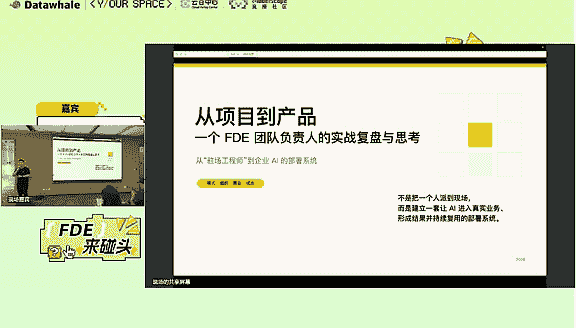

# 🚀法索AI FDE产品化实践：01：从现场解决问题到商业化落地

在本节课中我们将要学习如何从一个真实的现场出发，逐步把一个AI产品打磨出来，并最终实现商业化落地。我们会围绕法索AI团队的实际经历，讲清楚什么是现场交付工程，如何进入陌生的专业领域，如何和关键用户一起工作，如何设计产品入口，如何根据用户反馈迭代，以及如何把经验量化为可复制的产品能力。无论你是产品经理、开发者，还是对AI商业化感兴趣的初学者，都能从中获得具体的方法论和可操作的步骤。


## 1. 课程概述与核心目标

本节课的主要内容分为几个部分。首先，我们会介绍FDE的核心定义，以及为什么进入现场是做产品的前提。其次，我们会拆解法索AI针对诉讼律师打造的AI产品，看看它是如何从上传材料到案件工作台完成用户路径的。然后，我们会讲述团队在法律这个完全陌生的领域中，是如何先扮演学生角色，再找到合伙人和律师助理两个关键人物，并据此确定产品质量标准的。接着，我们会分析产品入口为什么选择上传材料而非聊天框，以及产品是如何从七个模块逐步进化为支持记忆和多模态材料的案件工作台的。最后，我们会讨论商业化的本质，包括如何量化经验、如何捕捉客户现场的需求信号，以及如何把能力包装成市场愿意买单的产品。


## 2. 什么是FDE与现场思维

FDE可以用一个公式来表达：

```
FDE = 进入现场 + 解决问题
```

这里的现场，指的是用户真实工作发生的地方，而不是产品经理想象中的办公场景。进入现场的前提是，你可能面对的是一个完全不熟悉的领域，这意味着你需要做好跨界的准备。法索AI的团队成员并非法律专业人士，也不是律师或工程师，创始人本身是学金融出身的，因此在做法律AI产品时，天然具备跨界属性。FDE的一个重要命题是，能否从一个现场中提炼出解法，并让这个解法走向商业化。法索AI目前正处于从现场解法走向产品化的阶段，因此本次分享将聚焦于他们在打磨法律AI产品过程中的想法与实践。

用户路径可以用如下伪代码描述：

```
用户路径 = 上传材料 -> AI分析 -> 案件工作台
```


## 3. 法索AI产品介绍：诉讼律师的AI助手

在深入产品决策之前，我们需要先对这个产品有一个直观的认识，否则后续讨论会显得比较抽象。法索AI的产品非常专注，它专门围绕诉讼案件构建，面向的用户群体也非常垂直，只服务诉讼律师，不涉及非诉讼业务。用户的使用路径可以抽象为以下三步：

- 第一步，律师将大量案件材料上传到系统中。
- 第二步，系统对这些材料进行AI分析。
- 第三步，分析完成后，律师进入个人的案件工作台。

这个用户路径非常简单，但它完整覆盖了从材料接收到结果获取的核心闭环。这就是法索AI目前的产品形态。


## 4. 进入陌生专业领域的方法：先做学生

上一节我们介绍了产品的基本形态，本节中我们来看看，当一个非法律背景的团队进入法律领域时，应该采取什么样的姿态。创始人本人对法律领域非常陌生，因此在开始做产品之前，他一直在思考如何进入一个陌生的专业领域。一个关键的观点是，不在现场的人没有发言权。很多产品经理和开发者习惯于凭借自己的经验认为自己很专业，但实际上，他们对用户的真实工作现场一无所知，不知道用户每天在经历什么。因此，在没有真正进入现场之前，不要急着去定义用户的问题，甚至在客户打电话描述需求时，也不要轻易就接受表面信息，因为客户讲出的需求往往不是他真正的需求。作为产品经理，辨别真实需求是基础课程，而用户往往不会主动把真实需求说出来，也不会通过调研完整地表达出来。

那么应该怎么办呢？团队后来围绕这个话题持续探索，核心思路就是如何进入现场，完成第一次真实交付，并把人的经验转化为产品。进入陌生领域的第一步，是让自己先做学生。专业人士是谁？现场中的人才是专业人士。因此，团队的做法是先找到关键人物，然后和这些人一起完成一次真实的工作。创始人曾经亲自去律所工作，从凌晨两点工作到第二天早上六点，并跟随律师朋友去法院办案，观察他们的真实工作方式。通过这种方式，他找到了两个非常核心的人物，一个是合伙人，另一个是律师助理，这两个人在诉讼案件处理中构成了一个紧密的团队。


## 5. 核心角色与确定质量标准

在进入现场并找到关键人物之后，我们需要明确产品的质量标准应该由谁来决定。以下是两个关键角色及其职责：

- 合伙人，负责接案、组建案件群、评价案件分析报告的质量。
- 律师助理，负责整理材料、执行具体分析工作，是系统的真正使用者。

诉讼律师接到案件后，通常会把客户拉到一个群里，把材料丢进去，然后艾特律师助理，要求对材料进行整理，并输出一份案件分析报告。基于这个工作流，法索AI的早期产品形态被设计为七个模块，这七个模块共同构成了一个简单的工作流，最终生成一份深度的案件分析报告。需要说明的是，这七个模块之所以重要，并非因为AI天生擅长处理这七件事情，而是因为这七个模块正好构成了一份深度的案件分析报告，团队需要AI在这七件事情上保持一致性和稳定性。

质量标准可以用如下公式表示：

```
质量标准 = 结果接受者的评价
```

既然要生成这样一份报告，就需要有人参与进来进行评价。谁来使用这份报告，谁就有资格评价这份报告。因此，在前期打磨这七个模块时，报告的质量全部由合伙人来评价。团队也不害怕在客户面前展示不成熟的版本，一开始输出的报告很粗糙，甚至被用户吐槽不如大学一年级学生，但团队根据反馈持续优化，并引入专家共创。经过一年多的打磨，这份报告的质量已经超过了一个一年级律师的水平，合伙人评价说，这个报告已经可以担任他的律师助理了。

这里会出现两种情况。一种是合伙人觉得AI可以直接替代律师助理，但这在实际中不太可能。另一种更合理的情况是，当这套系统表现稳定后，合伙人会放心地为自己的律师助理购买账号，让助理去使用。因为合伙人通常不会亲自做这些案头工作，大部分繁琐的材料整理和分析是由律师助理完成的。因此，团队最终识别出，律师助理才是这个系统真正的使用者，而谁接受结果，谁就决定了质量标准应该如何设定。


## 6. 产品入口设计：遵循真实工作流

上一节我们讨论了核心角色和质量标准，本节中我们来看看产品入口应该如何设计。团队曾经收到过一条用户信息，用户问在哪里发“你好”，因为他习惯了所有AI产品都是一个聊天框，进入后就感到困惑。团队并没有为了迎合这个表面需求而增加聊天框，因为在设计产品时，他们已经梳理了律师的完整工作流和工作状态。律师助理收到一堆文件后，第一件事不会是跟文件说“你好”，然后开始聊天，他的工作是接受材料并进行深度分析。因此，法索AI的产品入口直接设计为上传材料的界面。

只要用户是诉讼律师，第一次使用之后就会觉得非常契合，不需要任何指导就能无缝进入产品流程。这是因为这个流程就是律师过去在办公桌上办案的流程，只是被转移到了AI产品里面。使用者决定了产品入口应该如何设计。在判断用户需求时，团队也认识到，客户给出的往往是他心里的解决方案，但这个方案受限于他对技术或产品的认知，可能存在“知识的诅咒”。因此，团队在构想产品和交互时，不能完全照搬客户的话，而需要回到现场去理解真实的工作方式。


## 7. 产品迭代路径：从七模块到案件工作台

上一节我们介绍了产品入口的设计思路，本节中我们来看看产品后来是如何演进的。团队最初策划的路线图是横向覆盖所有可能的诉讼案件领域，但实际走过的路并非如此。去年4月份产生想法，7月份下定决心做这件事，团队甚至专门购票参加世界人工智能大会，看到其他团队把想法做成产品后非常受鼓舞。到7月份，民商事案件的七个模块已经能够形成稳定的报告，团队也和专家、律师一起把刑事模块的案件分析全部处理完毕，准备进入开发。

然而，用户的实际行为并不按照预期。在七个模块还不稳定时，用户一直在询问上线时间。等到民商事七个模块变好后，用户又开始通过另一条路径提出新需求。最初的产品界面只有七个模块，但当用户发现这份案件分析报告可以使用，质量已经可以胜任一年级律师的工作后，他们提出了第二个需求：案件分析报告不是一成不变的，客户会提供新证据，律师会有新想法，还会有之前办过的案例判决，是否可以持续添加新材料并重新分析。这意味着用户已经在民商事这个方向上做纵向深化，而不是等待横向覆盖。

为此，团队推出了第二版产品，增加了一个上传文件按钮和一个重新生成按钮，让用户可以上传新材料，系统据此重新进行分析。这一版满足了用户需求后，用户又开始提出新的欲望，他们说重新生成已经可以，但觉得不够自由，希望能自由地和AI讨论策略。这个变化发生在去年12月份左右。从支持新材料上传并保持输出一致性，到实现稳定输出，团队花了五个月时间才解决一致性问题。

就在产品准备上线时，用户又说不够自由，希望能讨论。于是产品形态进化为现在的案件工作台。这个工作台可以看到用户上传的所有案件材料，完全支持多模态，因为律师接收到的材料本身就是多模态的。工作台展示分析结果和生成的文书，最重要的是支持自由讨论。团队还为产品增加了记忆功能，名为“小锁案件分析助手”，它会将案件中所有材料、所有分析结果、所有对话记录沉淀到案件记忆中。

诉讼是一个跨周期的事情，可能需要三个月、六个月甚至一两年。如果使用通用AI，三个月后回来可能什么都不记得，或者需要重新建立上下文，甚至上下文会因为材料过长而爆炸。法索AI的记忆功能让用户在三个月或六个月后回来，小锁仍然在等待，用户只需要告诉小锁最新的进展，甚至忘记案件细节，也可以让小锁回顾之前聊了什么、分析了什么、本来要关注什么，然后无缝继续开启案子。这个版本也是被用户的需求逼出来的。

该版本于2025年5月21日正式上线，也就是这款产品真正面市的日子。上线当天，团队获得了第一届法律科技大赛半辅助赛道的第一名，并完成了种子轮融资。此外，团队在刚刚过去的世界人工智能大会创新孵化区拥有了自己的展位。


## 8. 商业化逻辑：量化经验与捕捉需求信号

上一节我们回顾了产品的迭代路径和上线成果，本节中我们来看看商业化的核心逻辑。商业化的前提是规模化和可复制化。在AI时代，我们到底在量化什么？团队认为，是在量化经验。产品中包含了一些外部专家的经验，他们参与了产品的共创。法索AI团队本身是一个典型的AI驱动团队，团队内部沟通甚至都是AI之间的沟通，他们认为人与人之间的沟通效率很低。团队会把自己在使用产品中的体感和经验融入到产品里面，把自身量化，将经验全部放进产品中。

商业化前提可以用如下公式表示：

```
商业化前提 = 规模化 + 可复制化 = 量化经验
```

为什么要把经验和能力放进产品？因为当你是一个小团队时，一定要突破个人的时间和精力上限。如果每次都要让客户跑来问老板这件事可不可以，那就永远无法做到规模化，也无法实现真正的商业化，因为你自己就是那个卡点。应该把自己量化成一个又一个的技能模块，或者一个又一个agent，让它们在公司里运行，这才是小团队做商业化的最重要前提。

商业化是从一个现场到一类市场。团队常常会想，我为某个客户解决了问题，积累了一些能力，能不能把这些能力卖给别人？这是一种从内向外的想法。但拥有能力不等于别人想买。商业化的本质在于有没有人有需求。如果用户想买且有需求，而你没有产品，你也能卖出去；如果用户没有需求，哪怕你能力再强也卖不出去。团队举过一个卖衣服的例子，有些商家在小红书上只放一张图就卖衣服，八月份下单九月中旬才发货，因为积累到一百单才去生产。这说明，人家有需求的时候，你没有能力也能卖出去；人家没有需求，你再有能力也卖不出去。因此，考虑商业化时，不是看自己的能力有多强，而是看哪一类人反复面临相同的问题，找到产品机会，把自己的能力包装成适配这些需求的产品，再把它卖出去。

另外，团队还能在客户现场捕捉到一些信号。比如，早期产品界面比较简陋，是黑白风格，团队觉得简洁高级，但用户觉得简陋。去年十月或十一月时，已经有少量付费用户，但不多。用户一直在使用，后来集中反映希望UI做得好看一点。团队最初觉得UI不影响使用，优先级不高，但后来多个用户都提出同样的要求。团队成员都会直接跟客户沟通，没有中间层，创始人打电话给用户询问原因。用户解释说，产品很好用，想发给同事和其他律师，虽然团队是唯一围绕诉讼做的法律AI，但用户对比其他法律AI后发现，这个首页太简陋了，别人可能根本不想试用，而且发出去也没面子。这时团队意识到，升级品牌和UI变成了非常重要的事情，优先级很高，因为用户想要为产品做转介绍时，UI成了一个卡点。

客户能否从持续使用，进到关心别人怎么样才能用得上，这在某种程度上说明产品可以标准化，可以走向商业化。团队当时进行了一整套UI升级，包括今天演示中使用的PPT，虽然是AI制作的，但整体符合UI规范。还有一个例子，产品只支持微信支付，客户会打电话说付款卡片必须点击购买按钮才能弹出二维码，点旁边的文字旗舰版不能购买，希望调整卡片。因为客户已经介绍别人去购买了，对方却不知道怎么付款，客户很操心这件事，这说明产品真的被很多人接受了，团队才有信心推广。团队在2025年6月开始正式进行小规模推广，之前一直在打磨产品。


## 9. 本节总结




本节课中我们一起学习了法索AI从现场出发，逐步构建诉讼律师AI产品的全过程。我们了解了FDE的核心定义是进入现场解决问题，学会了如何在陌生领域先做学生、找到合伙人和律师助理等关键角色，掌握了产品从上传材料到案件工作台的用户路径，了解了七个模块如何构成案件分析报告，以及产品如何根据用户真实需求从七模块进化为支持记忆和多模态的案件工作台。最后，我们探讨了商业化的本质，包括量化经验、突破个人精力上限、捕捉客户现场信号，以及把能力包装成市场需求的产品。希望这些内容能对你从零开始做AI产品并实现商业化有所帮助。

