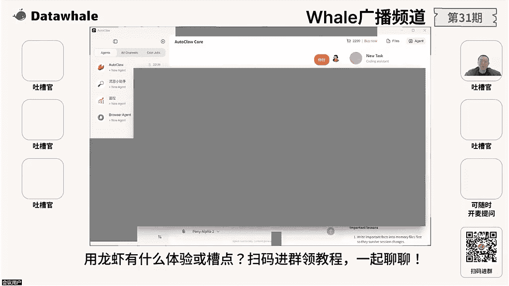
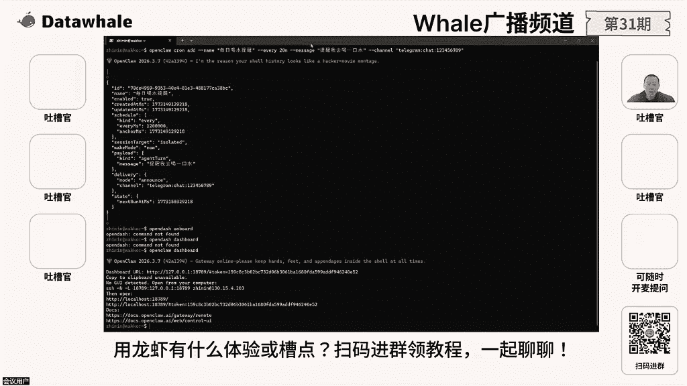
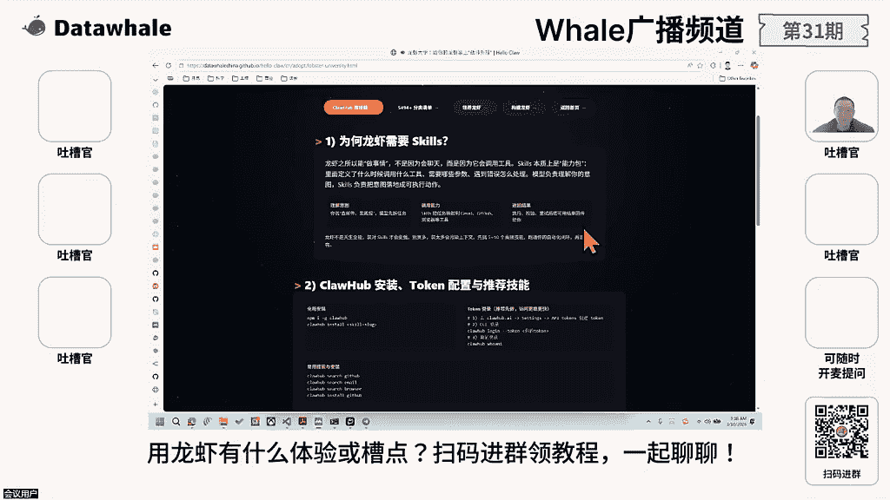

# 🦐 HelloClaw 从0开始成为养虾大师：01：课程概述与学习目标


在本节课中我们将要学习 HelloClaw 项目的基本情况，包括它包含的两个主要部分，以及适合哪些人群进行学习。


HelloClaw 是由 Datawhale AI+X 与散步团队共同构建的龙虾中文教程。当然也有英文版本，但目前主要专注于中文版，之后会发布同步的英文版本。

这个教程主要分为两个部分。第一部分是龙虾的领养，也就是告诉你怎么使用这个龙虾助手。第二部分是龙虾的构造，也就是包含哪些组件，以及如何把它们组合在一起。

如果你想要开发一个私有定制化的 AI 助手，可以参考这个教程。

目前这个教程还在完善中，很多场景没有完全考虑清楚。如果你有自己的私有场景，可以贡献出来，加入团队一起编写教程。比如实用的案例，不一定是量化交易，也可以是 Open Cloud 盯盘，或者让它做文献整理、科研助手等场景化的内容。

这样效率会更高。如果大家对这个教程感兴趣，可以联系作者，教程链接会发到群里。

# 🛠️ HelloClaw 从0开始成为养虾大师：02：安装方式与部署选择

上一节我们介绍了 HelloClaw 的课程概述，本节中我们来看看如何安装和部署它。

安装 HelloClaw 可以选择云端部署或者本地部署。对于初学者，建议优先使用云端方式。

本地部署需要配置的东西非常多，比较麻烦。如果你想快速上手，尽量使用云服务器。比如腾讯云或者智普的 AutoClaw。这些云服务比较傻瓜化，点一下下载体验就会下载安装包，但只支持 Windows 和 Mac。

下载完成后需要注册一个账号，用手机号注册即可。云端服务有时候响应速度比较慢，你问它一个问题，它可能需要沉思很久才能回答。

云端部署的好处在于有硬盘快照和系统镜像功能。如果你觉得当前版本不好用，可以先做快照，再重装系统，换另一个版本。如果新版本不好用，再把快照恢复回来，数据也不会丢失。

不过云服务也会让你绑定厂商，厂商希望你 lock in，一旦迁徙会有成本。但考虑到 AI 发展很快，一年后形态可能完全不同，所以不必过度担心。

以下是安装时需要注意的几个要点：
- 优先选择云端部署，降低安装难度。
- 本地部署配置繁琐，适合有经验的开发者。
- 云服务提供快照和镜像，方便回滚版本。

# 🤖 HelloClaw 从0开始成为养虾大师：03：模型与渠道配置



上一节我们介绍了安装方式，本节中我们来看看如何配置模型和渠道。

安装完成后，进入 Quick Start 模式。程序会告诉你要配置哪些东西，你一直点 OK 即可。如果想定制化，可以点 Menu。

配置时首先要选择模型。这里推荐使用 OpenRouter 上的免费模型，比如借月星辰推出的 reasoning model，它支持 tool calling。

但是使用前你需要先在 OpenRouter 注册账号，获取 API Key。这是一个隐性门槛，普通用户可能不太熟悉。

其次要选择渠道，也就是集成平台。原生支持的集成应用比较有限，国内主要支持飞书。QQ、Telegram、Discord 等可能需要额外处理。

如果你想配置飞书，需要跳转到飞书界面，把相关 token 粘贴过来。但配置过程没有实时跳转，需要你先准备好所有信息，再慢慢贴过去。

以下是配置时需要准备的信息：
- 模型提供商的账号和 API Key。
- 渠道平台的账号和相关授权信息。
- 如果需要联网搜索，还需要对应的搜索 API Token。

# ⚡ HelloClaw 从0开始成为养虾大师：04：快速启动与任务示例

上一节我们介绍了模型与渠道配置，本节中我们来看看如何启动并给龙虾布置任务。

配置完成后重启程序，理论上就可以使用了。你可以给龙虾布置任务，最常见的是定时任务。

定时任务使用 Cron 命令。例如你可以告诉龙虾：每隔 20 分钟提醒我喝水一次。


```text
every twenty minutes remind me to drink water
```




你还需要指明发送的渠道。如果不指定，默认使用最近配置的平台。如果配置了多个平台，比如 QQ、主机、Telegram，它只会提醒最后一个平台。


更常用的用法是在通道里直接用自然语言和机器人聊天，比如“我想设置一个喝水提醒，每20分钟一次”，不需要输入复杂命令。

# 🔮 HelloClaw 从0开始成为养虾大师：05：核心概念与未来展望


上一节我们介绍了任务示例，本节中我们来看看 HelloClaw 的核心理念以及 AI Agent 的未来方向。

OpenClaw 之所以火，是因为它是第一个真正应用级的 AI 工具，真的能干点事情。


AI 本质是预测模型，比如 Transformer。如果它足够了解你，可能就知道你下一步该干什么，说出你心里最想说的话。

你可以把人生写成一个上下文。比如一个人60岁写的日记可能只有几个 EM，如果你有 EM 级别的上下文，AI 就可以克隆你的整个状态。

```
人生上下文 = 所有日记 + 行为记录 + 偏好信息
```


未来可能出现 Agent 市场，每个人把自己的 Agent 派出去打工，挣钱。这叫 Agent 人才市场。

关于 Skill 的设计，Skill 本质是封装一套 Workflow。颗粒度不能太粗也不能太细。太抽象会生成粗糙结果，太复杂会让模型困惑。

OpenClaw 自带的 Skill 不超过 20 个，只有在现有 Skill 完全做不到时才会追加新的 Skill。我们要对 Skill 保持敬畏之心。

最后，如果你不是硬核开发者，建议使用大厂的云端机器，比如腾讯云。腾讯比较安全，而且很多人用 QQ 或微信，绑定起来更方便。



本节课中我们一起学习了 HelloClaw 的概述、安装部署、模型与渠道配置、快速启动示例，以及核心概念和未来展望。

