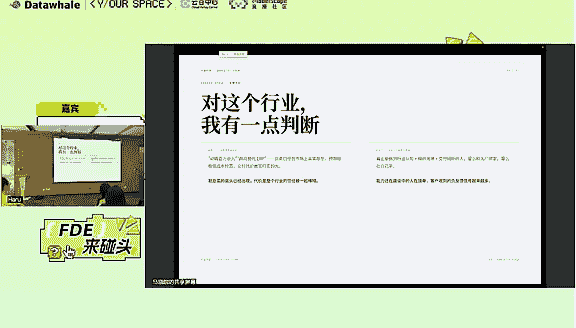

Datawhale AI+X FDE 实战教程：第一章：FDE 的全景与选择边界 🚀

在本节课中我们将要学习 FDE 的全貌，理解它在 AI 与业务落地最后一公里中的作用，掌握选择与边界这两个核心关键词，并通过真实案例学习如何从企业需求中筛选出值得先做的项目。

什么是 FDE 及其角色定位 🎯

FDE 的本质不是一个全新的岗位，而是把售前、项目经理和交付等原有角色揉合在一起。因为 AI 降低了后端交付成本，使得一个人或小团队可以同时承担需求诊断、工程验证和产品交付。

我们可以用下面的公式来描述 FDE 的核心职责：

FDE = 客户需求诊断 + 快速工程验证 + 业务结果交付 + 可复用产品沉淀

在传统的软件交付中，需求方和产品方通常是分开的。而在 FDE 场景中，当客户的业务问题和产品解决方案两侧都还没有完全确定时，FDE 需要深入现场，通过轻量级的工程验证，让业务问题与产品能力共同梳理。最终交付的不是单次项目，而是既能产生可感知的业务结果，又能沉淀为可复用产品资产的输出。

与传统产品经理或交付工程师的区别在于，FDE 更关注最终产生的业务指标，比如成本降低或 GMV 提升，而不仅仅是功能上线。

案例一：线下零售对账自动化 🛒

上一节我们介绍了 FDE 的角色定位，本节中我们来看看第一个真实案例，理解 FDE 如何为企业创造价值。

某线下零售公司在商超内运营门店，年交易额达数十亿人民币。该公司面临一个具体痛点：每个周期都需要与商场对账，但门店收银系统、商场支付系统与财务系统之间没有打通，导致对账依赖人工，每个周期需要一两个工日，且占用店员和销售人员的业务时间。

我们可以把对账流程简化为下面的逻辑：

对账结果 = 商场对账单 + OCR 识别 + EIM 兜底 + 定时任务自动比对 + 人工异常处理

实施过程中，我们先将商场出具的对账单通过 OCR 转化为结构化数据，再用 EIM 进行兜底修正，随后通过定时任务在周期内自动完成比对。人工只负责最后的异常核查和跨人沟通。

这个案例表面上技术含量不高，但其背后的业务价值非常显著。除了节省人工成本外，试点门店发现每个周期会有 2% 到 3% 的金额存在多付或少付的差异。假设年交易额为 50 亿人民币，2% 到 3% 就是一笔巨大的金额。对这类利润率并不高的零售企业而言，这笔 recovered 金额很可能直接转化为净利润。

这告诉我们，一个看似简单的自动化任务，只要切中业务痛点，就能带来远超预期的价值。

核心观点：选择与边界 🧭

上一节我们分析了零售对账案例，本节中我们来看看 FDE 工作中最关键的两个词：选择和边界。

价值的产生不从交付开始，也不从需求提交开始，而是从我们决定做什么那一刻就开始了。在面对客户时，我们需要同时梳理两侧内容：

一侧是客户的需求和业务问题，另一侧是解决方案和产品能力。只有两侧都清晰后，才能进行快速的工程验证，使业务问题与产品能力达成匹配。

选择与边界可以用下面的逻辑表达：

价值起点 = 明确的选择 + 确定的边界

做出选择的目的是交付两类东西：一类是能够直接感知的业务结果，另一类是可服用的、可复用的产品资产，而不是每次都重复投入人力。

FDE 的五步工作法 🪜

上一节我们讨论了选择与边界，本节中我们来看看 FDE 落地时通常遵循的五个步骤。

以下是 FDE 的五步工作法：

1. 排优先级：在多个客户诉求中，选择离钱最近、反馈链条最短、交付成本最低的一件事情先做。
2. 提取引擎知识：从最佳实践人员或现有流程中提取核心知识和判断逻辑。
3. 做小闭环：先选一两个用户或小团队，通过日报、周报等方式快速验证，建立 2 到 3 个工作日的反馈循环。
4. 进入生产环境：在小闭环验证有效后，扩大到整个业务场景，正式投入生产使用。
5. 沉淀资产：将验证过程中形成的知识、规则和组件转化为可复用的产品资产，降低后续交付成本。

这个过程对大多数企业来说都是通用的标准流程，不需要特别复杂的案例也能理解。

案例二：电商投流知识沉淀 🛍️

上一节我们介绍了 FDE 的五步工作法，本节中我们来看看第二个案例，理解这五步在电商投流场景中的应用。

某跨境电商公司的投流团队面临人员素质参差不齐的问题，但每个人面对的问题复杂度相似，只是管理的账号数量、活动数量或关键词数量不同。团队的一号位已经是行业内的最佳实践者，是快速获取知识的最佳来源。

我们可以把投流知识沉淀简化为下面的步骤：

投流沉淀 = 提取一号位判断逻辑 + 构建日报周报闭环 + 生产环境推广 + 异常规则沉淀为 KPI

具体做法是先提取头部投流人员如何判断某个词近期表现不佳，将其转化为 AI 可学习的知识；然后构建最小闭环，自动生成定时任务报表，发给一两个选定的人员快速做出调整决策；在反馈显示投流质量提升后，进入正式生产环境；最后将如何寻找投流异常、哪些内容一线同学容易理解等内容沉淀为产品化资产。

FDE 所需的核心能力 🛠️

上一节我们分析了电商投流案例，本节中我们来看看一个优秀的 FDE 人员需要具备哪些核心能力。

以下是 FDE 需要具备的能力清单：

- 业务诊断与取舍：能够看清企业真实问题，决定什么先做、什么后做、什么不做。
- 工程验证：能够快速搭建轻量级原型，验证业务假设。
- 交付后验证：能够确认交付结果是否真的产生了业务价值。
- 部署与组织推动：能够在多个部门、多人团队中推动方案落地，理清谁是借力、谁是拉力、谁是阻力。
- 产品化与商业判断：能够判断哪些能力该沉淀为产品，哪些不该做，并持续降低交付成本。

这些能力合起来，使得 FDE 不仅能完成一次交付，还能帮助组织建立可持续的 AI 落地能力。

踩过的坑：比价与作业批改 ⚠️

上一节我们梳理了 FDE 的核心能力，本节中我们来看看两个失败案例，避免重复踩坑。

第一个坑是电商比价。我们曾尝试在国内货架电商、信息流平台和二手交易平台上抓取相同 SKU、相同尺寸、相同规格的商品进行价格比较。起初觉得这件事很简单，但很快发现频繁遇到验证码、账号封禁、数据结构变化等问题，导致一周刚交付，下周就失效。

这背后的本质是对行业缺乏敬畏。国内电商平台的风控策略和商业规则非常复杂，很多信息无法直接获取，不能简单地用通用爬虫思路去解决。

第二个坑是学校作业批改。学校希望 AI 帮助老师批改作业，但作业和考试是两个完全不同的场景。考试不允许判错，因为老师可能会因此被扣钱；作业则相对宽松。

我们可以用下面的公式来理解批改准确率的影响：

批改错误数 = 题目总数 × 班级人数 × (1 - 准确率)

假设一份作业有 20 道题，班级有 50 个人，准确率为 97%，那么总共 1000 道题中约有 30 道题会被批错，这意味着至少有 25 个学生的作业会出现一道或多道题被错批。如果老师不检查直接发下去，家长发现后会引发信任危机。

此外，学校提出的需求包含三个不同的目标：精准足够、在精准足够的前提下节约时间、在节约时间的前提下产生额外业务价值（如基于数据做个性化推题）。这三个目标的底层构建方式完全不同，但我们最初没有把需求收敛清楚，导致交付困难。

适合与不适合的场景清单 📋

上一节我们回顾了失败案例，本节中我们来看看哪些场景适合 FDE，哪些场景不适合。

以下是适合 FDE 的场景特征：

- 业务目标清晰，能够直接关联到成本降低或收入提升。
- 反馈链条短，交付后能快速看到结果。
- 外部干扰因素少，归因清晰。
- 业务价值大，能够建立客户信任。

以下是不适合 FDE 的场景特征：

- 需求描述模糊，客户自己也不清楚要解决什么问题。
- 业务价值难以量化，无法区分 AI 贡献与人工贡献。
- 外部干扰因素多，如季节、地理位置、库存变化等，导致归因不明确。
- 缺乏行业敬畏，低估了平台风控或业务复杂度。

成功的案例通常符合前一组特征，而失败的案例往往中了后一组的陷阱。

如何避免沦为外包 🚫

上一节我们给出了适合与不适合的场景清单，本节中我们来看看如何避免 FDE 工作变成一次性外包。

如果产品侧没有收敛，交付就是一事一意的成本，容易沦为外包。反之，如果产品侧收敛，交付就变成了资产。我们可以用下面的两本账来判断：

第一本账：业务指标是否持续改善，用户是否真的在使用，FDE 离开后团队能否独立运行。
第二本账：是否沉淀了行业方法论，能否变成可服用的组件，产品能力是否在升级，交付成本是否在下降。

优秀的 FDE 目标是让自己在同一类问题上越来越熟练，逐渐减少重复劳动，而不是每次都像吃药一样只管一段时间。

行业判断与应对 🔮

上一节我们讨论了如何避免沦为外包，本节中我们来看看对行业的一些判断以及应对方式。

社交媒体上经常出现“月入百万，两个月把 ERP 干掉”这类内容。这类内容为了流量和获客，往往把预期拉得极高，却忽略了交付背后的真实代价。长期下去，行业信任被稀释，每个人的信用成本都在上升。

真正具备行业认知、组织落地能力、交付闭环且 AI 原生的人才目前仍然稀缺，市面上能流通的优质交付能力不足。

应对方式是回归商业定义。在与客户沟通时，需要回答清楚以下几个问题：

- 客户关心什么？
- 客户原来是怎么做的？
- FDE 做完之后，客户现在怎么做的？
- 产生了什么新的价值？
- 与原方案相比，优势是什么？

所有能力都有边界，AI 并不能让供给能力无限放大而没有成本。我们需要向老板灌输正确的观点，立足于诚信，让客户认可并看到价值。

总结 📝

本节课中我们一起学习了 FDE 的全貌，理解了它不是新岗位，而是售前、项目经理与交付的结合；掌握了选择与边界这两个核心关键词，知道价值始于决定做什么的那一刻；学习了零售对账与电商投流两个真实案例，理解了 FDE 的五步工作法；梳理了 FDE 所需的核心能力，并回顾了比价与作业批改两个失败案例，明确了适合与不适合的场景；最后学习了如何避免沦为外包，以及回归商业定义的应对方法。

希望大家在实际工作中，始终记住选择和边界，做好需求判断与组织推动，建立客户信任与正向闭环。

