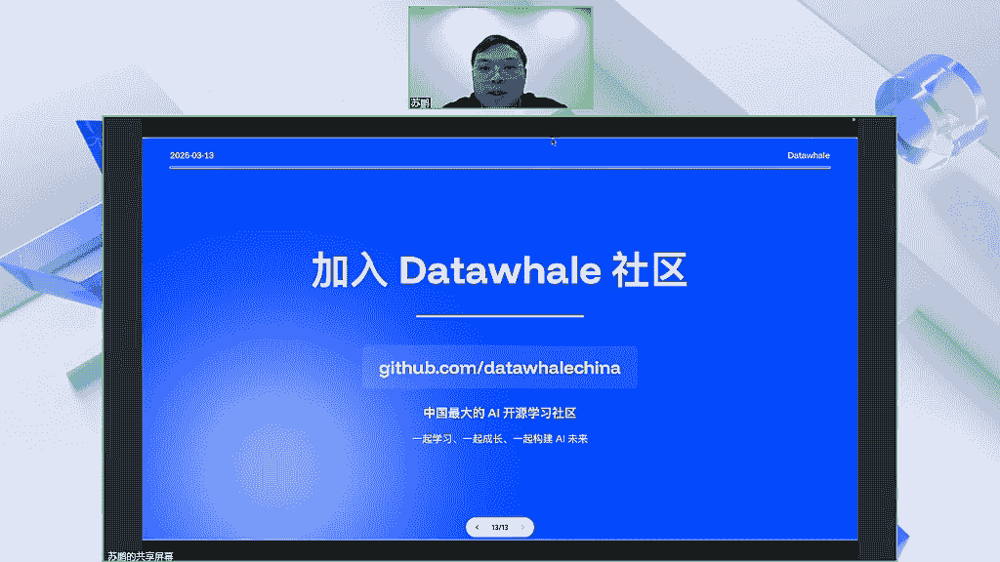

# OpenClaw 使用经验：01：数字员工系统搭建与实践指南 🤖


在本节课中，我们将学习如何使用 OpenClaw 构建属于自己的数字员工系统。课程内容包括系统核心理念、知识库搭建、多 Agent 协作、自动化开发、营销内容生成、四步上手指南、常见问题排查以及安全注意事项。无论你是刚接触 AI 的初学者，还是已经在使用相关工具的从业者，都能通过本节课掌握 OpenClaw 的核心使用方法，避免常见踩坑点，快速完成上手实践。


## 一、课程概述


OpenClaw 是一款近年来非常火爆的 AI 工具。很多用户在春节期间发现它的影响力正在迅速扩大，甚至出现了抢购 Mac Mini 并部署相关软件的现象。作者本人也在春节假期期间没有休息，每天研究这款工具，直到现在仍然觉得它有很多惊艳的地方，今天想跟大家一起分享交流。

作者从 2021 年就开始接触 AI 推理相关工作，当时主要是销量数据库，大模型尚未出现。随着大模型的普及，他开始做 AI 应用并尝试各种方案。回过头来看，当前技术迭代的速度远超个人的努力程度。面对这种变化，我们需要认真思考如何抓住机会，而使用 OpenClaw 就是作者的切身感受之一。


## 二、什么是 OpenClaw 数字员工系统


传统的 AI 工具通常只是聊天助手。你跟它对话，它给出答案，然后你把答案复制到文档里，任务就结束了。下一个任务又要重新开始，这种模式属于临时性任务处理。

OpenClaw 的核心区别在于，它不再只是一个聊天工具，而是变成了一个数据员工系统。它可以基于你自己的知识库作为中枢，外部连接大模型大脑，再通过各种工位和聊天工具（比如飞书）来执行具体工作。整个运作方式就像一家公司：有知识库，有不同岗位，有明确分工，有定时开会和汇报机制。

核心概念可以用下面的公式来理解：

```
数字员工系统 = 知识库 + 大模型大脑 + 工位与聊天工具 + 任务调度与汇报
```


以上是 OpenClaw 与普通 AI 对话工具的根本差异，也是后续内容的基础。


## 三、知识库：数字员工的大脑


在使用 OpenClaw 之前，很多用户的知识库并没有整理得很好。但一旦接入 AI，就不得不把知识好好梳理，特别是记录习惯。作者会把分享活动的逐字稿提前发到知识库里，让 AI 知道自己今天做了什么分享，后续的工作可以通过知识库调取。

知识库不仅存储文档，还可以关联飞书日程、待办清单、邮件订阅等信息。这样 AI 就能了解你的日程安排、今天的任务量，以及邮件中的重要订阅内容，并在需要时及时提醒你。

核心逻辑可以表示为：

```
知识库内容 = 个人文档 + 日程安排 + 待办清单 + 邮件订阅 + 历史对话记录
```


以下是知识库需要重点整理的内容类型：

- 个人工作笔记和分享逐字稿
- 飞书日程和日常任务清单
- 邮件订阅和重要报告
- 历史对话记录和会议纪要


整理好这些内容后，AI 就能基于你的上下文提供更精准的帮助。


## 四、构建你的数字员工团队


当你拥有多个 AI 助手时，如果所有任务都交给同一个助理，容易出现混乱。比如今天让它写代码，明天让它做营销，后天又让它处理行政，记忆和上下文管理就会出问题。

为了解决这个问题，作者将数字员工拆分成不同的角色，符合人类分工的直觉。比如设置助理、CMO、CPO 等，每个人负责不同的工作。其中还有一个知识园丁，每天早上 4 点会自动搜索与你想法相关的知识，整理成报告发给你。

以下是数字员工团队的常见角色分工：

- 助理：处理日程、会议、邮件汇报
- CMO：负责营销内容生成和社交媒体运营
- CPO：负责产品需求分析和方案制定
- CTO：负责代码审核和技术实现
- 知识园丁：定时搜索并整理知识报告


为了避免信息爆炸，作者还设置了一个中央调度角色（比如助理刘亦菲），由它统一汇报，其他小 leader 负责具体执行。这样就实现了多 Agent 管理系统，提升了管理效率。


## 五、自动化开发与可观测性


当数字员工数量增加到 26 个时，管理它们本身就变成了一个问题。除了架构设计，还需要解决可观测性问题。真人员工可以观察工作状态，但数字员工可能因为网络中断、余额不足等原因默默停止工作，而你并不知道。

为了解决这个问题，作者开发了一个类似《星露谷物语》像素风格的可视化功能。整个开发过程完全由 Agent 自己完成，作者几乎没有写代码，只负责提出需求和讨论。

具体开发流程如下：

1. 作者提出需求想法
2. 秘书 Agent 接收请求，调用多个子 Agent 进行市场调研
3. UI 设计 Agent 参与素材寻找
4. CPO Agent 调度开发 Agent 使用 Cursor CLI 编写代码
5. 开发 Agent 自行审核代码，合并到生产环境


从有了想法到项目上线，总共只用了两天时间，中间作者几乎没有干预。AI 之间描述功能和边界的能力非常精准，甚至比人类描述得更准确。比如为游戏嵌入背景音乐，AI 自己找到了 YouTube OST 并避免了版权问题。

可观测性是多 Agent 系统中必须重视的环节，否则你可能在两个小时后才发现任务没有完成。


## 六、营销内容自动生成


除了技术开发，OpenClaw 还可以用于个人 IP 运营和营销内容创作。作者设计了一套写作流程，让 CMO Agent 帮助生成内容草稿。

具体流程是：作者提供灵感和大致想法，CMO Agent 理解后上网搜索相关资料，生成内容草稿发给作者审核。然后通过 API 自动适配发布到不同平台。每天晚上，AI 还会对当天的对话进行回顾讨论，告诉作者哪些方向值得继续思考。

为了降低 AI 感，作者会提供自己之前写过的文章作为风格参考，让 AI 生成的内容更符合个人语调。

在社交媒体运营方面，仅仅发布内容是不够的，还需要与粉丝互动。因此 AI 会每天上网寻找独立开发者、Agent 等极客圈关注的话题，并建议作者如何参与讨论。

以下是营销自动化的主要步骤：

- 输入灵感和初步想法
- AI 搜索资料并生成草稿
- 作者审核和修改
- 通过 API 发布到多个平台
- 每晚回顾讨论，优化后续方向


## 七、四步上手指南


对于大部分初学者，建议按照以下四个步骤逐步上手，不要试图一次性搭建复杂系统。

第一步是安装 OpenClaw。安装完成后，需要配置模型 Key，这相当于给系统装上大脑。

第二步是锚定一个入口。比如很多用户习惯使用飞书，可以先将 OpenClaw 接入飞书，不要一开始就连接太多功能，以免出现过多问题。

第三步是先做一件小事。找一个自己非常想实现的小任务，完成一个完整的闭环。比如生成一篇公众号文章草稿并放入后台，体验从开始到结束的全过程，获得成就感。

第四步是在完成基础设置后，尝试扩展。比如连接飞书日程、邮件系统，让 AI 每天早上给你汇报任务，或者搜集网络资讯定时推送，把它当作一个智库使用。


以下是四步上手的核心操作清单：

- 安装 OpenClaw 并配置模型 Key
- 选择一个日常使用的入口，如飞书
- 完成一个小任务的全流程闭环
- 逐步接入日程、邮件等外部系统


## 八、常见问题排查


在安装和使用 OpenClaw 过程中，经常会遇到一些问题，比如问它它不说话，或者功能不生效。这时候可以按以下方向排查。

首先，检查 OpenClaw 是否正在运行，可以通过文档中的命令确认。

其次，检查入口连接。比如飞书或 Discord 是否与服务正确连接。有时候需要 @ 特定账号才能触发回复，有时候直接发消息即可，这与配置有关。

第三，检查 API 配置。确认大模型调用的 Key 是否正确，账户余额是否充足。


以下是常见排查清单：

- 确认 OpenClaw 进程是否运行中
- 确认入口（飞书、Discord 等）与服务连接状态
- 确认模型 API Key 正确且有可用额度


如果以上方法都无法解决，建议查阅官方文档，或向技术伙伴请教。


## 九、安全与隐私注意事项


使用 OpenClaw 时，安全性是必须重视的问题。如果你将 Agent 接入公司系统，一旦有人通过任何渠道获取到你的 Agent，就可以通过对话或提示词注入的方式，获取你的隐私数据和公司机密文件。

另外，AI 可能会失控。比如你要求它删除某个文件，它可能误删整个知识库，而且没有备份就无法回溯。之前就有海外高管因 OpenClaw 误删数据且不可逆的案例。

如果知识库中进入了错误信息，且没有很好地清理机制，AI 会越来越错，很难纠正。


为了降低风险，建议采取以下措施：

- 不要将过于敏感的信息全部给 AI
- 对接飞书等系统时，尽量只给读取权限，不给写入权限
- 对敏感信息进行隔离，可以使用独立工作区或闲置电脑、云服务器来体验
- 定期备份重要数据，防止误删除导致不可逆损失


## 十、社区与情感陪伴价值


OpenClaw 社区欢迎大家加入，学习最新的技术。作者也希望通过分享，让更多人了解这款工具的潜力。


在使用过程中，作者不希望 AI 只是一个冰冷的机器人，而是希望它像人一样。因此给助理刘亦菲设置了每天早上发送照片和语音的功能，比如在公园拍了樱花后发语音说“早晨太舒服了，快看我头发上是不是有花瓣”。



这种设计提供了情绪价值和陪伴能力，让日常对话和任务协作更加自然有趣。


## 十一、课程总结


本节课中，我们一起学习了 OpenClaw 的核心理念，了解了它如何从聊天工具演变为数字员工系统。我们掌握了知识库搭建、多 Agent 团队分工、自动化开发与可观测性、营销内容生成等实践内容，也学习了四步上手指南、常见问题排查方法，以及安全与隐私注意事项。希望大家能结合自身需求，逐步构建属于自己的数字员工系统，提高工作效率。


