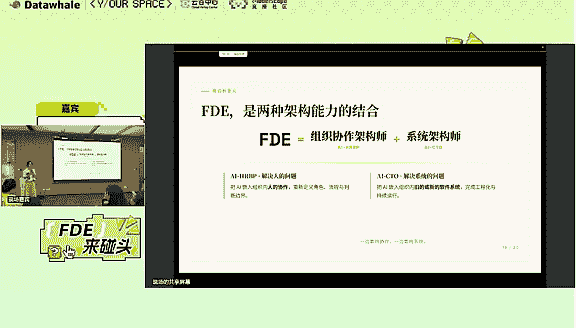

# 【Datawhale AI+X】Skill：从甲方真实组织与工作流程中生长：第一章：从实战痛点到AI技能萌芽 🚀

## 本节概述


在本节教程中，我们将学习如何从甲方真实的组织结构和工作流程中，逐步生长出可落地的AI技能。我们将结合一个食品品牌包装审核的真实案例，了解从观察需求、拆解角色、到构建AI工作流的完整过程，并探讨AI时代组织协作与技术落地的核心差异。


## 一、从乙方开发到甲方内生：技能产生的背景

半年前，我们团队从奇迹创团毕业后，便淡出了科技圈和AI圈，进入了一家新消费品牌及其上游工厂和下游渠道供应链，开始从事FDE工作。半年过去，FDE这三个字母在自媒体和培训领域突然变得非常火热，外界看起来游刃有余，但我们自身的真实感受却是连滚带爬、破波烂烂。

在过去关于规模化的经验中，人工智能往往是破破烂烂、修修补补的状态。前面分享的小伙伴也提到过AI具有鲁棒性问题，因此天然需要人工介入修补。我们踩过不少坑。

以下是两个典型的失败场景。


- 产品调研场景：AI可以计算出爆品逻辑，但无法评估品牌入驻渠道时需要支付的人情和入场费。
- 销售分析场景：当分析流程被工程化后，确实能给出比传统数据分析更好的结果。但进入新季度后，品牌方的数据口径发生了变化，我们又不得不重新修补。

经过这些挫折后，我们产生了一个关键认知：技能不应该由乙方为甲方编写，而应当从甲方组织内部自然生长出来。


## 二、观察需求：让AI成为现场的观察员

接下来我们来看一个具体案例。我们为一家食品品牌审核外包装，这是一个非常小的STEL场景，用来讲解技能是如何在组织内生长的。

首先，在寻找需求时，必须先进行观察。我们可以让AI担任这个观察员。这里的“观察”源自麦肯锡的方法论，称为现场第一信息员访谈。这种方法只能进行售后补正，无法替代你亲身置身现场的体验。

当我们接到SDEK项目，第一天到达客户公司时，就办理了飞书账号，并被拉入业务群。随后发生了两件略显尴尬的事情。


- 第一件：进入业务群后，老板欢迎我们加入大团队，群里大家开始寒暄，我们自我介绍后，群聊瞬间冷了下来，气氛十分尴尬。
- 第二件：被拉入对方会议后，同样重复了上述场景。无论大家是在争吵还是讨论正事，旁边总有一个人像幽灵一样默默蹲着。

不过，这种尴尬也有一个好处。在公司内部做FDE时，你常常会被拉到与客户公司同事一起吃饭，尤其是客户是临时公司时，大家吃得非常开心。我们开始思考：群聊和会议中的尴尬事务，应该交给AI处理；而吃饭这种事情，才应该由人来完成。

基于这个想法，我们尝试让人退出群聊和会议，把AI Agent拉进去。

## 三、AI进入协作群：捕捉不同结构的上下文


当AI进入群聊和会议后，它会听到两种完全不同的信息结构。


在会议中，大家会说“老板圆满完成了任务”；而在群聊中，大家会讨论“这个最是怎么定的？变更有没有同通过？上次这是怎么做的？到底是谁来负责。”

随后，我们让Agent进入了一个产权协作群。在这个极小的案例中，经过三个星期的拉扯，大家争议最多的环节就是包装审核。

之所以会出现拉扯，是因为产品经理提出包装设计需求，设计师根据需求完成设计，而质量法规同学随后介入，评估设计是否合规，是否符合广告法等要求。当一个决策由三个人共同做出时，他们就会来回拉扯。

我们积累了群聊中的上下文和拉扯内容，这些内容天然成为了AI的上下文。

第一版做法是：直接告诉AI，去分析群聊中发现了哪些拉扯，并帮我们沉淀出最值得做成skill的场景。低版本的Ki可以在没有人参与的情况下自行运行。

但第一版无法使用，因为信息上传是碎片化的。虽然能有一点点好的结果，但整体上信息依然碎片化。

## 四、把AI当作员工：用IPO框架拆解岗位


一开始我们作为乙方，尝试用自己所谓的工程化逻辑对内容进行优化，再拿给甲方业务同学查看。结果发现，业务同学不了解AI，无法给出AI真正能理解的反馈；而我们又不够了解业务。碎片化的信息直接丢给AI解析，也无法根本解决优化问题。

于是我们想到了另一种场景：不再把AI写成一个skill，而是把它当作一个能替代部分人工工作、完成包装审核的员工。如果这样看待AI，安排它做什么的角色应该是HRBP。

在人力资源管理中，有一个梳理岗位说明书的方法，称为IPO。当HRBP需要开设新职位时，会按照这种逻辑输出：这个职位到底需要做什么，再转换成JD，最后按照JD去招人。

IPO框架可表示为：


```text
Input → Process → Output
```


我们将岗位说明书拆分为五个部分。

- 岗位的输入是什么。
- 岗位应该如何分布和处理。
- 岗位可能自己产生什么临时任务。
- 岗位的交付是什么。
- 在执行这件事情时，遇到了什么卡点以及冗余步骤。

拿着这份访谈框架，我们与真实执行包装审核的业务同学进行了沟通。

## 五、角色拆解：四个角色与五维表格


沟通过程中我们发现，执行包装审核不止有三个角色，实际上有四个角色。


| 角色 | 职责 |
|------|------|
| 设计师 | 自查错别字、版式，但有创作者盲区，易遗漏粗心错误 |
| 产品经理 | 审核是否符合产品概念，表达产品理念 |
| 渠道方 | 执行渠道规范，如标识大小排版一致 |
| 法律法规 | 食品安全法、广告法等红线标准 |


按照刚才的IPO框架（Input-Process-Output）拆解之后，会形成一张表格。

- 横向：四个角色，即执行这四项任务的人。
- 纵向：五行，即我们刚才拆解的五个维度。

## 六、审核标准的三层级与AI的能力边界

梳理完成后，我们发现产品经理的审核逻辑依赖于个人审美；渠道专供审核的标准，每次都来源于采购和渠道销售的口头反馈，比如觉得“不太ok，回去改一下”；法律法规可以拆分为两种：一种是已成文的标准规范，另一种是零散的，比如因地区法院等突然产生的新案例。

不同的审核标准，对应不同的执行上下文。

再进行一轮拆解后，我们发现四个真人审核角色的任务可以拆解为三个层级。

```text
Level 1: 标准化审核（错别字、固定法律法规）
Level 2: 需上下文审核（零散反馈标准）
Level 3: 个人判断审核（个人审美）
```


基于这个认知，AI应当优先解决第一层级问题，然后积累上下文去解决第二层级，有机会时再尝试第三层级。但第三层级的个人审美，不应包含在AI的替代范围内。

我们基于此产出了一张表格。

## 七、V2版本的诞生：让业务同学直接参与


有了这张表格之后，我们可以直接让业务同学“爽一把”。业务同学只需要打开飞书表格或colex，对AI说：“我是某某角色，我在包装审核这个阶段，会基于我刚才梳理出来的输入进行什么工作，最终产出什么，请你帮我写。”

于是第二版出现了。不同的人可能会选择不同的表达方式，但这正是我们真正介入进行工程化、接入工作流的完美上下文。

## 八、SBE角色转变与两个生产方向

这个时候，SBE的角色才真正变成了engineer角色。从我们自身来看，一个ST（场景/任务）又会拆分为两个不同的生产方向。

第一个方向：提升单次执行的准确性。

在包装审核场景下，可以将任务拆成不同的视觉模块。该用OCR的地方用OCR，该用VLM的地方用VLM。同时，固定规则脚本（例如涉及能量计算的部分）不应依赖AI判断，而应依赖脚本判断。还可以增加置信度相关部分，将AI无法判断的内容交给人处理。

第二个方向：融入完整的工作流程。

从单点审核发展成常态化的预审。这取决于公司内部执行包装审核的工作流到底是在群聊中，还是在飞书内部，或者是其他系统中。

更进一步，可以用历史包装经验来反哺设计。例如直接告诉设计师：“基于这个风格，这样做可能效果更好。”但融入完整工作流仍是我们正在探索的方向，对于不同客户类型，其数字基建不同，因此融入工作流的架构方案也应不同。

刚才另一位老师分享过的五级表格，也是我们现在尝试和探索使用的工具。

## 九、数字化周期与AI周期：组织协作的本质差异

关于AI组织或AI时代的AI转型，到底应该是什么样子，以及与上一轮软件带来的数字化有什么差异，我们有以下思考。

在数字化周期中，所有工作流依靠系统（S）来约束。但对于成长中的组织，工作流程本身是动态变化的，才能实现成长。只依赖系统就会产生数据孤岛，无法跟上动态变化和系统冗余。工程师从上帝视角优化系统时，系统会越来越大，随后又需要在不同地方搭建新系统。

在AI周期中，我们一直在讲的一点是：不断通过人为AI充填上下文。无论是在包装设计这样的单点场景，还是在整个组织内，都能发现价值。


是否存在一种可能：真正的FD所沉淀的，是一个上下文的状态。当拥有这个上下文状态之后，智能就应该自然涌现。


当我们以AI可理解的上下文整理出包装审核的业务流程时，业务同学自己外部就已经变得可直接可用了。

## 十、FD角色的定义：解决人的问题大于解决工程问题

我们对FD的理解和定义是：本质上解决人的问题，大于解决工程问题。可以将其拆分为两个角色。



第一个角色是AIHR（AI人力资源业务伙伴）。过去H所做的是人与人协作的架构；在新时代，在人被组织之后，AI应该如何协作。需要重新定义角色、流程和判断。我们提到的I方法，仅仅是I方法论中的一个很小模块。

第二个角色是架构师。过去解决的是如何将系统交给人使用；现在则是：当AI被嵌入系统后，旧软件系统、新软件系统、旧人、新人到底应该如何协作。

这里还留下一个供大家共同探讨的问题：AIBP和CTO到底应该来自于甲方组织内部，从内部培养，还是招聘外部人员，亦或是由乙方视角来完成这件事？

## 十一、讲者自我介绍与结语

最后简单介绍一下我自己。大家可以叫我一科。在AI 1.0时代，我是视觉算法方向的产品经理。在大模型迭代周期中，因为发现不确定视觉能做什么，就自己做了两年消费品，算是自己的FD。艺人团队拿去做整个渠道的产品和用户增长，并把所在品牌做成了商家案例。同时我也尝试独立开发，在亚马逊、谷歌、小红书的黑客松上拿到一些奖项，运气好成为了一个创业练习生，用四个月时间从黑客松到了种子轮。

之后花了半年多时间，探索如何从创业练习生变成真正的OPC角色，或者真正的创业公司角色。目前我们正在为消费品品牌及其上下游工厂和渠道，搭建上下游中台，构建一套能让智能自然涌现在组织内的AI方案。

最初标题叫“没有人想跟你的……”，是因为在与周边初创团队、服务百人左右企业的SB朋友聊天时，发现大家都只有微薄的回报，很少有人真的像媒体所说年薪百万。这些内容最初发在公众号，之后开始持续更新，例如“没有人想进你的破培训”、“没有人想用你的破知识库”。这些都是我们踩过的小坑，也欢迎大家愿意与我们分享坑和翻车经历。在这个概念还未被充分定义的周期里，最先试错的人可能最接近正确。

谢谢大家。

## 本节总结

在本节教程中，我们一起学习了如何从甲方真实的组织与工作流程中生长AI技能。我们回顾了乙方开发时踩过的坑，认识到技能应从甲方内部生长；通过食品品牌包装审核案例，学习了如何让AI观察现场、进入协作群、积累上下文；掌握了用IPO框架拆解岗位、识别四个角色、建立五维表格的方法；理解了审核标准的三层级以及AI的能力边界；探讨了SBE角色的转变、两个生产方向，以及数字化周期与AI周期在组织协作上的本质差异。最后，我们分享了讲者的成长经历与对FD角色的思考。
