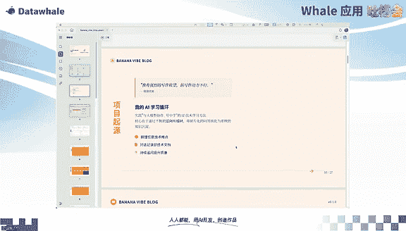

# 🤖 Datawhale AI+X：VibeBlog AI技术博客生成助手：01：从项目起源到多智能体架构

在本节课中我们将学习 VibeBlog 项目的来龙去脉，包括项目为什么要做、是如何设计的，以及实际运行效果如何。我们还会一起看看多智能体架构是如何把“一句话输入”变成“十几万字技术博客”的，最后简单聊聊未来规划和使用建议。


## 1. 项目起源

项目起源可以用一句话概括：作者本人喜欢写作，但写作能力不强，于是尝试利用大模型辅助写作，并在与 AI 的不断追问和反驳中，逐渐把对陌生技术主题的碎片化学习，转化成系统性的知识沉淀。

在实践过程中，作者发现从对话记录到正式文章之间还存在很大的鸿沟。对话记录通常只有文字，缺乏排版、图片和图表，阅读体验不佳。如果手动去找专业工具画架构图，再手动整理对话记录，流程会非常繁琐。基于这些困难，作者希望能够把自己总结出来的追问优化流程，直接集成到一个自动化写作 Agent 中，于是 VibeBlog 项目应运而生。

技术写作是一个普遍的难题，不仅是一个人会遇到，很多技术人员在写作时都会面临类似的挑战。作者总结出技术写作中普遍存在的五大痛点，分别是耗时耗力、配图困难、深度不足、面向不同技术水平的读者难以兼顾、以及运营成本高。为了降低技术门槛，让更多人能够轻松地把想法落地成技术博客，作者开发了这个基于多智能体协作的技术写作助手。

以下是 VibeBlog 项目要解决的五大痛点。

- 耗时耗力：写一篇高质量的长篇技术博客需要投入大量时间和精力。
- 配图困难：寻找合适的配图，或者自己画出美观的图表，都需要额外的工作量。
- 深度不足：对某个感兴趣的技术点，往往无法做到面面俱到，导致文章内容不够深入。
- 读者层次差异大：针对不同技术水平的读者，同一篇文章很难做到既简单易懂又专业深入。
- 运营成本高：维护技术博客的日常更新和流量，需要持续投入较高的成本。

VibeBlog 适用的场景非常多。技术博客主可以用它快速生成一篇从头到尾的 AI 博客，用于维持日常的关注度和流量；工作者可以把工作经验快速转化为技术博客；教育工作者可以用来生成教学材料；学习者也可以输入一个想要深入研究的主题，让 AI 生成一篇带有专业度的技术博客或教程。

## 2. 多智能体架构设计

上一节我们介绍了项目的起源和要解决的痛点，本节中我们来看看作者是如何设计系统架构的。

作者的设计思想比较朴素，核心思路是模拟人类专家团队协作打造一篇长篇技术博客的过程。写一本书或者写一篇很长的技术博客，本质上是一个人扮演了很多个角色，包括资料调研、内容规划、内容撰写、持续迭代、画图、编写代码、排版等等。作者把这些工作抽象成不同的独立智能体，按照职责进行划分，让每个智能体只负责自己擅长的部分。

以下是架构中主要的智能体角色及其职责。

- 调研员（Researcher）：负责搜集资料，为文章提供背景知识。
- 规划师（Planner）：负责根据技术主题设计大纲，确定包含哪些章节。
- 撰写员（Writer）：负责根据大纲和背景知识撰写正文内容。
- 问题员（Questioner）：负责检查撰写员的输出，找出模糊、错误或幻觉的地方，通过持续追问来扩展文章长度和深度。
- 代码员（Coder）：负责在文中插入代码示例，并生成匹配的代码块。
- 画师（Artist）：负责智能配图，包括架构图、流程图和封面图。
- 审核员（Reviewer）：负责对全文进行质量评分和缺陷检查，如果质量不达标，就把文章打回重写。
- 排版员（Formatter）：负责把所有内容集成，生成排版精美的最终博客。

整个架构采用流水线模式。用户输入一个技术主题，内容依次经过每个智能体的处理。如果中间某个智能体发现问题，比如问题员或审核员认为内容不足，流程就会流转回最开始的步骤，重新搜集资料或重新撰写，直到文章质量达到要求为止。

核心协作流程可以用伪代码表示。

```
输入主题
    ↓
调研员搜集背景资料
    ↓
规划师生成文章大纲
    ↓
撰写员按章节撰写正文
    ↓
问题员追问模糊点，扩展深度和长度
    ↓
代码员插入代码示例
    ↓
画师生成配图和架构图
    ↓
审核员评分检查，不达标则打回重写
    ↓
排版员集成输出最终博客
```

## 3. 核心技术难题与解决方案

上一节我们介绍了多智能体架构及各个角色的职责，本节中我们来看看作者在实现过程中遇到的五个核心技术难题，以及分别是如何解决的。

### 3.1 如何生成超长文章

最开始作者尝试过一种类似“俄罗斯套娃”的方案：先根据一句话生成大纲，再从大纲生成小论文，最后逐步扩写成大文章。但这个方案有个明显问题，就是随着文章越来越长，每次扩写都需要把上一轮的全部内容再次输入给大模型，导致输入 Token 数呈指数级增长，最终会受限于模型的输出长度限制，文章无法无限增长。此外，还容易出现前后主题发散、内容不一致的问题。

后来作者改用“分治加相上下文传递”的方案。首先设计完整的大纲，把技术主题拆解成多个章节。然后进入递归或循环撰写过程，每次只续写一个章节。为了保证连贯性，在撰写当前章节时，不仅包含当前章节的大纲，还包含上一章的摘要和下一章的预告，同时还会注入背景知识，防止内容跑偏或发散。

长文生成的核心思路可以用公式描述。


```
总文章长度 = Σ(每个章节的独立撰写长度)
连贯性保障 = 上一章摘要 + 当前章节大纲 + 下一章预告 + 背景知识注入
```

通过这种机制，只要大纲规划得足够仔细且足够长，就可以一次性输出非常长的文章，彻底解决了长文生成的问题。

### 3.2 如何生成图表和代码

大模型本身无法直接输出图片文件，但可以输出描述图表的语言。作者采用了“双轨策略”。第一条轨迹是让大模型输出 Mermaid 等图表描述语言，再用专业工具渲染成架构图或流程图。第二条轨迹是直接生成指定风格的配图，比如卡通风格的插图，由图像生成模型完成。

代码生成的思路与图表类似。在撰写大纲和正文时，撰写员会在合适的位置插入标记，比如 `<coder>` 标签。随后代码员智能体扫描全文，提取这些标记，根据上下文生成匹配的代码示例。最后在集成阶段，把标记替换成实际的代码块和输出结果。


以下是图表和代码生成的处理流程。

- 图表轨迹一：大模型输出 Mermaid 描述语言 → 专业工具渲染 → 架构图或流程图。
- 图表轨迹二：大模型输出图片风格描述 → 图像生成模型生成 → 卡通风格配图。
- 代码轨迹：撰写员插入 `<coder>` 标记 → 代码员扫描提取 → 生成代码示例 → 集成替换为最终代码块。

### 3.3 如何保证文章质量和专业度

解决了长度和图表代码问题后，还需要保证输出内容的质量。作者把自己在学习过程中总结的“追问与反驳”方法，抽象成了问题员智能体。问题员负责检查文章深度、数据和概念，找出模糊之处，并给出扩展和优化建议。如果内容不合格，就打回去重写。

除此之外，作者还专门增加了审核员智能体。审核员针对全篇所有要素进行检查，包括逻辑漏洞、内容缺失、搭配问题以及整体质量。如果文章没有达到设定的分数阈值，就会被打回到前面的生成环节，进行多轮迭代。通过这种“问题追问 + 审核把关”的机制，文章的长度被不断拉长，深度被不断加深，专业度也随之提升。

动态知识补全机制与各个智能体集成在一起。每当某个环节发现问题并被打回时，系统就会基于多轮搜索机制，补充相关上下文和背景知识，填补知识空白，再重新生成内容。

质量控制的迭代逻辑可以简化为以下代码。


```
while 文章质量分数 < 阈值:
    审核员检查全篇
    if 存在逻辑漏洞或内容缺失:
        问题员进行追问
        多轮搜索补充背景知识
        撰写员重新生成相关章节
    else:
        通过审核
输出最终博客
```

## 4. 实际效果与演示

上一节我们介绍了核心技术难题及其解决方案，本节中我们来看看系统实际能生成什么样的效果。


VibeBlog 支持短文、中文和长文三种模式。短文大概能生成三万多字，配十张图，包含五个大板块。中文模式下流程相同，能达到八万多字，配图和代码块更多。长文模式端到端输出可以达到十五万字左右，代码块和配图数量更多，内容的丰富度和专业度也更高。

作者演示过一个关于 Wem 推理引擎解析的案例。生成的文章开头有封面图，接着是目录，随后是每个章节的介绍。在撰写过程中，如果遇到适合用图表说明的概念，系统会自动加入图表信息并配以描述；如果需要代码示例，系统会集成代码并给出解释和模拟输出结果。整篇文章围绕 Wem 的核心机制展开，还包含原理解析、代码示例和输出结果。

从效果来看，无论是深度还是专业度，输出结果基本达到预期，可以直接用于技术分享或个人博客发布。

## 5. 未来规划与使用建议

上一节我们展示了实际生成效果，本节中我们来看看未来规划以及在 AI 辅助编程中值得参考的经验。

未来规划方面，作者计划支持更多的输入源，包括代码仓库、论文、B站视频等更专业的数据来源，以提升输出内容的技术专业度。还计划支持更灵活的配图设置，增加更通俗或更深度的风格选择，甚至支持面向儿童的技术科普。此外，智能导图、局部内容优化、视频和漫画等多样化展示形式，也都在考虑之列。最终目标是构建一个知识共创平台，让不同用户的问题被自动聚合，生成关联的技术博客，形成系统性的学习框架。

关于如何开始使用，目前不需要复杂部署，直接启动即可进入主界面，输入一句话后，系统会同步显示每一步的进度，让用户清楚地知道当前处于哪个阶段完成了什么事情。

在 AI 编程经验方面，作者分享了几条建议。第一，先进行规划再实现。把要做的每一件事拆解并标记，每次只实现一个小功能，功能拆分得越细越好，能更好地控制 AI 生成代码的范围。第二，不要让 AI 直接写代码，先让它输出方案文档，文档里要写清楚影响点和测试方法，作为你和 AI 交互的媒介。第三，审核代码时不需要逐行看，但要重点关注可疑和模糊的细节，找出 AI 偷懒或遗漏的地方，让它重新实现。第四，给 AI 明确的质量目标或优化方向，让它不断改进代码。

以下是 AI 编程实践的关键步骤。

1. 拆解需求：把每一步任务标记并细化，每次只实现一个功能。
2. 输出方案：让 AI 先写方案文档，明确影响点和测试方法。
3. 审核代码：重点检查可疑细节，驳回不合格部分并要求重写。
4. 设定目标：告诉 AI 想要达到的代码质量或优化方向。

## 总结



本节课中我们一起学习了 VibeBlog 项目的起源、多智能体架构设计、长文章生成、图表与代码集成、质量控制机制，以及实际效果演示和未来规划。通过模拟人类专家团队的分工协作，VibeBlog 能够把一句话技术主题转化为排版精美、图文并茂的超长技术博客，大幅降低技术写作的门槛和成本。希望这些内容能对你理解 AI 辅助技术写作有所帮助。
