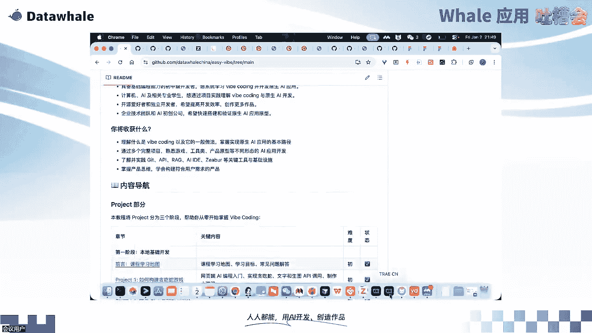

# 🎯 【Datawhale AI+X】VibeCoding时代：从零基础到生产级产品：01：课程概述与项目整体结构

在本节课中，我们将学习整个项目的整体构造，以及这套教程要实现的核心目的。本教程面向零基础学习者，目标是帮助你从零开始，最终交付一个可以正式上线、具备前后端功能并能被外界访问的 AI 原生应用。教程内容以项目制为主线，强调从 0 到 1 的完整开发链路，并同步介绍 AI 基础能力的调用方法，而不是让每个学习者都去训练大模型。

整个教程分为三个阶段，难度依次递增。第一个阶段是基础开发，侧重 AI 编程工具的使用与 AI 能力的初步认识。第二个阶段是中等难度，侧重本地开发、UI 设计、前端代码生成以及数据库与后端服务的对接。第三个阶段是高级难度，侧重现代前端设计、服务器部署、支付系统接入以及真实用户增长的验证。下面我们先来看基础阶段的具体内容。

# 🛠️ 【Datawhale AI+X】VibeCoding时代：从零基础到生产级产品：02：第一阶段：AI基础编程工具与入门实战

上一节我们介绍了课程的整体结构与三阶段学习路径。本节我们重点来看第一阶段的基础开发内容，以及这一阶段需要完成的三个小项目。


第一阶段的核心思路是，让大家学会使用 AI 基础编程工具，能够通过自然语言生成应用。目前常见的 AI 编程工具主要分为三类。第一类是网页端的集成开发平台，允许用户在浏览器里直接进行开发。第二类是本地安装的编辑器插件。第三类是面向特定垂直领域的 AI 生成平台。本教程以智谱 AI 相关工具作为替代方案进行教学，因为它是目前最简单、最容易上手的选择，适合第一节课直接上手。

除了编程工具，第一阶段还会介绍几项基础 AI 能力，包括提示词工程、图片与视频 API 的调用方式，以及理解 AI 的能力边界。之所以要学这些，是因为未来的大多数应用都会与 AI 能力深度耦合，不仅仅是做一个普通网页，还需要能够调用文本、图片等不同的 AI 能力。

以下是第一阶段的主要知识点：
- 使用 AI 编程工具通过自然语言生成网页应用
- 掌握提示词工程的基础写法
- 了解图片和视频 API 的调用流程
- 认识 AI 能力的适用边界与限制

第一阶段需要完成三个小项目，帮助学习者把理论转化为实际操作能力。

以下是三个具体项目：
1. 贪吃蛇游戏：用于熟悉 AI 工具生成简单交互应用的流程。
2. 图片类交互应用：要求复现一个名为“超级景字旗”的示例。之所以选择复现，是因为如果你能准确抄袭并运行他人的应用，就证明你已经具备一定的应用控制能力。
3. 图像编辑任务：介绍如何调用图像相关 API。初期会提供 Python 调用示例模板，让学习者直接粘贴给 AI 工具即可完成调用；后期则要求学习者自行阅读 API 文档，实现外部工具调用，并在前端接入相应模型。

```python
# 示例：调用图像编辑 API 的基础模板
import requests

response = requests.post(
    "https://api.example.com/v1/image/edit",
    headers={"Authorization": "Bearer YOUR_API_KEY"},
    json={"image_url": "...", "prompt": "..."}
)
print(response.json())
```

第一阶段学习结束后，你将掌握 AI 基础编程入门，并能够独立完成简单的图片与文本交互应用。下一节我们将进入中等难度的第二阶段，学习如何在本地进行开发，并打通从 UI 设计到前端代码的链路。

# 🎨 【Datawhale AI+X】VibeCoding时代：从零基础到生产级产品：03：第二阶段：本地开发、UI设计与前端代码生成

上一节我们完成了基础阶段的 AI 工具入门与三个小项目实战。本节我们来到中等难度的第二阶段，重点解决如何在本地环境开发，以及如何将 UI 设计转化为真实的前端代码。

在基础阶段，我们主要在网页端完成所有操作。到了中等阶段，我们希望学习者能够在本地机器上进行更多开发工作。教程中介绍的本地开发工具包括 Cursor 与 AIDE，此外还会列出其他 IDE 的参考选项。之所以优先推荐 Cursor，是因为其国内外版本在模型能力提升后表现良好，并且 Solo 模式现已免费开放，适合作为入门工具。如果学习者进一步进阶，可以根据自身需求选择其他编辑器。

第二阶段的第一个核心项目是制作“霍格沃茨画像”。之所以设计这个项目，是因为软件开发通常包含后端、AI 算法与前端三个部分，而前端部分往往被忽视。我们希望教会大家使用前端工作中真正能用的编辑工具。例如，Figma 是所有前端同学必须掌握的工具，我们还会介绍用于设计不同元素素材的工具，帮助大家生成网页静态素材。

学习者需要先画出简单的原型，然后让 AI 工具帮助复现出来。除了 Figma，我们还会讲解一些前端基础概念，比如什么是切图、什么是量尺寸，这些是传统前端工作形式。虽然现在主要使用 Figma 等现代化工具，但理解这些基础概念有助于更好地与设计稿对接。

以下是第二阶段的核心技能：
- 在本地使用 Cursor 或 AIDE 等工具进行开发
- 掌握 Figma 的基础操作与界面设计
- 将 UI 设计稿转换为前端代码
- 使用 MCP 或直接生成方式实现 UI 到代码的自动转换

很多学习者用 AI 生成的应用页面看起来不够美观，主要原因是没有使用现代化的前端组件库或 Figma 模板。Figma 社区中有大量他人制作的优秀前端模板，包括苹果设计风格的参考页面，以及各类网页模板。如果你觉得自己的页面丑，可以直接找这些高质量模板进行参考或修改。


UI 设计到前端代码的转换主要有两种方式：一种是使用 MCP 协议进行转换，另一种是直接借助 AI 生成代码。本节会逐一介绍这些方法，确保学习者能够打通从 UI 设计到前端代码的完整链路。

第二阶段的学习目标是掌握 UI 设计能力，并实现 UI 到前端代码的自动化流程。下一节我们将继续探讨第二阶段的数据库与后端服务内容。

# 🗄️ 【Datawhale AI+X】VibeCoding时代：从零基础到生产级产品：04：第二阶段进阶：数据库、后端服务与产品思维


上一节我们介绍了本地开发、UI 设计以及前端代码生成的方法。本节我们继续深入第二阶段，学习数据库与后端服务的对接，以及产品思维的基础方法。

编写后端通常需要数据库与健全的系统设计，因为我们希望应用拥有登录系统和更多的后端服务细节。从零代码编程的角度来看，推荐使用 Supabase 这种托管型后端服务。Supabase 相当于将数据库直接挂在别人的服务器上，学习者不需要自己购买服务器，降低了新手上手的技术门槛与成本。

Supabase 提供以下核心功能：
- 数据库：存储用户数据与业务信息
- 认证：支持谷歌与 GitHub 登录，实现登录注册功能
- 文件存储：提供存储桶，用于保存图片与文件，生成公共网络地址
- 边缘函数：在后端运行业务代码，避免将大模型密钥写在前端

以下是使用 Supabase 边缘函数保护大模型密钥的典型流程：
前端请求 -> 边缘函数（安全存储密钥）-> 校验用户登录状态 -> 调用大模型 API -> 返回结果

将密钥写在边缘函数中，而不是前端页面，可以确保只有登录用户才能正常调用大模型，防止密钥泄露导致费用被恶意刷完。发送邮件等涉及密钥的操作，也应通过边缘函数完成，以符合线上安全规范。

除了技术实现，第二阶段还会讲解产品思维。产品思维的核心在于如何构思一个产品，以及如何从优秀的产品中获取灵感。很多程序员的想法容易陷入纯自嗨，即只凭个人主观判断设计功能，而缺乏真实用户需求。为了提高投资回报率，教程会讲解如何想出一个好的点子，让更多人愿意使用你的应用。

一个有效的方法是拆解市面上几十个甚至上百个 AI 产品。第一步是功能拆解，判断产品是否有价值；第二步是实现拆解，观察如何复刻这个产品。如果你能掌握这种复刻能力，就有机会设计出具备上限级别用户量的产品，例如拥有几百、几千甚至几万真实付费用户的应用。

产品思维中最重要的技能之一是“从抽象到具体”。很多初学者提出的需求过于抽象，例如“我想做一个提高文档处理效率的应用”，这句话本质上是废话，无法直接落地。我们需要通过连续提问进行细化：什么是文档？是 Word 还是 PPT 或 PDF？什么叫处理？应用是手机应用还是网页应用？只有把抽象需求拆解到具体动作，才能给出可实现的开发路径。

以下是一个需求细化的示例：
抽象需求：我想做一个提高文档处理效率的应用
初步细化：我想做一个 AI 提高 PDF 文档转成文字速度和质量的网页程序
最终细化：为用户提供一个网页工具，让用户上传一份不超过 20 页的文字 PDF，在约 10 秒内得到一份段落结构清晰、标题层级保留的可编辑文本，并支持一键复制和下载为 TXT 文件


为什么要如此细化？因为 AI 需要明确的指令才能给出高质量答案，就像领导布置任务时也需要具体，不能只说“解决这个问题”。此外，细分场景能让你的应用与竞品区分开来，建立真正的竞争力。

在白板上构思应用也是教学中验证过的有效方法。我们会让学习者先在黑板上画出应用的所有界面，包括登录界面、操作界面和结果界面，然后再用 Figma 绘制，最后借助 Figma MCP 转换为代码。应用最重要的不是视觉华丽度，而是交互链路是否通顺、好用，以及是否解决了真实需求。

第二阶段学习结束后，你将掌握数据库、认证、文件存储、边缘函数等后端基础能力，并具备初步的产品思维与原型设计能力。下一节我们将进入高级阶段，学习现代前端设计与服务器部署。

# 🚀 【Datawhale AI+X】VibeCoding时代：从零基础到生产级产品：05：第三阶段：现代前端、服务器部署与商业化交付

上一节我们完成了数据库、后端服务与产品思维的学习。本节我们进入高难度的第三阶段，学习如何做出现代化的页面，并将应用部署到服务器上实现真实交付。

高级阶段的第一个重点是现代前端设计。很多学习者生成的页面看起来很丑，主要原因是没有使用现代前端组件库。实际上，只要使用了成熟的组件库，页面就不会太难看。页面好坏的判定标准可以简单理解为：是否达到了目前主流 Web 应用的基本视觉水平。这个水平并不难达到，关键在于有人把标准操作程序（SOP）写出来，学习者照着做即可。

页面做得好看还不够，还需要确保用户跳转链路正常，即页面之间的导航与交互流程完整。我们会教学如何绘制产品需求文档（PRD）、进行原形深度检查，以及如何使用 AI 生成视觉风格统一的不同页面。当你掌握了从页面到代码、从代码到同样风格的新页面，就相当于完成了一个完整应用的构建。

第三阶段的第二个重点是服务器部署。前面提到的 Supabase 在用户量增加到几百或几千人时，费用会变得很贵。对于预算有限的学习者，我们需要学习如何将后端与数据库部署到自己的服务器上。教程中介绍了使用 Zeabur 进行部署的方法，它提供网页化的免费服务器选项，支持从 GitHub 部署，也支持 Docker 部署。学习者只需掌握从 GitHub 部署这一种方式，即可将后端配置文件部署上去，获得公网可访问的链接，相当于自己的网站正式上线。

部署完成后，还可以购买域名，并接入支付系统，让真实用户付费使用。高级阶段的最终目标是：拥有健全的前后端系统、支付系统、后端服务器，并能被外界访问；同时完成前端设计与代码转换、产品原型构建、产品链路打通以及用户增长验证。

为了检验学习成果，课程会设定毕业设计或作业要求，例如必须拉取 50 到 100 个真实用户，或者通过应用赚到 100 元，否则不予及格。这种考核机制的目的，是强制每位学习者走出舒适区，真正把应用推向市场。

第三阶段学习结束后，你将能够独立交付一个具备商业化潜力的完整应用。下一节我们将介绍 AI 能力查阅手册，帮助你在开发过程中快速找到合适的 AI 功能与场景。

# 📖 【Datawhale AI+X】VibeCoding时代：从零基础到生产级产品：06：AI能力查阅手册与常见场景

上一节我们完成了高级阶段的前端设计与服务器部署内容。本节我们介绍一套辅助工具，即 AI 能力查阅手册，帮助非算法工程师快速了解 AI 能力与应用场景。

对于不熟悉算法的学习者来说，可能不清楚什么是 AI，也不知道 AI 具体包含哪些能力。AI 能力手册就是一个可以查阅的工具包，列出了文本、图像、音频、视频等多模态能力，并给出了对应的实际应用场景。

以下是常见 AI 模态与场景示例：
- 图像模态：人体识别与门禁、通用图片理解、识别属性、目标检测（安防、工业制造）、内容理解、文本识别、图像生成
- 音频模态：说话人识别、语音克隆、音频分类
- 文本模态：自然语言理解、文本生成、摘要与翻译

每个能力条目下会说明原理与可用模型。当你在开发应用时，不确定该使用哪种 AI 能力，可以在这里查阅。更简单的做法是，将手册内容复制给 AI，询问哪些内容可以用在你的程序中，以及该如何实现。AI 可以根据场景推荐可调用的云服务厂商与模型。

这份手册涵盖了 AI for Science 等多个领域，希望无论你是什么专业背景，都能从中找到有用的信息。教程并不期望每个学习者都去训练大模型，因为训练模型内容太多，学习成本太高，更适合单独开设课程。本教程的目标是让你会调用 AI API，掌握 AI 能力的边界与使用方法。

AI 能力手册学习结束后，你将具备快速查阅 AI 能力、匹配业务场景并调用外部 AI 服务的能力。下一节我们将总结从抽象到具体的产品思维方法论。

# 🧠 【Datawhale AI+X】VibeCoding时代：从零基础到生产级产品：07：从抽象到具体的产品思维方法论

上一节我们介绍了 AI 能力查阅手册与常见场景。本节我们系统梳理贯穿整个教程的产品思维方法论，特别是如何将抽象想法转化为可落地的应用。

产品思维的起点是真实需求，而不是凭空想象。很多同学一开始会说“我想做一个提高文档处理效率的应用”，这类表述过于宽泛，本质上没有提供可执行信息。要把废话变成功能，需要不断追问：文档是指什么格式？处理是指什么操作？应用是网页还是手机端？只有把每个名词都细化到不能再细化，才能得到一份 AI 可以直接执行的需求描述。

需求细化可以用如下公式理解：
可落地需求 = 抽象目标 × 细化维度（文档类型、处理动作、应用平台、输出格式、性能指标）

举个完整的细化示例：
初始想法：我想做一个提高文档处理效率的应用
细化后：为用户提供一个网页工具，让用户上传一份不超过 20 页的文字 PDF，在约 10 秒内得到一份段落结构清晰、标题层级保留的可编辑文本，并支持一键复制和下载为 TXT 文件

细化后的描述之所以更有价值，是因为它定义了明确的输入、输出、性能要求与交互方式，消除了歧义。AI 之所以有时输出乱七八糟的结果，往往是因为用户给出的指令过于抽象，AI 无法确定具体该怎么做。

除了需求细化，白板原型设计也是关键环节。在写代码之前，建议先在纸上或黑板上画出应用的所有界面，包括登录页、操作页、结果页，明确页面之间的跳转关系。这个交互链路比单纯的视觉美观更重要。现代组件库可以保证界面不会太丑，但如果交互逻辑混乱，用户依然无法使用。

竞争力的来源不在于想出一个没有人想过的点子，因为绝大多数点子千千万万人都能想到，而在于你是否能把需求拆解到具体场景，并做出真正好用的产品。一个拥有 300 个付费客户的应用，在简历上比一个只做演示的 Demo 具有更大的说服力。

产品思维方法论学习结束后，你将能够从抽象想法出发，经过需求拆解、原型设计、交互链路梳理，最终落地为可交付的应用。下一节我们将对整个教程进行总结，并说明如何参与社区贡献。

# 🏁 【Datawhale AI+X】VibeCoding时代：从零基础到生产级产品：08：课程总结与社区贡献指南

上一节我们梳理了从抽象到具体的产品思维方法论。本节我们对整个教程进行总结，并说明如何参与社区建设与项目贡献。

本教程的总体思路是从低到高，帮助每位学习者真正实现一个完整的 AI 原生应用。即使你不使用 AI，也可以按照同样的流程开发普通应用；但考虑到当前是 AI 时代，理解 AI 能力是必要的基础。教程配套了 AI 能力入门手册，供学习者在开发过程中查阅能力与场景。

教程目前的学习曲线仍存在一些波动，部分环节不够顺滑，我们正在努力将曲线打平。每一章节都配有详细的说明与示例，部分示例比官方文档更加详细。基础学习者可以直接将示例内容交给 AI，请求按示例实现功能；进阶学习者可以利用示例进行问答学习。

本教程的核心理念是目的导向。技术高手可以从零到一构建应用，技术中等水平的学习者可以修改他人模板，技术基础较弱的学习者也可以稍微改改模板即可发布应用。关键不在于你是否从零开始写代码，而在于你清楚应用的目的是什么，服务哪些人，以及你希望从中获得什么。大一学生经过一两年的学习，完全可以达到与一两年工作经验工程师相当的水平，甚至在 AI 原生时代做出更多有趣的探索。

这门课程不依赖于名校背景或天赋，关键在于行动力。无论是大专生还是大学生，只要有行动，就能掌握这些能力。聪明反被聪明误，方向不对，努力白费。因此教程中特别强调产品思维，帮助学习者避免走偏，真正解决用户痛点。

如果你对本教程感兴趣，欢迎提交 Pull Request 或提出批评意见，共建这个项目。社区中已经有一些学习者贡献了微信小程序等方向的教程，大家可以参考与借鉴。未来我们希望覆盖微信、安卓、iOS、浏览器等更多平台的模板，让每个人都能用最快的速度交付自己的应用。

总结来说，本教程三个核心特点是：项目制、从 0 到 1 的完整开发、以及 AI 能力教学。我们希望学习者完成课程后，不仅能做出 Demo，更能交付服务真实用户、可写入简历、甚至能够盈利的正式产品。



感谢大家的学习与支持。如果有任何建议或想法，欢迎随时沟通，共同把这个项目做得更好。
