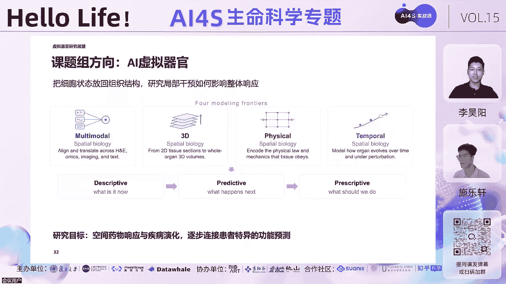

# 🔬 AI与空间生物学：01：课程概述与背景知识


在本节课中，我们将学习空间生物学的基本概念，了解病理切片与分子信息之间的关系，并初步认识如何利用人工智能从病理图像中预测空间转录组数据。本课程属于AF science生命科学专题系列的最后一场，由西湖大学李浩阳老师主讲。课程的核心目标是探讨一个问题：一张病理切片里到底藏着多少分子信息？

我们今天将会搞清四件事：
- 第一，空间生物学对细胞空间信息的认识。
- 第二，从病理切片预测分子信息，涵盖从判别模型到生成模型，再到单细胞层面的预测。
- 第三，空间生物学基础模型的介绍，探讨AI能在组织区域到单细胞层面预测多少分子信息。
- 第四，虚拟细胞的概论，并进行病理切片预测空间组学的实操与评估。

了解了课程的整体框架后，我们需要先弄清楚什么是病理切片，以及它与分子信息之间有什么联系。

---

# 🩺 AI与空间生物学：02：病理切片与分子信息

在临床中，医生常用的病理切片通常是H&E染色的图像。染色使用两种染料，一种是苏木精，另一种是伊红。苏木精染碱性结构，主要显示细胞核；伊红染酸性结构，主要显示细胞质。在这种染色下，病理医生可以快速观察组织的形态、细胞排列以及病灶区域，从而做出初步判断。这种形态学信息是肿瘤诊断的重要依据，也是许多肿瘤科室判断癌症的金标准。

然而，形态学信息并不能提供一切。根据高中生物学中的中心法则，遗传信息的流动遵循：

[ \text{DNA} \rightarrow \text{RNA} \rightarrow \text{蛋白质} ]

DNA被转录成mRNA，mRNA再被翻译成蛋白质，蛋白质最终执行生物学功能。其中，转录组对应mRNA的表达，蛋白组对应多种蛋白标志物的检测。转录和蛋白之间存在前后关联，但两者并不等价。我们主要关注的是转录组和蛋白组这两种分子信息。

为什么分子信息很重要？以乳腺癌为例，有三个关键标志物：HER2、ER和PR。如果这三个标志物都呈阴性，就称为三阴性乳腺癌，这是一种非常棘手的疾病状态。如果某个标志物呈阳性，医生可以针对性地进行靶向治疗；如果都呈阴性，可能只能采用化疗等其他手段。因此，判断分子是阴性还是阳性，是诊断和治疗决策的第一步。

以HER2为例，它是细胞表面与生长调控相关的蛋白，过表达会推动肿瘤细胞生长。临床检测HER2主要用于判断乳腺癌的阴阳状态，进而决定是否进行靶向治疗。除了乳腺癌，其他癌症也有各自的靶向标志物。了解这些分子信息对于后续治疗非常有帮助。

仅仅知道分子表达的高低（阴或阳）仍然不够，我们还需要了解这些细胞在肿瘤微环境中是如何组织排列的。

---

# 🌡️ AI与空间生物学：03：空间组织与热肿瘤冷肿瘤

在肿瘤微环境中，细胞的排列方式直接影响免疫状态。我们可以将肿瘤分为热肿瘤和冷肿瘤两类。热肿瘤意味着免疫细胞积极浸润到肿瘤区域，相当于在疯狂攻击肿瘤，免疫系统正在发挥作用。冷肿瘤则相反，免疫细胞虽然存在于肿瘤微环境中，却被阻挡在肿瘤区域之外，无法进入内部进行有效攻击，因此免疫反应作用很小。

这说明我们不仅需要知道细胞的数量和比例，还需要知道它们在空间微环境中的排列方式。了解这种排列，才能判断肿瘤是热肿瘤还是冷肿瘤，从而更好地理解肿瘤的免疫状态。在空间生物学中，有一个重要假设：除了细胞数量之外，位置和邻域信息也是解释肿瘤免疫状态的关键因素。

有了这些背景，我们自然会问，如何才能同时获得细胞的分子信息和空间位置信息？这就引出了空间组学技术。

---

# 🧬 AI与空间生物学：04：空间组学技术概述

空间组学的发展经历了几个阶段。20年前的Bulk RNA-seq可以测定一块组织的混合分子信号，相当于知道了一块组织中很多细胞的平均状态，但无法区分每个单个细胞的具体信号。2010年左右，单细胞测序出现，它将组织解离成单个细胞，如同拆开乐高积木，分别研究每个细胞的基因表达水平。但单细胞测序仍然丢失了细胞在组织中的位置和邻居信息。

2016年开始，第一代空间转录组测序技术问世。与此同时，也出现了一些基于成像的方法。无论是基于测序还是基于成像，我们都将其统称为空间转录组，即空间组学。使用这些技术，我们可以知道每个细胞或每个斑点的基因表达水平，以及它在空间中的位置，即X,Y坐标。

空间组学主要包含以下两类技术：
- 测序型，也称为Spot-based或Sequencing-based。其原理可以简单理解为：在一片薄薄的组织切片下方接上几千个紧密排列的小碗，每个碗有已知的空间坐标。组织裂解后，mRNA掉落到这些碗中，随后对每个碗内的mRNA进行测序。这样我们就知道了每个碗的位置和其中所有基因的表达量。早期的分辨率约为100微米，现在Visium HD等技术已达到200纳米，小于平均细胞大小（约5到10微米）。
- 成像型，也称为Image-based或原位测序。其原理是不需要让mRNA掉落，而是直接对组织切片进行多轮染色，想检测哪个基因就染哪个标志物，将其显示为特定颜色。通过荧光强度，我们可以知道mRNA在原位的位置和相对表达量。例如MERFISH、seqFISH和CosMx等技术都属于此类。成像型的优势是可以获得细胞级别的表达信息，因为可以利用染细胞核或细胞边界的标志物来分割单个细胞，从而得到该细胞内所有基因的表达。

两种方案各有利弊。测序型相对便宜，基因面板大（可测约18000个基因），但无法获得真正的单细胞级别信息。成像型无偏差、可获得细胞级别表达，但早期基因面板小（约300多个基因），且成本高昂。现在10x Genomics等公司的技术已发展到可测更多基因，但价格依然很高。

空间组学虽然强大，但成本高昂，而病理HE切片便宜且存量巨大。这是否可以用AI从HE中预测出空间组学的分子信息？

---

# 🎯 AI与空间生物学：05：从HE图像预测空间转录组的动机与局限

HE图像是长期以来的诊断金标准，保存量大，染色便宜。而空间转录组是新兴技术，成本非常高，一次检测可能需要十几万人民币，且耗时耗力，在临床中难以大规模普及。因此，我们希望用低成本的HE图像，通过AI模型去“撬动”高成本的分子信息，预测每个区域或每个细胞的基因表达或蛋白表达。

这个预测任务有两个重要作用。第一，形态信息看不到的分子信号可以被放大或揭示；第二，我们不仅想知道分子信号的高低，还想知道它在空间中的组织情况，哪些区域高表达、哪些区域低表达，这些分子与哪些细胞类型邻近。这些信息可以用于研究肿瘤内部的分子差异，这是单纯形态学信息无法看到的。此外，预测出的分子信息可以与病理切片结合，用于患者生存预测或免疫治疗反应预测，效果往往优于单纯使用形态信息。

然而，这种预测也有重要局限。这种预测任务主要面临以下三个局限：
- 生物学多样性，即使病理形态非常相似的组织，其分子状态也可能完全不同。
- 测量与配对误差，冷冻切片、组织制备、RNA测序和细胞分割等环节都会引入空间上的误差，导致病理细胞位置与RNA测定位置不能完全重合。
- 分布外问题，新样本可能不在训练数据的分布范围内，精准肿瘤学和泛癌泛化都非常困难。

此外，还有一个最根本的信息论问题。无论我们如何建模，本质上只是一个函数，它通过之前的配对数据进行归纳，并不提供额外的信息。给定一个新的HE图像，模型预测出的分子信息都是基于形态信息转换或总结出来的，并不能提供真正的新信息。深度学习可以放大或精准捕捉肉眼不可见的信号，但我们要心中有数：有些基因与形态高度相关，预测效果可能达到七八成；有些基因与形态关联低，预测效果可能只有一两成；没有哪个基因能完全通过形态达到百分之百预测。

了解了动机和局限后，我们来看具体的建模方法是如何演进的。

---

# 🧠 AI与空间生物学：06：判别式与生成式建模方法

最早的建模方法是判别式预测。给定一张HE图像，将其切分成连续的小块（patch），通常为24×24像素，因为GPU无法一次处理过大的图像。将这些小块输入编码器，可以是基础模型，然后进行回归。最简单的方法是对每个基因分别进行回归，预测基因A的表达量和基因B的表达量。

后来逐渐演变，人们意识到空间信息很重要，一个斑点周围的邻域信息对其有帮助；同时，基因之间也存在关联，不应只单独看基因B或基因C，而应考虑基因ABC之间的关系。统筹考虑这些因素后，判别式方法的效果越来越好。

但是，判别式方法使用均方误差（MSE）损失，容易将不同状态平均化。即使两张HE图像形态非常相似，其分子表达可能截然不同，MSE回归会倾向于将它们平均化，抹平了差异化的表达。这是MSE回归的一个根本性问题：它没有考虑相似图像可能对应不同分子表达的情况。

基于这一问题，研究者开始探索生成式模型。最早的生成模型使用扩散模型（Diffusion），通过逐步拟合噪声来生成分子信息。训练时拟合噪声，预测时反过来进行。虽然耗时，但作为生成式模型，它能很好表示同一样本下不同真实分子表达的变化。随后出现了ST Flow，使用流匹配（Flow Matching）而非扩散方式，结合局部空间注意力来建模。

无论是Diffusion还是ST Flow，由于初始噪声是随机的，每次生成只是从分布中采样一次。我们可以通过多次生成获得多个采样，从而大致知道在同样的HE图像下，分子信息的分布范围。

早期方法多在斑点级别（每个斑点包含10到20个细胞）进行预测，如果我们想做更精细的单细胞级别预测，就需要引入基础模型。

---

# 🏗️ AI与空间生物学：07：基础模型与多模态对齐

为了提高泛化性，基础模型（大模型）变得至关重要。在病理切片上已有多个成熟的大模型，例如UNI、H-optimus-0、CONCH等。有些是无监督在数百万甚至数千万张病理图像上训练的；有些则通过文本辅助建立更好的表征。它们的本质都是给定一张HE图像，通过基础模型获得高维表征。

除了纯病理图像模型，还有一些模型将HE与空间转录组进行对齐。例如，OncoGene通过对比学习的方式，将每个斑点的基因表达量按从高到低排序，形成“基因名字句子”，然后与图像特征进行对比学习，让正向配对的图像和空间表达在特征空间上更近，负向配对更远。正向配对是指我们知道HE和空间转录组在物理空间上的对应关系，每个斑点的表达与其对应的图像块位置最近。

PathChat等模型则进一步将病理图像与单细胞级别的空间转录组进行对齐，是首个在单细胞级别进行病理图像与空间转录组对齐的基础模型。我们课题组在24年也收集了40多张人类癌症切片，约2000万个细胞-图像配对，横跨15种肿瘤类型，使用CLIP方式训练，但引入了邻域约束：周围细胞不被完全视为负样本，而是带有约束的正样本，以平滑单细胞级别的敏感信息，使训练更稳定。

有了这些模型，我们可以进行哪些下游任务？

---

# 💊 AI与空间生物学：08：下游任务：虚拟染色与生存预测

基于HE与空间转录组的对齐，最直接的下游任务是单细胞级别的表达预测。由于病理大模型注入了分子信息，我们可以从HE图像生成配对的免疫组化（IHC）补片，这被称为虚拟染色。例如，我们只想看HER2这一个靶点，生成其IHC补片后，进行细胞分割和DAB去卷积，计算每个补片的阳性得分（H score），分为0、1、2、3四个类别，以判定阳性程度。

另一个重要任务是生存预测。单纯使用HE图像进行生存预测时，模型不知道分子信息。我们可以通过病理大模型预测分子信息，将图像编码器和组学编码器的输出整合在一起，同时预测生存反应或复发风险。加入分子信息后，效果通常优于单纯使用病理大模型，因为我们引入了更重要的模态，并从冗余的HE信息中抽丝剥茧、放大了关键信号。

到目前为止，我们讨论的多是静态描述。如果我们想对静态信息进行干预，观察扰动前后的变化，就需要进入虚拟细胞和虚拟器官的领域。

---

# 🤖 AI与空间生物学：09：从静态描述到虚拟细胞与虚拟器官

大多数生物学分析和论文都是静态的，即在某一时刻固定住信息。但如果我们想对静态信息进行干预，例如给组织加药或敲除基因，观察其随时间的变化，传统的细胞或类器官实验成本高且不够稳定。此时，可以用AI以循环的方式进行预测，大幅降低人力、时间和金钱成本，实现大规模的药物筛选或基因敲除反应测定。

这就是虚拟细胞（Virtual Cell）要做的事情：给定扰动前的数据和刺激（化合物、用药或基因敲除），预测细胞之后会如何变化。虚拟细胞的价值在于，我们不需要在真实患者身上进行昂贵且痛苦的试错，而是在计算层面先进行扰动，告知用药后效果可能好或坏。

然而，单纯研究单细胞并不是一个封闭系统，因为每个细胞都受邻域影响。器官层面比细胞层面更稳定，且许多临床表现是在器官层面才涌现的。因此，我们课题组研究的是虚拟器官，而非仅仅是虚拟细胞。原因包括：临床结局多在器官层面定义；扰动需要在相对封闭的领域内进行；单细胞测序本身会引入额外刺激，无法反映真实原位状态。

我们课题组围绕空间生物学开展以下四个方向：
- 多模态空间生物学，整合形态、组学、医学影像、临床文本等信息。
- 3D空间生物学，将2D切片重建为3D器官，减少假阴性。
- 物理空间生物学，考虑力学作为无形的手推动细胞运动、聚集或硬度变化，并力求从少量干净数据中总结生物物理定律。
- 时空空间生物学，给定多个时间点的切片，进行排列、内插或外推，探究驱动变化的基因或区域。

最终目标是构建从描述性（Descriptive）到预测性（Predictive）再到指导性（Prescriptive）的信息观，帮助临床医生做出更好的决策，像Agent一样进行规划和执行。

理论介绍完毕后，我们进入具体的代码实操环节。

---

# 💻 AI与空间生物学：10：实操教程：HE到空间表达的预测

实操中，我们使用HER2空间转录组的一个子集，包含三个患者的切片，两个作为训练集，一个作为测试集。问题被简化为预测6个基因，使用传统的单细胞方式对基因进行log规范化。数据量不大，每个切片约几百个斑点（因为是100微米分辨率的早期空间转录组方法），训练集约600个斑点，测试集176个斑点。

每个斑点对应的图像块为112×112像素。最开始不使用深度模型，而是提取简单特征：每张图像是RGB三通道，提取每个通道的均值、标准差和5个分位数，共21个特征值（3通道×7个统计量）。使用线性回归进行建模，评估指标为皮尔逊相关系数（PCC），即预测表达值与真实表达值的PCC。

[ \text{PCC} = \frac{\sum (x_i - \bar{x})(y_i - \bar{y})}{\sqrt{\sum (x_i - \bar{x})^2 \sum (y_i - \bar{y})^2}} ]

结果显示，有些基因预测效果不错，有些甚至呈负相关。这与数据量少、基因数少、特征提取简单有关。在如此简单的场景下，部分基因仍能达到0.3的相关性，说明其与形态高度相关；效果差的可能是数据量不足，或本身与形态关联低。

我们还对比了使用原始RGB三个特征与使用21个统计量特征的效果。出人意料地，3个特征有时比21个特征效果更好。这是因为21个特征都是由RGB计算出来的，存在高度自相关（特征冗余）。在机器学习中，特征冗余且数据量不足时容易过拟合，导致效果更差。

接下来使用HistoToGene方法，输入32×32像素的图像块，经过两层编码器得到64维表征，预测6个基因，训练40个epoch，使用三个随机种子评估稳定性。皮尔逊相关系数稳定在0.4到0.5之间，40个epoch后损失下降趋稳。但在第三个切片上的泛化效果并不理想。

随后尝试基于扩散的方法（Diffusion-based），同样使用64维表征，每个位置生成16次，观察分布。通过多次生成获得分布，发现生成次数越多，均方误差越小，效果越稳定。取最小值（min）比单次生成（first）更稳定，更贴合真实情况。我们还统计了不同斑点的标准差，标准差高的区域表示分子表达范围大，形态敏感性强，可能是需要关注的肿瘤区域。

对比三种方法（线性回归、HistoToGene、扩散模型）时，在数据量和参数量较少的情况下，简单的线性回归效果有时更好；HistoToGene需要更大量的特征嵌入和高维表征才能展现优势；扩散模型作为生成式模型，方差可能较大，不够稳定。

最后介绍ST Path，它探讨在固定区域训练时，能多大程度泛化到切片的其他区域。结果显示，用于训练的上下文斑点越多，泛化到整个切片斑点层面的效果越好。皮尔逊相关系数随已知上下文斑点数量增加而提高，均方误差逐渐减少。这说明了解的邻域信息越丰富，泛化效果越稳定。

此外，还使用了OncoGene等模型的权重，将每个斑点的基因表达按从高到低排序，形成“基因句子”，进行编码与对齐。给定新的查询图像，在特征空间中检索最接近的参考图像块，余弦相似度约为0.4左右，检索成功。

以下是特征提取的代码示例：

```python
import numpy as np
from skimage import io

def extract_features(image_path):
    img = io.imread(image_path)  # shape: (H, W, 3)
    features = []
    for c in range(3):
        channel = img[:, :, c]
        mean = np.mean(channel)
        std = np.std(channel)
        quantiles = np.quantile(channel, [0.1, 0.25, 0.5, 0.75, 0.9])
        features.extend([mean, std] + list(quantiles))
    return np.array(features)  # 21维特征
```

实操结束后，我们来看直播中的问答与总结。

---

# ❓ AI与空间生物学：11：问答与总结

关于如何判断预测的空间组学结果是否准确，如果有真实配对数据，直接计算真实值与预测值的皮尔逊相关系数即可。如果没有配对数据，可以将预测结果泛化为细胞类型，通过HE图像结合病理医生的形态判断进行大概评估。

关于HE切片除了细胞形态外还能看到什么分子信息，肉眼直接看到的仍是形态信息。但放大到组织区域级别，可以看到肿瘤病灶、免疫区域、血管等结构。虽然肉眼看不到分子信息，但近五年的研究表明，病理切片包含隐晦的分子信息，需要通过深度学习进行深度挖掘和信号放大。部分基因与形态无关，例如PD-L1，通过形态很难预测，相关系数可能只有0.1左右。

关于从空间组学走向虚拟细胞需要解决的问题，首先需要摒弃完全依赖单细胞测序的建模方式，因为单细胞测序无法获取空间位置和邻域影响。目前有两种主要方案：一是同时取对照组和用药组的同一位置切片进行测序，但这是破坏性测量，无法真正配对；二是在一片组织上随机打码，让不同细胞敲除不同基因，但这也不是完全的控制变量。因此，生物技术必须先发展，提供更干净、数量更大的空间数据，AI才能在此基础上建模并应用于虚拟细胞。



对于医学生转向AI方向的建议，建议采用“边做边学”的方式。首先学习概率论、线性代数、微积分等基础，再了解机器学习和深度学习的历史流程，理解扩散模型、大语言模型等为何有效。最重要的是先定义一个足够有前景和趣味性的课题，然后根据数据和问题构建模型，再回头学习相关AI方案。不要过度依赖AI替代思考，AI可以处理劳动密集型工作，但不能替代你问“为什么”的第一性原理思考。编程可以借助AI，但必须理解代码每一步是如何来的，并保持代码整洁，避免冗余导致边界条件问题和运行缓慢。

本节课中，我们一起学习了空间生物学的基本概念，病理HE切片与分子信息的关系，热肿瘤与冷肿瘤的空间组织，空间组学的两大技术路线，从HE图像预测空间转录组的动机与局限，判别式与生成式建模方法，基础模型与多模态对齐，虚拟染色与生存预测等下游任务，虚拟细胞与虚拟器官的愿景，以及HE到空间表达预测的实操流程和常见问答。希望这些内容能帮助你理解如何利用AI从低成本病理图像中挖掘高价值分子信息，为精准肿瘤学和临床决策提供支持。

