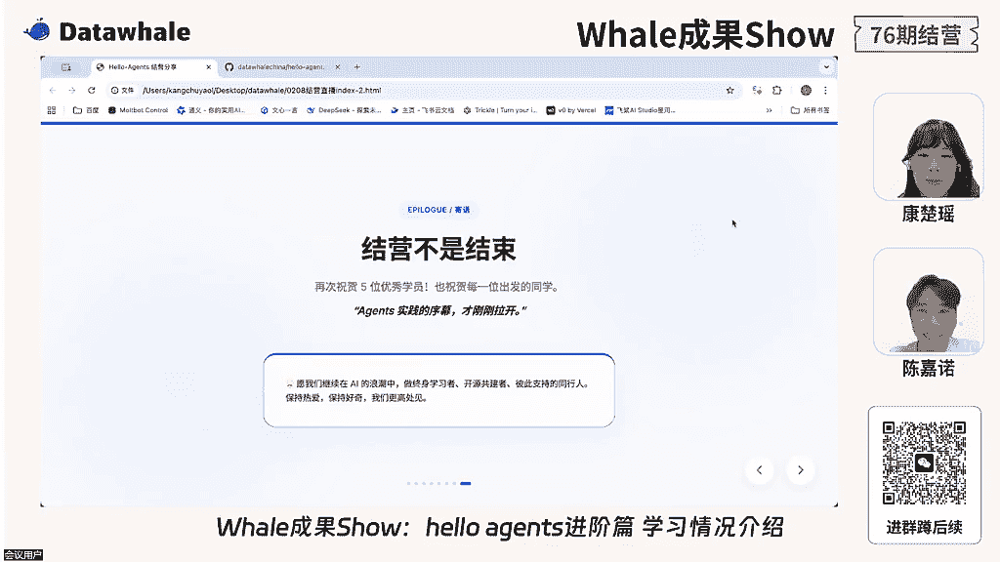

🤖 Datawhale AI+X: 第1章：不需要准备好才开始——开始本身就是准备

本节课中我们将学习Datawhale Hello Agent进阶篇课程的整体情况，以及助教在组队学习过程中的观察和心得分享。内容涵盖课程介绍、学习数据统计、优秀学员表现、助教个人心路历程、两种常见的学习者类型、具体的学习方法，以及对未来学习的展望。

## 👋 自我介绍与课程定位

上一节我们概述了本节课的学习内容，本节中我们先从助教自我介绍开始。

先自我介绍一下，我叫楚瑶。我这一次是在Datawhale第76期的组队学习里面，Hello Agent进阶篇担任助教。这也是我第一次以助教身份参与组队学习。除了分享课程学习情况，我也想简单分享一下自己的心路历程，以及在这个过程中的一些简单洞察。

## 📚 课程内容与学习路径

上一节我们完成了自我介绍，本节中我们来看看这门课程具体包含哪些内容。

Hello Agent是一套比较系统的智能体学习课程。我们希望通过这一门课程帮助开发者从理解模型基础，到智能体基础，最终能够亲手去做整个复杂的智能体系统。

以下是课程的主要模块：

- 课程共包含16个章节。
- 从经典智能体范式的构建，到LangGraph等主流框架的应用。
- 后续涉及核心组件，包括记忆机制、RAG、智能体通信等。
- 教程过程中配置可运行的Demo，供大家亲身体验。
- 最后提供可用于实训的案例，例如旅行助手Deep Research Agent和赛博小镇，让大家真正运行一个成熟的Agent。
- 学员可以基于这些案例的变体，或自己的想法，最终提交结课作业。

整体课程内容即包含这些部分。核心学习路径可以用公式表示：

智能体学习路径 = 经典范式构建 → 主流框架应用 → 核心组件掌握 → Demo实战体验 → 结课作业提交

## 🔗 课程阶段与开源资源

上一节我们梳理了课程章节，本节中我们来看看课程分期和相关资源获取方式。

这一期课程分为入门篇和进阶篇。进阶篇更强调具体的代码运行以及实践。相关课程链接已经放在底部。

以下是资源获取途径：

- 如果在本期报名时没有赶上，也可以在指定网址找到本期课程课件。
- 课件已经开源在GitHub上面。
- 欢迎大家多多学习，并给我们提出更多建议。

## 📊 学习情况统计

上一节我们说明了资源获取方式，本节中我们来看看大家的实际学习数据。

这一期报名进阶篇的同学一共有167位。最终有提交打卡的是45位同学，其中有7位同学完成了所有任务的打卡。

之所以能在这些夹缝之中抽出时间完成打卡的同学都很了不起，因为最近这段时间无论是打工人还是在读学生，都面临年终总结或期末考试，学习任务和工作任务都很重。我觉得这些同学应该给自己一些掌声。

## 🏆 优秀学员介绍

上一节我们看过了打卡数据，本节中我们来看看哪些同学表现突出。

在完成所有任务打卡的7位同学里面，我们评选出了5位优秀学员。

以下是优秀学员的共同特点：

- 能够在社区里面积极活跃。
- 为课程提交了一些PR。
- 带领群里其他同学分享更好的学习经验。

以下是几位具体的优秀学员：

- 加诺同学：评选时才知道他已经是Datawhale成员，也是本次分享的主持人，正好被评为优秀学员。这再次体会到Datawhale是一个很神奇的组织，会在不同群里发现认识的人。
- 维特同学：下一位主题分享的另一位嘉宾，他比较社恐，但仍愿意站出来跟大家一起做分享，非常了不起。

感谢这些优秀学员以同行人的角度，在整个学习过程中带领其他同学一起完成本次学习。

## 🗺️ 助教个人心路历程

上一节我们介绍了优秀学员，本节中我们来看看助教自己的学习经历。

简单分享一下整个心路历程。我是一个比较内向的人，去年参加过两次Datawhale组队学习，但那两次都没有具体参与到组队动作里面，属于在群里暗中观察别人学了什么，然后自己默默打卡的角色。我是一个在群里面潜水比较安静、独自打卡的人。

因为我是上班族，属于在职人员，所以非常理解日常工作上面会有很多琐碎事情，并且有很多变数，会影响原本计划完成学习和打卡。因此，刚才提到的7位同学能够在十几天学习里面坚持把7个任务都完成打卡，确实很了不起。

我之所以在这一期参加助教，也是想推自己，能够坚持把打卡和学习任务做下来。前两期学习过程中，我只完成过一次从头到尾的打卡坚持。后面一方面是自己有懒惰心态，第二个是工作时间安排比较紧张，所以没有完成整个打卡任务。基于这个出发点，我想以助教角色参与组队学习。但很遗憾，这次我也断更了，没有完整打完卡。

做了一次助教之后，我发现能观察到很多同样作为学习者的不同心态，这些心态会影响接下来的学习动作或行为，也给自己一些比较大的感触。

## 👥 第一种学习者类型

上一节我们分享了助教的个人经历，本节中我们来看看观察到的第一种学习者。

以下是第一种常见的学习者类型：

- 觉得自己可能没有太多基础，不敢加入别人团队，但实际上已经完成了报名。
- 在群里看到大家特别活跃，会产生心理负担，说自己原来不是学这个技术的专业，也没有AI相关背景，担心跟不上学习节奏，会不会给大家拖后腿。
- 虽然表达了这些顾虑并获得鼓励，但我认为没有太多相关基础也没有关系。学习是一件自己想清楚要学什么、学习目的是什么、能从哪些方面得到成长的事情，下定决心就可以完成。跟背景相关的因素我觉得无关紧要。
- 最终这位同学没有真正参与到打卡学习任务里面，无论组队还是个人学习都没有参与，我觉得是一个比较遗憾的事情。

## 🌟 第二种学习者类型

上一节我们分析了第一种学习者，本节中我们来看看第二种截然不同的类型。

以下是第二种学习者的典型表现：

- 特同学自称有点社恐，但在小窗聊天知道这一点之前，他在群里面其实特别活跃。
- 有一种老大哥非常老道的学习者形象，带领大家一起尝试，把踩过的坑分享给大家，让大家避坑，扮演引路人的角色。
- 即使是社恐，也可以克服一些心理压力，给大家做干货分享。

在这个过程中，阻碍我们的往往不是知识的难度，也不是学AI有多难、掌握新技能有多难，而是我们愿不愿意跨越内心的那道门槛。我想迈出这一步，我先试一下。这是我作为助教角色里面收获最大的一个洞察。

核心洞察可以用公式表示：

学习行动 = 是否跨越内心门槛 × 是否愿意迈出第一步

## 🛠️ 学习方法与核心建议

上一节我们总结了两种学习者，本节中我们来看看助教总结的学习方法。

基于这个洞察，我回顾了一下过去自己的学习历程。说实话，我自己也不是科班出身，也不是学技术的，不是学AI的，是半文半理的学科背景，也是从零开始学。

在这个过程中，我觉得更重要的是内心的门槛，以及有没有一个比较好、适合自己的学习方法。

以下是具体的学习建议：

- 目标与信念感要足够强。知道自己现在要学的是什么，对自己有什么帮助。即使学得慢一点，至少迈出了这一步。
- 善用AI工具。现在AI时代有很多工具，能够实现技术平权，不是说某些技术或知识只能掌握在少数人脑子里。如果善用AI工具，过去看来非常异想天开的想法，其实也有可能被我们落地、实现。遇到不会的事情，可以问AI，问卡点，也可以让AI出主意帮我们一起解决。
- 善用社区力量。像Datawhale组织这种组队学习活动，就是把志同道合的人凝聚到一起。可能有基础好的，也可能有基础薄弱的，你可以在这些社区里面主动、勇敢地去发问。只要能够正确提问，哪怕只问一句这个知识点怎么理解，讲出来你的一些观点，大家都会很乐意给你解答。或者发起一些交流，发起互学互助的小活动。

有效学习可以用公式表示：

有效学习 = 强烈目标感 + 善用AI工具 + 积极利用社区

总的来说，在AI时代我们去学习，不需要准备好才开始。我们随时都可以开始，因为开始本身也是一种准备。

## 🔮 总结与未来展望

上一节我们介绍了学习方法，本节中我们来总结全文并展望未来。

最后呢，在这一期学习虽然是一个节点，但是未来我们也会有很多期新的组队学习任务。希望大家能够继续坚持在学习路上的热爱，保持好奇心，坚持学习，保持热爱，保持好奇。

我的分享就到这里，谢谢大家。

## 🤝 额外介绍与结尾

上一节我们总结了课程心得，最后本节中我们来介绍另一位同学并结束分享。

来，我在这里额外介绍一下素瑶吧。最开始她是报名Hello Agent进阶篇的学习者，当时是这个学习的运营助教。后面在一个学习中，她发现有教程有bug跑不通，就直接提交PR，就这样被评为了优秀学习者。后面她加我微信的时候，才发现为什么之前看你这么眼熟。后面一聊才发现我们之前真的线下见过，就这么神奇。对，就是特别的神奇。因为我在评选的时候，压根就没有发现，你也在助教总群里面，我以为你只是一个普通的学员。

本节课中我们一起学习了Datawhale Hello Agent课程概况、学习数据、优秀学员、两种学习者类型以及学习方法，希望大家都能开始行动。
