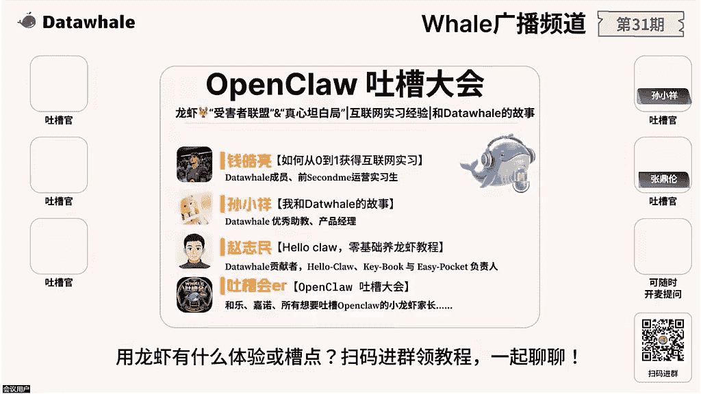

# Datawhale 助教成长故事：01：我与 Datawhale 的相识 🎓

本节课中我们将学习孙小祥老师如何从一名初学者，逐步成长为 Datawhale 社群的优秀助教，以及他对 AI 学习社群的真实感受。适合想要了解社群学习模式的初学者阅读。

## 初次接触 GPT 与 Datawhale

上一节我们做了课程概述，本节中我们来看看作者是如何接触 Datawhale 的。

2023 年的一个晚上，作者注意到 ChatGPT 出现后，行业开始产生变化。作为一名中年从业者，他之前写过 C 语言和 Java 代码，现在从事产品功能工作。他觉得 GPT 会对行业产生影响，于是决定学习相关知识。虽然不记得具体原因，但他连接到了 Datawhale 社群。当时学习的第一门课程是李木老师的《动手学深度学习》。

以下是他初次学习时的几个关键感受：
- 课堂氛围与以往不同，虽然一开始比较懵懂。
- 李木老师在线分享，群里助教热情答疑。
- 社群通过开营、任务打卡、组内分享等方式串联知识点。
- 群里有很多和他一样想学但不知道怎么学的小伙伴，问题初级但得到热情回答。

## 潜水员与社群温度

上一节我们介绍了初次接触课程的经历，本节中我们来看看作者在社群中的早期状态。

作者当时是标准的潜水员，默默在群里看大家回复，然后自己解决问题。课程结束时，大家开心庆祝结业。在他看来，学习过程只是一个逗号，以为之后会有拉群或推销课程，但实际上社群纯粹是为了学习。这一刻他特别喜欢这个群体和 Datawhale 的理念。

## 从偶尔冒泡到主动参与

上一节我们看到了作者作为潜水员的经历，本节中我们来看看他是如何逐步融入团队的。

后来他陆续参加了更多课程，从偶尔冒泡，到主动发言，再到踊跃做小组讨论，甚至一步步成为队长，感受到融入团体。虽然参加了很多课程，有时无法协调时间，但非常感谢马老师和浩源老师的帮助。所学内容在工作中提供了深刻帮助。课程不能解决工作中 100% 的问题，但它是一个开头，让人有能力继续学习去解决后续问题。

社群成长可以用下面的公式简单表达：
社群成长 = 持续参与 + 主动发言 + 小组讨论 + 团队角色

以下是他参与社群的角色演变过程：
```text
潜水员（默默观看） -> 冒泡者（偶尔发言） -> 小组讨论者（主动参与） -> 队长（组织团队） -> 助教（帮助他人）
```

## 成为运营助教与社群精神

上一节我们介绍了角色从学习者到团队成员的转变，本节中我们来看看他如何成为助教并理解社群精神。

2025 年，他申请成为 Hello Agents 的运营助教。虽然个人能力有限，但他想和社群里闪闪发光的小伙伴在一起，为后面想进步的小伙伴举灯。他从最初什么都不懂的小白，成长到能帮助大家解决问题，并主动组织讨论。每个人成长感受不同，但 Datawhale 给他的感觉是：每个人用自己的方式贡献团队，包括写教程、改作业、答疑、整理资料。就像玉神所说，没有人是完美专家，大家都是学习者，每个人都愿意分享，这让社群显得特别不同。

## 如何加入社群与参与贡献


上一节我们探讨了助教身份和社群精神，本节中我们来看看如何加入这些社群群聊。

今天是第一次跟大家见面，作者认为自己的技术和文笔一般，但想用自己的感受和经历，帮助还在观望的小伙伴尽快加入，也希望未来能帮助更多人。

以下是不同加入方式对应的群聊用途：
- 想学习但不清楚学什么：可以进入第一个群。
- 想探究能做哪些贡献、参加哪些活动：可以进入相关群。
- 想报名成为助教：可以加入助教群。
- 成为领学员或推荐课程内容，或邀请其他领学员：可以加入领学员群。
- 关于 AI 同识的学习交流：也有相关群聊。

所有二维码可以通过 Vinet 公众号最新一期找到。


## 总结



本节课中我们一起学习了孙小祥老师与 Datawhale 相识的故事，从初次接触深度学习课程，到从潜水员成长为助教，再到理解社群纯粹学习与互助精神，最后了解了如何加入不同的社群群聊。希望这些经历能鼓励更多小伙伴走进社群，开始自己的 AI 学习之旅。

