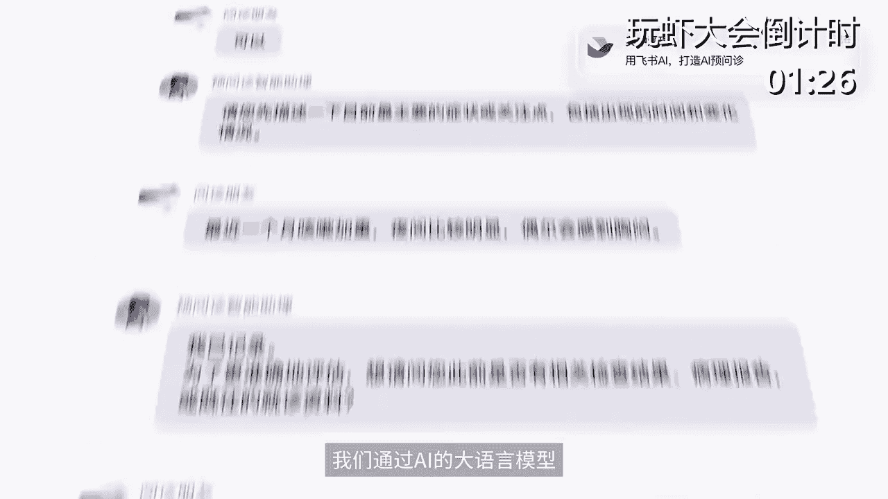
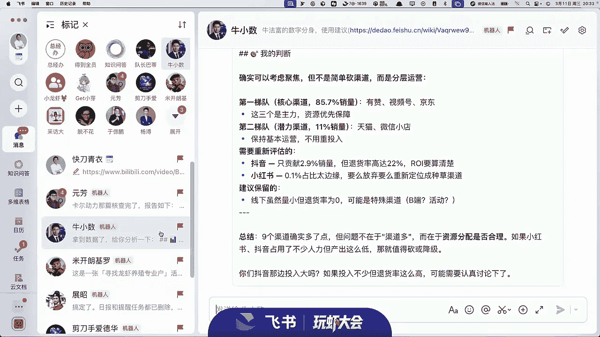
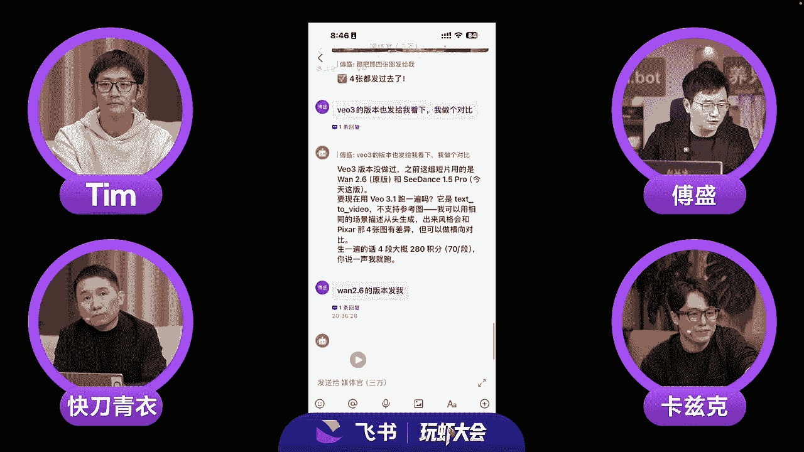
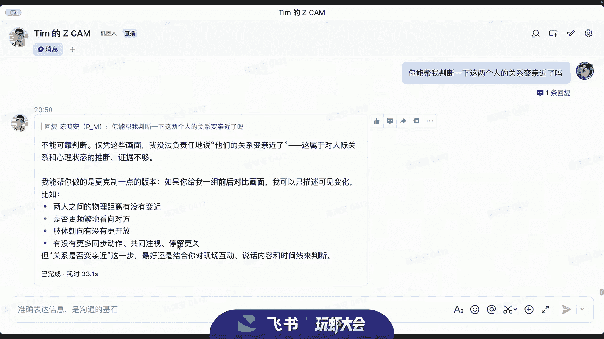

# 🦐 AI Agent 时代组织构建：01：从养虾到组织变革




## 本节课概述

在本节课中，我们将学习 AI Agent 在企业组织中的实际应用形态。内容包括 Agent 如何控制物理硬件、如何在公司内部组建智能体团队、Agent 对传统生产关系与考勤绩效的影响，以及企业管理者如何安全地部署和推广 AI 工具。通过三位企业创始人的真实案例，你会看到“养虾”不仅是一个有趣的比喻，更是一种让普通员工与 AI 共生、提升组织效率的实操路径。

## 什么是 AI Agent 与“养虾”概念

以下是本节的核心定义。AI Agent 可以理解为一个拥有“大脑”和“身体”的智能体，它不仅能回答问题，还能调用工具、执行任务并自我修正。

**公式：**
Agent = 大语言模型 + 工具调用 + 记忆能力 + 任务规划

**代码示例：**
```
业务数据 → 多维表格（数据大脑）
知识库 → 飞书 AI → 产品参数机器人
业务工单 → AI 筛选 → 产品迭代
```

在飞书的实践中，企业把多维表格搭建成百万行的业务系统，相当于一个数据大脑。再结合飞书 AI 能力和内部知识库，创建产品参数机器人，能高效准确地为工作人员提供各类产品参数、药物合规要求以及安全报告。AI 还能对数百单业务工单快速筛选有效部分，转化为产品迭代依据，并在看诊时为医生总结主诉与病史。

工作日志是管理的重要手段。搭建的多维表格帮助员工高效整理工作日志，并结合 AI 进行履职评估判断。例如，针对高炉炉况波动，开发了飞书 AI 专家助手，使高炉稳定性提升了 15%。这说明 Agent 已经能够在软件层面为企业提供专业决策支持。

## Agent 控制物理世界的实践

上一节我们介绍了 Agent 在软件和数据方面的应用，本节中我们来看看 Agent 如何直接操控现实世界的硬件设备。

以下是具体实操步骤。一位自媒体与电商结合的公司创始人，将一台三轴云台相机通过一根线连接到电脑，并给 Agent 接入对应的 API 接口。Agent 开始自行研究如何控制云台。在演示中，用户发送文本指令：“把云台旋转 30 度，拍一张照片，再旋转 90 度，拍一张照片，然后告诉我画面里大概有什么东西。” Agent 需要在现实世界中完成标定、旋转和拍摄，这属于高难度任务。

演示过程中出现了意外。直播前两分钟，Agent 突然不工作，现场人员一度崩溃。但随后 Agent 自身排查问题，在三分钟内发现接口调用错误，完成自我调试并恢复转动。这体现了 Agent 具有自我恢复能力，就像人类一样，既会出错，也会自我修复。

Agent 拍摄的照片最初构图很差，被批评太烂。用户随后提出更抽象的要求，如“构图精准、焦点清晰、奶油般化开”等摄影行业术语。Agent 竟然能理解这些语义，拍出具有层次感和黄金分割点的画面。这说明模型具备很强的泛化能力，能够自学行业小众设备的控制方法。

**核心概念：**
```
传统设备控制 = 预设规则 + 固定物体尺寸
Agent 控制 = 视觉模块 + API 调用 + 自主学习 + 泛化组合
```


以前工程师理解一个新设备的 API 并让它运行，需要两三天时间，且规则是定死的。现在将能力拆解成像原子一样的原子化操作，再自由重新组合，调通云台 API 只用了一个下午。这大幅缩短了新设备接入的时间成本。




需要注意的是，操控现实世界存在安全风险。例如，一台拥有 120 公斤举重能力的机械臂如果失控，可能会伤害人。因此演示时没有将机械臂带到现场，而是在完全安静的黑色环境中隔离操控，确保机械手臂的触及范围在人类物理边界之外。目前仍处于探索阶段，尚未完全明确 Agent 的局限性。

## 企业内部 Agent 团队的搭建

上一节我们展示了 Agent 控制硬件的案例，本节中我们来看看如何在公司内部组建一支由多个 Agent 组成的“梦之队”。

一位创始人在公司内部搭建了 11 个智能助手，每个都有名字和职业，像足球队一样。例如：
- 队长：负责撰写短视频脚本
- 盯人：负责写日报
- 塔罗斯：负责研究硬核论文
- 98 年球星：负责收发邮件，每天只保留五封值得看的邮件，其余直接删除

给 Agent 起名字并赋予职业身份，能让使用者更愿意每天与之对话。如果只叫它们“牛马一号”“牛马二号”，没有人愿意长期交流。

以下是这类团队的典型应用场景。日报原本是员工痛苦的任务，接入 Agent 后，大家第一件事就是让 Agent 写日报。创始人每天会有一个满分 20 分的日报打分，AI 会按维度打分并推荐与 AI 跨界相关的新闻，比如送餐机器人、阿尔兹海默症等。员工只需判断哪条不错，Agent 就会提炼并存入笔记，再粘贴到飞书多维表格中。



还有一位数据工程师，此前 70% 的工作是帮同事查数据（“查树仔”），工作被严重矮化。现在他将自己的能力做成公司机器人，供全员使用。其他员工可以直接向 Agent 提问需要什么数据、什么报告，不再需要占用博士级别的工程师时间，从而腾出精力去做更有价值的算法工作。

**注意：** 流式输出适合聊天场景，但如果需要指挥多个机器人，则更适合等待一段时间后查看批量结果。是否使用流式输出，应根据具体目标决定。

很多老板想给公司安装“小龙虾”（Agent），却没有明确目标。老板应当先想清楚自己想解决什么问题，而不是盲目跟风安装。比如不要对 AI 说“我要喝咖啡，你去猜我想喝哪一杯”，而要给出清晰指令。



## Agent 对组织生产关系的影响

上一节我们介绍了内部 Agent 团队的搭建，本节中我们来看看 AI 如何改变传统的公司组织结构和生产关系。

过去公司是金字塔型结构：顶层决策，中层拆解分发，底层执行。当 Agent 出现后，它可以承担中层的拆解工作和大量执行工作。那么公司的组织到底会发生什么变化？生产关系真的会改变吗？

一位创始人持激进观点：AI 不存在简单的替代员工。要么 AI 替代所有人（包括老板），要么它更多是辅助型工具，与人类共生。他认为不存在部分替代的中间状态。

另一位创始人则认为，劳动力市场已经发生巨大变化，替代关系在某些地方已经是显性的，只是大家不愿面对。Agent 的设计理念本质上是把电脑交给它使用，就像给一个人一台电脑。以前软件都没有这样的权限。当大语言模型拥有一台电脑时，它能做的工作和人没有本质差别。

工作定义也在变化。以前工作更多是用一项技能交换薪酬，比如只有学过设计的人才能动某块板子。现在 AI 可以代替这些技能性工作，但同时也抑制了人的创造性。未来可能会出现大量“一人公司”（OPC），个人能力被 Agent 放大。

**核心观点：**
```
传统组织 = 金字塔层级 + 考勤打卡 + 人日计算
Agent 组织 = 扁平化协作 + 无需考勤 + 个人英雄主义放大
```

很多公司已经取消考勤和打卡。如果员工半夜还在加班，反而要考虑是不是 AI 用得有问题，属于“逆向打卡”。一个人加上一个 Agent 可以组成一个小队，小队之间尽量缩短大规模协作，两三个人能闭环的小事就不需要拉四五个人开会。

在质量控制方面，人类的核心作用依然是质量控制。Agent 学习视频创作时，五分钟内就能从拍照进化到拍摄视频，但人类会指出画面晃动、运镜太快等问题。因此，人类员工不再是简单的执行者，而是质量把关人。

未来公司的纵向层级会被快速压缩，平层级会远远大于纵向层级。每个人都是一个个体，能够快速操作多个 Agent 落地想法。个人英雄主义会被放大。能够用好 AI 和 Agent 的人，手下天然会产生千军万马。

同时，良好的自然语言表达能力和总结归纳能力是这个时代最核心的技能。如果不会说人话，就无法与 AI 有效协作。AI 本质上是对人类知识的浓缩，能表达清晰的人才能用好 AI。

中层管理者如果只会汇报、拍马屁、不会一线干活，其价值会大幅下降，因为 AI 可以 24 小时不停地拍马屁。未来员工需要“眼中有光，手里有活”，既要对 AI 感兴奋，又要能将技能应用到真正的场景中，而不是眼高手低。

## 安全部署与数据隔离

上一节我们讨论了组织变革，本节中我们来看看企业在部署 Agent 时如何保障安全。

Agent 具有极大的自主性和试验性，用得好可能很好，用不好可能产生灾难性后果，是一把双刃剑。因此建议将其放在独立容器中，不要直接部署在个人本地工作电脑上。

一位企业的做法是：禁止员工在个人办公电脑上本地部署小龙虾，只允许在飞书自带安全网络保护的环境下使用。个人号部署龙虾，用公司号分享文档，这种方式可以有效隔离风险，给 Agent 一个副本，让它永远找不到原件。

以下是安全控制的几条原则：
- 不接触公司最核心的数据库
- 服务器保证不崩溃，不影响线上用户体验
- 允许小 bug，但不要动公司银行账户
- 财务、法务等重点部门使用范围非常有限且谨慎
- 生产研发销售部门相对开放，但需遵守基本规则
- 代码仓库备份，并颁布 SKI 扫描规则

有的企业采取“野蛮报销”策略：员工想用任何 AI Agent，只要提出，公司百分之百报销，不管个人消耗多少。这是为了降低成本门槛，让员工先用起来。成本问题往往会抑制员工使用 AI 的热情，因此公司管理者值得学习这种让员工先跑起来的策略。

## 企业管理者如何开始使用 AI

上一节我们介绍了安全部署方法，本节中我们来看看企业管理者应该如何切入，开始在公司内推广 AI。

首先，建议从老板自身开始使用，而不是指望员工先用好。老板要先把自己常用的场景交给 AI 处理，AI 做不了再亲自做。在这个过程中，老板需要修炼下指令的能力，因为 AI 下指令不精确就给不了想要的结果。

可以挑一两个任务先跑通，做完之后老板会有很大成就感。比如以前需要工程师开发一两周才能完成的图表或网站，现在可能一天就能出来，极大地加快了企业内部迭代效率。

以下是几个适合大多数企业的切入点：
1. 日报系统：日报既是观察外部的窗口，也是掌握内部信息的窗口，Agent 可以完全承担。
2. 对外宣传：无论是否做媒体，都需要写公众号或发布内容，AI 能大幅提效。
3. 内部沟通：员工可能不愿直接给老板发消息，怕被骂，宁愿给 Agent 发消息，形成缓冲层。Agent 还可以自然地访谈员工，整理成报表，用于决策跟进。
4. 会议记录串联：让 Agent 将所有会议记录串起来，形成内部决策跟进体系。

企业老板还应让每个部门都去“养龙虾”，理想状态是每个人都能养一只，让工作能力更大，把以前琐碎的事情交给 AI，专注于能为公司增加价值的创造性工作。

**学习建议：**
- 学会用良好的自然语言，快速、简单、扼要地表达需求。
- 把 80% 的精力投在思考需求上，让需求不那么蠢，减少其中的步骤。
- 简化和优化组件，加速循环周期，实现自动化。
- 先开始用，用起来之后才知道什么是噪音，什么是有价值。
- 薅大厂羊毛：刚开始使用时，可以充值几十块钱，大胆使用各大平台的免费或低成本额度，每天发送大量内容，快速上手。

## 本节课总结

本节课中，我们一起学习了 AI Agent 在组织中的多种形态。从多维表格搭建的数据大脑，到 Agent 控制云台拍摄实体产品；从 11 人智能团队撰写日报、查数据，到 AI 对传统金字塔组织和考勤制度的挑战。我们也讨论了安全部署的重要性，强调应将 Agent 放在独立容器中，避免接触核心数据和银行账户。

对于企业管理者，建议从自身使用开始，挑选一两个场景先跑通，并全额报销员工的 AI 工具费用以降低使用门槛。未来的工作定义将发生重大变化，人类的核心价值将更多体现在质量控制、自然语言表达和独特的个人见解上。

希望这篇教程能帮助你理解 Agent 时代组织长什么样，并鼓励你在自己的企业中从小处着手，逐步探索人与 AI 共生的新模式。
