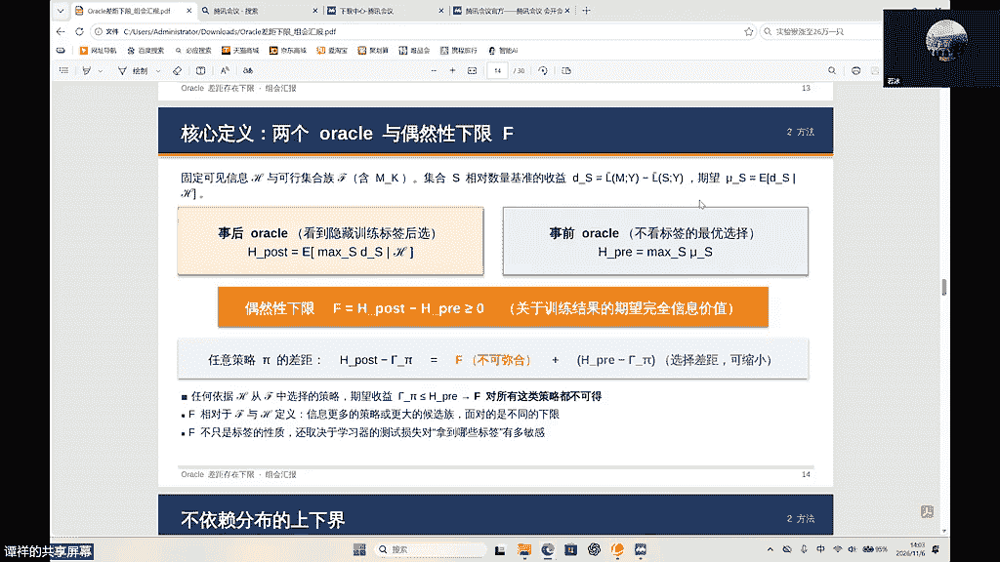

# 🛡️【Datawhale AI+X】大模型安全：1：主动学习与标签获取基础


## 开篇概述


在本节教程中，我们将学习主动学习的基本思想，理解监督学习中标签获取为什么需要花费金钱和时间，并认识预言家机制如何帮助决策者在信息不足的情况下评估策略改进空间。

## 监督学习与标签成本

上一节我们介绍了机器学习的整体流程，本节中我们来看看监督学习里标签打上的具体含义。

监督学习的核心任务是给每个数据样本打上标签。标签的获取不是免费的，它需要消耗金钱和时间。比如我们要对图像进行分类，就需要人工手动去处理图片，给图片里的物体画框，标注出具体内容是什么。

主动学习的核心目标可以用下面的公式来表达：

**argmax_{S⊆C, |S|≤B} 模型性能(S)**

其中 C 表示候选样本集合，B 表示可用的标注预算。这个公式的意思是，在有限预算的限制下，选出一批能让模型性能最好的样本进行标注。


主动学习策略的具体步骤如下：

- 在有限的预算范围内，挑选出最值得标注的样本。
- 利用这些高价值样本，帮助模型更好地完成训练任务。

## 标签获取的风险与延迟


在了解了主动学习的定义之后，我们继续看看标签获取本身所带来的问题。


标签获取本身存在风险。以银行发放贷款为例，如果银行在不知道借款人还款标签的情况下就把钱贷出去，可能会造成资金损失；如果不贷款，则可能错失原本可以赚取的利润。由此可见，风险本身也是有价值的。

标签还具备延迟特性。比如贷款的还款日期，或者病人出院后是否需要复查，这些结果需要隔很长一段时间才能获得。这意味着模型决策的真实效果无法立即得知，评估层面就存在一个问题：我们到底能获得多少改进？

预言家机制可以帮助我们评估改进空间。想象银行是一个预言家，能够提前知道把钱贷给某些人之后会产生什么影响。根据这个影响，我们再来判断贷款策略，从而了解当前工作还有多大提升空间。

但是，预言家的优势带有一定的随机性。借款人是否一定会还款，病人是否一定会按时复查，这些结果都不确定。因此，预言表现出的领先并不代表所有策略都能稳定学到，而是包含一定的运气成分。

# 🔍【Datawhale AI+X】大模型安全：2：随机性、预言家与评价机制

## 标签选取策略的演进

上一节我们介绍了主动学习与标签获取的基础，本节中我们来看看近年来标签选取策略是如何发展的。

2017 年，研究者提出了基于深度学习的主动学习方法，并强调样本多样性。近年来，研究者使用 ROADS 等基准来评估信息获取的可靠性，并尝试将在信贷场景下验证的策略迁移到医疗等其他领域，来看当前策略是否成功。

本文提出了一种过下限 AF 方法，具体内容将在后面进行解释。

常见的标签获取准则包括以下几种：

- 不确定采样：模型把握不住的地方就去询问。比如模型预测违约概率为 0.5 的样本，比预测概率为 0.99 的样本更不确定。
- BLAD：区分模型参数不确定性和标签本身的随机性，更关注能够消除不同模型和策略之间分歧的标签。
- BA-BELL：将思路扩展到整体样本批次，避免一次选出大量标签相似的人。
- CUR set：在梯度空间中同时考虑模型不确定性和样本多样性，尽可能挑选不同的人，以观察此次获取是否有用。
- EPIG：关注目标分布的预测，了解标签对真正关心的目标分布的作用。

这些策略越来越以下游损失作为评价标准。从模型的不确定性，到需要知道的参数信息，再到目标上的预测信息，最后到下游损失，这是一个逐步深化的过程。

## 现有方法的局限性

在介绍了常见策略之后，我们需要看看这些方法在实际复杂模型中存在的问题。

现有准则多在逻辑回归等模型上验证。当下游学习器更换为 XGBoost、CatBoost 或神经网络时，信息代理是否仍然能够匹配，目前还不清楚。研究者曾在小规模上尝试使用多层感知器进行处理，但范围有限。

评估主动学习的可靠性也存在陷阱。挑选我们认为最有价值的样本，并不一定能让预测更加准确。有些方法在测试集上表现很好，但无法迁移到其他场景。跨领域基准显示，在信贷场景下有效的策略，不一定能用在医疗场景。

另外，初始化随机、训练协议等细节都可能改变不同算法的排名，因此不能仅依赖单一指标来决定策略。

## 选择性标签与延迟反馈

在讨论了评估局限性之后，我们继续看看选择性标签与延迟反馈的问题。

选择性标签意味着只有被批准的样本才有标签。比如违约概率为 0.5 的样本，如果不发放贷款，我们就无法获取它的真实价值，这会造成价值损失。被拒绝的样本同样可能包含有价值的信息，研究者关注这些被拒样本到底能产生什么价值。

延迟反馈意味着结果需要几个月才能出现。研究者倾向于研究在这些场景下如何使算法达到最优。

决策者只能依赖当前可见的信息，而真实结果不能作为已知条件。一个早期的相关概念是完全信息的期望价值。意思是，如果我们知道所有标签和所有信息，可以通过它来计算能获得多少收益。这就好比买彩票前不知道号码，如果提前知道开奖号码再去选号，平均会赚多少。

本文的创新点在于把偶然性下限定义为所护标签的完全信息价值，并给出不依赖分布的上下界，用来说明基准方法的领先机制。

## 研究方法总览

在了解了问题背景之后，我们看看本文的具体研究方法。

该方法包含以下四个步骤：

1. 学习者在有限风险预算内批准一批候选人，以获取后续标签。
2. 构建两个 Oracle，一个基于期望选择，一个在看到所有标签后选择。
3. 报告差距拆解为三种来源：测试集随机结果带来的偶然性优势、当前信息条件下可争取的部分等。
4. 利用上下级结果模型和精确搜索，检查得到的期望收益是否可信。

问题设定可以用下面的代码形式概括：

```text
学习者拥有已标注数据 D
标签尚未到达
候选集合 O 和 C
目标变量 Q
二元结果 YA
先选择 YA，再看到结果和风险
```

学习者使用逻辑回归、XGBoost 和小型多层感知器三类模型。通过这三类学习器，研究者发现下游性能几乎在初期就达到实质水平，之后其占比随标签噪声和预算上升，说明谁能赢得剩余差距取决于学习器本身。

研究者承认数学功底有限，后面包含大量数学推导，此处不再展开。

# ☣️【Datawhale AI+X】大模型安全：3：大模型安全与数据投毒


## 大模型安全的研究方向


上一节我们介绍了主动学习的评价机制与研究方法，本节中我们来看看大模型安全相关的内容。

大模型安全包括越狱、后门攻击和对抗式训练等方面。目前公开的攻击案例较少，看起来像是自娱自乐，但实际上关系到模型训练结果。已知的数据投毒例子包括字节跳动相关事件。

## 数据投毒与梯度下降

在了解了大模型安全的背景之后，我们具体看看数据投毒是如何工作的。

机器学习最常用的优化方法是梯度下降。梯度下降的目标是找到损失下降最快的方向，从而达到损失最小的位置。这个过程可以用下面的公式表示：

**θ = θ - η · ∇J(θ)**

其中 θ 是模型参数，η 是学习率，∇J(θ) 是损失函数的梯度。

如果我们知道模型继续学习的过程，就可以采用数据投毒的方式。即给模型放入一批投毒数据，使得损失下降过程不再朝着期望的最小方向走，而是朝着偏差最大的方向走。

举个天气预报的例子。原本我们输入湿度、温度等参数，训练模型输出今天的天气。如果数据被投毒，模型可能输出错误结果。比如原本应该是阴天，模型却输出大晴天。用户看了天气预报出门，结果下雨却没有带伞。

## 视觉模型与自动驾驶风险

在讨论了天气预报例子之后，我们继续看看数据投毒在视觉模型中的后果。


在训练视觉模型时，如果对数据进行投毒，可能会造成非常严重的后果。因为模型参数量很大，对参数加入微小扰动就能产生非常大的偏差。比如一个参数是 1，我们加上 0.1 的扰动，对所有参数都施加这样的扰动，累计误差能达到几百的程度。


以自动驾驶为例，模型原本能识别出人。如果在图片中人为加入一点点恶意扰动，模型可能把人判定为无机物，比如凳子，或者把人识别成猪、鸡、狗、鸭，甚至飞机。在自动驾驶场景下，这会造成非常可怕的后果。

## 结束语与总结

本节教程到这里就结束了。如果你要分享 PPT，记得对具体实验结果和模型框架打码，不要把全部内容公开，讲清楚重要思想即可。



在本节教程中，我们一起学习了主动学习的基础、随机性与预言家机制、标签选取策略的演进与局限，以及大模型安全中的数据投毒攻击。希望这些内容能帮助你建立起初步的认知，后续欢迎大家交流探讨，也可以尝试一起进行相关的投稿与合作。

