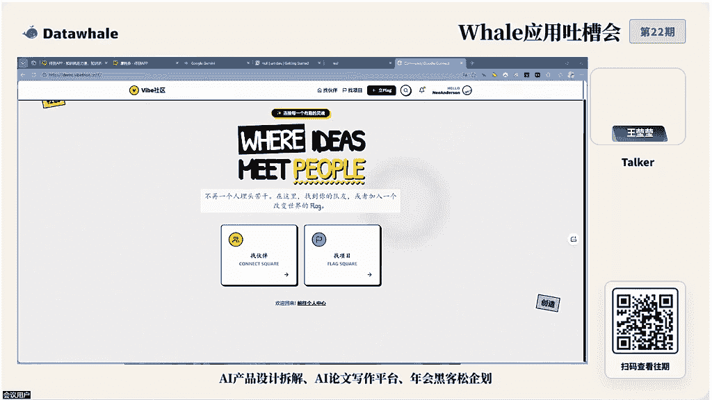

# Datawhale AI+X 年会黑客松：01：年会黑客松概述与初心 🎉

在本节课中，我们将学习Datawhale AI+X 年会黑客松的基本背景和核心目的。年会黑客松是一个面向社区的共建活动，专门为那些心里有AI想法、但还处于发展阶段的人而设。我们的初心非常简单：一个人憋着想法很久，不如一起迈出第一步。希望每个参与者都能在这个平台上被看见、被回应、被连接。

之所以想把这件事做下来，是因为我们的筹划小组在讨论时发现，很多有AI想法的人其实卡在了起步阶段。他们不知道如何迈出第一步，找不到志同道合的同路人，或者缺乏足够的自信去推进想法。其中不少还是学生群体，社交圈子比较小，好容易产生的想法很容易被搁置。我们不希望这些宝贵的念头被忽略，而是希望每一个想法都能被温柔对待。在年会期间，我们不仅会回顾过去一年在学习活动、教程编写、社区贡献和助教工作中的表现，并做一次年度总结，还会一起思考2026年接下来要做什么，寻找能一起走下去的伙伴。本次年会的本质是共建，需要大家共同参与、共同塑造。

了解了年会黑客松的初心和总体目标之后，接下来我们来看看活动具体包含哪些核心模块。

# Datawhale AI+X 年会黑客松：02：核心模式之回忆模块与Flag广场 🏁

年会黑客松包含几个核心模块，每个模块都有明确的作用。下面我们先来介绍前两个模块，分别是回忆模块和Flag广场。

以下是核心模块的具体说明：

1. 回忆模块
回忆模块会加入到每个人的个人信息页面中。当你想在社区里和其他朋友建立链接时，系统需要先展示什么样的信息呢？我们主要会展示你过去一年里参与过的活动，以及一些个人基本信息。这样，其他人一眼就能了解你做过什么，更容易和你产生连接。

2. Flag广场
Flag广场是大家立Flag的地方。你可以把自己的想法、想写的教程，或者还没有探索清楚的方向，全部发布到Flag广场里。广场支持点赞和评论，还会生成一个Flag热力榜单，显示当前Flag的活跃度。你可以把自己的Flag放到社区里，让更多人看到，收到反馈，遇到志同道合的小伙伴，从而获得从想法到行动的推动力。这也是一种互赠礼物的方式：大家一起推动一个Flag，让想法在社区里被看见。

核心概念可以用下面的公式和代码来描述：

```python
FlagSquare = { ideas, tutorials, unexplored_directions }
ActivityScore = f(likes, comments, shares)
```


除了回忆和立Flag之外，年会黑客松还设计了更深层的想法共创机制，下面我们来看看想法树和IDEA Train。

# Datawhale AI+X 年会黑客松：03：核心模式之想法树与IDEA Train 🌳

想法不应该一蹴而就，它需要时间慢慢生长。基于这个观点，我们设计了想法树和IDEA Train两个机制，帮助大家把模糊的想法逐步完善。

以下是两个共创机制的详细内容：

1. 想法树（Idea Tree）
想法树采用思维导图的方式进行共创，有点像面向想法的GitHub。一个想法树包含一个基础的大致方向，以及围绕它生长的叶子和果实。叶子代表大家发表的思考、问题、灵感、讨论或笔记；果实代表更落地的成果，比如教程或MVP。我们希望给想法足够的时间和空间，让它自然发生。

2. IDEA Train
IDEA Train强调团队合作。想法发起人拥有管理权，可以决定谁参与、谁编辑、谁查看，也可以邀请大家共创。在开始构建之前，大家先寻找有共同兴趣和目标的人，一起把想法逐步完善。完善之后，我们会组织一场头脑风暴，采用6分钟闪电辩论的形式，两个想法小队一对一快速辩论，核心目的是帮对方指出真实的问题。场外观众也可以向辩论选手提问。辩论结束后，你可以选择继续推进这个想法，或者进行调整。最后，我们会进入路演环节。

核心概念可以用下面的代码来描述：

```python
IdeaTree = {
    "root": "base_direction",
    "leaves": ["thoughts", "questions", "inspiration", "discussions", "notes"],
    "fruits": ["MVPs", "tutorials", "landing_projects"]
}

IDEA Train Permission = {
    "initiator": "manage",
    "members": ["edit", "view"],
    "public": ["view"]
}
```

想法经过共创和辩论之后，接下来就是最关键的展示环节——路演，我们下一节详细说明。


# Datawhale AI+X 年会黑客松：04：路演环节与Building Public目标 🎤

路演不是答辩，而是一次诚实的进展分享。我们建议用HTML页面来做路演，而不是传统的PPT。因为HTML页面可以通过链接直接分享，大家不需要下载文件，而且可以直接展示你的界面、愿景，或者已经做出来的MVP。


以下是路演页面建议包含的内容：

- 你的想法目前走到了哪一步
- 在这个过程中遇到的挑战
- 学到的经验
- 获得的反馈
- 你在社区里认识了谁，建立了哪些新的链接

我们的核心目标是Building Public，即在公开的过程中一起走，让每一步都有价值，卸下对结果的焦虑。年会黑客松不要求你已经准备好，参加本身就是为了慢慢准备好。

理念和模式都讲清楚了，接下来我们来看看实际的平台演示，具体功能是如何实现的。

# Datawhale AI+X 年会黑客松：05：平台Demo演示与功能介绍 💻

目前平台的Demo只有前端，后端还在设计中。在吸收大家的建议之后，我们会推出完整方案。下面是Demo的主要功能模块。

以下是主页和连接广场的功能介绍：

主页只有两个按钮，一个是“找伙伴”，一个是“找项目”。如果没有登录，会提示先登录。点击“找伙伴”会进入连接广场，这里可以看到很多社区成员。我们计划根据相似的经历、相似的技术栈，或者互补的内容，对人员进行筛选、排序和组合，让大家遇到各种各样的人。广场里还有筛选功能，也可以随机抽取一个人来认识。

以下是Flag广场和项目页面的功能介绍：

Flag广场是核心模块之一。点开一个Flag后，你可以看到项目主图、项目状态、点赞和分享按钮。团队成员可以查看项目，也可以发布讨论。进展时间线允许你发布进展，管理项目。你可以修改项目状态、审批机制以及可见性，也可以删除这个Flag，或编辑基础资料。页面支持上传图片，后续还会增加更多字段。成员管理方面，你可以设置项目管理员，并对加入项目的人进行审批。

以下是不同角色看到的界面说明：

根据你的角色不同，看到的页面也不同。作为发起者，你拥有完整的管理权限；作为观察者，你可以查看其他项目；作为参与者，你可以发布进展，也可以修改进展内容。此外，还可以设置私密项目，私密项目不会被其他人看见。

以下是个人中心和编辑功能的说明：

点开自己的主页，可以查看联系方式，当然也可以设置不让别人看。个人主页会展示一些档案，比如“2025 Data故事”和“年度总结”，还有你参与的Flag，都会显示在这里。编辑个人主页时，可以设置基础信息、可见性（所有人可见、团队可见、仅自己可见）、身份或自定义标签、当前状态、简介和在职情况。你还可以添加社交媒体账号和作品集。


档案部分是可以自定义的模块。管理班可以发起档案，设置供大家填写的字段，填写后档案就会体现在个人主页上。你也可以管理档案的可见性。比如“2026规划Flag”档案，如果你还没有填写，可以点击进行填写并保存。


以下是后台管理功能的说明：

后台可以添加新的档案，策划更多活动。对一些不合适的项目，后台可以审核或下架，以保证平台安全。还可以管理用户状态，使用通知中心和搜索功能。

核心概念可以用下面的代码来描述：

```python
Visibility = { "public": "所有人可见", "team": "团队可见", "private": "仅自己可见" }
ProjectRole = { "initiator": "manage", "observer": "view", "participant": ["publish_progress", "edit_progress"] }
Roadshow = HTML(mvp, vision, challenges, feedback, connections)
```

平台功能演示到这里就结束了，下面是参与方式和本节总结。

# Datawhale AI+X 年会黑客松：06：参与方式与本节总结 📝

如果你想加入我们的黑客松活动群，可以扫描左侧或右侧的二维码。右侧二维码可以体验年会黑客松的现场Demo。微信群二维码有效期为7天，过期后我们会更新。直播间和会议中的小伙伴，如果对年会设计有任何建议或意见，欢迎随时开麦提出。我们希望大家积极参与，记录过去一年的新进展，在新的一年里立下Flag，找一些小伙伴一起努力。

最后，再次感谢唐昌以及所有参与年会共建的小伙伴们的付出。期待在年会现场见到各位。



本节课中，我们一起学习了Datawhale AI+X 年会黑客松的背景、初心、核心模块（回忆模块、Flag广场、想法树、IDEA Train、路演）、平台Demo的主要功能，以及如何参与活动。希望大家能够卸下焦虑，带着想法加入我们，一起在公开中成长。
