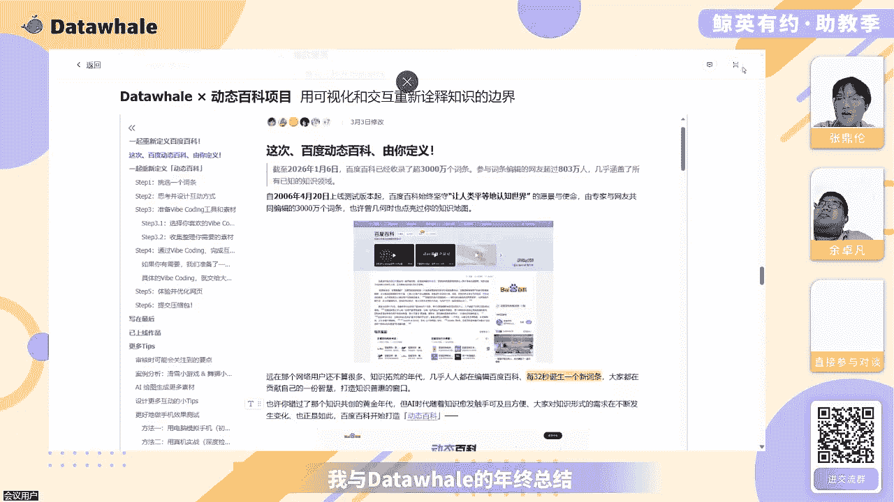
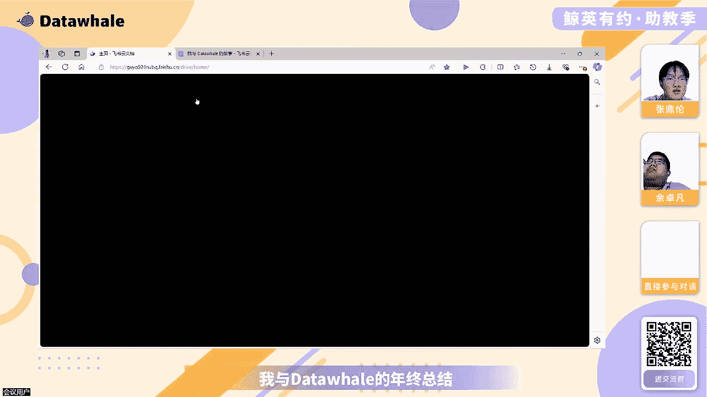
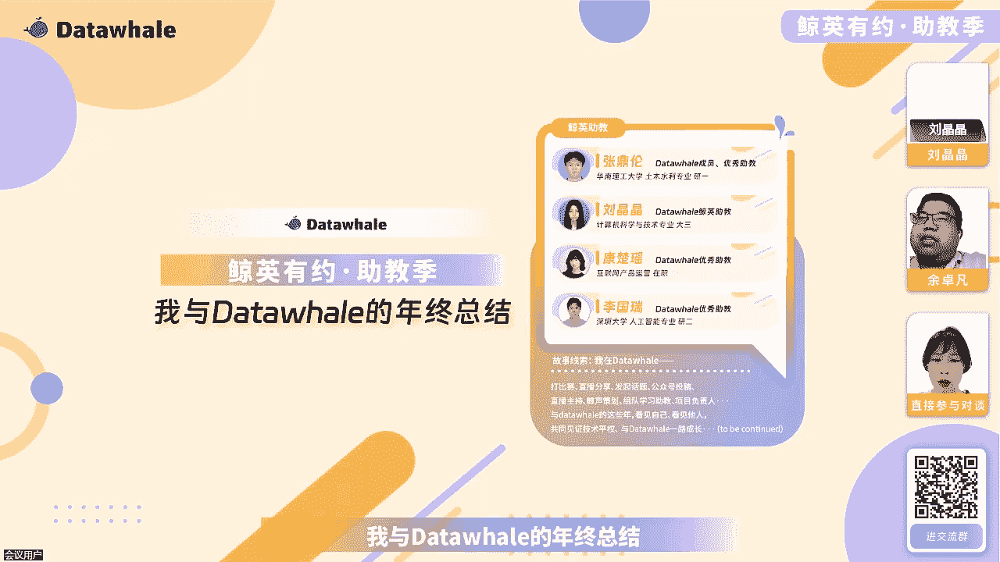
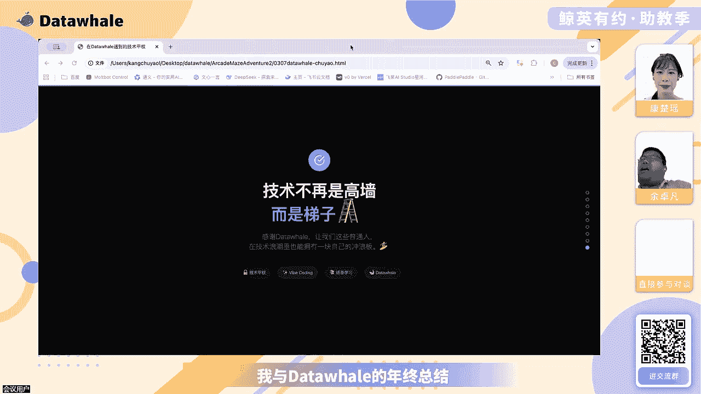
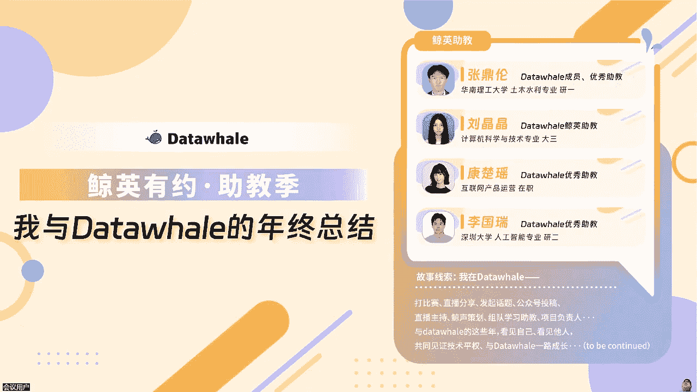

# Datawhale 助教成长与社区共建教程：01：开篇概述：Datawhale 社区与助教体系 🌟

在本节课中，我们将学习 Datawhale 社区的基本情况，了解助教在社区中的定位，以及整个教程将要涵盖的核心内容。Datawhale 是一个面向人工智能学习者的开源社区，社区提供免费的高质量教程，涵盖机器学习、深度学习、大语言模型、智能体等多个方向。为了让更多学习者能够顺利学习下去，社区设立了助教机制，助教负责在学习过程中回答问题、鼓励学员、维持社群活跃度，并参与教程和项目的共建。

以下是 Datawhale 社区的核心特征：

- 课程全部免费，面向零基础学习者开放。
- 教程内容开源，学习者可以随时查阅和参与改进。
- 社区强调“以学习者为中心”，鼓励成员相互帮助、共同成长。
- 助教不仅是答疑者，也是社区文化的传播者和活动的组织者。

本教程的内容来源于四位 Datawhale 优秀助教的真实经历。他们分别来自土木水利、计算机科学、生物科学和人工智能专业，有的在校学生，有的在职人员，背景各不相同，但都在 Datawhale 找到了适合自己的成长路径。接下来的章节中，我们将依次介绍从学习者到助教的转变过程、非科班跨入 AI 领域的学习方法、助教的具体工作内容、社区共建项目参与方式，以及如何成为助教的实操步骤。

# Datawhale 助教成长与社区共建教程：02：从学习者到助教：角色转变与成长路径 🌱

上一节我们介绍了 Datawhale 社区的基本情况和助教体系，本节中我们来看看一名普通学习者是如何逐步成长为社区助教，甚至承担主持和策划工作的。这个过程并不是一蹴而就的，而是经历了从关注、参与、分享到贡献的逐步积累。

以下是典型的助教成长路径：

- 第一阶段：学习者。关注社区公众号，参加组队学习活动，完成打卡任务，掌握基础知识。
- 第二阶段：分享者。在吐槽会、直播间或社区渠道分享自己的学习成果和项目经验。
- 第三阶段：助教。报名助教招募，负责特定课程的学员支持、答疑和打卡管理。
- 第四阶段：主持人或领航员。参与社区活动策划、直播主持、教程共建，帮助更多学习者成长。

以张定伦的经历为例，他本科就读土木水利专业，辅修计算机，最初接触 Datawhale 时觉得社区“高高在上”，与自己距离遥远。2023 年 ChatGPT 引发人工智能热潮后，他开始关注大语言模型，并通过社区开源项目了解到 Datawhale。2023 年秋天，他第一次真正参与 Datawhale 的活动，报名了“小有可为 AI 开源公益创新挑战赛”中的乡村课堂赛道。在教程指导下，他一点点迭代项目，最终被评为优秀学习者并进入决赛。

进入决赛后，社区老师注意到了他的作品设计，邀请他在社区直播中进行首次分享。虽然当时技术尚不成熟，但社区成员给予了热情反馈和鼓励。分享结束后，他越来越喜欢分享这件事，开始频繁在社区发布内容，包括科研绘图教程、AIGC 原理与应用教程、期末速通指南等。随后，他受邀加入吐槽会的主持和策划团队，并参与建立了“经生经络”等话题体系，目标是帮助一千人以上掌握 AI 技能并进行表达。

在这个过程中，他还参与了动态百科项目，将百度百科的文字条目改造成可交互的网页，例如腊八粥制作、接财神、猜灯谜等互动页面。此外，他还参与了医学 AI 试点小组，与队友开发了产后抑郁管理智能系统。从学员到助教再到主持人，他的角色发生了明显变化，但始终保持着对社区的热情。

以下是社区推崇的两条核心价值观：

```text
价值观一：成就共建贡献者
价值观二：成为伯乐
```

“成为伯乐”意味着社区成员会主动发现优秀的学习者和贡献者，提供支持和平台，让更多人被看见。张定伦表示，自己正是在这样的氛围中感受到温暖，并希望未来继续继承这种文化，帮助更多学习者。

# Datawhale 助教成长与社区共建教程：03：非科班跨入 AI 领域的学习方法 🚀

本节我们继续讨论如何在没有计算机背景的情况下学习 AI。上一节我们介绍了助教的成长路径，本节中我们来看看非科班学习者面临的困难以及可行的解决方法。刘婧婧大一时被调剂到土木专业，大二转入计算机科学与技术，起初跟不上进度，感到非常煎熬。楚瑶本科生物科学，现在是互联网产品运营，也没有编程基础。他们的经历说明，非科班背景并不是学习 AI 的障碍。

非科班学习者通常会遇到以下几个常见问题：






- 缺乏编程基础，面对代码感到害怕和枯燥。
- 学习内容过于抽象，难以获得短周期的正反馈。
- 容易被各种 AI 新闻和热点分散注意力，产生焦虑。

针对这些问题，社区分享者提供了以下建议：

首先，心态上要做转变。不要先想“我该怎么学习”，而要先想“我学这个是为了解决什么问题”。是为了工作提效，还是为了掌握新岗位技能，抑是单纯出于兴趣？明确问题后，再有针对性地选择学习内容。

其次，聚焦主线知识，避免信息过载。可以利用 AI 工具帮助绘制知识版图，列出某个领域至少需要掌握的理论知识和重要名词，然后逐项学习。支线知识可以留到以后用碎片时间拓展。

第三，快速动手，追求“move fast”。不要试图先把所有基础知识学完再做项目，而是直接挑选一个感兴趣的项目，把它跑通。在跑通过程中遇到问题，再去查缺补漏、阅读教程或请教他人。这种从项目中学习的方式，能快速建立正反馈，增加学习乐趣。

以下是非科班学习 AI 的建议步骤代码示例：

```python
# 非科班学习 AI 的建议步骤
steps = [
    "确定想要解决的具体问题",
    "聚焦主线知识，忽略暂时不需要的支线内容",
    "挑选一个感兴趣的小项目，先把它跑通",
    "在项目中遇到问题时，有针对性地学习相关知识",
    "利用 AI 工具辅助编程和调试",
    "记录学习心得，在社区中分享，获得反馈"
]

for step in steps:
    print("当前学习重点：" + step)
```

刘婧婧在 2025 年春训营中学习了 RAG 课程，通过组队学习找到了志同道合的小伙伴，互相打卡、解答问题，学习氛围浓厚。她还把所学的 AI 知识应用到 Java 课程大作业中，开发了一个 AI 模拟面试网站，并向老师推荐了 Datawhale 平台。楚瑶则在学习 Python 时，最初只要求自己“看得懂代码逻辑，满足工作需求”，不强求自己一定要能独立编写。当“外挂 coding”工具出现后，她的体感发生了很大变化：过去需要花一个月学习的内容，现在两分钟或十分钟就能得到更好的结果，编程门槛显著降低。



# Datawhale 助教成长与社区共建教程：04：助教工作实务与方法论 🛠️

上一节我们探讨了非科班学习者如何入门 AI，本节中我们来看看成为助教后具体需要做什么，以及有哪些行之有效的工作方法。助教在社区中承担着连接教程组织者和学习者的桥梁作用，工作内容因角色不同而有所区别。

助教通常分为运营助教和专业助教两类。运营助教负责整个学习流程的把控，包括开营仪式、每日发布打卡提醒、更新群公告、结营仪式以及筛选优秀学习者。专业助教则侧重于学习内容本身，负责回答学员提出的专业问题，评阅和筛选优秀笔记，并针对课程难点给出解释。

以下是助教工作的四条核心方法：

- 调动学习者热情。及时关注群内动态，对学员的提问和反馈给予积极回应，避免出现冷场，让每个人都感受到被重视，从而保持学习积极性。
- 降低学习难度。很多学员畏难是因为觉得任务多且难。助教可以将每日学习任务进行简单拆解，说明内容并没有想象中那么困难，帮助学员循序渐进完成学习，建立信心。
- 及时给出鼓励。学习过程中的正向反馈是学员坚持下去的动力。发现学员做得好的地方，应当及时夸奖和肯定他们的努力。
- 细心学习课程。作为专业助教，必须对本次课程内容非常熟悉，才能快速反应并准确解答学员的问题。

可以用以下公式概括助教的核心职责：

```text
助教核心职责 = 调动热情 + 降低难度 + 及时鼓励 + 细心学习
```

刘婧婧曾担任夏令营运营助教，负责直播开营。虽然第一次做直播感到有些迷茫，但在负责人的帮助下顺利完成。活动结束后，她被评为优秀助教，这让她更加坚定继续做助教的想法。张定伦在担任吐槽会主持和策划工作时，也发现助教工作不仅是帮助别人，自己在备课和解答问题的过程中，也倒逼自己更深入地掌握知识。这种“教学相长”的体验，是助教工作最大的收获之一。

# Datawhale 助教成长与社区共建教程：05：社区共建、项目参与与技术平权 🤝



本节我们继续介绍如何参与社区共建项目，并探讨 AI 时代下的技术平权问题。上一节我们详细说明了助教的具体工作方法，本节中我们来看看除了当助教之外，学习者还可以通过哪些方式为社区贡献力量。

Datawhale 社区有很多开放的共建项目，例如动态百科、AI 医疗试点小组、ConfUI 教程开发等。动态百科项目旨在将百度百科的传统文字条目改造成可交互的网页。例如，“腊八粥”条目可以变成展示制作过程的交互页面，“接财神”变成可玩的小游戏，“猜灯谜”变成元宵节主题的互动体验。这些页面最终会上线到百度百科，全世界的人都可以访问。项目门槛较低，主要使用 Web 前端开发，即使没有编程基础，也可以在半天左右的时间内尝试完成一个简单页面。

以下是参与动态百科项目的简化流程代码：

```python
# 参与动态百科项目的基本流程
def join_dynamic_encyclopedia():
    join_group("动态百科贡献群")
    select_entry("选择感兴趣的百度百科词条")
    use_web_coding_tool("使用 Web 开发工具制作交互页面")
    debug_and_test("稍微调试，确保页面可运行")
    submit_for_review("提交作品，等待上线到百度百科")
```

张定伦还负责了天耀城动态百科项目，召集社区伙伴一起贡献内容。他认为这个活动很好玩，门槛不高，只要愿意投入时间调试，就能做出看得见摸得着的作品。

在技术平权方面，AI 编程工具的出现极大地降低了技术门槛。过去，想要实现一个创意需要逐行学习编程语言、处理标点符号和缩进等细节；现在，学习者只需要关注想要实现的业务逻辑，通过对话方式与 AI 工具沟通，就能快速生成 Demo。这意味着代码已经不再是阻挡学习的绊脚石，灵感和行动才是关键。

以下表达了技术平权的核心思想：

```text
技术平权：Coded is cheap, show me your idea and action.
```

即代码很容易生成，重要的是你的想法和行动。社区鼓励非技术背景的学习者利用 AI 工具，将自己的点子变成实际产品，而不必纠结于底层代码实现。

此外，社区还开展了 AI 医疗试点小组、小龙虾（Open Cloud）等项目。小龙虾可以接入飞书、钉钉，作为个人助手帮助阅读长文、定时推送天气新闻、完成量化股票分析等任务。社区会提供保姆级部署教程，欢迎感兴趣的学习者加入群聊讨论。

# Datawhale 助教成长与社区共建教程：06：如何成为助教及常见问题解答 ❓

上一节我们介绍了社区共建项目和技术平权理念，本节中我们来看看如果你想成为助教，应该如何报名，以及在助教工作中可能遇到的常见问题和解决方法。

成为助教的基本流程如下：

```python
# 成为 Datawhale 助教的基本流程
def apply_for_teaching_assistant():
    step1 = "加入助教报名群或社区意向群"
    step2 = "选择自己感兴趣的组队学习课程"
    step3 = "在正式招募学员前，提交助教报名申请"
    step4 = "等待审核，优先考虑以往的优秀学习者"
    step5 = "获批后，按时开展助教工作，从头跟到尾"
    return "成为助教"
```

需要注意的是，报名助教并不一定能够当选。社区会优先选择以往表现优秀的学习者。如果你决定成为助教，最好具备责任心，能够从活动开始坚持到结束，避免中途退出。

助教工作中常见的问题包括学员跟不上进度、学员过度依赖 AI 编程、非科班学习者觉得内容太难等。针对学员跟不上进度，助教可以先鼓励大家跟上打卡节奏，哪怕只是浏览一遍教程而不进行实际操作；对过于困难的代码实操可以暂时跳过，但不要完全放弃整个流程。同时，助教可以将课程难点反馈给教程组织者，建议优化内容或设置不同难度等级，让学员分流学习。也可以在 B 站等平台寻找相关讲解视频，发到群里帮助学员理解。

针对依赖 AI 编程的问题，建议学习者拥抱 AI，学会把 AI 用好。如果打算从事相关专业工作，仍然需要学习一些底层基础知识，这样在调试 Bug 和理解架构时会更加得心应手。不能百分之百相信 AI 生成的答案，需要扮演审核者的角色，检查 AI 的输出。学习者的角色正在从纯粹的代码执行者，转变为 AI 工具的使用者和审核者。

对于非科班跨入计算机领域的困难，建议从兴趣出发，找到能快速获得正反馈的小项目。例如，先用 AI 工具做一个简单的俄罗斯方块游戏，或者做一个图片生成工具，快速体验成就感，从而产生继续学习的动力。兴趣和热爱是克服困难的重要力量。

# Datawhale 助教成长与社区共建教程：07：总结与展望 📚

在本节课中，我们一起学习了 Datawhale 社区的基本情况，助教的成长路径，非科班跨入 AI 领域的学习方法，助教的具体工作内容和方法论，社区共建项目的参与方式，以及如何成为助教的实操步骤。四位分享者的经历表明，无论专业背景如何，只要愿意迈出第一步，社区里就会有人伸出援手，帮助你走得更远。

助教经历最大的收获在于“教学相长”。站在学习者角度和站在助教角度，对同一件事情的看法是不一样的。助教在帮助他人解答问题的同时，也倒逼自己更深入地掌握知识。这种经历对未来求职、考研或职业发展都非常有价值。

社区的核心文化包括“成就共建贡献者”和“成为伯乐”。每个人都可以在社区中找到自己的位置，从学习者出发，逐步成为助教、贡献者，甚至社区成员。如果你对 AI 感兴趣，不妨先从参加组队学习开始，成为优秀学习者，再慢慢尝试承担助教工作，最后分享你的成长故事。



希望本教程能为正在学习或转型的你提供一些参考和鼓励。在 Datawhale，只要你愿意尝试，就会有人帮助你接住每一个机会。祝大家在社区中收获成长与惊喜。
