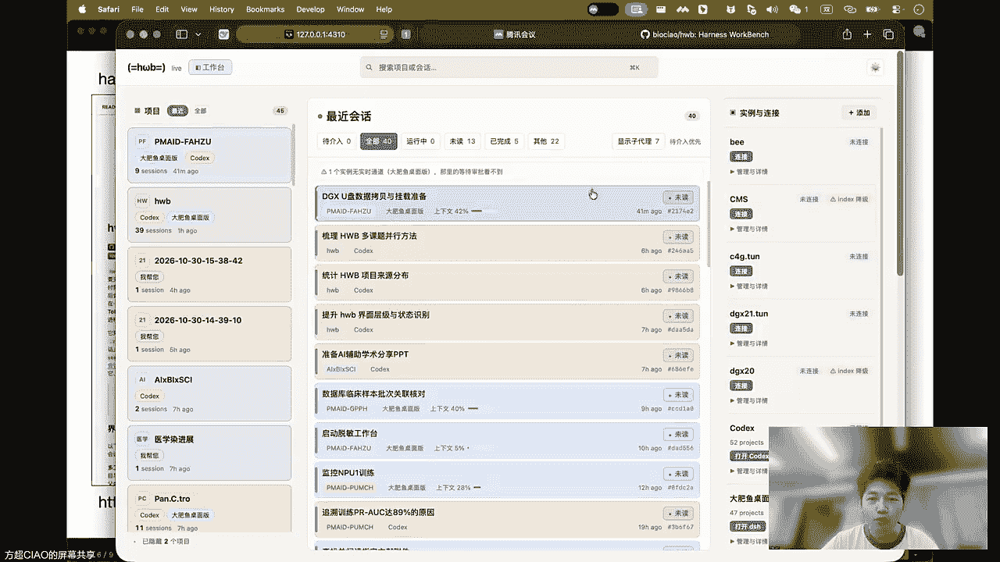
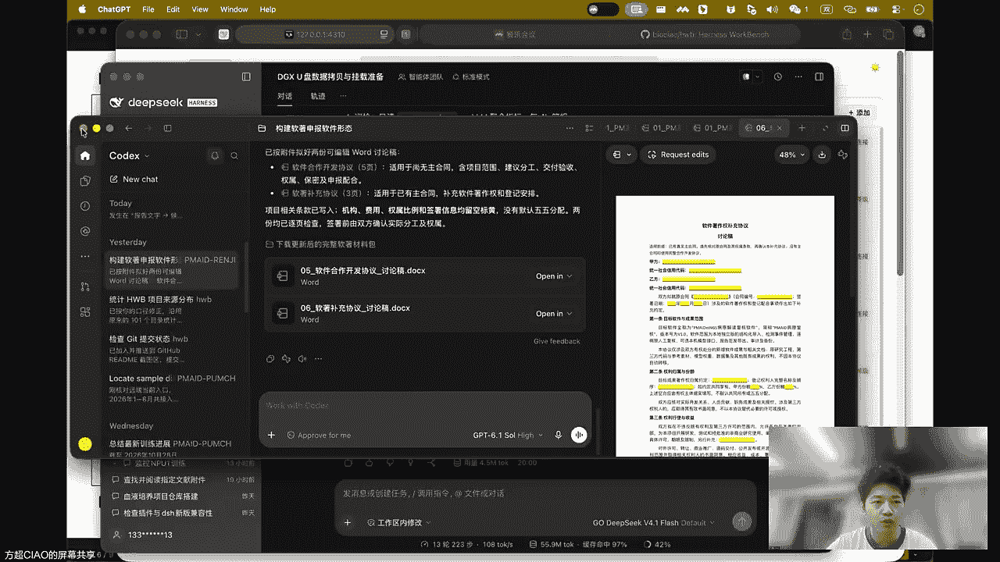
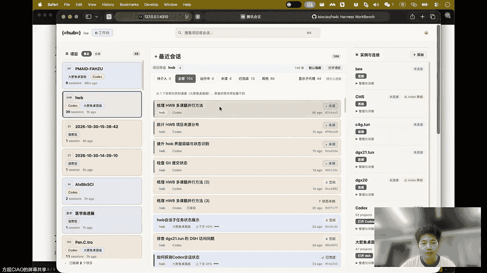
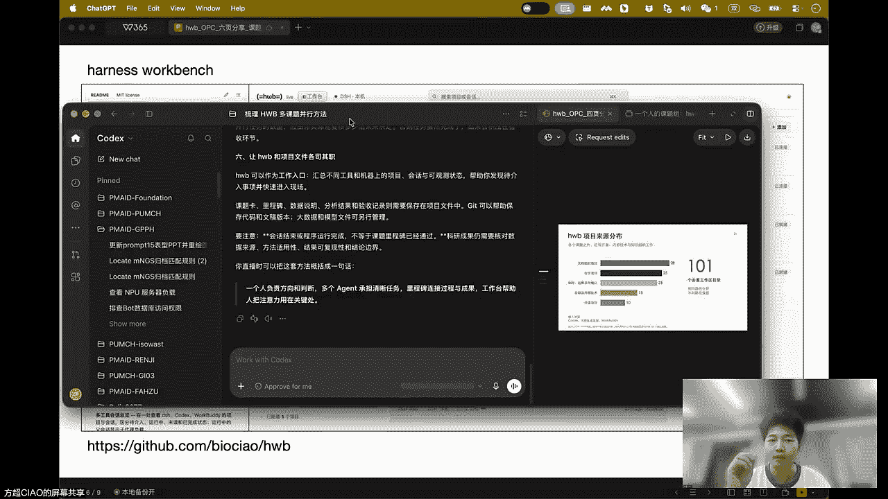
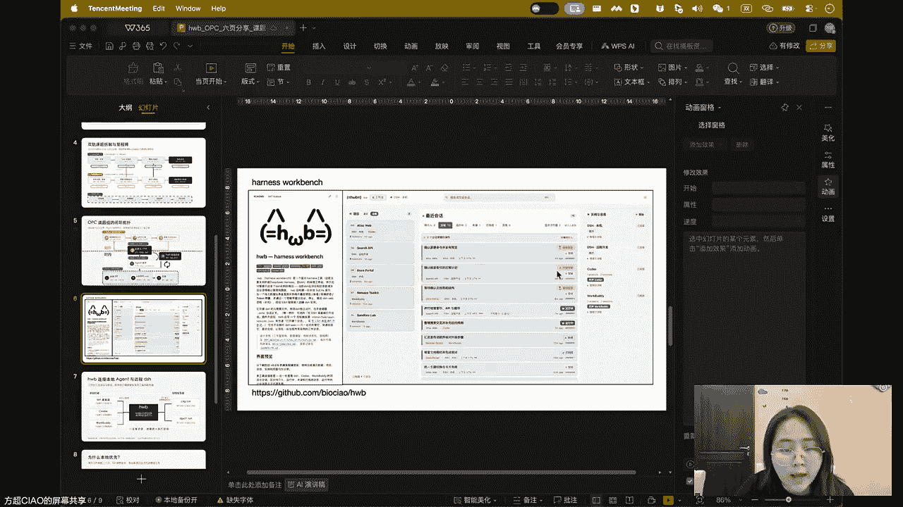

# 🧬 病原多组学与AI科研：01：课程概述与AI在科研中的角色

在本节教程中，我们将学习如何在AI时代高效管理多个科研项目。讲师方超来自华大基因，长期致力于探索如何利用AI提升科研工作效率，之前已经多次参加AI相关的交流会并分享经验。最近他因为自己同时开展了超过100个课题，深刻体会到多任务协调和项目组织所带来的困难。通过这次分享，你将了解AI如何帮助科研人员从重复性文档工作中解放，同时也要明白哪些工作仍然需要人类亲自决策。这些内容适合初学者，使用大白话进行讲解，希望能帮助你在众多科研任务中保持清晰的进度掌控。

AI时代到来之后，科研工作的效率确实得到了显著提升，我们能够同时开展的事情也变多了。但是，如何协调不同项目之间的关系，如何组织多任务的进度，反而变成了一个令很多科研人员头疼的问题。方超通过统计自己的开源项目，发现自己同时在进行的项目数量超过了100个，这个数字听起来非常夸张，但背后反映出了一个普遍存在的现象：AI虽然让单个任务变得更快，但项目数量的增加让管理成本急剧上升。


# 🧬 病原多组学与AI科研：02：100个项目的真实构成与任务分类

在了解了AI提升效率的背景之后，接下来我们来看看方超统计的100多个项目到底包含哪些内容，以及这些项目是如何分类的。这部分内容可以帮助你判断，在自己的科研工作中，哪些任务适合交给AI处理，哪些任务必须由人类主导。

以下是项目分类的具体情况：
- AI自动化任务，共23个。这些项目大多是AI自动生成的临时项目，包括运维任务、定时任务、每日AI文献总结、定时任务进度汇报等。这类任务非常省心，不需要人类投入太多精力，可以让AI自动完成。
- 文档组织类项目，共28个。这类项目属于文档整理和汇报逻辑的工作。由于华大基因正在进行AI转型，存在多体系融合的现象，不同的领导需要听到不同的数字，关注不同的技术方面，即使做的是同一件事，汇报口径也可能完全不同。有了AI之后，每周的进度报告可以由AI负责组织、罗列和呈现，针对不同的汇报口径生成相应的报告。这28个项目在过去会让人苦不堪言，每周需要花费大量时间写会议纪要、周报、项目汇报和制作PPT。现在有了AI，相当于把这部分时间都省下来了。而且因为数据、纪要和工作内容都存在本地，AI可以查询，避免产生幻觉，可信度也很高，汇总后的篇幅也不长，可以直接用于向上汇报。
- 传统课题类项目。剩下的三类更偏向传统的科研课题。
  - 开源项目，涉及10个，方超会在合适的时间陆续介绍。
  - 内部自研项目，大约15个。包括技术预言、大模型开发、微调工作、下游任务应用的分类头设计、数据整理和数据治理等工作。这些项目基本都是方超个人深度参与。
  - 合作方项目。这类项目难度最大，也最费心力，因为需要面对高校老师、医院医生，定期进行汇报，涉及横向或纵向课题。虽然生物信息学分析流程可以交给AI加速并行处理，但对结果的复核和确认始终需要人类认真研判，判断逻辑是否正确。

严格来说，真正的课题加起来大约40个，如果把开源项目算上，大约是50个。方超的精力基本分配在这50个项目上面，剩下的项目交给AI托管。所以100个项目确实有一定水分，但大部分同学可能也没有做到这么多。


# 🧬 病原多组学与AI科研：03：AI Agent的两种类型与科研场景选择

在具体介绍管理工具之前，我们需要先了解AI Agent的分类，这样才能选择适合自己科研场景的工具。不同类型的Agent适用于不同的任务，盲目选择可能会导致效率低下。

以下是AI Agent的两种主要类型：
- 托管型Agent。代表工具如Open Cloud，运行之后可以自行执行长期任务，最后随时询问结果即可获得答复。然而在实际科研工作中，这类工具用得并不多。科研课题很多是面对未知问题的探索和解决，现阶段AI还不够成熟，无法独立完成这种高难度的未知问题攻关。
- Coding型Agent。代表工具如Codeex、Cloud Code、Work、D Harness等。这类工具的工作模式是：人类给出明确指示，AI负责执行，人类负责决策。方超认为这类工具对科研帮助非常大，因为在过程中人类可以进行方向性决策，只是把具体执行交给AI。

今天的讨论主要围绕Coding型Agent的工具调度方式展开，因为这类工具更适合科研中人机协作的场景。


# 🧬 病原多组学与AI科研：04：OPC一人公司概念与课题组应用

理解Agent类型之后，我们引入一个核心概念，叫做OPC。这个概念能够帮助你建立一个人带领多个AI助手完成科研工作的整体思路。

```
OPC = One Person Company（一人公司）
OPC = 1人（或10人以内团队） + AI支撑的各职能部门
```

OPC指的是一个人或者十人以内的团队，利用AI支撑并替代公司所需的各个职能部门，实现一个人运转整个公司的目标。放到课题组里面也是相通的。有了AI加持之后，很多工作可以由AI承担。方超的领域是生物信息学，可以被看作科研领域的“码农”，上游数据可能已经由其他机构或平台产生，不需要自己辛苦做实验。科研人员大部分时间在拿到数据之后进行分析，这类过程完全可以交给Agent去执行。


# 🧬 病原多组学与AI科研：05：本地Git调度与Agent文档管理

为了高效使用Agent，方超采用了本地Git的方式进行项目调度。这个方法的核心在于把数据和资产掌握在自己手中，而不是依赖于单一的云端软件。

以下是本地化项目管理的关键做法：
- 将所有项目的数据、内容和文档放在Git仓库中进行版本控制。这个概念在IT行业非常熟悉，但在科研领域仍有很多人比较陌生，建议大家主动了解。
- 为每个Agent准备一个`agent.md`文档，例如`cloud.md`。这份文档用于标记项目的整体情况。Agent会以鉴定式披露的方式告诉用户需要什么信息、应该去哪些文档里查找，从而让Agent快速掌握项目的全貌。
- 将这个Agent文档放在项目当中。无论使用哪个Agent，都可以要求它读取这个文档。这样在切换不同的Agent之间，都可以快速掌握项目情况，并实现项目进度的同步。


# 🧬 病原多组学与AI科研：06：跨工具切换与Agent协作机制

在建立本地Git管理之后，方超还需要频繁在不同的Agent工具之间切换。这其中涉及到工具限额、数据资产掌握以及实际使用策略等问题。

以下是频繁切换Agent的主要原因：
- 工具使用限额。例如Cloud Code的Pro会员有每周额度，Plus会员有5小时额度，额度用完之后需要充值更大的会员，或者等待额度恢复后才能继续工作。当有很多项目需要推进时，等不起，必须换另一个工具去执行。
- 切换成本问题。过去切换工具的成本非常高，因为很多信息都存储在软件内部，换了工具之后相当于要从头开始。方超希望所有的数据和资产都应该在自己手中，因此采用本地方式管理所有项目内容，换一个Agent之后，它可以通过读取`agent.md`快速了解项目，接着工作。
- 实际使用策略。白天使用Cloud Code，因为它是定额的；晚上使用D Harness，因为它晚上半价。两者穿插使用。Body更多地用于项目进展汇报、PPT制作、会议纪要等工作。

通过这种方式，很多项目可以同时让Cloud Code和D Harness接触，项目进展类的工作则交给Body处理。


# 🧬 病原多组学与AI科研：07：Honey Work Bench多项目状态面板

当项目数量增加到一定规模，单纯依靠本地Git和Agent文档已经不够了，方超开发了一个小工具来解决项目切换和状态追踪的问题。这个工具就是Honey Work Bench，简称HWB。

以下是Honey Work Bench的主要功能：
- 左侧列出所有Agent工具的项目。
- 中间显示项目绘画状态，包括哪些需要审批、哪些正在运行、哪些已经完成但尚未查看结果。
- 右侧可以注册本地的Agent，包括当前使用的Codeex和D Harness等。
- 能够在同一个项目里看到Codeex和D Harness两个工具的开发状态，清楚哪些是由D Harness开发的，哪些是由Codeex开发的，哪些状态尚未读取。

HWB的实现方式并不复杂。它读取DH桌面端和Codeex桌面端的本地配置文件，只读取绘画的状态，而不是读取绘画的内容。它只是做了一个跳转功能，点击之后跳转到对应的Codeex或Session，不抓取任何上下文。如果想看具体上下文，点击跳转即可。这个工具其实就是一个信息汇总的面板，让方超把不同项目的状态清晰地列在一起，极大地节省了切换项目的时间。


# 🧬 病原多组学与AI科研：08：对外汇报与人机协作的底线



项目管理不仅是内部事务，对外汇报同样重要。方超特别强调了人类在AI协作中的最终决策权，这是很多初学者容易忽视的红线。

以下是对外汇报时需要注意的几点：
- 项目进度需要定期向合作方或领导汇报。
- 人类是项目的最终负责人，拥有唯一的最终决定权，绝对不能把AI推到前面来。
- 很多学生会直接把AI生成的内容给老师汇报，一旦被对方质疑问题，就答不上来，这是非常危险的行为。
- 正确的做法是：先将AI生成的内容消化，认可并充分理解之后，再把它拿出去对外讲解。理想的状态是，对外没有任何AI的痕迹，但人拥有100%的解释权，能够完全充分地解释和理解内容。
- 否则合作方容易质疑是不是AI生成的，如果内容空洞无误，对方会很快失去耐心，觉得你不负责任。

在跟合作方交流汇报之后，确定下一步的计划和目标，目标先进入人的脑子，然后再回去交给Agent去执行。这就是方超认为OPC可以执行的最小课题项目闭环。在这个基础上，从一个课题增加到三个、五个、十个甚至二十个课题，逻辑是相通的。




# 🧬 病原多组学与AI科研：09：多项目调度的痛点与本地优先策略

当项目数量增加到10个以上，乃至40到50个重点项目时，会出现新的管理困难。方超在分享中提到，自己曾经出现过找不到要推进项目目标的眩晕感，项目跑完需要review，某些需要提前appro，还有的因为断电断网导致任务中断。合作方突然询问特定内容时，在众多项目中难以快速定位。



以下是多项目调度面临的典型困难：
- 3到5个项目切换没有阻碍，但项目增多之后，很难快速找到想要推进的目标。
- 项目运行状态不一致，有的已完成需要审查，有的需要审批，有的因断网或关机中断需要恢复。
- 原生工具缺乏便捷的项目定位功能，搜索有时搜不到关键词，无法快速查看同一项目下不同Session的上下游任务状态。

为解决这些问题，方超开发了Honey Work Bench。最初这个工具是为了把远端服务器的项目接入进来，因为远端服务器稳定性更强，不会因为WiFi断连、电脑盖上或进入休眠而中断。但使用一段时间后发现缓存机制有问题，带宽不足时远程状态无法及时更新，因此逐步转变为以本地化为主的工具形式。在自己的电脑上存一份项目的最新进度，把轻量化的分析工作放在本地运行会更简单舒服。

为什么本地优先非常重要？除了前面提到的要把数据掌握在自己手中之外，还有一个原因是云端工具的本地化内容藏得非常深，使用门槛高，没有把东西披露出来。纯云端的工具只能登录访问，不知道状态，整合起来非常麻烦，而且数据不在自己手里，一旦无法访问就会丢失，切换工具的成本也很高。

本地优先的第二个优点是切换工具可以无缝进行。在Codeex和Body之间切换，甚至可以让它们同时在同一个项目下跑不同分支。因为所有的数据都在本地，读取的是同一份目录，写入时避免在同一个文件里冲突，就能很好地规避问题。这些问题都是Git已经非常成熟的管理模式了，所以本地化加上Git仓库，解决了很多问题，也是工具能够实现的基础。

项目使用Git登记和记录之后，可以放到服务器上同步一份，也可以放到别人的电脑上同步。不同的服务器功能不同，有的跑项目非常强，有的跑AI非常强，可以根据任务特性在不同服务器上运行合适的任务。


# 🧬 病原多组学与AI科研：10：课程总结与后续建议



本节教程中，我们一起学习了AI提升科研效率后带来的多项目管理挑战，了解了100多个项目背后的真实构成，掌握了AI Agent的两种类型及其在科研中的适用场景，学习了OPC一人公司概念在课题组中的应用，以及本地Git调度、Agent文档、Honey Work Bench等多项目管理工具和方法。同时，我们也认识到对外汇报时人类最终决策权的重要性，以及本地优先对数据安全和工具切换的意义。


方超今天想要分享的核心点，就是如何在面对大量同步开展的项目时，组织好自己的工作。他统计的项目主要来自高频使用的几个工具，今天讲的重点是在本地电脑上维护项目的安排和调度。如果大家对Honey Work Bench感兴趣，可以去GitHub搜索相关项目并点赞关注。如果有自己常用的工具想要接入，也可以在项目上提需求，方超很乐意扩充兼容性，这部分工作也可以交给AI去完成。




希望这些内容能帮助你在众多科研项目中保持清晰的进度掌控，把执行交给AI，把决策留给自己，真正实现高效的AI辅助科研。
