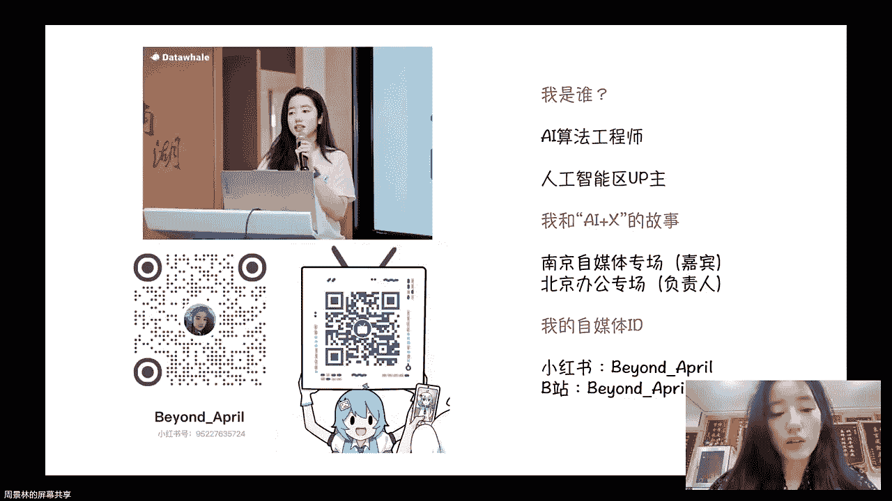

# 🚀 Datawhale AI+X活动组织教程：第1章：活动概述与整体规划

在本节课中我们将要学习如何组织一场Datawhale AI+X系列活动。无论活动是在室内还是室外举办，都需要一套清晰的流程和应对突发状况的预案。我们会先了解活动的基本结构，再看看在实际执行中可能遇到哪些常见问题，帮助新手避免踩坑。

AI+X活动通常包含两个核心环节，分别是嘉宾分享环节和实践操作环节。嘉宾分享环节负责介绍前沿的AI技术和实际应用场景，实践操作环节则让学员动手完成一个完整的小型项目。这两个部分缺一不可，才能保证学员既听得懂又做得出来。

我们可以用一个简单的公式来表示活动的基本结构：

$$AI+X活动 = 嘉宾分享环节 + 实践操作环节$$

在组织活动的过程中，突发情况几乎是必然会遇到的。比如组织者本人可能突然接到紧急任务无法继续负责，或者嘉宾因为临时工作无法按时分享。另外如果活动在户外举办，天气和气温也会影响到最终的到场人数。以下是我们在实际活动中遇到的典型突发情况列表：

- 组织者在活动筹办到一半时，因紧急任务需要临时抽身，必须找到一名协作者接手组织工作。
- 嘉宾在分享前接到临时紧急任务，无法按原计划进行演示。
- 户外活动受天气影响，虽然气象局预报不下雨，但现场气温较低，导致到场人数远低于预期，活动开始时仅十几到二十人，后期才逐渐增加到三四十人。

针对这些不确定因素，我们在制定活动方案时必须留出足够的余量，并提前制定备选方案，这样才能在出现意外时快速调整，保证活动正常进行。

# 📋 Datawhale AI+X活动组织教程：第2章：人员协作与沟通策略

上一节我们介绍了活动的整体规划和常见突发情况。本节中我们来看看如何与团队成员和各方负责人进行高效沟通，以及在关键人员缺席时如何保障活动不停摆。

活动组织离不开多方协作。除了核心组织团队，还需要明确各个环节的负责人，比如宣传物料的来源、推广引流的执行、教程质量的把控、教程展示的方式等。每个环节都应该有专人负责，避免职责模糊导致任务遗漏。

在与负责人沟通时，建议采用极简沟通方式。因为这些负责人通常需要同时管理全国各地的多场活动，手头任务很多，没有精力进行冗长的背景介绍。我们可以直接说明自己的需求，清晰列出截止日期和交付内容，避免无谓的沟通浪费双方时间。

极简沟通可以用下面这个公式来理解：

$$极简沟通 = 明确需求 + 截止日期 + 交付内容$$

以下是实际组织中建议采用的沟通方式：

- 直接说明需求，不要铺垫过多背景信息。
- 明确截止日期，比如要求提前五天提交PPT内容，而不是提前三天。
- 为突发情况预留缓冲时间，给后续处理留出空间。
- 列出每个环节的负责人名单，确保问题能迅速找到对应的人解决。

# 🛠️ Datawhale AI+X活动组织教程：第3章：时间管理与预案准备

上一节我们介绍了人员协作与沟通策略。本节中我们来看看如何合理安排时间节点，并为演示内容和现场设备制定充分的预案。

时间是活动组织的核心约束。在实际操作中，我们往往只有大约一周的时间从接到任务到完成活动筹备。在这个紧张的周期里，必须尽早开始收集内容和准备材料。正常情况下我们可能只需要提前三天把PPT交给组织方，但为了应对突发状况，建议尽量提前五天就把所有内容收集齐全。

建议的提前量可以用下面这个简单公式表示：

$$建议提前量 = 正常提前量 + 缓冲时间（例如 5天 = 3天 + 2天）$$

演示内容的准备是现场顺利进行的关键。整体负责人需要准备一份完整的活动流程PPT，并对各位嘉宾的PPT在结构和风格上进行统一。现场可能还需要二维码报名表、签到表等辅助材料。这些关键内容都要提前做好备份，并且尽量提前到现场进行预演，确保设备和流程没有问题。

以下是时间与预案方面的具体建议：

- 提前五天完成PPT内容收集，给自己和对方留出修改时间。
- 为每个环节明确负责人，建立快速沟通渠道。
- 提前备份所有演示文件和现场材料，防止遗失或损坏。
- 提前到现场进行一次完整的流程预演，检查投影、网络、音响等设备。

# 🎤 Datawhale AI+X活动组织教程：第4章：现场执行与分工协作

上一节我们介绍了时间管理与预案准备。本节中我们来看看活动当天的现场分工，以及如何选择有经验的团队成员来保障活动质量。

现场执行需要明确的分工，每个人都知道自己负责什么，才不会出现推诿或遗漏。对于AI+X活动来说，我们一般会配备主持人、摄影师和助教。主持人负责控制场地气氛和流程节奏，摄影师负责记录活动精彩瞬间，助教则负责在实践环节回答学员问题、协助调试代码。

助教的角色尤为重要，因为AI+X活动的一个核心亮点就是实践部分。如果没有足够的助教支持，学员在动手操作时容易卡住，整体体验会大打折扣。

现场团队的构成可以用下面这个公式来概括：

$$现场团队 = 主持人 + 摄影师 + 助教 + 有经验组织者$$

此外，在活动筹备阶段，建议优先找一位有经验的小伙伴进行指导和学习。虽然我们鼓励所有同学积极参与组织工作，但为了保证活动质量，核心环节还是应该由有经验的人来把关。比如遇到现场突发问题，可以直接交给博晨、苏鹏、玉神等有经验的同学处理。

以下是现场建议配备的人员及其主要职责：

- 主持人：串联全场流程，引导嘉宾分享和学员互动。
- 摄影师：拍摄活动照片和视频，用于后期宣传和复盘。
- 助教：协助学员完成实践任务，解答技术问题，维持实践环节秩序。
- 有经验的组织者：统筹突发状况，负责关键决策和应急处理。

# 📊 Datawhale AI+X活动组织教程：第5章：教程质量与展示优化

上一节我们介绍了现场执行与分工协作。本节中我们来看看如何在时间紧张的情况下保证教程质量，并通过可视化方式提升展示效果。

教程质量直接体现了Datawhale的专业水平。由于筹备时间通常只有大约一周，部分教程内容可能需要重写或大幅修改。在这种情况下，我们可以选择使用之前已经制作好的可视化形式来展示内容，而不是从零开始制作新的教程材料。

教程展示质量可以用下面这个公式来表示：

$$教程展示质量 = 已有可视化素材 + 资源库支持$$

AI+X系列活动拥有自己的资源库，里面存放了许多已有的可视化资源和教程素材。如果我们需要更新或补充内容，可以将新素材提交给资源库负责的同学，由他们帮助制作可视化展示。这样不仅能节省时间，还能提升整体的展示质量，让学员更直观地理解AI技术。

以下是保证教程质量的具体做法：

- 以Datawhale的名义输出内容，整体水平要体现品牌专业性。
- 时间不足时优先使用已有的可视化素材，避免重复造轮子。
- 有新内容时及时提交给资源库负责同学进行可视化处理。
- 提前进行教程试讲，确保讲解逻辑通顺，难度适中。

# 📝 Datawhale AI+X活动组织教程：第6章：总结与后续建议

本节课中我们一起学习了如何组织一场Datawhale AI+X活动，包括活动概述、人员协作、时间预案、现场分工以及教程质量把控等方面的内容。

活动组织是一个系统工程，需要提前规划、预留余量、明确分工，并为突发情况准备应对方案。无论是面对组织者临时缺席、嘉宾无法到场，还是户外天气导致人数波动，只要我们在方案阶段就考虑到这些可能性，并在执行过程中保持清晰的沟通，就能把活动办得既专业又顺利。

如果你以后要组织类似的活动，可以重点关注以下几点：提前五天准备材料、找到有经验的组织伙伴、明确现场分工、利用资源库提升教程展示效果。希望这些经验能帮助你更好地举办AI方面的活动。如果想讨论更多AI相关内容，欢迎关注相关账号进行交流。

