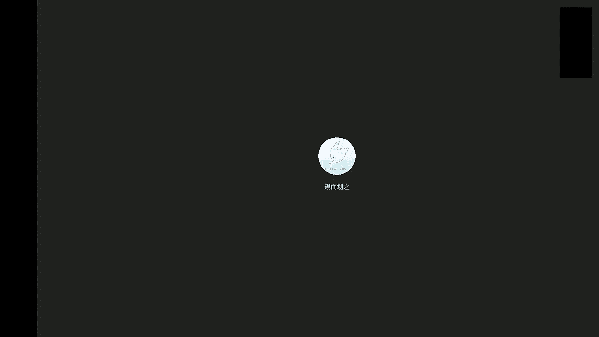

# 🩺 深度睡眠：大脑清洁与阿尔茨海默：01：课程概述与免责声明

在本节课中，我们将一起了解睡眠的基本常识，学习如何评估自己的睡眠状况，并探索改善睡眠的具体方法。

首先需要说明一个前提。讲师没有医师身份，本次分享也不构成医学建议。如果你评估后觉得自己的睡眠状况已经对自身造成重大影响，第一步应该去找医生。这就是本次分享的免责声明，我们在这里不提供诊断或治疗权利。

我们在这里的目标是什么？首先，借此机会分享一些个人体会，包括讲师和来访者、用户的观察，以及干预后的数据结果。其次，希望大家能通过这次机会，实际审视自己的睡眠，认真盘算一下自己的情况。最后，在盘算过程中，如果你有疑问或困扰，可以及时进行互动交流，对感兴趣的话题进行更深入的探讨。

整个过程预计是一小时到一个半小时左右，具体时长会根据现场提问人数和沟通顺畅程度而定。

以下是本次分享的三个主要目标：

- 分享个人体会、观察数据与干预结果
- 协助大家实际审视自己的睡眠状况
- 提供及时互动的交流空间

# 📝 深度睡眠：大脑清洁与阿尔茨海默：02：睡眠自检与现状评估

上一节我们介绍了课程概述与免责声明，本节中我们来看看如何进行睡眠自检，帮助你了解睡眠目前的困扰程度。

在开始之前，建议你先做一个简单的睡眠自检。你可以借此机会看一看、感受一下自己的睡眠状况，为自己打一个分。打完分以后，心里会大概有一个谱，课程结束后可以重新打分，对比困扰程度的变化。

第一个问题，睡眠在多大程度上困扰你。你可以现在开始给自己打分，分数区间是从0到5分。0分表示完全没有困扰，5分表示几乎被睡眠问题压着走。每个人的评价区间不一样，有人凌晨两点睡觉但精力很好，觉得还可以；有人想早睡却睡不着，或者非常看重白天精力，就会觉得很困扰。这只是对你自己来说的一个状态，没有绝对的对错。

公式：睡眠困扰评分 = 0 ~ 5 分

第二个问题，一周七天里，你会有几天的晚上被睡眠问题所困扰。这里所说的睡眠问题，一般包括以下几种情况：从你想要躺在床上睡觉，到真的睡着，超过了半个小时，翻来翻去睡不着；早上想要好好睡眠，但晚上反复醒来；入睡后很快醒来，醒完之后没有困意；做噩梦等。你可以盘一盘一周七天里，有几天晚上会觉得自己被这些情况困扰。

以下是睡眠问题的常见定义：

- 入睡时间超过30分钟
- 夜间反复醒来
- 入睡后很快醒来且无困意
- 做噩梦

经过这两个问题，你就初步评估了一下，对于自己来说，睡眠这个模糊的形状可能是怎样的。你可以感受一下，睡眠现在对你来说，重要程度是多高。

接下来，你可以再感受一下，如果睡眠会稍微好转，你希望是哪个方面发生变化。比如入睡时间和起床时间更规律，还是希望整体时间往前调，或者早上起来不那么困，日间精神状态改善等。

以下是大家常见的改善方向：

- 入睡时间和起床时间更规律
- 整体睡眠时间段往前调
- 早上起来不那么困
- 日间精神状态得到改善

# ⏰ 深度睡眠：大脑清洁与阿尔茨海默：03：睡眠时长与入睡时间的常识

上一节我们介绍了睡眠自检与现状评估，本节中我们来看看关于睡眠时长和入睡时间的常见问题。

很多人关心睡多长时间才合适，几点睡觉才不算熬夜。从统计学角度来看，一个人的睡眠时长一般在6到8小时之内，太长了可能也不好，太短了也不好。但具体到每个人身上，情况可能不太一样。

有一部分人觉得睡5个小时或6个小时就够，这其中有一小部分是天赋异禀，真不需要太多睡眠。但另有一部分人，其实是对自己有要求，想要保持清醒状态，身体为了适应这种要求，就压缩了睡眠时间。所以如果你的整体睡眠时间在6到8小时这个区间之内，通常不会被医学框架认定为睡眠时间不够。

关于几点睡、几点起算合适，中医上有不同说法，但核心思路是顺应自然节奏。假设我们生活在没有手机、没有电脑、不需要搞AI，每天种庄稼的时期，到了晚上天黑了，你自然就睡了，半天就起了。那时候的睡眠点和整个大自然的节奏是一致的。中医理解上，一般在10点到10点半左右的区间睡比较合适。当然，现在很难完全达到这个状态。

睡眠这件事情很有意思，它实际上是人体不可违抗的自然规律，与我们内在需求和外界环境要求之间的矛盾爆发点。比如你要工作，晚上还在回消息，尽管文明进化很快，AI很多很快，但你的身体还停留在数万年前的初始水平，没有跟上环境变化的速度。

以下是关于睡眠时长与时间的关键点：

- 统计学推荐睡眠时长：6 ~ 8 小时
- 个体差异：部分人天生需要较少睡眠，部分人是刻意压缩睡眠
- 建议入睡时区：10:00 ~ 10:30 左右（顺应自然节律）


# 😰 深度睡眠：大脑清洁与阿尔茨海默：04：焦虑与睡眠的关系

上一节我们介绍了睡眠时长与入睡时间的常识，本节中我们来看看焦虑如何影响睡眠。

焦虑实际上是一种对于不确定性的担忧。现在的环境，大家大概率不会愁吃愁喝，也不会明天就饿死，但为什么还会这么担忧呢？这是因为你的身体并不知道外界有这么大的变化，它感受到的是来自外界迅速发展的变化性，以及内在的情绪感受。身体很长时间没有和能够链接到自然的事物待在一起，比如树木、人的自然节奏等。内心就会有一种不安稳，这种不安稳迭代到整个时代的迅速发展，就会演变成焦虑。

接下来的人，包括比我们小十岁、小二十岁的人，以及未来起码50年的周期里，大家都会越来越焦虑，这是跑不了的。所以你会发现更多的人晚上熬夜，失眠会成为一种症状。这不是某一个人面对的问题，是我们共同面对的现象。

焦虑与睡眠之间还存在一种恶性循环。你对于睡眠本身的焦虑，也会变成一种焦虑。越强迫自己睡觉，越睡不着。这时候焦虑上面叠加一层自责，你焦虑，说自己怎么睡不着，怎么这么多事情，然后自责没有照顾好身体，焦虑到了这个点还没睡着怎么办，焦虑就越来越高，越来越高，你就真睡不着了，然后更逼自己说现在就要睡着，结果就不行了。

以下是焦虑影响睡眠的关键机制：

- 焦虑源于对不确定性的担忧
- 现代环境的快速变化加剧身体不安感
- 强迫入睡 → 焦虑增加 → 自责 → 更难入睡

# 🔄 深度睡眠：大脑清洁与阿尔茨海默：05：身体自我调节与CBTI原理

上一节我们介绍了焦虑与睡眠的关系，本节中我们来看看身体如何自我调节，以及CBTI的基本原理。

CBTI是针对睡眠障碍，尤其是失眠的一线疗法。在效度上，它和安眠药是同一等级的，也是临床最为推荐的疗法。但是CBTI适合的人群比较特定，主要是那些完全丧失睡眠能力的人，也就是说想睡觉但一夜完全睡不着。如果你只是因为生活里的种种事情，不舍得睡，希望给自己自由飞翔的机会，或者想把休息时间用来娱乐和放飞自我，硬性逼自己睡觉是逼不了的，你也做不到。

CBTI的方法是利用身体的自然规则。它会强制安排睡眠时间，比如每天晚上提前睡5分钟，早上早起，起来早了白天就会困，困到晚上就能更早睡。它适合驱动力特别强，说什么事都不干，一定要把睡眠搞好的人。CBTI的优先级高于安眠药，因为安眠药长期服用，会面临剂量越来越大，到某一天不太管用的副作用，虽然不是每个人都这样，但这是临床现象。

我们现在讨论的不是严重到完全失去睡眠能力的情况，而是如何在现有时间内，让自己睡得更好，能安稳入睡，同时内心不特别不舒服，不会觉得还没玩够很难受。

CBTI背后也是一个自然的规则。你作为一个人，能呼吸、能吃饭、有相对正常的节奏，说明身体整体处在较为平衡的状态。当哪里出现失衡，身体会千方百计把状况扭过来，回到平衡状态。所以CBTI让你早上到点就不能再睡觉，甚至要求午睡时间不要超过半小时，最好15到20分钟就醒。这也是和睡眠动力有关。

你可以把体内的睡眠曲线想象成潮汐，往回退退退退回去，退到一定程度，一定会再长过去。如果你白天一直不睡觉，够困了，到了晚上那个点，可能相对来说就会更容易睡觉。这是一个大的逻辑。首先没有人是一直睡眠好，从来没有经历过睡眠不好的状态。其次，当你睡眠不好的时候，首先要相信身体有足够的动力，会自我调整。

以下是CBTI的核心操作：

- 固定起床时间，早上到点就起床
- 限制午睡时长，不超过30分钟，最好15到20分钟
- 白天保持清醒，增强夜晚睡眠压力

公式：睡眠动力 ≈ 潮汐机制（白天保持清醒 → 夜晚睡眠压力增加）

代码逻辑：

```
if 白天不睡觉:
    夜晚入睡难度降低
```

# 🧠 深度睡眠：大脑清洁与阿尔茨海默：06：睡前记忆与大脑清理机制

上一节我们介绍了身体自我调节与CBTI原理，本节中我们来看看睡眠对记忆和大脑清理的作用。

睡眠是一个休息的过程，在休息的时刻里，你的脑和身体会像打扫房间、清理垃圾一样，把不好的东西扔掉，把好的东西规整好。所以白天学习的东西，在睡眠时，身体和大脑会自动帮你进行加工。


但是如果你一直处在很疲惫的状态里，身体会优先照顾疲惫，让你得到休息，你学的东西就没有空间得到好的加工了。这是因为大脑内存是有限的，身体肯定优先先做那些更能保障基础生活的事情，先让你吃上饭，吃完饭了再说怎么吃更好的饭。

所以睡前强行记东西，效果可能并不好。睡前记东西为什么有人觉得更好，是因为睡眠时大脑会自动加工，但前提是身体不至于太疲惫。

以下是睡眠期间大脑的工作机制：

- 清理无用信息，像扔垃圾一样
- 整理有用记忆，像规整房间一样
- 优先保障基础生存，剩余资源才用于记忆加工

公式：睡眠期间大脑操作 = 清理无用信息 + 整理有用记忆

公式：大脑资源分配 = 基础生存优先 + 剩余资源用于记忆加工

# 😌 深度睡眠：大脑清洁与阿尔茨海默：07：深夜焦虑与放松方法

上一节我们介绍了睡前记忆与大脑清理机制，本节中我们来看看针对深夜焦虑和胡思乱想的放松方法。

深夜焦虑、胡思乱想、内耗导致睡不着，是很有共性的问题。过去你可能采取过一些措施，比如念佛教咒语、四七八呼吸法、把空调调到很低的温度，或者通过运动让自己身体累一点。有些措施效果不是很好，或者不能持续。

我们可以从过去的经验里得到启发。有的奏效，有的不奏效。如果你完全没见过这个问题，它实际上就不是问题了。所以可以回忆一下，有没有哪一天你不知道怎么回事，睡得还可以。比如出去旅游时，早上七八点起床出去玩，玩了一天，晚上很自然就困了，就睡着了。这是因为旅游时比较快乐，晚上不那么回想很多东西了。

方法来源于你自身，对你来说一定是有效的，你只需要看到它是怎么有效的，然后去总结，让它更多地复现。刚才也有提到，有些人觉得睡前看一些成人电影有助于入睡，这些都属于个人经验，关键在于找到适合自己的方式。

环境也很重要。睡眠不是高唤起的那种娱乐休息，它是让你逐渐处在一个较为平静位置的状态。如果床上放着第二天工作要看的资料，或者醒来后第一眼就要看的报告、手机页面，或者各种会引起你焦虑的事情，你会是什么状态？你应该按照反面来布置环境，让你在床上时，直觉感到更安全、更放松。

有些小窍门可以偶尔试试，但不是长期解决方法。比如平躺时眼睛往下巴方向看，眼球向下翻，可能会让人进入睡眠状态，但这有一点因果颠倒，效果没有想的那么大。再比如调低空调温度，因为睡着后身体进入静息状态，能耗降低，体温会低一点，外界温度再低一些，身体会觉得不睡觉耗能太大，于是“关机”进入睡眠状态。

茶氨酸、褪黑素等补剂属于治标不治本，能管一段时间，但大量摄入会打破身体原本的平衡，身体会慢慢调回去，所以不是关键因素。

以下是缓解深夜焦虑的常见方法：

- 念咒语、四七八呼吸法
- 调低空调温度
- 运动让身体适度疲劳
- 优化睡眠环境，去除焦虑源
- 眼球向下翻等小动作

公式：睡眠环境优化 = 去除工作资料 + 移除焦虑源 + 营造安全感

# 📄 深度睡眠：大脑清洁与阿尔茨海默：08：焦虑的预防与应对

上一节我们介绍了深夜焦虑与放松方法，本节中我们来看看如何预防和应对日常焦虑。

当焦虑成为影响睡眠的主要因素时，需要认真看一看，到底是怎么了，你为什么焦虑。焦虑这个东西，在咨询过程中发现一个角度，问题其实是无法被直接解决的。当你处在另外一种状态里时，之前困扰你的东西，会自然而然有一些新方案，但并不是因为你解决了它。

所以我们不和这些东西做纠缠。当你看见自己焦虑时，并不是说要立刻不睡觉，把所有困难都处理掉。你可能能处理一些，但肯定所有的都没办法处理。

首先因为焦虑是对未知的恐惧。你要先看一看，自己在焦虑什么。就像做头脑风暴一样，发现自己睡不着觉，实在太焦虑了，那就别睡了，起来把所有焦虑转移到纸上，不要让它在脑子里转。

这就像一个程序，前台在运转，后台不断给你发病毒性消息，挤占内存。我们现在就是把这些挤占内存的东西腾到纸上。这实际上在给大脑一个信号，这些东西已经有地方安放下来了。把大脑清空，把焦虑具体化，就是一个方法。

写下来之后，不一定非要去做。你生活里想想，小时候迟到觉得天要塌了，天真的塌了吗？问题不是用来解决的。而且问题就算不解决，你活到现在也不差，不会因为迟到一次就打入地狱。

在这个过程中最重要的是怀抱着这样的心态，去尝试对你有效的方法。当你觉察到有担心时，没关系，带着担心去做，看看会发生什么。没有哪一个办法是永远有效的，也没有哪一个办法对所有人都有效。你要去找适合你的方式，能让你在兴奋状态下安静下来，能让你对焦虑有一些措施。

以下是应对焦虑的步骤：

1. 写下所有焦虑，转移到纸上
2. 接受最坏可能的结果
3. 保持探索心态，试用不同方法
4. 复现对你有效的方法

公式：大脑内存释放 = 焦虑内容迁移至纸面

# 📱 深度睡眠：大脑清洁与阿尔茨海默：09：手机使用与正念觉察

上一节我们介绍了焦虑的预防与应对，本节中我们来看看手机使用对睡眠的影响，以及正念觉察的方法。

晚上不睡觉，大部分时间都在用手机。当你刚拿起手机，可能还在比较放松、比较愉快的状态。但看上半个小时、一个小时后，状态会变成什么样？刷手机会变成一个惯性动作，你想休息，想用这种方式放松神经。但刷到后来，也许也不那么有趣，可也不想停下来。身体和大脑被大量来自手机的信息冲刷，进入了较为麻木的状态，在这种状态里很难睡着。

所以为什么要支持大家用正念方法呢？就是去使得你对自己的感受有一些觉察。这种觉察要分情况看，首先是否找到了适合这个时候的你的方法。其次正念也有很多形式，比如冥想、念咒语、什么都不想等。但强行要求大脑什么都不想是做不到的。

正念觉察不是为了强行改变状态，而是为身体变化提供空间。你可以试着感受，现在脑袋是沉的还是轻的，你是坐着还是躺着，身体上哪一处感受更吸引注意力，那个感觉是什么形状，是持续的还是会变化的，当你去体会的时候会有什么情绪。

自我照顾的小动作也有帮助，比如用手轻轻按摩头部，或者伸个懒腰，以舒服的形式，各种歪七扭八地伸，怎么舒服怎么伸，慢慢去做，充分感受此刻的身体状况。让白天里更多出现这样的小机会，帮助身体。

晚上睡不好，往往并不单纯是睡前那一小段时间的事情，而是你整个白天的状态。

以下是正念觉察的具体练习：

- 感受脑袋状态：沉还是轻
- 感受身体姿势：坐着还是躺着
- 注意力吸引点：身体哪处感受更强
- 感受形状与变化：持续还是变化

公式：正念觉察 = 非评判性地关注当前身体感受

# 🌞 深度睡眠：大脑清洁与阿尔茨海默：10：白天状态与晚上睡眠

上一节我们介绍了手机使用与正念觉察，本节中我们来看看白天状态如何影响晚上的睡眠。

很多时候晚上睡不好，其实不是睡前几分钟的问题，而是你整个白天的状态。如何让白天的时候更开心，让开心的事情多发生，让自己更容易感到满足，晚上就会睡得更好。累的时候，在那些感觉累的当下进行自我照顾，也能让睡得更好。

睡眠问题通常不是一天两天形成的，身体和大脑长期协作，维持到了现在的状态。你要慢慢积累，先积累一个，再积累两个，一点一点去积累那些能让你比现在好上一点点的方法。比如说现在感觉哪里不舒服，可以用手轻轻照顾一下。

以下是改善白天状态的建议：

- 增加开心的事情
- 累时及时自我照顾
- 白天多进行身体舒展动作

# 🌳 深度睡眠：大脑清洁与阿尔茨海默：11：AI时代的睡眠焦虑与自然疗法

上一节我们介绍了白天状态与晚上睡眠，本节中我们来看看在AI时代如何缓解与睡眠相关的焦虑。

AI技术发展很快，加上开源社区的发展，带来的焦虑和对未来的焦虑是很正常的。完全不焦虑才不正常。这是一个大趋势，接下来的整个时代，大家都会随着AI等科技浪潮带来的时代发展加速。上一辈人、我们、十年前、现在，状态都不一样，时代发展太快。

面对宏大趋势，回归到自己身上，还是得吃饭、喝水、睡觉。就算明天火星人进攻地球，三体人占领世界，今天不吃饭、不呼吸，一样活不下去。所以要关注具体的、微小的事情。

每天接收到的信息太多，世界飞速变化的冲击让人容易站不稳。你可以每天安排出一小段时间不用手机，到公园里散散步，在有树的地方，摸摸树叶、摸摸树干，看看今天的云是什么样子。给生活留一小段时间，去接触身边5公里以内的真实自然、真实环境。

网上的很多信息，只是信息，只是观点，有些还是骗子故意放出来的。去现实世界接触，你会真正去看今天是什么云、是什么树、树叶是什么样子、绿化带有什么植物，还有开花情况、气味等。人身为这种存在，和自然本来就是一体的。在自然环境里，能感受到绿色，能呼吸到更清晰的空气，整个人会自然而然放松，不需要做什么，心里会觉得踏实，有一种安心的感觉。

中医体系也强调与自然节律结合，身体是连接内外的重要抓手。不要被成功学裹挟，人本身有另外一面，和自然本来就是一体的。

以下是缓解AI时代焦虑的方法：

- 每天留出不碰手机的时间
- 接触自然环境：公园、树木、云朵
- 回归具体生活：吃饭、喝水、睡觉



# 🎓 深度睡眠：大脑清洁与阿尔茨海默：12：总结与AI辅助学习建议

上一节我们介绍了AI时代的睡眠焦虑与自然疗法，本节中我们来进行总结，并介绍如何利用AI辅助学习。

今天我们整体梳理了睡眠状况评估、睡眠时长与时间常识、焦虑与睡眠关系、身体自我调节、大脑清理机制、深夜焦虑应对、环境优化、正念觉察、白天状态管理以及AI时代焦虑缓解等内容。

核心思路是：相信身体有调节能力，只需要给它一些时间；处理焦虑，包括对睡眠本身的焦虑和睡眠以外的其他焦虑；采用更接近自然的方式和方法；积累其他的一些小诀窍。你可以把这些整理一下，如果有具体问题，可以在群里继续聊。

关于如何使用AI，建议两个方向。第一个方向，让AI协助你去判断、协助你探索，你对于睡眠的认知。很多人包括我自己也感觉到，理念上很想注意睡眠，但实际行动上可能没有那么注意。背后有很多自己对于睡眠的理解，这些理解不是问题，而是要让AI协助你探索，你对睡眠真正的看法，在现阶段是怎样的。

第二个方向，让AI协助你去探索那些你能够用的、有效的措施，已经采取过的和觉得可能有效的措施中，有效背后的机理，对于你来说有用的是什么？尤其要让他从身体休息角度去做探索。因为AI很擅长给你一堆资料，但人在这个过程中最难的，也是AI无法支持的一点是，这个过程如何做。

系统了解睡眠的材料，其实并不是特别有推荐，因为睡眠这件事，最好的方式是自己去探索体验，根据自己的体验看哪些对你有帮助。看到的材料通常是整体形成方案的东西，但个人最重要的是先睡好觉，再说怎样。当我们想系统去了解时，很多时候重点会跑偏，觉得要去学习一个东西，那个是不是真的要的，可以判断一下。

备考方面，睡前和醒来更重要的是，需要让信息在脑海里有一些有益的组织。睡前看资料不是去看书，而是睡前可以做一个回顾，完全不看书的情况下，在纸上写，或者在脑海里把今天学习的内容列出来，列结构、画思维导图，这是最有用的方法，利于睡眠记忆。但要看自己的状况。除了考试，给自己安排一些考试中间能让自己比较舒展的休息，备考才会更高效。

以下是使用AI辅助睡眠学习的建议：

- 让AI协助探索你对睡眠的真实认知
- 让AI协助分析有效措施背后的机理
- 睡前回顾学习内容，画思维导图
- 备考期间安排舒展休息

本节课中我们一起学习了睡眠自检、睡眠常识、焦虑与睡眠关系、CBTI原理、大脑清理机制、放松方法、正念觉察、白天状态管理、AI时代焦虑缓解以及AI辅助学习建议。希望大家结合自身情况，慢慢尝试适合自己的方法，祝大家好眠。

