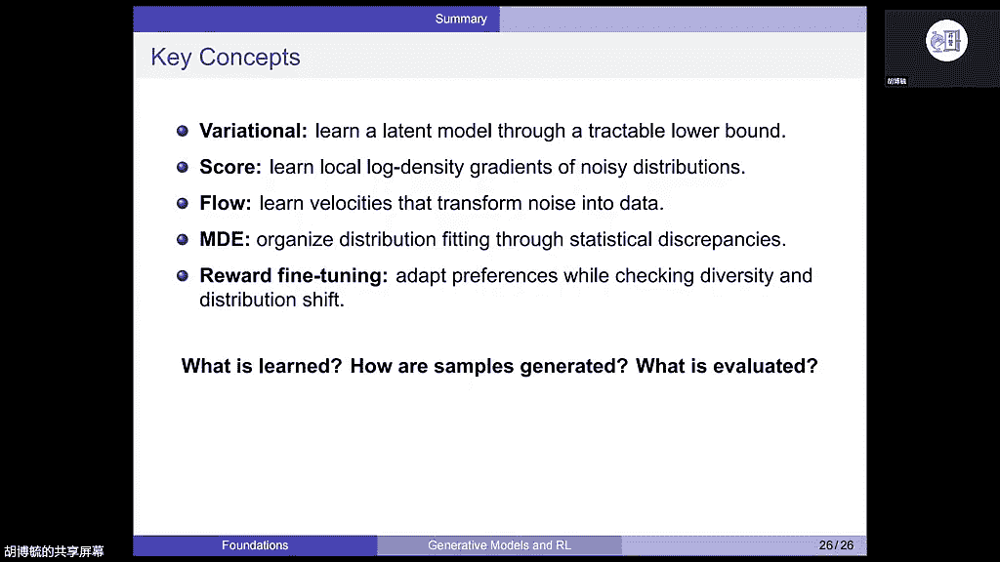

# 🤖 生成式模型原理解读：01：从噪声到数据的扩散模型入门

本节课中我们将学习生成式模型的基本原理，重点介绍如何从噪声中还原数据，并详细讲解扩散模型的变分、得分与流三种理解视角，最后介绍基于强化学习的生成式模型微调方法。

## 课程背景与讲者介绍

本节内容的分享者是对外经济贸易大学统计学院统计学专业的一年级博士生。该学院的老师多出身于数学背景，因此目前的研究方向主要集中在生成式模型与强化学习上。由于工程方面的基础相对较弱，讲者希望能够通过学习前沿的生成式模型知识，弥补这一不足。在学习过程中，主要参考了宋阳编写的《扩散模型基础》一书，也学习了麻省理工学院关于流匹配与扩散模型的课程。本节内容将从变分、得分和流的角度出发，研究余弦模型等典型的扩散模型。

## 生成式模型的核心目标：从噪声还原数据

生成式模型要完成的一件核心事情是：从数据中生成噪声是很容易的，而从噪声中生成数据才是生成式模型的本质任务。所谓生成式模型，是指我们假设数据来自于某个概率分布。大家在概率论与数理统计课程中应该学过，数据通常是由某个概率分布产生的。然而，在实际问题中，我们并不知道这个分布具体是什么，而且在原则上也永远无法直接知道真实的分布形态。我们只能获得一些观测样本。我们认为图中的这些 X_i 是从概率分布 P_data 中抽样得到的。

接下来，我们希望利用这些观测样本来学习一个模型 G_θ。这里的 G_θ 可以看作是神经网络的某些参数。我们的目标是让模型 G_θ 与真实数据分布 P_data 之间的距离尽可能接近，也就是说，让模型分布与真实数据分布尽量保持一致。这就是生成式模型最基本的目的。用公式表达，我们希望模型分布 G_θ 趋近于真实数据分布 P_data。

## 扩散模型的基本原理：加噪与去噪

我们可以观察到，扩散模型在训练阶段通过加噪的方式对模型进行训练，而在生成阶段则通过去噪的方式生成新数据。一个比较经典的例子是 DDPM，即去噪扩散概率模型，它属于离散去噪的概率模型，也是目前比较经典的方法之一。在训练时，我们给原始样本加上噪声；在生成时，则从噪声分布中一步一步构造出新的生成数据。

## 三种理解扩散模型的视角

理解扩散模型主要有三种视角。下面是这三种视角的具体介绍。

第一种是变分视角，从这个视角出发，我们得到的是一个隐变量模型。第二种是得分视角，核心思想是学习一个得分函数，用来反映样本变动的方向。第三种是流视角，核心思想是学习一个速度场。DDPM 方法既可以从变分的视角来理解，也可以从得分的方式来理解。

## 变分视角：隐变量模型与 ELBO

在变分视角下，隐变量模型的基本思想对应着 VAE，即变分自编码器。我们有一个观测样本 X，通过编码器将其编码为隐变量 Z。这个编码器是基于给定 X 的条件下的隐变量分布。随后，我们再通过解码器从隐变量 Z 解码生成 X。

在训练模型时，我们需要同时考虑重建误差和分布正则化两个问题。具体来说，既要让解码器的似然损失，也就是重建误差足够小，又要让给定 X 之后的 Z 分布与先验分布之间的 KL 散度保持较小。先验分布通常选取高斯分布。如果不能满足这一条件，生成的结果可能会出现不合理的情况。

训练目标对应着 ELBO，即证据下界。ELBO 可以通过詹森不等式进行推导。它的本质是对数似然的期望低于期望的对数，因此它是一个下界。变分视角可以理解为一种近似方法。由于我们不知道数据的真实分布，因此引入一个先验分布，然后通过贝叶斯方法求得后验分布，从而逼近那个未知且无法直接求解的分布。

## DDPM 与扩散过程的具体流程

接下来我们介绍比较经典的 DDPM 模型。我们从 X_0 开始，一步一步地加噪，最终使 X_T 服从高斯白噪声分布。随后，再通过解码逐步地去噪，最终还原回数据分布，这就是训练过程。当模型参数固定之后，我们就可以从白噪声开始生成新的样本。

在图示中，灰色箭头表示人为加入的噪声，每一步都是一个加噪的过程；黑色箭头表示逆向回来的过程，即去噪过程。需要注意的是，去噪的过程不是每一步都能稳定地逆回，而是随机的，而不是一个绝对确定的逆过程。训练即通过加噪来进行，生成则是从�声分布出发，一步一步地去噪。

## 得分视角：得分匹配与条件分数

得分视角的核心是：对数据 X 的密度函数先取对数，再求梯度，得到得分。得分反映了 X 变化的方向和程度。这里的得分与统计学中的 Fisher 得分是不一样的。Fisher 得分是对统计模型的参数求梯度，而我们这里的得分是对观测样本 X 求梯度，反映的是 X 的局部变化。得分箭头指向 X 局部变化的过程。

DDPM 既可以从噪声预测的方式来理解，也可以从得分估计的方式来理解。多步加噪可以看作 alpha_K，即总的转移核，相当于多次加噪过程的乘积。X_K 的结果是观测样本加噪之后，再加一个高斯随机噪声。我们需要求解的损失是简单的平方误差。优化过程本质上就是回归，对应得分。

从变分视角下的 DDPM 与基于得分的过程是等价的，这两种视角可以相互理解。

关于边际分布与条件分布，我们想知道的是边际分布，但直接求解比较困难。在训练时，我们有观测样本，噪声也是已知的，因此可以通过条件目标进行回归，学习噪声的得分，即条件得分。为什么去噪的回归可以学到边界得分呢？因为条件得分可以通过平方损失求得，平方损失可分解为得分项与与参数无关的常数。直接求得分比较困难，但条件得分比较容易求得。因此，我们可以用条件得分替代得分，这就是去噪得分匹配方法。

训练完成之后，我们就得到了模型的分布。通过模型的分布再进行采样，就可以生成新的数据。采样可以使用随机微分方程，也可以使用概率流常微分方程，后者没有随机项。如果是一步的确定性常微分方程，采样速度就会比较快，消耗的资源也更少。

逆时随机微分方程是采样过程，当没有随机项时，它就是一个 ODE，仅包含速度项，将 X_t 视为路径，求导得到速度。这里的 W_t 是一个标准的维纳过程，或者说标准的布朗运动。常微分方程则没有随机项，它学到的是一个速度。

## 流视角：速度场与流匹配

流视角认为 X_t 仍然需要去学习一个速度场。我们在噪声分布与目标分布之间建立一条路径，然后对 T 求导，获得从噪声分布到目标分布的速度。当 T 等于零时是噪声，当 T 等于一时是数据样本。

在给定条件下，T 等于零时是噪声分布，T 等于一时是一个点；如果是边际分布，T 等于零时是噪声分布，T 等于一时是一个期望。

举个例子，我们可以使用线性差值。Z 是噪声分布，X_1 是我们的目标分布。X_t 可以通过线性差值去构造一条限定的路径。U 是对 X_t 关于 T 求导，得到 X_1 减去 Z。这个 U 就是我们在回归中学到的速度。

条件流匹配对应 additional flow，也就是说，我们去做一个平方损失，去求回归的最优解。希望求出给定条件下，给定 X_t 的 X 的条件速度的期望，这就是条件速度匹配。训练时是线性的差值，但在实际生成新数据的过程中，路径未必是线性的，可以是其他非线性的路径。

对三种方法进行总结。变分视角学习的是隐变量模型和后验分布的近似；得分视角学习的是梯度，也就是得分；得分匹配是让真实得分与模型得分逼近；流匹配学习的是时间依赖的速度场。

生成时，变分模型使用解码器从后验分布中生成新的样本；得分模型可以从随机微分方程或常微分方程中生成样本；流模型则是一个常微分的方式。

## 统一框架：最小化分布距离

统计学中有一种思想，可以将所有的扩散模型理解为最小距离估计。这是上世纪 50 年代一位数学家提出来的框架，即让模型分布与样本分布之间的距离尽可能小。我们可以构造一系列分布之间的度量方法，然后去最小化这个距离，这些都属于生成式模型。

常见的分布距离或差异度量包括下列几种。

- 对抗损失，例如生成对抗网络中最小化对抗损失。
- 交叉熵，例如极大似然估计可以理解为最小化交叉熵。
- KL 散度，最小化 KL 散度。
- Wasserstein 距离，例如最优传输距离。

生成式模型可以理解为一种近似。P_star 是我们的数据分布，P_theta_N 是我们的模型分布。我们可以通过一些方法将其分解，误差包括模型近似误差、统计误差和优化误差。

## 基于反馈的强化学习微调

涵涵给大家分享的内容是通过强化学习去微调生成式模型。生成式模型很多时候能生成一些样本，但是我们希望它生成一些我们更想要的样本。因此，我们会使用基于人类反馈的强化学习。定义一个评分函数，定义一个 reward，然后使这个 reward 变得更大，即希望我们生成的样本能够让 reward 更大。

所以我们可以通过 reward 去微调模型，生成出更符合要求的模型。

例如，之前有一个预训练好的模型，就是 PPO。然后我们有自己定义的 reward，对每个样本都可以求一个 reward，再取指数。这就相当于做了一个加权去微调。如果 reward 比较大的样本，我们就给予更高的权重；如果 reward 比较小的样本，我们就给予更低的权重。

这是一篇 2025 年的论文思想。举个例子，假设我想生成一些偶数。我可以定义 reward 为偶数样本的概率减去基数样本的概率，然后加上温度参数 tau。当 tau 比较大时，模型可能会为了获得更大的 reward 而生成多样性变少、偏离预训练参考分布的样本。因此，我们需要加入正则化，限制模型不要偏离参考分布太远。

在不管是大模型的强化学习，还是其他场景，这种方法都很常见，即通过距离乘以惩罚系数。给定一个正的惩罚系数，用 alpha 去乘以它，不要让模型偏离参考分布太远，保证多样性。如果没有这个正则化，分布就会偏离得很远；如果有正则化，就能生成我们想要的分布。

正则化可以用 KL 散度，如果 KL 散度不好计算，也可以用其他分布距离。本文中使用的是 Wasserstein 距离的上界。因为 Wasserstein 距离在高维情况下计算成本较大，使用上界之后，可以将其转化为平方距离，计算起来比较容易。

二阶 Wasserstein 距离在存在有限二阶矩的情况下，其平方就是期望下的平方距离。其中 gamma 是一个耦合，即 X 和 Y 的联合分布。某个联合分布的边缘分布就是 X 的边缘分布，X 服从 mu 分布，Y 服从 nu 分布。联合分布求边缘就直接得到各自的分布。这比两个分布独立的假设要弱一些。我们可以构造某个上界，从而降低计算成本。

此外，还可以进行在线微调。微调一遍模型之后，从微调后的模型生成一些新的样本，再通过这种方式再次微调，不断地迭代下去。

## 问答与讨论要点

讲者的汇报风格比较像美国数学系教授，内容偏硬核，涉及 Wasserstein 上界估计等数学概念。应用方向包括图像生成、蛋白质生成以及分子生成。将扩散模型与条件扩散模型、强化学习结合，是一个比较大的创新点。

目前针对大模型的强化学习方式，比如 DPO，更多。如果把扩散模型和 VOM 结合，如何实现上界估计？如果把它和多模态大模型结合，如何解决数据问题？奖励函数的设计是一个比较大的挑战，高质量的 reward 从哪里来？

主要是一些人类主观定义的奖励函数。论文中做了三个实验。一个是数字生成实验，用偶数概率减去基数概率作为 reward；如果是图像压缩，就以图像的存储字节数作为 reward；如果是文生图，就可以用 CLIP 的 score 作为 reward。这就是基于任务给定的奖励。奖励可以是任务特定的，也可以单独训练一个 reward model。

关于使用 RL 的意义，扩散模型本身效果已经非常好，引入强化学习范式的优势在于什么地方。例如，如果用 CLIP 作为 reward，CLIP 对比的是整体语义，但可能无法保证细节上的一些刻画一致性。包括指定花和草的相对位置，但生成的图里面可能有花有草，位置不对。如何保证语义细节一致性？是否会引入相关而非因果的语义信息？

讲者发现，不同的提示词会导致不同的结果，模型生成的 reward 也不够稳定。可以把表示学习的思想融入进去，比如对比表征。研究文本提示词是长句、短句，还是调换顺序，究竟是如何影响文本表征的。因为 CLIP 是文本编码器，改变文本提示后，CLIP 编码后的结果如何变化，又是如何影响 reward 和生成图片表征的。

我们不希望生成过程是黑箱，希望至少是可视化的方法，或者设计一些表征上的指标去量化，把过程展现为一种机制解释的想法。

## 本节总结

本节课中我们一起学习了生成式模型的基本概念，了解了从噪声到数据的扩散模型原理，掌握了变分、得分与流三种视角，认识了统一最小化分布距离的框架，并了解了基于强化学习的模型微调方法与相关讨论。
