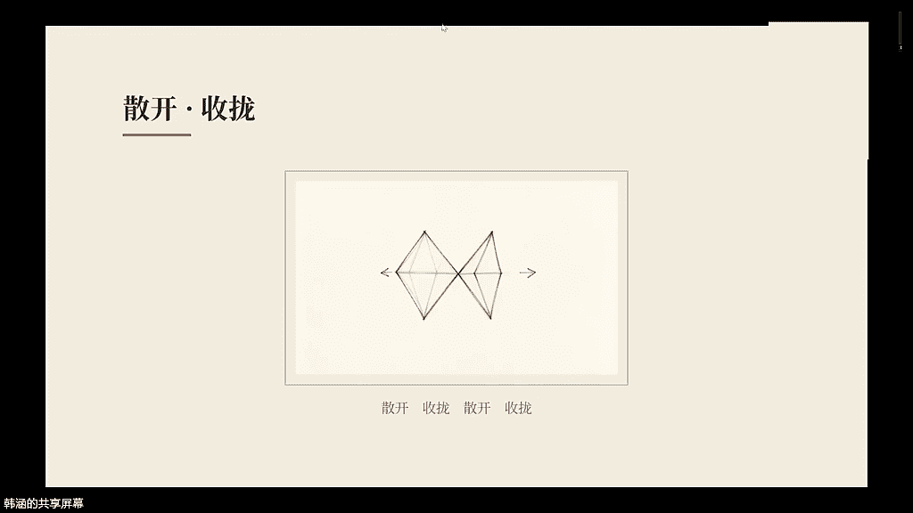
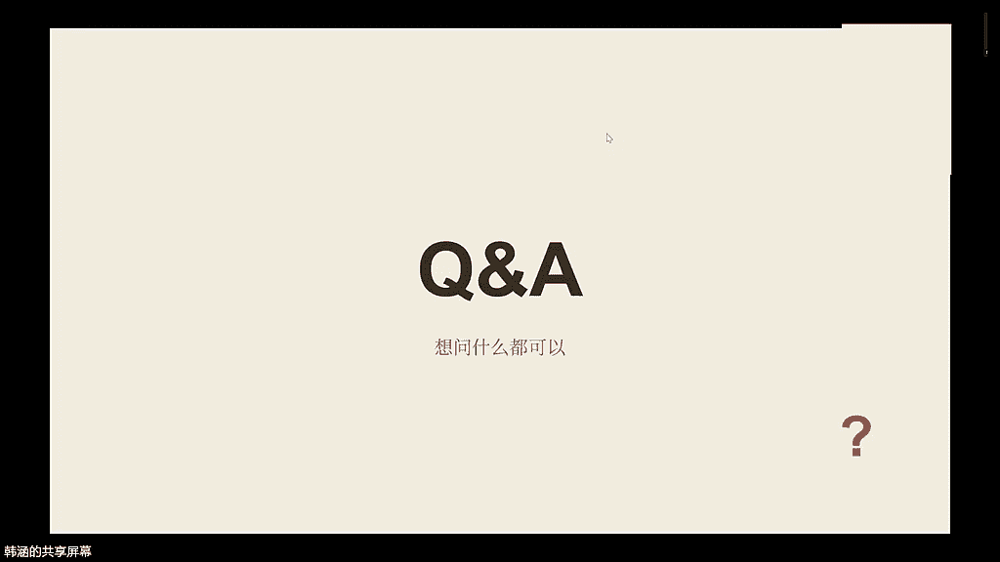
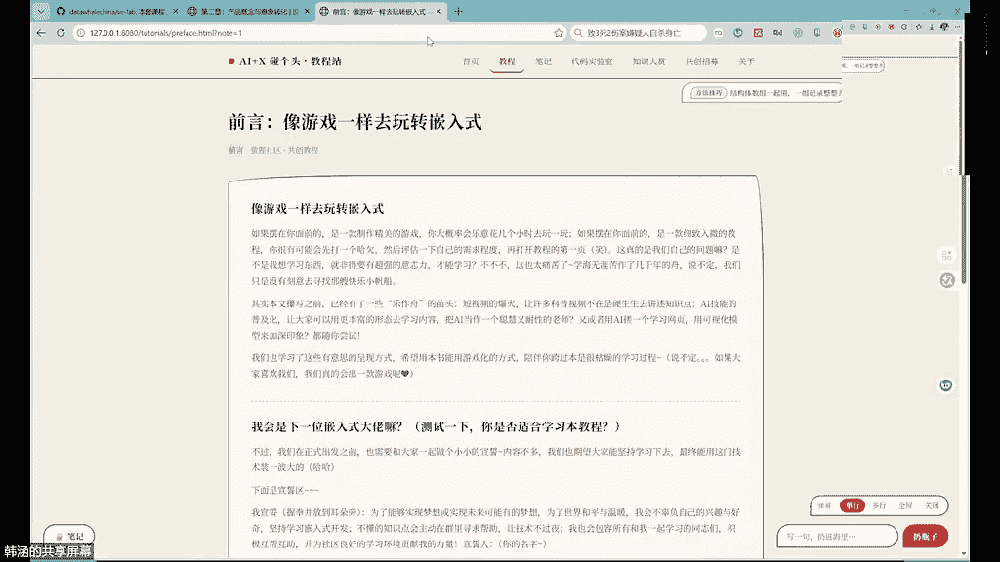

# 🤖 Datawhale AI+X 硬件创业：01：从想法到量产的全流程与市场调研

## 概述

在本节教程中，我们将学习一个硬件产品是如何从一个最初的想法，逐步成长为可以量产的实际产品的完整过程。我们会聊到市场调研的方法，双钻模型的应用，原型机的研发，以及EVT、DVT、PVT等验证环节。此外，我们还会介绍供应链合作，AI工具在硬件开发中的作用，以及如何防止抄袭和控制成本。这篇内容适合对AI硬件感兴趣，想要了解硬件创业全貌的初学者。

## 硬件产品开发的全流程概览

上一节我们介绍了课程的整体目标，本节中我们来看看硬件产品是如何一步步诞生的。一个硬件产品从无到有，远比软件产品复杂得多。软件可以快速迭代，代码写完就可以发布，用户发现问题可以立即修复。但硬件不同，一旦模具开好，产品生产出来，修改成本非常高。因此在硬件创业中，前期的调研和测试显得尤为重要。

我们的团队来自之前的明月合客双基地，也是李泽香教师的孵化基地。团队成员之前都有过产品调研和初步开发的经验。现在我们带着已有的认知，再次从头开始尝试开发一款产品。这款产品就是我们今天要重点分享的web codinging键盘。

这款键盘的具体配置如下：

```text
主控芯片：ESP32S3
按键数量：7个机械按键
输入设备：1个可按压的旋转编码器
灯效：2颗LED灯
音频：1颗MEMS麦克风
接口：1个USB插口
```

从这个配置可以看出，这不是一个普通的办公键盘，而是一个专门为AI交互场景设计的硬件设备。

## 双钻模型与产品定义




接下来我们聊聊如何把一个模糊的想法变成清晰的产品定义。这里我们要用到一个重要的理论工具，叫做双钻模型。它是2004年英国设计委员会提出的设计思维框架。

双钻模型的核心逻辑可以用下面的公式表示：

产品定义 = 第一次发散（收集信息） → 第一次收敛（聚焦需求） → 第二次发散（探索方案） → 第二次收敛（确定产品）

在第一个发散阶段，我们需要从身边和网上收集大量的案例资料和一手数据。这些资料不需要像学术论文那样严格归档，但必须能够支撑我们后续的需求判断。更有价值的是从真实用户手中直接获取的反馈数据。

举个例子，我们在开发web codinging键盘时，最初的灵感来自于看到有人把大疆的语音交互硬件和翻页器结合使用。但那只是简单的二者拼合，并没有做成一体化产品。我们意识到，如果能把语音输入、键盘操作和编码器控制整合在一起，就会成为一个更有价值的AI硬件产品。

在第一个收敛阶段，我们需要对功能进行优先级排序。不是功能越多越好，而是根据用户需求划分优先级，从P0到PN依次排列。非必要的功能会被剔除，保留核心功能。比如我们的键盘保留了旋转编码器和RGB呼吸灯，这些功能虽然不影响基本输入，但能提升用户的使用体验和产品吸引力。

第二个发散阶段是进一步探索产品形态和交互方式。这时候可能会涉及到AB测试，外观和功能还没有最终敲定。我们需要反复推敲，找出最适合用户的方案。

第二个收敛阶段，产品雏形已经形成，进入demo阶段。这时候我们才会真正上手实测，验证这个产品是否真的适合实际使用。

以下是双钻模型在我们键盘项目中的具体应用要点：

- 灵感来源：市面上缺乏集成语音麦克风的AI键盘
- 用户画像：AI极客、职场办公人员、居家办公者
- 核心功能：语音输入、机械按键、旋转编码器、LED状态反馈
- 优先级剔除：去除了非必要的复杂功能，聚焦AI交互体验

## 桌面调研与用户调研

在产品正式开发之前，我们需要进行充分的调研。调研分为两个部分，一部分是桌面调研，另一部分是用户调研。这两者有明显的区别。

桌面调研是指通过网络声音和网上数据来了解市场。这部分数据具有真实性，可以作为后续技术选型和功能定义的支撑。比如我们要做键盘，就需要去查哪些功能是真正有用的，哪些功能只是花里胡哨。从凌乱的网络声音中提炼出最基础的验证结论。

用户调研则是去了解谁会使用我们的产品，用来做什么，使用周期是什么，反馈如何。这部分更多是对假想产品的行为评估。比如假设用户买了我们的键盘之后，会如何改善他的工作流，会带来什么样的体验提升。

以下是我们在调研阶段需要回答的关键问题：

- 市面上是否已有同类产品？
- 竞品的大概价位是多少？
- 竞品解决了什么样的问题？
- 我们的目标用户是谁？
- 用户使用我们产品的场景是什么？
- 用户能否感受到明显的体验改善？

在实际操作中，桌面调研帮我们避免了重复造轮子，用户调研帮我们确认了真需求而非伪痛点。有时候用户自己也说不清楚要什么，只有当产品真正出现在他们面前，他们才会意识到原来这样会更好。

## 原型机研发与建模

当我们完成了市场调研和产品定义，就进入原型机研发阶段。这一阶段包含两个主要部分，一部分是硬件开发，另一部分是建模。


建模是指确定产品的外观形状和内部结构。在建模过程中，我们经常会遇到形状和硬件不匹配的问题。比如最开始我们可能想做一个异形的立体结构，但电路板本身是正方形或长方形的，这就需要反复磨合，让产品形态和技术实现达成一致。

为了降低成本，我们建议采用从简单到复杂的策略。先做一个最简单的长方形外壳，打印出来确认内部结构能适配元器件，保证使用安全和防水，然后再逐步改造外形。这个从1到2，再从2到3的过程，可以有效防止在前期就投入过多的时间和金钱。

以下是建模阶段的常见步骤：

1. 确定整体产品形态
2. 绘制基础外壳结构
3. 验证元器件适配性
4. 优化内部空间布局
5. 迭代外观设计

AI工具在建模中也开始发挥作用。现在有些建模软件可以接入大模型，通过MCP协议调用AI辅助建模。虽然还不能达到直接描述需求就生成完整电路和PCB布局的程度，但已经能够帮助我们生成外壳模型，大幅提高效率。

## EVT、DVT、PVT验证流程

原型机做出来之后，并不意味着可以直接量产。硬件产品需要经过严格的验证测试，主要分为EVT、DVT、PVT三个阶段。

EVT是工程验证测试。这个环节在软件开发中没有对应的概念，但在硬件开发中非常重要。我们需要确保想法真的能在硬件里实现，功能能够落地。因为硬件资源有限，成本高昂，如果在前面没有充分测试，产品出来后发现用户不买单，那就是打水漂。

DVT是设计验证测试。这时候产品已经接近生产级别，我们需要考虑安全性和稳定性。硬件产品卖出去后可能要使用好几年，不能像软件那样随时更新。因此要在不同温度、不同环境下测试，确保产品在极端条件下也能正常工作。

PVT是生产验证测试。这是小批量试生产阶段。我们需要验证工厂是否真的能按要求生产出来。比如我们可能订了100套，结果只有30套能用，70套变成废料，这种情况会造成巨大损失。所以在正式量产前，必须先做小批量试产，验证良率和工厂能力。

以下是三个验证阶段的核心关注点：

- EVT：功能是否实现，技术是否可行
- DVT：安全性是否达标，稳定性是否足够
- PVT：工厂是否能稳定量产，良率是否合格

## 供应链与工厂合作

硬件创业中，供应链是一道很大的门槛。大公司如小米之所以能控制成本，很大程度上依靠的是强大的供应链体系。对于个人创业者来说，早期找到靠谱且愿意做打样的工厂非常困难。

在与工厂合作时，有几个关键点需要注意。

首先是BOM表，即物料清单。BOM表里会有大件和小件。大件的议价空间通常在8%左右，但小件的溢价可能高达300%甚至800%。一个几毛钱的小零件，在工厂报价里可能变成几块钱。因此需要仔细核对BOM表中的每一项价格。

其次是合同透明度。有些工厂会把钢管费、打板费、贴片费都写清楚，有些则只给一个总价，里面可能存在黑箱操作。比如在板子选型或工艺上偷懒，这就需要我们擦亮眼睛。

以下是评估工厂的主要标准：

- 产品质量是否合格
- 交付周期是否满足要求
- 价格是否在市场正常范围内
- 是否愿意支持小批量打样

3D打印可以帮助我们做原型机验证，解决外壳长什么样子的问题，但它不能替代大批量生产。3D打印出来的产品更像玩具，性能和精度都达不到量产标准。真正量产时，仍然需要开模，使用注塑等工艺。

## AI在硬件开发中的作用

在AI时代，AI工具已经能够帮助我们解决很多软件开发成本。比如上位机开发，以前嵌入式工程师可能需要一周才能做出来，现在借助AI，两天甚至一天就能搞定。下位机开发也有AI辅助，但还不能完全实现一键生成电路和PCB布局。

不过，AI无法替代真实的市场洞察。桌面调研可以用AI辅助，用户调研可以用AI设计调查表，但真正的用户痛点和需求判断，必须靠人去完成。AI只能模拟虚假的需求，不能替代人与人的真实交互。

在硬件开发全流程中，AI更适合作为辅助工具，用于加速验证、代码开发和测试环节，而不是完全依赖AI来判断产品是否能卖出去。

## 防抄袭与成本控制

初创公司最担心的问题之一就是被抄袭。对于硬件创业，完全防止抄袭几乎不可能，但可以采取一些策略降低风险。

第一种方法是不要随意向外泄露产品细节。不要把产品形态发到各个平台，因为一旦想法泄露，第二天可能就在淘宝上看到同样的产品。

第二种方法是快速迭代。我们可以采用两代优势策略，对外发售的产品是两代之前的形态。当竞争对手抄袭完成时，我们已经有新一代产品在手，依然保持竞争优势。


以下是降低早期成本的具体建议：

- 先做最简单的形态，避免前期过度设计
- 使用3D打印验证外壳，不要急于开模
- 从开源平台寻找已验证的供应商
- 小批量试产，控制试错成本




开源也是一种策略。如果我们把产品开源出来，竞争对手抄袭也就失去了商业价值，因为大家都可以免费制作。当然，这适合于我们不以赚钱为主要目的的项目，如果是商业产品，仍然需要谨慎对待知识产权。

## 总结



本节教程中，我们一起学习了硬件产品从想法到量产的全流程。我们介绍了双钻模型在产品定义中的应用，区分了桌面调研和用户调研，讲解了原型机研发与建模的关键点，详细说明了EVT、DVT、PVT三个验证阶段，探讨了供应链合作与成本控制，以及AI在硬件开发中的角色和防抄袭策略。


硬件创业是一个漫长且充满挑战的过程，前期调研和测试越充分，后期返工的成本就越低。希望这篇教程能帮助初学者建立起对AI硬件开发的整体认识，为后续的实践打下基础。
