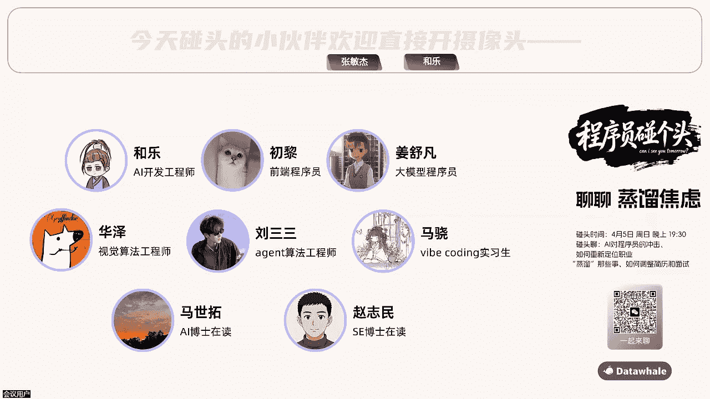

# 🤖程序员碰个头：聊蒸馏与AI焦虑：01：直播开场与嘉宾阵容介绍

在本节课中我们将要学习本次直播的基本背景，认识参与讨论的各位嘉宾，并了解大家关注的核心议题是什么。

本次直播的主持人是何乐，目前从事AI算法开发工作，主要研究如何让人工智能更好地配合业务场景，提升整体开发效率。与他一同参与讨论的嘉宾包括书房、华泽、珊珊、马小、马瑞特以及郑明。其中书房是一位大模型程序员，隶属于data团队，今天主要是来尝试直播功能并收集大家的反馈。华泽拥有大约六年工作经验，之前做过前端开发，后来转入机器学习算法，随后又涉猎视觉算法，目前主要从事动态相关的算法工作，希望能够通过这次交流给大家带来一些帮助。珊珊是一位从事Agent算法的工程师，拥有大约八到九年的经验，她之前也是全栈开发出身，出国留学之后转向大模型方向，专注于Agent技术，希望与大家一起探讨如何面对职业焦虑。

马小是一名大学生，最近刚入职一家公司进行实习，实习范围涉及V coding，他希望了解刚毕业的本科生在进入职场后会遇到什么情况，以及应该如何思考自身发展。马瑞特目前是中国科学院大学的博士研究生，正值硕博连读的节点，研究方向主要是AI与安全相关的内容，非常期待与大家探讨这个话题。郑明之前在湾区工作过几年，后来又读了博士，工作期间从事软件开发，读博期间主要做智能体开发，对智能体开发有较深的感受，也希望通过这次讨论碰撞出一些有趣的想法。

以下是今天参与讨论的人员构成概览，涵盖了前端开发、后端开发、大模型算法、AI应用全栈开发，以及博士和实习生等不同背景：

- 主持人：何乐，AI算法开发，业务流程应用研究
- 嘉宾书房：大模型程序员，data团队成员
- 嘉宾华泽：六年经验，前端转机器学习与视觉算法
- 嘉宾珊珊：八到九年经验，全栈转大模型Agent算法
- 嘉宾马小：大学生实习生，V coding方向
- 嘉宾马瑞特：中科院大学博士，AI与安全研究方向
- 嘉宾郑明：湾区工作经验，博士，智能体开发


通过这次阵容介绍，我们可以看到今天的讨论涵盖了从实习生到资深工程师，从前端到算法，从传统开发到AI应用的不同视角。本节课中我们一起学习了直播的开场流程以及各位嘉宾的基本背景。


# 📄程序员碰个头：聊蒸馏与AI焦虑：02：简历修改与AI能力体现

在上一节中我们介绍了直播的嘉宾阵容，本节中我们来看看针对程序员简历修改的具体讨论内容，以及如何在AI时代重新定位简历中的技术竞争力。

本次简历修改环节的案例是一位名为初理的前端开发工程师，他从2020年毕业至今一直在一家公司工作，拥有大约五年的前端开发经验。他最近感到有些焦虑，希望审视自己的工作经历，看看是否还有更好的或更有前途的发展方向，因此提交了一份简历供大家讨论。他的求职意向依然是前端开发，因此大家需要探讨的是他到底是应该继续做前端开发，还是应该考虑转向后端或者其他方向。根据经验判断，五年经验的前端开发者通常会被视为高级前端人才，市场上依然有需求，但当前的主要竞争依然围绕着传统前端技术展开。

简历的核心结构可以用如下公式表示：

```text
简历 = 技术栈 + 项目经历 + 业务能力 + AI能力
```

以下是针对这份简历的具体修改建议，大家可以参考这些要点来审视自己的简历：

- 在简历中体现V coding相关内容，增加与AI进行交互的经验描述
- 技术栈部分应移至简历顶部，让HR能够第一时间看到
- 排版建议改为横向两列形式，避免使用不美观的玻璃拟态展示方式，尽量将内容压缩到一页或两页之内
- 基础技术如get请求、RESTful API、基础Node.js可以不写，但如果涉及底层调优，例如V8引擎相关内容，可以适当保留
- 建议向Node.js后端、全栈开发、智能体调优和页面开发方向发展，形成能够做智能体调优和页面的小型智能体能力
- 突出UI走查能力和设计稿还原能力，这是前端开发者的重要技能
- 增加前端性能调优内容，例如图片压缩、高并发场景下的内存占用优化等
- 如果做过语音相关项目，也可以加入简历中
- 优势技能放在前面，劣势技能放在后面，先给HR一个优势明显的感官印象
- 五六年经验的开发者应当突出业务能力，说明自己的业务是什么，技术与业务要有所结合

对于简历中的AI能力和业务能力如何体现，建议将业务能力放在项目经历中，将AI能力放在技术栈部分，这样HR更容易看到。此外，简历不应是通用的，建议抓取目标岗位的JD，根据具体职位要求对简历进行针对性修改。例如可以在Boss直聘上搜索前端开发岗位，查看主要的VE要求，再对简历进行调整。

关于是否需要学习React，个人认为可以学，虽然React语法相比Vue稍微有一些难度，但学习后可以拓宽技术思路，不需要花费太长时间。本节课中我们一起学习了简历修改的核心要点，以及如何在AI时代更好地展示个人技术与业务能力。


# 🤖程序员碰个头：聊蒸馏与AI焦虑：03：AI面试辅助项目演示

在上一节中我们讨论了简历修改与AI能力体现，本节中我们来看看舒凡分享的AI面试辅助项目，了解AI如何协助面试者进行模拟面试。

该项目名为Offerer，主要面向面试者使用，目的是提供AI辅助面试功能，帮助用户提升面试表现。系统的核心功能包括登录、新建面试、上传或手动编辑简历、查看面试记录等。左侧可以直接开始一个新面试，中间部分允许用户提前上传和手动编辑简历，这些简历内容会作为AI面试官对用户个人信息的参考依据。右侧的C records部分可以查看用户之前保存的所有面试记录，随时查看之前面试的结果、面试数据以及面试过程中的对话内容。


以下是AI面试的主要流程阶段，整个面试被拆分为四个部分：

- Setup阶段：AI面试官会提前确认用户的职业、状态、经验，以及用户希望设定的面试整体难度、问题数量等信息
- Self Introduction阶段：用户进行简单的自我介绍
- QNA阶段：AI面试官根据用户的经验或简历情况提出问题，用户进行回答
- Feedback阶段：面试结束后总结表现，给出反馈和结论

在面试过程中，用户可以随时开启或关闭麦克风和摄像头，也可以随时结束面试。结束后可以选择跳过本次记录，或者将其保存到记录库中。保存后，用户可以查看本次面试的时间、时长，以及自己和面试官分别说了什么。此外，系统还可以根据面试情况生成AI报告，由AI对用户的表现进行多维度的数据分析，指出不足之处。

目前该产品比较通用，适用于任何职位和任何经验水平，没有针对特定行业做过深度优化。界面语言目前主要是英文，但也可以支持中文。在行业选择上，目前没有特定限制，用户可以在工作经历中填写任何内容，无论是编程、设计还是产品管理都可以。未来可以讨论是否开发面试官版本，届时AI将扮演面试者的角色。本节课中我们一起学习了AI面试辅助项目的核心功能和使用流程。


# ⚠️程序员碰个头：聊蒸馏与AI焦虑：04：AI蒸馏与程序员焦虑吐槽

在上一节中我们了解了AI面试辅助项目，本节中我们来看看大家在吐槽环节中关于AI蒸馏、工作流程变化以及职业焦虑的真实想法。

马小作为一名刚入职的本科实习生，表示自己深切感受到了AI带来的冲击，甚至觉得自己已经被蒸馏了。在传统的项目开发中，实习生通常会经历大小项目训练、学习团队合作、理解如何做注解、如何编写文档和API等流程。但在AI时代，这些传统流程几乎被完全抛弃了。他所在的团队使用VP Code取代一切，基本上不再人工编写代码，代码审查也很少，大部分由AI自动审查，人类只需要编写prompt，然后用来不断调整CI。

AI生成代码的速度非常快，比人工编写快得多，很多时候AI写出的代码质量也优于刚毕业的本科生。这给实习生带来了巨大的职业冲击。以下是他总结的四个主要问题：

- 工作流程更快：原本需要一周开发的项目，现在可能三天甚至一天就能完成。不管项目优化如何，至少能跑得动。AI还会生成非常规范的markdown文档，文档相互递传，使得工作流程高度标准化
- 人工成长被挤压：大学里的知识已经滞后，竞赛项目的学习空间也有限。使用AI写代码时，只需要动动手指甚至不用动手指，让AI继续优化即可得到不错的项目。用户会觉得自己做了很多事情，但实际上什么都没做，没有思考，没有实际操作
- 工具依赖导致迷茫：AI喜欢在原有框架基础上继续写代码，在好的老项目上能写得很好，但在差的项目面前只能写相似代码来维持运行。这导致小白很难遇到好项目进行练手，大部分项目只是能跑动，例如前端项目内存占用可能比正常网站高出两到三倍。AI还会不断给出新的框架和方法，如果没有足够知识基础，用户很容易变得迷茫，一天学了多个领域知识却一无所获
- 公司对AI依赖度过高：有创始人表示90%的代码都是AI写的，有些情况下甚至没有审查就直接推送，导致源码泄露。这引发了谁应该背锅的问题，大概率是负责VP coding的人或实习生需要承担责任

AI开发流程与传统开发流程的对比可以用如下伪代码表示：

```text
传统开发 = 人工编码 + 人工审查
AI开发   = AI生成代码 + 人工复核
```

关于责任归属问题，如果AI出错了，特别是涉及金钱的问题，由谁来背锅？非科班出身的老板可能不懂计算机，容易误判AI的能力，认为AI可以直接替代人工审查。在乙方公司，如果线上出问题客户会责备，处境比较艰难。有些公司把实习生当正式工使用，实习生没有做好审查就被骂，而实际上AI已经通过了审查，人工却没有进行复核，实习生最终背锅。

另一个前提是工程的复杂程度。如果上下文长度达到100K，前端上下文能到80K，后端上下文能到200K，在这种情况下，大模型的帮助能力就很有限。老板如果是非科班出身，可能只是想用大模型去做以前传统方法就能做的事情，追求降本增效。工作流程加快已经是不争的事实，AI 24小时运行，而人需要吃饭睡觉，碳基生物很难打败硅基生物。只有当上下文足够长时，人类的优势才能体现出来。

针对这些问题，一些参与者提出了自己的看法。有人建议保持古法编程，甚至放弃IDE，使用更原始的编辑器，因为慢就是快，快就是慢，在AI的红利中迷失自我可能会一事无成。也有人反对古法编程，认为应该学会使用IDE，现代开发离不开工具。关于文档记录，AI的文档记录功能并不好，即使是较好的模型也无法很好地记录项目结构，存在依赖性，例如想用C++23特性但AI习惯用C++17，会导致文档写得一团糟，因此开发者仍需自己保持记录文档，这也是学习的机会。最后，保持良好的心态非常重要，因为在AI环境下工作会非常累，良好的心态是维持自我的关键。

还有一个重要的观点是，AI是一个放大器。如果基础不扎实，对事物理解不到位，无法将隐藏的假设表现在prompt中，最终会自食其果。高手使用AI的效果与普通人完全不同，有些高手花了两千多个小时学习如何使用AI，十年经验的程序员如果非常懂AI，写出来的程序一天之内就能完成，任务执行度能达到三个初级程序员的水平。把模型当作开发流程来使用，完成度会非常高。

实习生在AI时代下很难拥有五到十年的积累机会，矛盾不在于人和AI，而在于人和人，特别是领导层对AI的认知不足。如果AI发展得很快，未来很多拉取请求可能不需要人工审查，但人不能背锅。AI不可能百分百做到所有事情，现阶段仍然需要人工审查，大部分技术人员可能需要从开发岗位转向测试或产品经理。Git协作中，有些程序员习惯用AI提交代码，只保留自己的部分，覆盖他人代码，导致所有人都要重新上传，这也是需要协调的问题。

本节课中我们一起学习了AI蒸馏对程序员的实际影响，以及大家在面对AI时代时的各种焦虑和应对思考。


# 🔮程序员碰个头：聊蒸馏与AI焦虑：05：行业现状与未来职业定位

在上一节中我们讨论了AI蒸馏与程序员焦虑，本节中我们来看看关于行业现状、少儿编程争议、计算机行业未来以及如何应对AI焦虑的广泛讨论。

关于AI导致裁员是否真实存在，观点认为这其实是一个伪命题，AI只是导火索。大约从2020年开始，企业就一直在喊降本增效，问题在于如何降本、如何增效，AI只是给了一个契机。即使没有AI，也会有BI、CI等其他技术。这不是因为AI抢走了饭碗，更多是员工与老板之间，或者员工与更高层管理之间的矛盾。

关于Web coding出现后是否还有必要学习编程、少儿编程，观点认为当然要学，但学习方法需要改变。以前学编程可能要从二进制、变量、表达式、循环等基础开始，现在只需要花一个上午扫一眼某种语言的基本语法，下午就可以直接拿着Web coding上手写项目了。学习重点应该是快速学习能力和理念，把琐碎的细节交给AI，自己着眼于全局。有导师分享，新闻传播专业的学生跨行学习VAB coding，甚至能从零基础直接上手多模态算法，这说明技术门槛在不断降低。从0到1，从1到10其实很快，关键在于打破滤镜，打破舒适圈，第一步下载环境往往就会拦住很多人。

关于少儿编程，存在不少争议。现在小学二三年级的学生就开始学习C++、STL和模板，这在北京海淀这种鸡娃风气严重的地方比较常见。有人认为学编程是为了培养思维方式，但孩子学编程更像是做数学大题，是将大学里的C语言、数据结构、算法等内容不断前置。CCF规定参加NOI考试不能少于12岁，这才稍微缓解了这种风气。家长应该认识到，不一定要靠编程，更重要的是学习思维方式，并用AI解决具体问题，即战略层面的问题。以前幼儿园和小学用Scratch进行图形化少儿编程，是用大积木方式，是否能培养思维方式很难说。编程在很多时候只是一个工具，甚至不能说是思想，不应该用成年人的思维来看待孩子。成年人学编程是为了工作和科研，孩子学编程可能是为了比赛、拿奖、刷履历，这本身就容易产生学习焦虑，甚至加剧教育供需矛盾。

关于计算机行业是否会像土木工程那样衰落，有人在2019年就提出过计算机行业不到十年会衰落的观点，当时很多人不认同，但现在看来六七年过去了，行业确实出现了这种情况。原因在于当时几乎所有人都想转计算机专业，所有人往同一个方向跑，船就容易翻。但计算机行业不算衰弱，因为大家会重新思考什么是真正有意义的东西。以前计算机人才少，需求旺盛，项目多，缺程序员，所以这个行业被推到很高的位置。现在人多了，需求变少了，供不应求的情况才慢慢回归。计算机不同于土木和金融，知识更新很快，大量老东西会被淘汰。最重要的是计算方法、计算资源等硬核技术，它们构成了未来社会的基础设施。五十年前没人想到网络和WiFi会成为基础设施，后来有了网络，下一代可能是使用的Token和模型，也会变成像水和电一样的基础设施。只要基础设施地位存在，计算机行业就不至于像土木那样衰落。

计算机可以给各行各业赋能，覆盖面非常广，而土木的产业链比较垂直。工商管理虽然也广，但门槛比计算机低，计算机仍然有一定的技术门槛。本质上是需求问题，先有需求才会有人。只要各行各业对代码、数字化、智能化、标准化的需求存在，IT行业就不至于像土木那样消失。除非有一天智能化、数字化、标准化的需求完全消失了。计算机与基础学科强绑定，与技术学科强绑定，但计算机本身是一个工具，所有技术学科都需要算力，需要更强更大更精准的算力来推动发展，硬件永远绕不掉。万物皆可算，算力肯定要不断发展，硬件方面肯定会持续火热。

关于人与AI的关系，AI只是一个Transformer，是猜字游戏算法，没有进化到完全像人一样思考。当技术工具变得唾手可得，大家都用AI，差异就会变小。区别主要在于经验丰富的人知道哪个技术栈，能直接告诉AI怎么执行，基本上能做对八九不离十；没有技术栈的人容易犯错。AI可能推荐某个方案，但没有说明其中的大雷，只有做完之后才能发现。AI正在稀释智力，但分层次依然存在，还是需要架构层次的东西。要用好AI，不能把自己局限于只做某件事的人，要提升一个level，像CTO一样站在领导者角度思考如何设计、如何实现，每个Controller要读哪些内容，算法要迭代多少次，要达到什么样的算法结构。需要更顶层的架构设计，把自己的能力逼得更高，不断开拓，站得越高看得越远，用更高的角度平视AI。不要只在自身的小角度跟AI对话，那样永远无法赚到认知之内的钱，需要不断提升认知，站得更高，才能获得相应的能力。

针对如何应对AI带来的焦虑，微观角度上，如果自己的技能已经可以被简单的AI调教取代，那就说明当前技能需要不断精进和总结。每个人都不能只是一个标准操作流程的执行者，肯定会有作为人的独立特性。要在人的独立特性中，思考如何与业务紧密结合，放在实际业务中去发展。要保持不断持续学习的能力和心态，心态很重要，如果没有良好的心态，可能会觉得未来一片渺茫，不想学习。好的心态和学习状态会让自己在职业道路上不断往前走。

宏观角度上，AI对程序员的冲击其实是在逼我们重新思考这个职业应该往何处发展。这种冲击不是一天两天的事，不仅是AI的冲击，在AI盛行之前，一些需求就已经在下降，导致供需矛盾，特别是程序员越来越多。程序员这个行业在没有AI的情况下可能已经在下坡路上，但AI又给程序员注入了新的剂，代表了新的职业定位。对程序员来说，AI反而是倒逼我们去学习新东西，重新审视自己的职业和能力。

应对AI焦虑的心态可以用如下逻辑表示：

```text
结果 = 能被AI蒸馏 ? 可以摸鱼 : 不可被AI替代
```



本节课中我们一起学习了行业现状、计算机行业的未来前景，以及如何从微观和宏观角度应对AI焦虑，重新定位自己的职业发展方向。
