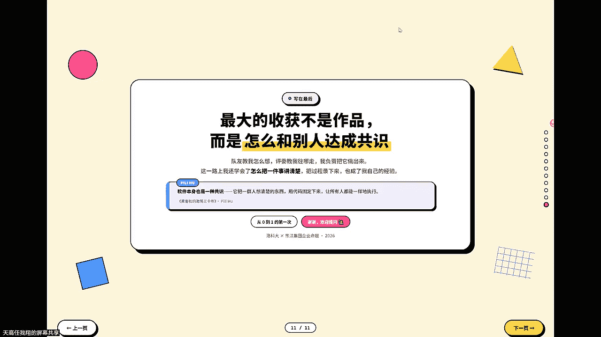

# 【Datawhale AI+X】：01：谷歌评委教你打造有商业价值的黑客松项目 🏆

在本节课中我们将要学习如何结合谷歌评委的真实反馈，在AI黑客松中打造具备商业价值的项目。我们会从组队理解赛道开始，逐步讲解需求分析、工作流拆解、AI协作开发、团队分工、商业包装、路演演示以及部署迭代等完整流程。每一部分都会用大白话解释，帮助初学者快速上手，避免常见误区。无论你是否有比赛经验，都可以按照这个思路来准备自己的项目。

## 第一节：组队与赛道理解

上一节我们介绍了课程的整体目标，本节中我们来看看如何组队以及理解黑客松的赛道。

在参加比赛之前，很多新手会觉得自己对行业一片空白，完全不知道从哪里开始。其实这很正常，你不需要事先精通所有领域。最有效的方法是寻找互补的队友，组成一支能力均衡的团队。在产品设计中，要把客户当作上帝，始终以客户需求为出发点。

以下是组队时可以参考的角色搭配：

- 业务专家：负责了解行业背景，比如授信、账期、额度、合同审核等真实业务场景。
- 产品设计人员：负责从用户角度思考，设计更贴近需求的交互方式。
- 技术落地人员：负责将方案转化为可运行的代码和系统。

团队能力可以用简单的公式表示：

团队能力 = 业务专家 + 产品设计 + 技术落地

有了合适的队友之后，你们可以一起编写概念科普文档，帮助所有人更快地理解信用额度、账期管理、合同审核等核心概念。对于第一次参加黑客松的同学来说，不需要害怕或不好意思，大胆说出自己的优势和想做的事情，互相合作是提升团队能力的重要方式。

## 第二节：需求分析与工作流拆解

完成了组队和赛道理解之后，本节中我们来看看如何分析需求并拆解工作流程。

进入具体开发前，团队需要先梳理比赛命题，然后拆解出完整的工作流程。在拆解过程中，大家要一起讨论，砍掉冗余的步骤，让流程真正能够进入企业并发挥作用。只有流程简洁明了，产品才容易被实际使用。

这里有一个关键点：AI可以帮你梳理得非常详细，但它给出的方案未必是最优的。AI可能会自认为需要很多确认步骤，但实际上在真实业务流程中，这些步骤完全是冗余的。你要有独立思考，不能让AI牵着走。

以下是处理AI建议的原则：

- 不要让AI牵着走，要保持独立思考。
- 明确哪些步骤需要保留，哪些可以简化。
- 采用人机协作模式，简化不必要的流程。

最优工作流可以用公式表示：

最优流程 = 必要步骤

从开发效果来看，做减法往往比做加法难得多。如果不加控制，AI说东你就加一个功能，AI说西你就再加一个功能，最后会把简单的事情复杂化。

正确的做法是：

1. 在开始前先把整体框架排版好。
2. 确定核心功能，避免后期手忙脚乱地临时添加。
3. 文档敲定后再继续开发，不随意更改方向。

## 第三节：技术落地与团队分工

理清了工作流程之后，本节中我们来看看如何进行技术落地与团队分工。

在实际开发中，建议明确每个成员的职责，避免大家各自为战。比如可以由一名成员负责技术落地，另外两名成员负责设计、产品交互和需求文档的编写。每个人专注自己的领域，开发效率才会更高。

团队分工可以用简单的伪代码描述：

成员A：负责技术落地
成员B：负责设计和产品交互
成员C：负责需求文档编写

谷歌评委指出，现在的黑客松普遍缺少两种东西：真正的技术突破，以及真实的商业思考。所谓技术突破，并不一定非要是全新的算法，更多是将现有技术整合、叠加，应用到真实场景中。

商业思考则更为关键。你需要问自己：做出这个demo之后，评委或客户愿意买账吗？如果未来想把它当成事业，是否有持续发展的方向？不要开发小玩具或伪需求，而要站在用户和顾客角度思考。

商业思考可以用公式表示：

商业思考 = 用户愿意付费 + 持续发展方向 + 真实场景痛点

在开发前期，就要进行真实的商业思考，确保产品方向正确。

## 第四节：商业包装与项目亮点

完成了技术落地和团队分工之后，本节中我们来看看如何包装项目并提炼亮点。

实际上，黑客松参赛团队使用的技术差距不会太大。关键在于你如何包装项目，解释为什么在这里使用这些技术，这些技术能发挥什么作用，以及与同类产品相比有什么优势。技术只是手段，商业价值才是核心。

以下是项目包装的核心要素：

- 技术选型的合理性
- 技术在场景中的实际作用
- 与竞品相比的独特优势
- 能够提炼出的路演亮点

项目竞争力可以用公式表示：

项目竞争力 = 技术实现 × 商业包装 × 真实价值

另外，黑客松的含义在AI时代已经发生了变化。过去强调快速尝试和通宵苦熬，但现在快速试错和尝试能力边界的价值更大。团队内部要主动交流，把想法彼此碰撞，这也是在黑客松中可以锻炼的重要方向。

## 第五节：演示与路演技巧

项目开发完成之后，本节中我们来看看如何进行演示与路演。

很多团队在路演时一上来就讲“我做了什么”，但实际上评委更希望先听“为什么要做这个项目”。你要站在产生这个想法的角度来讲，让评委了解你当时的思路和需求背后的思考。只有讲清楚为什么，评委才能顺着你的思路理解功能。

以下是路演建议的逻辑顺序：

1. 为什么要做这个项目
2. 解决了什么实际问题
3. 产品的核心功能
4. 商业价值和发展方向

路演逻辑可以用代码块表示：

路演逻辑 = 为什么做 → 做了什么 → 解决了什么问题 → 商业价值

评委通常关注三点。第一，从为什么讲起，让评委顺着你的思路理解功能。第二，完成度不等于价值，功能的堆砌没有用，真实的商业思考才重要。第三，形成共识，无论是用demo还是PPT，本质上是把你的想法变成在场所有人的想法，让大家认可你的产品。

最终的目标不是说“我多牛”，而是让大家跟你想的一样。

## 第六节：部署与迭代记录

在准备路演之前，本节中我们来看看部署与迭代记录的关键点。

很多团队会在最后一天才发现部署方式有问题，甚至在截止前的最后时刻还在调试。为了避免这种情况，你要在前期就建立验收标准，使用全新的环境把产品一步步搭起来，模拟客户的使用感受。本地开发时不会注意到的问题，只有在新客户的新环境下才会出现。

验收标准可以用公式表示：

验收标准 = 全新环境 + 客户视角 + 可迁移功能

因此，你的产品要具有可迁移的功能，前期就要考虑这些问题，不要把小事情拖到最后，否则可能会变成致命错误。

另外，开发过程中要记录每一次迭代的过程。不要闷头开发，想到哪做哪，那样没有条理。你需要沉淀下来，说明为什么开发这个功能，如何进一步开发，以及功能之间的层级递进关系。把迭代记录给评委看，能清楚地展示产品是如何一步步改进的。

## 总结

本节课中我们一起学习了从组队理解赛道，到需求分析与工作流拆解，再到技术落地、商业包装、路演演示以及部署迭代的完整流程。

核心要点可以总结如下：

- 组队要互补，覆盖业务、产品和技术三个角色。
- 工作流要做减法，不要被AI牵着走，避免功能堆砌。
- 商业思考是关键，要考虑用户是否愿意买账，是否有持续发展方向。
- 路演要先讲为什么，形成共识，而不仅仅是展示完成度。
- 部署要提前验收，迭代过程要记录，产品要可迁移。

希望这些内容能帮助你在下一次黑客松中，打造出既有技术深度又有商业价值的优秀项目。
