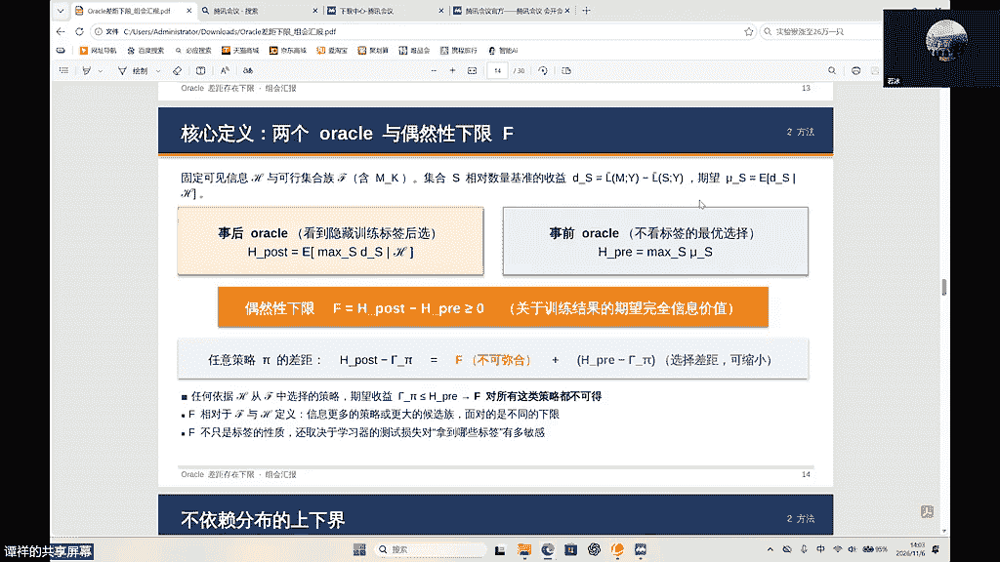

# Datawhale AI+X：1：主动学习与随机性挑战 🎲

在本节教程中，我们将学习主动学习的基本概念，探讨为什么标签获取成本高昂，并分析不受控的随机性如何导致策略排名被颠倒。我们还会了解研究者如何提出相应的评估方法，最后简要触及大模型安全中的数据投毒问题。无论你是初学者还是对主动学习感兴趣的同学，都能从中获得直观的理解。

主动学习的核心思想在于，在标签预算有限的情况下，挑选最值得标注的样本，从而用更少的人力成本完成模型训练。传统的监督学习需要人工给大量数据打标签，比如给图像画框或者给文本分类，这既耗时又花钱。主动学习则希望在有限的预算内，优先选择那些对模型最有价值的样本进行标注。

以下是监督学习与主动学习的主要区别：
- 监督学习：需要对所有训练样本的人工标注，成本高昂。
- 主动学习：只对选定的高价值样本进行标注，以降低标注开支。

核心概念可以用简单的公式来描述：样本选择 = 最大化(样本价值)，约束条件为标注预算不超过设定上限。

上一节我们介绍了主动学习的基本定义，本节我们来看看贷款场景下的具体风险以及标签延迟问题。假设你是一家银行，有客户前来申请贷款，你需要决定是否放贷。如果你放贷给违约客户，会损失资金；如果你拒绝了本可以还款的客户，则会错失赚钱的机会。这意味着每一个决策本身都带有风险，风险本身也具有价值。

更麻烦的是，贷款的标签通常是延迟的。你放贷之后，要等很久才能知道客户是否按时还款，因此无法立即获得反馈来调整策略。类似地，在医疗场景中，医生开药后也需要等几个月才能知道患者是否复查或者康复。

核心概念可以用公式表示：风险 = 违约概率 × 损失金额，而标签获取延迟 = 贷款发放时间与还款状态确认时间之间的间隔。

在了解了标签获取的风险后，本节我们讨论理想情况下的预言家假设，以及现实中标签本身的随机性。想象你是一名拥有预言能力的银行家，可以提前知道放贷给每个客户会产生什么结果。基于这种完全信息，你可以选择看起来最优的放贷策略。

然而现实中，标签的结构本身就是随机的。即使你把钱借给同一个客户，也不一定能百分之百确定他会还款。同样，给患者开药后，患者是否会按时复查也不确定。因此，某个策略看起来领先，可能只是因为运气好，而不是真正学到了普遍规律。

核心概念可以用公式表达：观察到的策略收益 = 真实策略效果 + 随机运气项。

前面我们讨论了随机性带来的问题，本节我们梳理近年来样本获取准则是如何演进的。研究者提出了不同的方法来决定下一步应该获取哪些样本的信息。

以下是常见的样本获取准则：
- 不确定性采样：模型对哪些样本最不确定，就优先标注哪些样本，就像老师挑学生做不会的题目。不确定并不代表该样本没有价值，有些天然带有随机性的样本依然很重要，比如模型预测违约概率为0.5的样本，比概率为0.99的样本更不确定。
- 多样性样本：避免一次性选出标签过于相似的样本，保证选出的人群具有差异性，避免重复获取冗余信息。
- 梯度空间覆盖：在模型参数空间中同时考虑不确定性和多样性，避免重复选出相似样本。
- EPIG：只关心与真正目标分布相关的标签预测信息。

这些准则的演进路线大致是，从单纯的模型不确定性，发展到参数信息，再到目标上的预测信息，最后关注下游损失。

有了获取准则之后，我们需要评估这些策略是否真的有效，本节我们分析评估过程中的陷阱。早期的研究发现，主动学习评估非常脆弱，挑选看起来最有价值的样本，并不一定能让预测更加准确。

例如，OS24工作构造了一个贪心策略，但在测试集上过拟合，无法迁移到其他场景。当标签组合数量呈指数级增长时，无法穷举所有组合，只能采用贪心策略寻找局部最优。后来提出了跨领域基准，用于衡量标注可达性能，结果显示在贷款场景下有效的策略，在医疗场景下可能完全不适用。此外，还存在参照使用时无法看到标签的问题，即我们到底应该和什么样的基准进行比较。

核心概念可以用公式表示：评估偏差 = 理想情况下的收益 - 实际场景中的收益，而这个偏差会受到初始化、训练协议等细节的影响。

鉴于上述评估问题，本节我们介绍本工作的核心贡献以及具体的方法步骤。研究提出通过下界来定义随机性，将其解释为所获标签的完全信息价值，并给出不依赖分布的上下界，用于说明基准策略的领先程度究竟来自哪里。

方法的总览可以分为以下四个步骤：
第一步，学习者在有限的风险预算内批准一批候选人，以便获取后续标签。
第二步，构建两两对比的预言家，一个基于期望进行选择，一个基于观察到所有标签后再进行选择。
第三步，将报告差距拆解为三种来源，分别是测试服用随机结果带来的偶然性优势、当前信息条件下可争取的部分，以及其他因素。
第四步，利用上下界结果模型和精确搜索，验证得到的期望收益是否可信。

具体实现上，会结合逻辑回归、XGBoost和轻量级MLP等三类学习器进行实验。

除了主动学习的核心内容，本节我们简要介绍大模型安全中的数据投毒问题。机器学习训练通常采用梯度下降方法，目标是找到损失函数下降最快的方向，从而找到最小损失点。

攻击者可以通过向训练数据中注入投毒样本，改变梯度下降的方向，使模型朝着偏差最大的方向更新，而不是期望的方向。例如，在天气预报任务中，原本期望模型预测阴天，投毒后可能输出大阳光；在自动驾驶视觉模型中，微小的敌对扰动可能让模型把行人误判为凳子、猪、鸡、狗、鸭或者飞机，从而引发严重后果。

梯度下降的更新公式为：参数 = 参数 - 学习率 × 损失梯度。数据投毒的本质就是人为操纵这个梯度方向。

本节教程我们一起学习了主动学习的基础、标签获取的风险、随机性对策略排名的影响、评估陷阱以及本工作的方法框架，还简要触及了大模型安全中的数据投毒。希望这些内容能帮助你理解为什么不受控的随机性会颠倒策略排名，以及研究者正在如何应对这一挑战。

