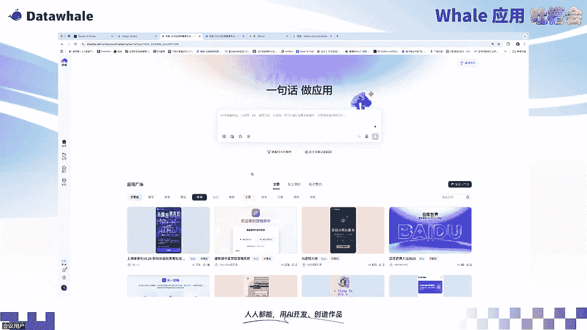

# 🚀 Datawhale AI+X 零代码 Coding 平台：快速调研验证产品价值：01：零代码智能体平台与产品价值验证

在本节课中我们将要学习如何使用零代码 AI 智能体平台，快速把想法变成可运行的小应用，并通过这些应用验证产品的实际价值。我们将会看到一个 AI 创业者如何将个人工具全部托管到智能体平台，如何在不具备深厚编程基础的情况下完成从想法到 Demo 的闭环，以及如何利用多个 AI 平台并行提升产品执行力。

---

## 1. 零代码智能体平台的背景与核心观念

过去一年，AI 智能体的主要形态多以对话形式为主，人们提到智能体时首先想到的是扣子这类需要搭建的对话工具。自从去年三月份 Manus 发布，并随后被搜购收购之后，AI 平台开始支持个人直接托管自己的工具应用。这意味着普通用户可以把个人开发的小工具全部放在平台上运行，而不再局限于简单的对话交互。

在实际使用过程中，我发现这种新型智能体平台能够显著增强个人的执行力。很多人每天脑中会涌现很多想法，但因为执行力不足，这些想法往往停留在脑海中并未真正落地。有了 Web Coding 和智能体平台之后，想法可以更快地转化为可交互的原型。

以下是智能体平台带来的核心变化：
- 从对话式智能体转向应用式智能体。
- 个人工具可以直接托管在平台上运行。
- 想法到 Demo 的时间被大幅缩短。

核心概念可以用下面的公式表示：

```text
个人执行力提升 = 智能体平台辅助 × 想法落地速度
```

---

## 2. 多平台并行使用的策略

在上一节我们介绍了零代码智能体平台的背景。本节中我们来看看如何同时使用多个平台来比较不同 AI 模型的输出效果。

我通常会同时打开两到三个智能体平台，给它们下达完全相同的提示词，让每个平台独立完成同一个任务。这个做法有点像招投标过程中的比稿环节，可以帮助我从不同视角观察同一个问题。

以下是常用平台的特点：
- 秒达：比较亲民，更像一个产品经理，擅长理解产品目的。
- Google AI Studio：表现聪明，基于一句话就能给出很多符合产品理解的建议。
- Minus：像一个优秀的程序员，项目管理、代码组织和可视化表现都很好，使用起来让人很放心。

不同平台的底层模型不同，因此对同一个任务的理解也会不同。通过同时下发相同任务，你可以从 AI 那里学到多种看待问题的方式。

核心概念可以用下面的公式表示：


```text
AI 视角多样性 = 不同平台数量 × 相同提示词的独立执行
```


---

## 3. 从想法到原型：产品经理的视角

在上一节我们介绍了多平台并行使用的策略。本节中我们来看看如何从产品经理的角度把想法转化为可落地的需求文档。

拥有一个想法很容易，但如何把想法定义清楚，是比较吃天赋的部分。很多平台宣传一句话就能做出应用，但实际上仅靠一句话很难把你心中想要的东西完整做出来。你需要站在产品经理的角度，把细节写清楚。

以下是一个详细需求描述的示例：

```text
我想做一个小游戏。
一只猫玩家站在画面中央。
猫的前面放置数量不等的盒子，可以是两个或者五个。
盒子里面装着各种不同的物体。
画面中会有女生的声音叫出某个物体的名称。
这个物体实际上就在盒子里面。
猫咪选中面前的盒子，同时做出相应的选择动作。
如果选中正确，游戏结束，出现结算页面，结算页面的声音激动地喊出“真棒”。
如果没有选中正确，声音会反复念出物体名称，直到选中为止。
整个游戏使用中文。
界面使用典型的像素风格。
```

产品能力的核心在于把不确定性的东西变成确定性的东西。技术是把确定的东西做出来，而产品工作是在反复试错中明确需求。智能体平台正好可以帮助你进行这种反复试错。


核心概念可以用下面的公式表示：

```text
产品能力 = 不确定性需求 → 确定性需求 的转化过程
```

---


## 4. 案例拆解：萝卜纸巾猫小游戏

在上一节我们介绍了从想法到原型的产品经理视角。本节中我们来看看一个具体的小游戏案例：萝卜纸巾猫。

这个想法来源于刷短视频时看到萝卜纸巾猫的视频。我立刻觉得可以把它做成一个小游戏，于是马上从床上弹起来，跑到电脑前，在智能体平台上把这个想法快速搭建出来。

开发过程的关键步骤如下：
- 在平台上输入详细的游戏规则提示词。
- 观察生成结果，发现逻辑不清楚的地方反复补充要求。
- 根据需要添加或删除功能，比如后来添加了背景音乐，但发现该模块表现很弱，于是把它去掉。
- 最后修改文案，完成游戏发布。

这个案例表明，即使是一个看起来很简单的小游戏，也需要产品经理对需求进行多次打磨。智能体平台能够帮助你快速完成这些迭代。

---

## 5. 案例拆解：自我管理工具


在上一节我们拆解了萝卜纸巾猫小游戏。本节中我们来看看另一个实际工具：自我管理项目管理系统。


作为一个产品经理，我经常在自我管理方面表现不佳，容易在做项目时飘到其他任务上，或者忘记之前答应过别人的事情。因此我决定做一个帮助自己管理项目的小工具。


以下是该工具的主要功能：
- 核心目标管理：添加新目标，设定优先级，定义成功标准，例如六月份交初稿，八月份交定稿。
- 阅读日历：记录每天的具体工作，比如今天准备了一家商贸公司的培训大纲并确认。
- AI 目标审计：AI 会根据你的年度核心目标、当天目标和本月目标，判断今日行动是否发生了目标偏移。
- 热力图显示：参考 GitHub 的小绿点，展示最近工作的完成情况和偏移情况。


AI 审计模块会指出类似这样的结论：今日执行发现了严重的目标偏移和伪工作陷阱，你正在利用战术上的忙碌来逃避战略上的难点。这种反馈能够让你及时醒悟，重新规划明天的任务。


核心概念可以用下面的公式表示：

```text
目标偏移 = 今日实际执行 - 年度核心目标
```

---

## 6. 案例拆解：买菜小助手


在上一节我们拆解了自我管理工具。本节中我们来看看第三个案例：买菜小助手。

这个想法来自朋友圈中一位社恐朋友的吐槽。他下班后想去菜场买菜，但不懂还价，容易被本地商贩报高价。于是我决定做一个帮助城市新手在农贸市场更安心买菜的小应用。

以下是该助手的功能模块：
- 拍照自动识别：上传菜品照片，显示名称、基本用途和挑选方法。
- 还价建议：提供还价的切入点和话术，帮助用户与商贩沟通。
- 分量计算器：根据用餐人数和餐次计算需要购买的斤数。
- 缩水提示：告知哪些菜会缩水，建议多买一些。
- 保存方法与推荐菜谱：提供食材保存建议和搭配菜谱。

这个案例锻炼的是对具体场景和用户需求的洞察能力。对于缺乏生活感的用户来说，通过制作这种小工具，可以逐渐理解业务场景的真实样子。


核心概念可以用下面的公式表示：

```text
场景洞察能力 = 具体用户痛点 × 小工具实践次数
```

---

## 7. 向 AI 学习，而不仅仅是使用 AI

在上一节我们介绍了买菜小助手的具体功能。本节中我们来看看如何通过 AI 学习提升个人竞争力。

AI 是可以更换的，但你作为个体是不可替换的。在某个岗位或项目中的角色，也无法被 AI 完全替代。因此，使用 AI 的第一步应该是向 AI 学习，而不是仅仅把它当作工具。

我会在发布应用之前，请 AI 解释其实现逻辑和架构设计。虽然我自己是产品经理，不一定精通技术，但通过 AI 的解释，我可以了解数据设计、UX 设计策略、核心代码实现逻辑等内容。这有助于我逐渐从产品经理成长为具备产品架构思维的人才。

核心概念可以用下面的公式表示：

```text
个人竞争力 = AI 无法替代的认知 + 向 AI 学习的能力
```

---

## 8. Web Coding 之前的灵感来源

在上一节我们介绍了向 AI 学习的重要性。本节中我们来看看在开始 Web Coding 之前，如何寻找创意和灵感。

在正式编程之前，你可能还没有明确的想法方向。这时候可以去浏览各个平台的市场或模板库，看看别人在做什么。例如秒达的市场、Google 的 Discover 页面、Minus 的模板，以及扣子编程开放的智能体搭建能力。

以下是寻找灵感的方法：
- 浏览平台市场，观察黑客松参赛选手使用的想法和实现方式。
- 拆解他人做好的智能体，分析它的初始提示词和搭建步骤。
- 思考自己是否能够复现，并尝试用自己的方式改进。

产品能力比纯粹的编程能力更重要，因为编程能力可以被替代，而决定 idea 是否有市场的产品能力难以替代。通过这种方式，你可以不断提升自己的产品直觉。

核心概念可以用下面的公式表示：

```text
创意来源 = 平台市场 + 他人方案拆解 + 个人场景观察
```

---

## 9. 总结



本节课中我们一起学习了零代码 AI 智能体平台的基本背景，学会了如何同时使用多个平台来比较不同模型的输出，掌握了从想法到需求文档的产品经理视角，并通过萝卜纸巾猫游戏、自我管理工具、买菜小助手三个案例了解了如何快速验证产品价值。我们还讨论了向 AI 学习而非仅使用 AI 的重要性，以及在 Web Coding 之前如何通过市场和模板寻找灵感。希望这些内容能帮助你用更低的门槛将想法落地，并在实践中提升个人竞争力。

