非科班也能做 AI 视频：01：课程概述与核心思路 🎬

在本节课中，我们将学习如何使用 Claude Opus 来制作 AI 视频，特别是针对没有计算机科学背景的同学。很多朋友可能认为做 AI 视频需要懂编程、懂动画，甚至需要购买昂贵的设备，但实际上并非如此。只要保持好奇心，愿意尝试新工具，任何人都可以上手。今天的内容来源于一次真实的实验，演讲者尝试了十二种不同的风格，最终完成了多个版本的短片，整个过程耗时不多，甚至不需要复杂的技术约束。

我们可以把这次实验的核心逻辑用一个简单的公式来描述：

```text
AI 视频 = 模型能力 + 对话记录 + 风格尝试 + 样片验证
```

这个公式告诉我们，视频的质量不仅取决于模型本身，还取决于我们提供了多少背景信息，以及是否在制作正式视频之前先做了小范围的测试。模型能力越强，我们需要的人为干预就越少，直接用大白话描述需求往往就能得到不错的结果。

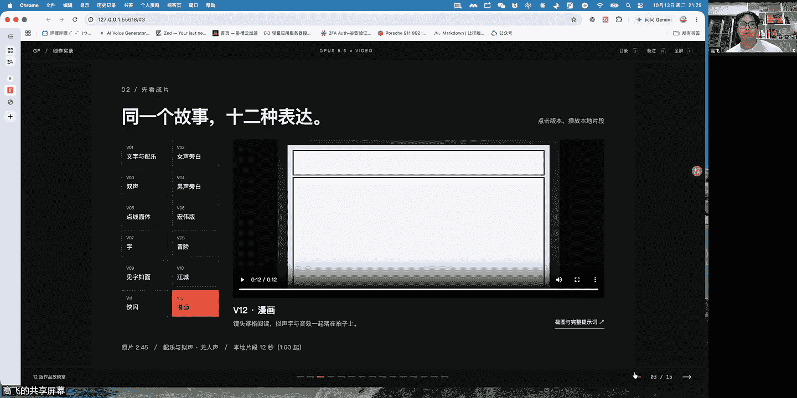

非科班也能做 AI 视频：02：准备工作与第一句话 🗂️

上一节我们介绍了课程的总体思路，本节我们来看看具体该怎么开始。制作 AI 视频的第一步，就是建立一个空白的项目文件夹，然后在跟 AI 对话时发出第一句话。这句话非常关键，因为它决定了 AI 后续能读取到哪些资料，也决定了视频的整体基调。

你可以这样写你的第一句话：

```text
我想做一个视频，请根据我之前的聊天记录和笔记，帮我生成内容。
```

如果你之前已经和 AI 进行过多次对话，积累了大量聊天记录，可以直接让 AI 读取这些记录；如果没有现成的记录，也可以先把笔记、项目文件准备好，再发送给 AI。除此之外，头像也是一个可以提供的素材，你可以直接发一张图片给 AI，或者让它使用之前记录过的头像。所有这些资料，都会被 AI 用来理解“你是谁”，从而生成更符合你风格的视频。


非科班也能做 AI 视频：03：AI 视频制作的基本流程 🔄

在确定了第一句话和基础资料之后，本节我们来看看制作视频的完整步骤。整个流程并不复杂，可以拆解为四个主要阶段，每个阶段都有明确的目的，避免在正式制作前浪费大量时间和 token。

以下是具体的步骤说明：

- 第一步：给 AI 一个非常大的方向，不要一开始就提供太多细节，除非你对风格有非常明确的要求。
- 第二步：让 AI 基于这个方向，输出几个不同的叙事风格方案供你选择。
- 第三步：让 AI 先制作 3 到 8 秒的样片，你可以同时生成 4 个样片来对比效果。
- 第四步：如果喜欢样片的风格，再让 AI 制作完整版本，时长通常在 3 到 5 分钟；如果不满意，可以让 AI 修改后再生成。


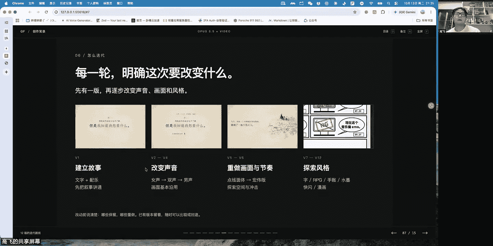

按照这个流程操作，可以在不满意时及时调整方向，而不是等到整个视频都做完才发现风格不对。这个方法非常适合初学者，因为每一步都可以验证，风险可控。

非科班也能做 AI 视频：04：技术选型与工具介绍 🛠️

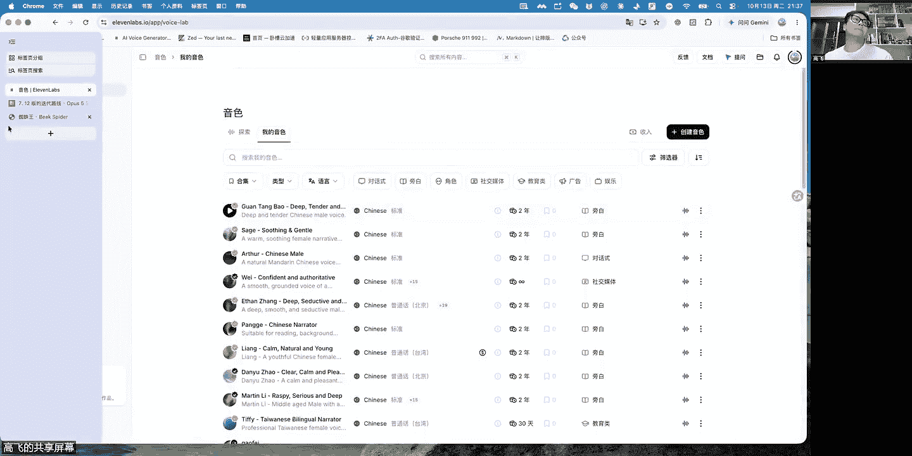

上一节我们介绍了制作流程，本节我们来看看具体用哪些技术工具。在实际操作中，你不需要自己安装复杂的环境，大部分工作都可以通过 AI 调用 API 来完成。以下是几个常用的技术方向：


- Remotion：用于制作动画和动态效果，适合做点线面、PPT 类风格的视频。
- Three.js / 3GS：用于处理 3D 场景和三维风格，适合需要立体感的内容。
- 文字转语音 API：将脚本文字转换为配音，支持多种音色，包括克隆你自己的声音。
- 视频模型平台：提供预设的音色和视频生成能力，可以直接通过 API 调用。

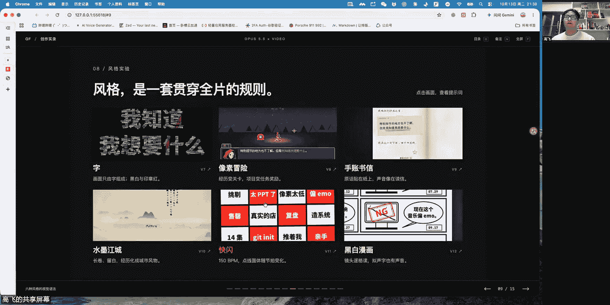

使用这些工具时，你可以直接告诉 AI 需要什么技术，让它自己去安装和配置，模型现在的能力已经足够强，不需要你写太多限制条件。你只需用大白话表达需求，AI 会负责处理底层实现。

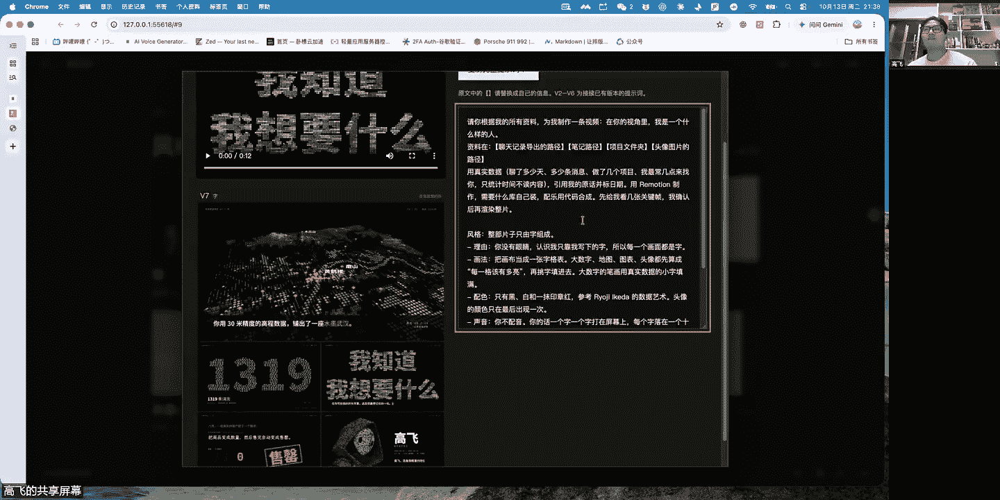


非科班也能做 AI 视频：05：风格迭代与样片制作 🎨

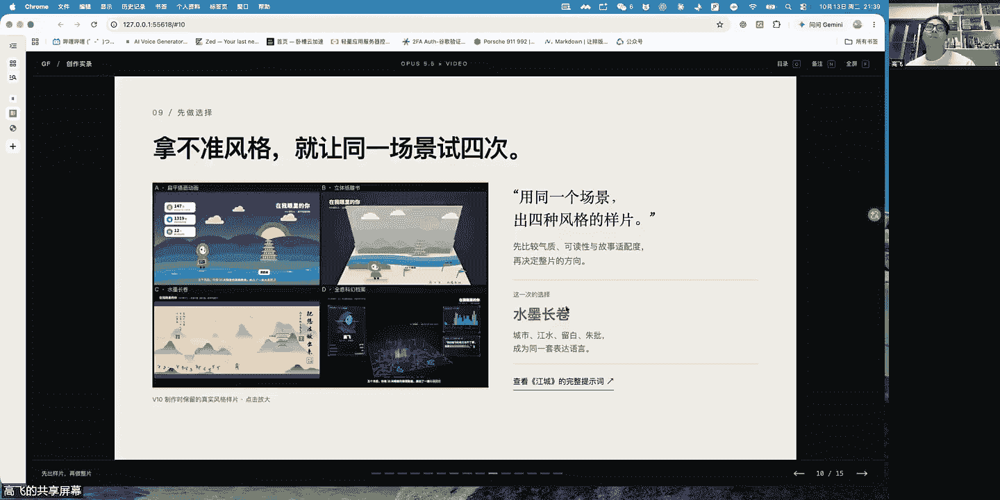

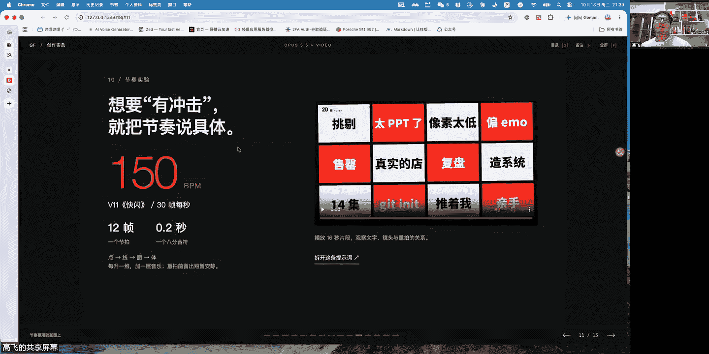

有了技术工具之后，本节我们来探讨如何确定视频的最终风格。风格是视频的灵魂，直接影响观众的观感，所以在正式生成之前，一定要通过样片进行验证。

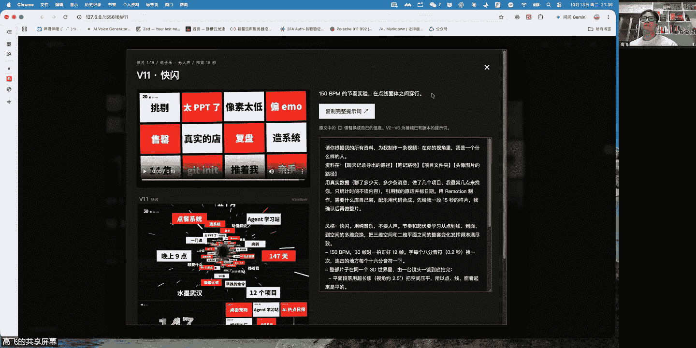

以下是几种可以尝试的风格示例：

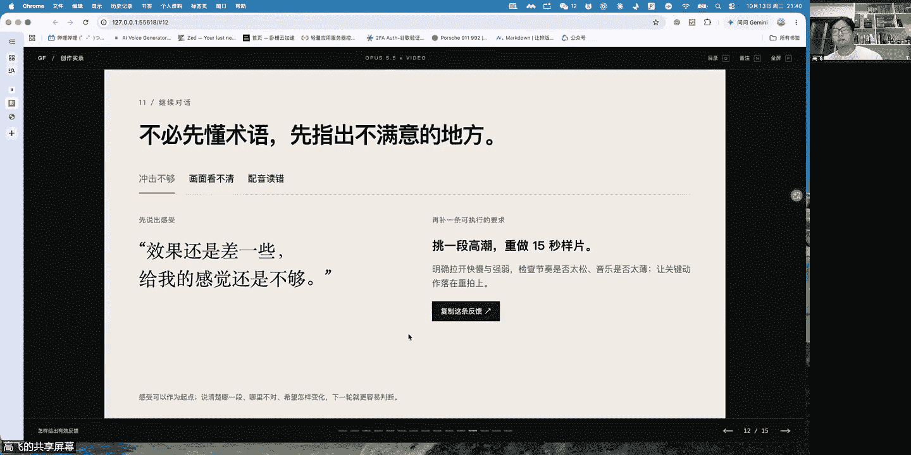

- 水墨风格：适合表达传统文化或具有艺术感的内容，可以让 AI 根据参考图自行构思。
- 快闪风格：节奏明快，适合科普类或短视频平台，画面切换频繁。
- 电调风格：色彩鲜明，适合现代感较强的主题。
- 漫画风格和手账风格：适合轻松、有趣的教育类视频，表现形式更像插画。

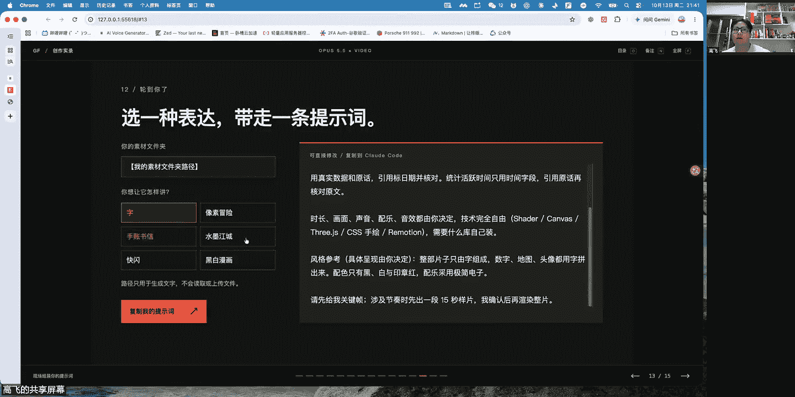

如果你已经在网上看到了喜欢的参考图，可以直接把图片发给 AI；如果没有参考图，也可以让 AI 自己想象几种风格并输出建议。最好的做法是让 AI 同时生成四个 3 到 8 秒的样片，你对比后选择最满意的一个，再基于该样片制作完整视频。

非科班也能做 AI 视频：06：代码生成视频 vs 像素级生成视频 📊

在上一节我们讨论了风格选择，本节我们来比较两种不同的视频生成方式，帮助你根据需求选择合适的方案。


第一种方式是代码生成视频，例如使用 Remotion 或 Three.js 编写代码来渲染每一帧，然后拼接成视频。这种方式的优点是成本较低，渲染速度快，而且对每一帧的控制非常精确，非常适合科普视频、教育视频以及抽象的点线面动画。

```text
代码生成视频 = 每一帧代码渲染 + 帧拼接 + 低成本 + 高可控性
```

第二种方式是像素级生成视频，例如使用即梦、豆包等基于像素的生成模型。这种方式一次性生成像素级画面，适合真人实景、短剧等需要高度真实感的场景，但缺点是每个视频的成本较高，生成时间较长，而且结果具有一定的随机性，类似于抽卡。

如果你要做的是视觉算法讲解、PPT 教育类内容，代码生成方式通常更合适；如果你要做的是真人出镜的短剧或电影级内容，像素级生成模型可能效果更好。

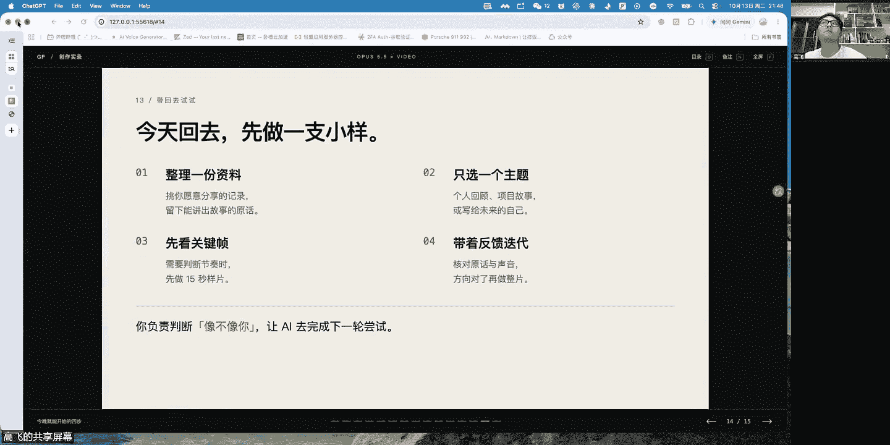

非科班也能做 AI 视频：07：总结与建议 ✅

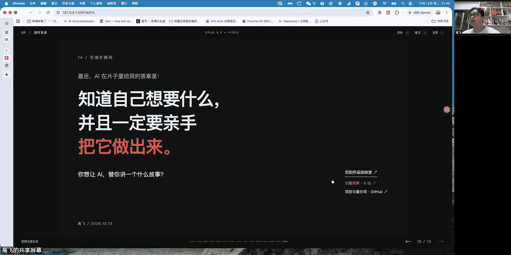

本节课中，我们一起学习了如何使用 Claude Opus 制作 AI 视频，从准备工作、第一句话设计，到完整的制作流程、技术选型、风格迭代，最后还对比了代码生成与像素级生成两种方案。希望这些内容能帮助非科班的同学快速上手，用大白话和 AI 沟通，制作出属于自己的 AI 视频。

