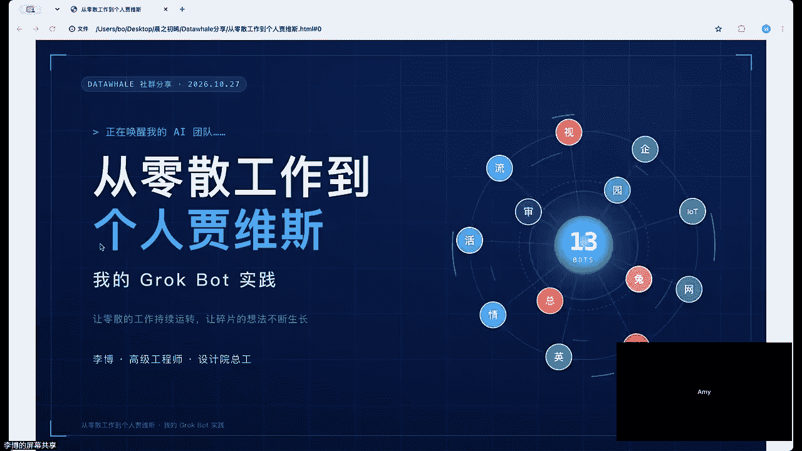
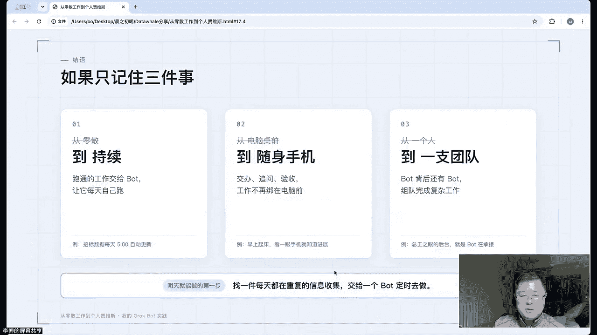
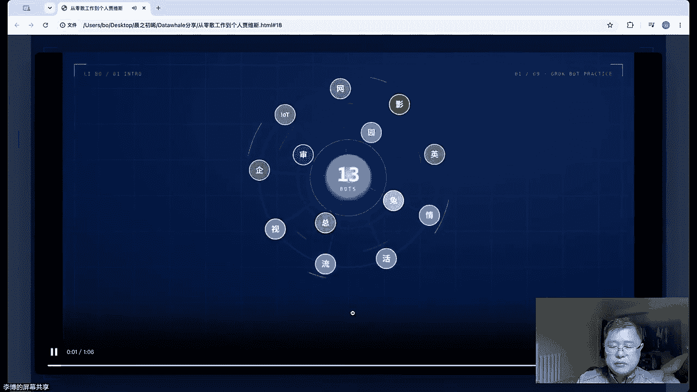
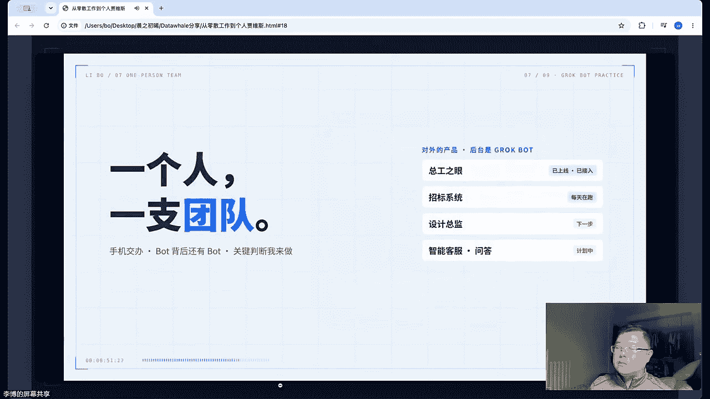

非程序员设计师：用手机管理十几个Bot：01：从零散工作到个人贾维斯🤖



在本节课中，我们将学习一位非程序员出身的设计师，如何用手机管理十几个AI机器人，把零散的工作变成一个持续运转的个人贾维斯。课程内容包括真实的使用场景、工具选择理由、个人与行业智能体的搭建方法，以及从电脑端到手机端的办公转变。你将看到一个设计师是如何在不具备深厚计算机基础的情况下，通过业余时间构建自己的AI团队，让工作在早晨五点就自动开始。

## 一、课程概述与讲师背景

上一节我们介绍了课程的整体目标，本节中我们先来了解讲师的背景和分享的起因。讲师名叫李博，是一名深学院的设计师，从事工程设计工作大约有二十年时间。他不是计算机专业出身，所以分享的内容更多来自于个人的实践经验，而不是理论研究。七月份参加Datawhale的小化联比赛后，他开始真正接触AI智能体，并逐渐在业余时间投入其中。由于家中有孩子，日常工作也比较繁忙，他只能利用业余时间来搭建和优化这些工具。从三月份开始接触相关技术，到现在已经有一定的积累，他希望通过这次分享，把自己的经验传递给更多非技术背景的同学。

以下是讲师分享的核心主题：
- 从零散的工作到个人贾维斯，打造个人助手。
- 用手机管理十几个AI机器人，实现移动办公。
- 在设计行业和企业管理中落地多智能体协作。

## 二、每天早晨5点的AI团队

刚才我们了解了讲师的背景，本节中我们来看看他的实际工作场景是怎样的。每天早晨五点，大多数人还在睡觉时，李博借助GroupBo已经启动了多个智能体开始工作。最先启动的是他的工程企业智能体，每天自动抓取招标数据，进行处理和AI分析，帮助企业筛选出符合要求的投标项目。数据抓取完成后，信息会在员工上班前直接送到公司桌面上。

以下是早晨自动运行的任务清单：
- 抓取招标数据：每天五点定时启动，处理后推送至企业桌面。
- 企业OA巡检：定期检查公司系统和网页状态。
- 学习日报：抓取Twitter等渠道的新动态，根据个人兴趣更新关键词。

以前李博需要自己对接各种接口，现在这些工作都由GroupBo来完成。这种模式让他不再需要长时间坐在电脑前，而是可以在手机上随时查看和调整任务。

## 三、为什么选择GroupBo

介绍完工作场景后，本节中我们来看看为什么李博最终选择了GroupBo，而不是其他工具。他尝试过多种平台，包括早期的Midjourney、OpenAI相关产品、Claude以及一些国内工具，但都存在不同的问题。比如有些工具注册困难，有些主要面向生活服务场景，在国内不太适用，还有些多智能体之间无法进行有效的对话交错。

以下是选择GroupBo的主要理由：
- 不仅是单一助手，支持多个机器人协同工作。
- 可以在电脑和手机上使用，手机端体验更顺畅。
- 使用时不需要挂梯子，访问和响应速度较快。
- 支持多智能体之间的交互，适合搭建虚拟设计工作室。

李博提到，用其他工具时有时感觉是被AI在使用，而使用GroupBo第一次感觉像是在带领一个团队，整个过程非常顺畅，就像只需要一部手机就能完成管理。

## 四、个人与行业智能体搭建

了解了选择理由之后，本节中我们来看看李博具体搭建了哪些智能体，以及它们分别承担什么任务。他的机器人大致分为个人需求和行业需求两类。个人方面，主要用于了解最新的AI动态、补足英文不足、抓取符合个人需求的比赛和活动信息。行业方面，则围绕他的本职工作，包括方案设计智能体和施工图设计智能体，这两个已经比较成熟，也帮助设计院的同事搭建了不少相关工具。

以下是主要的智能体分类：
- 个人助理：每天筛选Twitter新动态，更新学习工具和比赛清单。
- 设计总监群：负责产品审图和工程方案输出。
- 招标系统：每天五点自动更新招标信息，协助企业投标准备。
- 企业OA：定期巡检和公司网页维护。
- 智慧园区：接入传感器和设备，进行日常运维。

```text
机器人总数 = 个人助理 + 设计总监 + 招标系统 + 企业OA + 智慧园区 ≈ 10
```

目前他管理的机器人数量大约有十个左右，每个机器人对应一个具体场景，每天定时输出相应内容，形成了一套完整的个人工作体系。

## 五、从电脑到手机：移动办公的转变

接着我们了解了智能体的分类，本节中我们来看看李博是如何从电脑端转移到手机端的。以前他需要每天坐在电脑前处理接口和数据，现在通过GroupBo，他可以用一部手机管理所有后台任务，随时与机器人交流、修正和优化工作。这种转变让他不再被电脑束缚，实现了真正的移动办公。

以下是移动办公带来的变化：
- 任务下发：随时在手机上给机器人下达新指令。
- 问题修正：机器人运行过程中出现偏差，可以即时纠正。
- 客户维护：不需要长时间守在电脑前，也能处理客户反馈和服务器问题。

李博表示，这种便捷性让他感觉工作效率明显提升，零散的想法也能快速转化为可执行的任务。

## 六、智慧园区与硬件接入

讲完移动办公的转变后，本节中我们来看看李博在智慧园区和硬件接入方面的探索。他目前正在负责一个智慧园区项目，从平台搭建到现场传感器、设备接入，涉及软硬件结合。由于之前的IT团队离职，他亲自接手了传感器选择、平台搭建等工作。通过GroupBo，他可以简化传感器数据的读取和波动监控，虽然实际落地链条较长，但已经初见成效。

以下是智慧园区建设的关键步骤：
- 硬件接入：连接ESP32等小型设备，未来计划接入摄像头和麦克风。
- 平台搭建：将硬件数据接入管理系统，实现虚拟世界与真实世界的对接。
- 日常运维：通过机器人监控传感器状态，发现异常及时处理。

李博的未来目标是让AI走出屏幕，连接真实的设备，最终在工地和园区中实现自动化执行，这也是他向马斯克学习的方向之一。

## 七、多智能体协作与设计工作室

介绍完智慧园区之后，本节中我们来看看多智能体协作是如何在设计工作室中落地的。李博认为，单个机器人的能力是有限的，只有多个机器人组成团队，才能处理复杂的工程项目。他在GroupBo上重新搭建了多智能体系统，让不同的机器人扮演不同的角色，比如植物总工、水电总工、监督总工等，它们之间可以交叉讨论，最终得出正确的设计意见。



以下是多智能体协作的特点：
- 角色分工：每个机器人对应不同的专业方向，形成虚拟团队。
- 交互机制：机器人之间可以对话交错，互相修正意见。
- 持续优化：根据客户反馈和运行结果，不断调整机器人配置。



这种模式让他感觉自己不再是一个人在作战，而是拥有一支随时可用的AI团队，能够同时推进多个项目的进展。



## 八、课后交流与常见问题


在正式总结之前，本节中我们来看看课后交流部分提到的一些常见问题。学习者询问GroupBo如何安装，是否需要挂梯子。根据分享，安装时可能需要挂梯，但日常使用时不需要。关于费用，个人使用的老套餐额度通常足够，如果是公司运营且使用量大，可能需要购买更高限额的套餐，比如每月两百美元。另外，PPT和宣传片也是借助AI工具生成的，包括文案、配音和剪辑，体现了AI在内容制作中的应用。

以下是交流中的关键信息：
- 安装方式：首次安装可能需要网络工具，后续使用无需挂梯。
- 费用建议：个人用户可使用旧版套餐，企业用户建议评估高限额方案。
- 制作工具：PPT文案由Claude编写，视频配音和音乐由GroupBo完成。

这些信息可以帮助后续学习者更好地开始自己的实践。

## 九、总结与展望

最后，本节中我们来回顾本课的主要内容，并展望未来方向。李博通过业余时间，用手机管理十几个AI机器人，把零散的工作整合成一个持续运转的个人贾维斯。他不仅实现了移动办公，还在设计行业、企业管理和智慧园区等多个领域进行了探索。未来，他希望将AI更深入地介入到工程现场，让技术从虚拟世界走向真实的工地。

本节课中我们一起学习了：
- 非程序员如何用手机管理多个AI机器人。
- 选择合适工具的理由和实际操作场景。
- 多智能体协作在设计工作室中的应用方法。
- 从虚拟助手到真实硬件接入的逐步尝试。


希望这些内容能为你提供启发，鼓励更多非技术背景的同学尝试构建自己的AI工作团队。
